# Ранбук Дня 1. От вайб-кодинга к управляемой разработке: правила, скилы и инженерный харнес

## Архитектура первого дня: как мы превратим неуправляемого агента в дисциплинированного инженера

День 1 закладывает технологический фундамент всего четырёхдневного интенсива. Большинство разработчиков взаимодействуют с нейросетями в режиме «вайб-кодинга»: формулируют задачу естественным языком в окне чата, получают длинный фрагмент кода, копируют его в проект и надеются, что ничего не сломалось. На изолированных скриптах или одноразовых утилитах такой подход создаёт иллюзию высокой производительности. Однако при переносе в живую промышленную кодовую базу с реляционной базой данных, асинхронным вводом-выводом и внешними потребителями вайб-кодинг неизбежно заходит в тупик: модель теряет контекст, ломает обратную совместимость API, генерирует бутафорские тесты и вымывает архитектурные границы слоёв.

Цель первого дня — полностью демонтировать практику бесконтрольного чата и построить **детерминированный инженерный контур (Engineering Harness)** вокруг агента. К концу дня ваш агент превратится из непредсказуемого генератора текста в исполнительного младшего инженера, работающего по строгим процедурным регламентам, под контролем конституции репозитория и жестких ворот качества.

### Что вы построите за день

За 8 часов интенсивной практики вы создадите целостную систему управления разработкой:
1. **Карту архитектуры и связей (`architecture-map.md`):** документ разведки, фиксирующий границы слоёв, внешние контракты и зону влияния любых будущих правок в режиме «только чтение».
2. **Конституцию репозитория (`.agents/AGENTS.md`):** постоянные, активные на каждом шаге нерушимые правила архитектуры, запреты на читерство и критерии готовности (DoD).
3. **Детерминированные ворота качества в `pyproject.toml` (Quality Gates & Guardrails):** строгие конфигурации `ruff`, `basedpyright`, `pytest` и `coverage`, пресекающие обход правил на уровне кода возврата компиляторов и линтеров.
4. **Библиотеку из 7 процедурных скилов (`SKILL.md`):** атомарные исполняемые регламенты для исследования кода, фиксации текущего поведения тестами, модульного тестирования, интеграционных тестов с реальной СУБД, послойной разработки фич, обратимых миграций Alembic и безопасного рефакторинга.
5. **Доказательный A/B-эксперимент:** прямое сравнение результата вайб-кодинга в голом чате и работы агента под управлением собранного харнеса на одной и той же боевой задаче с динамическим переключением через утилиту `tools/toggle_skills.py` (удаление скилов $\rightarrow$ генерация с ошибками $\rightarrow$ восстановление скилов $\rightarrow$ чистая профессиональная разработка).

### Сквозной учебный репозиторий и стек

Практика Дня 1 разворачивается на реальном микросервисе сокращения и аналитики ссылок:
- **Рабочий каталог участника:** `~/work/Python-AI/fastapi`
- **Git-репозиторий:** `https://gitverse.ru/itpooh/Python-AI`
- **Технологический стек:** Python 3.12+, FastAPI, PostgreSQL 17, SQLAlchemy 2.0 (async), Alembic, Pydantic v2, `uv`, `ruff`, `basedpyright`, `pytest`, `pytest-cov`.

### Правила, по которым написан этот ранбук

1. **Прозрачный инженерный язык:** Мы заменяем размытые метафоры строгими терминами: «тесты текущего поведения сервиса» (Characterization Tests), «карта архитектуры и зона влияния правок» (Impact Analysis), «правило только вверх» (порог тестового покрытия можно повышать, но нельзя снижать), «нерушимые правила», «строгие запреты».
2. **Основной текст сфокусирован на архитектуре и управлении:** В ранбуке нет многостраничных простыней исходного кода приложения и тестов. Все полные листинги модулей сервиса, тестового контура, миграций, конфигураций и готовых файлов скилов вынесены в **[Приложение А. Справочник кода и окружения](./Приложение-А-Справочник-кода-и-окружения.md)**. В главах разбирается логика управления, контракты манифестов, архитектурные схемы и команды запуска.
3. **Никаких самописных скриптов-обёрток:** Все проверки осуществляются стандартными CLI-утилитами: `uv run pytest`, `uv run ruff check .`, `uv run basedpyright`, `uv run alembic check`. Это гарантирует прозрачность кода возврата (Exit Code 0 vs 1).
4. **Контрастный разбор «Вайб-кодинг против Харнеса»:** В каждой главе приводятся сравнительные таблицы и разборы типовых поломок неконтролируемого агента и способов их предотвращения.

> 💡 **Важно:**
> **Zero-Token Setup:** Окружение сервиса (PostgreSQL 17 в Docker, зависимости через `uv sync`, стартовые миграции) поднимается детерминированными системными командами за **0 токенов LLM**. Поручать настройку окружения агенту в чате запрещено: это прожигает контекст и приводит к рассогласованию среды. Полный порядок подготовки рабочего места описан в **[ПРЕРЕКВИЗИТЫ.md](./ПРЕРЕКВИЗИТЫ.md)**.

---


## Глава 1. От боли вайб-кодинга к инженерному контуру: почему «умный чат» ломает прод и как скилы решают эту проблему

### 1.1. Боль: почему вайб-кодинг ломается даже на лучших моделях

Вайб-кодинг — это практика делегирования инженерных задач языковой модели через свободный диалог в чате без формализованных внешних ограничений. На коротких фрагментах изолированного кода модели демонстрируют впечатляющую эрудицию. Однако при переносе в живую промышленную кодовую базу вероятность успешного внедрения стремительно падает.

Причина сбоев кроется не в низком интеллекте моделей, а в фундаментальной архитектуре LLM: модель генерирует вероятностно наиболее правдоподобный текст, не обладая встроенным механизмом верификации фактов и обратной связи от среды исполнения.

#### Схема 1. Три ключевые боли вайб-кодинга как следствия одной причины: у агента нет внешнего арбитра истины и нерушимых правил

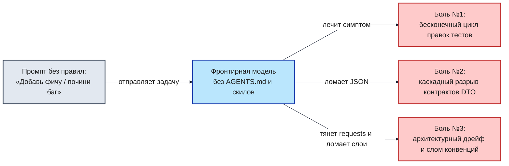

##### Фундаментальная причина сбоев: «Ловушка среднего Python» (The Average Python Trap)

Нейросеть обучалась на терабайтах публичных репозиториев GitHub, StackOverflow и туториалов. «Средний код на Python» в интернете — это синхронные блокирующие вызовы, отсутствие транзакционных границ, устаревшие библиотеки (Pydantic v1, SQLAlchemy 1.3), глобальные переменные и отсутствие строгой статической типизации.

Когда вы даёте агенту свободу в чате, он скатывается к этому «среднему коду». В современном микросервисе на FastAPI, SQLAlchemy 2.0 (async) и PostgreSQL 17 такой код приводит к трём ключевым производственным сбоям:

#### Боль №1. Бесконечный цикл правок (Fix Loop of Death)
- **Механика сбоя:** Разработчик просит агента починить тест или добавить поле. Модель меняет файл, падает проверка типов. Разработчик копирует ошибку в чат. Модель вносит вторую правку, ломая сигнатуру роутера. Разработчик снова копирует ошибку. На 4–5 шаге контекстное окно переполняется диффами, модель «забывает» исходную задачу и начинает ходить по кругу (осциллирующий дефект), маскируя ошибку отключением проверок (`# type: ignore` или комментированием ассертов).
- **Анатомия боли:** В голом чате агент не видит всей кодовой базы и пытается угадать решение по фрагментам ошибок, которые ему вручную скармливает человек. Нет внешнего стоп-условия — чат бесконечен и дорог.

#### Боль №2. Каскадный разрыв контрактов в распределенной архитектуре
- **Механика сбоя:** Агент решает «улучшить» нейминг и переименовывает поле в схеме ответа (например, `target_url` в `destination_url` или `short_code` в `code`). Внутри самого микросервиса тесты роутера могут пройти, если агент синхронно обновил фикстуру. Но за пределами сервиса находятся смежные микросервисы (Notification Worker, сервис аналитики, мобильные клиенты), которые ожидают строго фиксированный JSON.
- **Последствия:** Падение фоновых воркеров с ошибками валидации `KeyError / ValidationError` через 60 секунд после релиза.

##### Схема 2. Зона влияния правок одной переименованной переменной: как правка в `fastapi` каскадом бьёт по сервису уведомлений, мобильному клиенту и аналитике

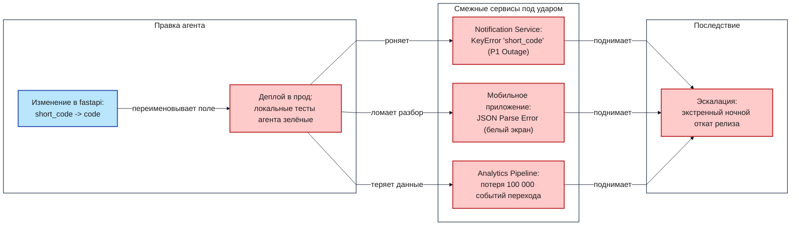

#### Боль №3. Архитектурный дрейф и слом соглашений команды (Architectural Drift & Scope Creep)
- **Механика сбоя:** Агент не знает архитектурных соглашений и конвенций репозитория и начинает импровизировать. Вместо использования сервисного слоя он пишет бизнес-логику и выполняет сырые SQL-запросы прямо внутри HTTP-роутеров. Хуже того — модель подтягивает чужеродный стек из открытых библиотек: вставляет синхронный `requests` вместо принятого в проекте асинхронного `httpx`, блокируя event loop FastAPI на несколько секунд. А по дороге устраивает несанкционированный рефакторинг («сделал красивее»), переписывая базовые классы и меняя сигнатуры в соседних файлах.
- **Последствия:** Размывание архитектурных слоёв, паралич event loop под нагрузкой, неконтролируемый Scope Creep (дифф на 15 файлов вместо точечной правки) и скрытые сайд-эффекты для всей команды.
- **Инженерное решение в харнесе:** Фиксация границ слоёв в `AGENTS.md` (роутер не знает про базу данных), карта архитектуры `architecture-map.md`, список разрешённых библиотек и строгий бюджет зоны влияния (не более 5 файлов на одну задачу).

#### Механика деградации: почему боли воспроизводятся в любом длинном чате

По мере роста истории диалога внимание трансформера (Attention) рассеивается: ранние системные инструкции вымываются свежими многостраничными трейсбеками ошибок. Агент теряет способность удерживать глобальные инварианты и переходит в режим локальной генерации правдоподобного текста.

#### Схема 3. Замкнутый контур деградации контекста: от падения проверки к ложному «Готово!» и новой задаче в том же испорченном чате

```mermaid
%%{init: {"theme": "base", "flowchart": {"curve": "linear", "nodeSpacing": 45, "rankSpacing": 70, "padding": 16}, "themeVariables": {"background": "#ffffff", "mainBkg": "#e2e8f0", "nodeBorder": "#334155", "primaryColor": "#e2e8f0", "primaryTextColor": "#1e1e1e", "primaryBorderColor": "#334155", "lineColor": "#0f172a", "secondaryColor": "#bae6fd", "tertiaryColor": "#ffffff", "clusterBkg": "#ffffff", "clusterBorder": "#334155", "titleColor": "#1e1e1e", "edgeLabelBackground": "#ffffff", "fontFamily": "Helvetica Neue, Helvetica, Arial, sans-serif", "fontSize": "18px"}}}%%
flowchart LR
    subgraph Generation["Генерация"]
        direction LR
        A["Промпт без правил"]
        B["Код с дефектом"]
    end
    subgraph Funnel["Воронка деградации контекста"]
        direction LR
        C["Падение проверки"]
        D["Починка в том же чате"]
        E["Заиливание контекста<br/>трейсбеками"]
    end
    subgraph Outcome["Результат"]
        direction LR
        F["Слом слоёв и удаление тестов"]
        G["Ложное «Готово!» в проде"]
    end
    A -->|"порождает"| B
    B -->|"не проходит"| C
    C -->|"запускает"| D
    D -->|"раздувает"| E
    E -->|"приводит к"| F
    F -->|"маскируется под"| G
    G -->|"новая задача в том же чате"| B
    class A,B core
    class C,D,E,F,G danger
    classDef neutral fill:#e2e8f0,stroke:#334155,stroke-width:2px,color:#1e1e1e
    classDef core fill:#bae6fd,stroke:#1e40af,stroke-width:2px,color:#1e1e1e
    classDef danger fill:#fecaca,stroke:#b91c1c,stroke-width:2px,color:#1e1e1e
    classDef success fill:#bbf7d0,stroke:#166534,stroke-width:2px,color:#1e1e1e
    style Generation fill:#ffffff,stroke:#334155,stroke-width:1.5px,color:#1e1e1e
    style Funnel fill:#ffffff,stroke:#334155,stroke-width:1.5px,color:#1e1e1e
    style Outcome fill:#ffffff,stroke:#334155,stroke-width:1.5px,color:#1e1e1e
```

---

### 1.2. Лечение: инженерный контур, лестница зрелости и четыре слоя обвязки

Чтобы ликвидировать дефекты вайб-кодинга, разработку необходимо перевести с уровня интуитивного чата на уровень воспроизводимого инженерного процесса.

#### Лестница зрелости AI-разработки (AI-SDLC Maturity Ladder)
1. **Ступень 0 (Вайб-кодинг):** Разработчик копирует код из веб-интерфейса чата. Ручное тестирование вслепую.
2. **Ступень 1 (Чат с системным промптом):** Большой системный промпт в интерфейсе IDE. Правила часто игнорируются при длинном диалоге.
3. **Ступень 2 (Репозиторный контур `AGENTS.md` + линтеры):** Файл правил закоммичен в репозиторий. Подключены строгие ворота качества на хуках.
4. **Ступень 3 (Процедурные скилы `SKILL.md`):** Атомарные пошаговые регламенты исполнения конкретных задач с явными Definition of Done и стоп-условиями.
5. **Ступень 4 (Мультиагентная оркестрация):** Разделение ролей (Coder, Reviewer, Architect) в изолированных контекстах с панелью судейства (тема Дня 2).
6. **Ступень 5 (Автономные фабрики фич):** Полный замкнутый цикл от тикета в трекере до верифицированного MR с авто-приёмкой.

День 1 выводит инженера со Ступени 0 на Ступень 3 за счёт построения четырёх взаимодополняющих слоёв обвязки.

#### Схема 4. Четыре слоя инженерной обвязки: два слоя задают, что агент обязан знать, два слоя проверяют результат машиной

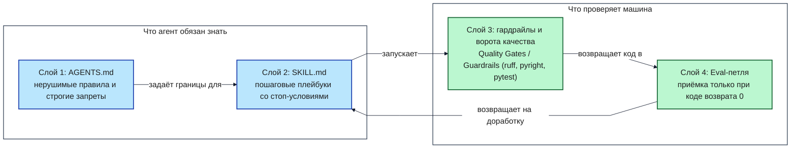

#### Разбор четырёх слоёв:
1. **Слой 1 (`AGENTS.md`): Конституция репозитория.** Документ верхнего уровня, активный в каждом ходе. Задаёт архитектурные границы, запреты на читерство и обход проверок.
2. **Слой 2 (`SKILL.md`): Операционные регламенты.** Специализированные процедуры (SOP), загружаемые строго по необходимости под конкретный тип задачи.
3. **Слой 3 (Гардрайлы и Quality Gates в `pyproject.toml`):** Детерминированные машинные арбитры (`ruff`, `basedpyright`, `pytest --cov`). Они не зависят от мнения LLM и возвращают объективный код возврата.
4. **Слой 4 (Eval-петля обратной связи):** Автоматический прогон ворот качества после каждого действия агента. Работа не считается сданной, пока код возврата не равен 0.

Если убрать любой из слоёв, контур рушится: без `AGENTS.md` агент изобретает чужие паттерны; без `SKILL.md` пропускает этапы тестирования; без Quality Gates принимает галлюцинации за рабочий код.

---

### 1.3. Глубокая теория скилов: история стандарта, суть и отличие от элементарных тулов агента

Стандарт процедурных скилов возник как ответ на проблему раздувания контекста (Context Rot). Когда все инструкции проекта упаковываются в один гигантский системный промпт, модель теряет фокус внимания и начинает путать правила разных задач.

#### Трёхуровневая механика Progressive Disclosure (Поэтапное раскрытие знаний)
1. **Уровень 1. Каталог (Metadata Discovery):** В системный промпт инжектируется только компактная таблица имён и описаний скилов (frontmatter). Затраты: < 2% контекстного окна.
2. **Уровень 2. Тело скила (On-Demand Invocation):** Полная процедура конкретного скила (~100–300 строк) подгружается в контекст только в момент возникновения соответствующей задачи.
3. **Уровень 3. Глубокие ресурсы (Deep Context & Tools):** Вспомогательные скрипты, схемы БД и детальные чек-листы читаются агентом только при выполнении соответствующих шагов процедуры.

#### Водораздел: Элементарные тулы (Tools) против Процедурных регламентов (Skills)
- **Элементарные тулы (Tools / CLI commands):** Это «руки» агента (прочитать файл, выполнить bash-команду, сделать HTTP-запрос). Инструмент предоставляет техническую возможность действия, но ничего не говорит о правильном порядке его применения, архитектурных ограничениях и критериях приёмки.
- **Скилы (Skills, SOP):** Это «мозг и методология» инженера. Скил определяет алгоритм: в какой последовательности вызывать инструменты, какие контракты соблюдать, что проверять на каждом шаге и когда немедленно остановиться и откатить изменения.

#### Схема 5. Категориальный водораздел: элементарные действия («руки») против процедурных регламентов («мозг и дисциплина исполнения»)

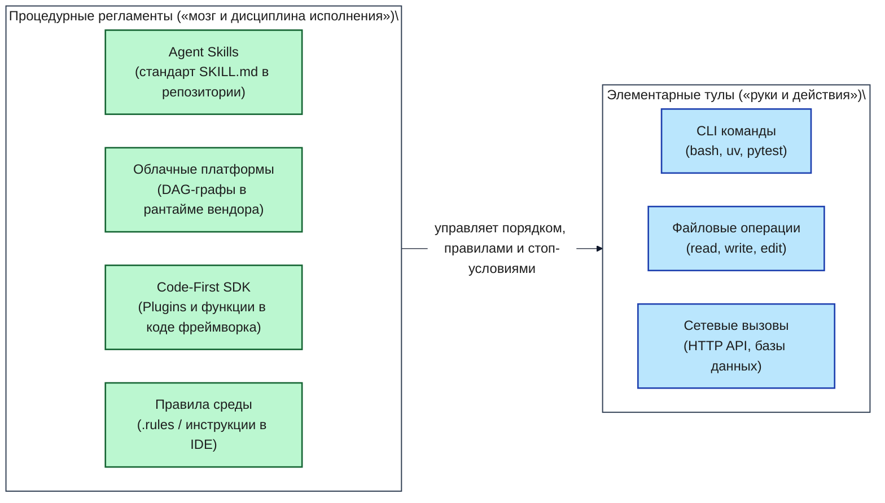

- **Траектория А (Инструмент без скила):** Агент получает задачу «добавить колонку в БД» и инструмент `bash`. Он вызывает `alembic revision --autogenerate`, видит зелёный вывод консоли и рапортует об успехе. При этом он не проверил метод `downgrade()`, оставил пустой откат и создал мину замедленного действия для продакшена.
- **Траектория Б (Инструмент под управлением скила `data-engineering`):** Скил принуждает агента выполнить строгий алгоритм: сгенерировать миграцию -> вручную заполнить `downgrade()` -> применить `upgrade head` -> проверить откат `downgrade -1` -> снова применить `upgrade head` -> запустить тесты интеграции. Любой сбой на промежуточном этапе активирует протокол отката.

---

### 1.4. Детальное сравнение скилов с рыночными альтернативами

В индустрии существует несколько конкурирующих подходов к управлению поведением AI-агентов. Разберём их архитектурные компромиссы.

#### 1.4.1. Amazon Bedrock Prompt Flows (Статический облачный DAG)
- **Архитектура:** Визуальный граф вызовов в облаке AWS. Узлы жестко соединены статическими рёбрами.
- **Ограничения:** Жесткая привязка к вендору (Vendor Lock-in), невозможность запуска на локальной машине разработчика, низкая гибкость при нестандартных ошибках сборки.

##### Архитектурный каркас Amazon Bedrock Prompt Flows (статический облачный DAG)

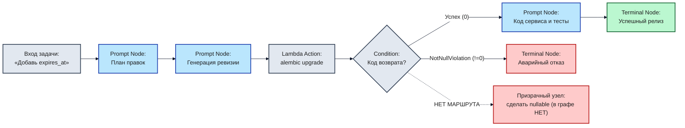

#### 1.4.2. Microsoft Semantic Kernel / Agent Framework (Host-SDK-Плагины)
- **Архитектура:** Программный SDK (C#, Python), где логика плагинов компилируется вместе с хост-приложением.
- **Ограничения:** Требует написания сложного инфраструктурного кода обвязки на Python/C#; правила не хранятся в виде простых файлов разметки рядом с кодом сервиса.

##### Архитектурный каркас Microsoft Semantic Kernel / Agent Framework (Host-SDK-Плагины)

```mermaid
%%{init: {"theme": "base", "flowchart": {"curve": "linear", "nodeSpacing": 35, "rankSpacing": 50, "padding": 16}, "themeVariables": {"background": "#ffffff", "mainBkg": "#e2e8f0", "nodeBorder": "#334155", "primaryColor": "#e2e8f0", "primaryTextColor": "#1e1e1e", "primaryBorderColor": "#334155", "lineColor": "#0f172a", "secondaryColor": "#bae6fd", "tertiaryColor": "#ffffff", "clusterBkg": "#ffffff", "clusterBorder": "#334155", "titleColor": "#1e1e1e", "edgeLabelBackground": "#ffffff", "fontFamily": "Helvetica Neue, Helvetica, Arial, sans-serif", "fontSize": "16px"}}}%%
flowchart LR
    HOST["Хост-приложение:<br/>C# / Python SDK"]
    KERNEL["Semantic Kernel:<br/>Ядро оркестрации"]
    PLUG["Plugin Registry:<br/>@kernel_function"]
    PLAN["Планировщик:<br/>Function Calling LLM"]
    EXEC["Нативное исполнение:<br/>Скомпилированный код"]
    RETRY["Правка кода SDK:<br/>Релиз нового пакета"]
    MISS["Дефицит IDE:<br/>Нет CLI и ФС из коробки"]

    HOST --> KERNEL
    KERNEL --> PLAN
    PLAN -->|"Выбор метода"| PLUG
    PLUG -->|"Вызов"| EXEC
    EXEC -->|"Ошибка NotNull"| RETRY
    RETRY -->|"Пересборка"| KERNEL
    KERNEL -.->|"Отсутствует"| MISS

    classDef neutral fill:#e2e8f0,stroke:#334155,stroke-width:2px,color:#1e1e1e
    classDef core fill:#bae6fd,stroke:#1e40af,stroke-width:2px,color:#1e1e1e
    classDef danger fill:#fecaca,stroke:#b91c1c,stroke-width:2px,color:#1e1e1e
    classDef success fill:#bbf7d0,stroke:#166534,stroke-width:2px,color:#1e1e1e

    class HOST,KERNEL neutral
    class PLUG,PLAN core
    class EXEC neutral
    class RETRY,MISS danger
```

#### 1.4.3. Графовые кодовые фреймворки (LangGraph, CrewAI, AutoGen)
- **Архитектура:** Определение логики агента через программные графы состояний (StateGraph) с условными переходами на чистом Python.
- **Ограничения:** Избыточная алгоритмическая сложность для прикладной разработки; разработчик тратит больше времени на поддержку фреймворка агента, чем на решение продуктовых задач сервиса.

##### Архитектурный каркас LangGraph (граф состояний StateGraph с условным роутингом и retry)

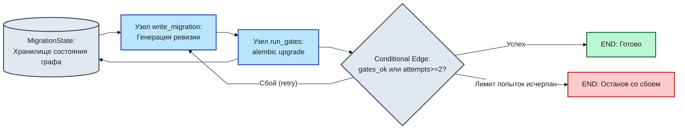

#### 1.4.4. Правила IDE и файловые маски: Cursor Rules (`.cursor/rules/*.mdc`)
- **Архитектура:** Текстовые инструкции, привязанные к шаблонам путей файлов (globs), например `app/api/**/*.py`.
- **Ограничения:** Привязаны к конкретному редактору; активируются при открытии файла, а не по типу сквозной задачи (не подходят для задач, затрагивающих несколько слоёв одновременно).

##### Архитектурный каркас Cursor Rules (активация по маске путей globs против сквозной задачи)

```mermaid
%%{init: {"theme": "base", "flowchart": {"curve": "linear", "nodeSpacing": 35, "rankSpacing": 50, "padding": 16}, "themeVariables": {"background": "#ffffff", "mainBkg": "#e2e8f0", "nodeBorder": "#334155", "primaryColor": "#e2e8f0", "primaryTextColor": "#1e1e1e", "primaryBorderColor": "#334155", "lineColor": "#0f172a", "secondaryColor": "#bae6fd", "tertiaryColor": "#ffffff", "clusterBkg": "#ffffff", "clusterBorder": "#334155", "titleColor": "#1e1e1e", "edgeLabelBackground": "#ffffff", "fontFamily": "Helvetica Neue, Helvetica, Arial, sans-serif", "fontSize": "16px"}}}%%
flowchart LR
    EDIT["Момент t0:<br/>Работа с моделью ссылки"]
    SKIP["Правило migration.mdc:<br/>НЕ активно (маска не совпала)"]
    DECISION["Решение о миграции:<br/>принято без правила"]
    OPEN["Момент t+1:<br/>Открыта ревизия Alembic"]
    RULE["Инжекция с задержкой:<br/>migration.mdc в чате"]
    MODEL["Агент в чате IDE:<br/>Нет сквозного контракта"]
    CONTRACT["Сквозной контракт 6 слоёв:<br/>нарушен запаздыванием"]

    EDIT --> SKIP
    SKIP -->|"Вайб-кодинг"| DECISION
    DECISION --> OPEN
    OPEN -->|"Триггер сработал поздно"| RULE
    RULE --> MODEL
    DECISION --> MODEL
    MODEL --> CONTRACT

    classDef neutral fill:#e2e8f0,stroke:#334155,stroke-width:2px,color:#1e1e1e
    classDef core fill:#bae6fd,stroke:#1e40af,stroke-width:2px,color:#1e1e1e
    classDef danger fill:#fecaca,stroke:#b91c1c,stroke-width:2px,color:#1e1e1e
    classDef success fill:#bbf7d0,stroke:#166534,stroke-width:2px,color:#1e1e1e

    class EDIT,OPEN neutral
    class SKIP,CONTRACT danger
    class RULE core
    class DECISION,MODEL neutral
```

#### 1.4.5. Открытый репозиторный стандарт `SKILL.md` (Agentic AI Foundation)
- **Архитектура:** Декларативные Markdown-файлы с YAML-frontmatter, закоммиченные в репозиторий проекта (`.agents/skills/<name>/SKILL.md`).
- **Преимущества:** Платформонезависимость (работает в OpenCode, Claude Code, Cursor, Factory Droid, Gemini CLI), версионирование в Git, читаемость человеком и моделью, поддержка Progressive Disclosure.

##### Итоговый архитектурный каркас: Репозиторный скил SKILL.md (Progressive Disclosure)

```mermaid
%%{init: {"theme": "base", "flowchart": {"curve": "linear", "nodeSpacing": 35, "rankSpacing": 50, "padding": 16}, "themeVariables": {"background": "#ffffff", "mainBkg": "#e2e8f0", "nodeBorder": "#334155", "primaryColor": "#e2e8f0", "primaryTextColor": "#1e1e1e", "primaryBorderColor": "#334155", "lineColor": "#0f172a", "secondaryColor": "#bae6fd", "tertiaryColor": "#ffffff", "clusterBkg": "#ffffff", "clusterBorder": "#334155", "titleColor": "#1e1e1e", "edgeLabelBackground": "#ffffff", "fontFamily": "Helvetica Neue, Helvetica, Arial, sans-serif", "fontSize": "16px"}}}%%
flowchart LR
    TASK["Инженерная задача:<br/>«Добавь expires_at»"]
    L1["Уровень 1:<br/>Реестр описаний скилов"]
    L2["Уровень 2:<br/>SKILL.md ровно одного скила"]
    L3["Уровень 3:<br/>Ресурсы references/ по требованию"]
    SOP["Исполнение СОП:<br/>Фазы 1..3 + откат"]
    GATE["Детерминированные ворота:<br/>alembic + ruff + pytest"]
    DONE["Definition of Done:<br/>Код 0 принят"]
    STOP["Стоп-условие:<br/>Откат + BLOCKED"]

    TASK --> L1
    L1 -->|"Сверка триггера"| L2
    L2 -->|"По требованию"| L3
    L2 --> SOP
    L3 --> SOP
    SOP --> GATE
    GATE -->|"Все проверки 0"| DONE
    GATE -->|"Сбой, попытки остались"| SOP
    GATE --> STOP

    classDef neutral fill:#e2e8f0,stroke:#334155,stroke-width:2px,color:#1e1e1e
    classDef core fill:#bae6fd,stroke:#1e40af,stroke-width:2px,color:#1e1e1e
    classDef danger fill:#fecaca,stroke:#b91c1c,stroke-width:2px,color:#1e1e1e
    classDef success fill:#bbf7d0,stroke:#166534,stroke-width:2px,color:#1e1e1e

    class TASK neutral
    class L1,L2,L3,SOP core
    class GATE neutral
    class DONE success
    class STOP danger
```

---

### 1.5. Сравнительная матрица стандартов и различия в поддержке скилов

#### Сводная таблица 1. Подходы к управлению поведением агента

| Критерий | Чат-промпт (Vibe) | Системный промпт IDE | Cursor Rules (`.mdc`) | LangGraph / CrewAI | Файловый стандарт `SKILL.md` |
|:---|:---|:---|:---|:---|:---|
| **Хранение** | Память чата | Профиль юзера | Репозиторий `.cursor/` | Python-код графа | Репозиторий `.agents/skills/` |
| **Расход контекста** | Критический (переполнение) | Постоянный высокий | Средний (по путям) | Высокий (состояния) | Минимальный (Progressive Disclosure) |
| **Переносимость** | Нулевая | Низкая | Только Cursor | Требует Python SDK | Полная (любой агент) |
| **Версионирование** | Нет | Нет | Git | Git | Git |
| **Управление шагами** | Хаотичное | Слабое | Среднее | Жёсткое кодовое | Декларативное процедурное |

#### Сводная таблица 2. Поддержка скилов агентными средами

| Среда / Инструмент | Механизм поддержки `SKILL.md` | Поддержка `AGENTS.md` | Проверка ворот качества |
|:---|:---|:---|:---|
| **OpenCode CLI** | Нативная поддержка `.agents/skills/` | Читает из корня репозитория | Через встроенные shell-инструменты |
| **Claude Code** | Через слэш-команды и суб-промпты | Читает `CLAUDE.md` и `AGENTS.md` | Через Bash-инструмент |
| **Cursor IDE** | Через правила `.cursor/rules/` | Симлинк на `AGENTS.md` | Через встроенный терминал |
| **Factory Droid** | Нативная поддержка директории скилов | Автоматическая префикс-инжекция | Автономные eval-хуки |

---

### Контраст «Вайб-кодинг против Профессионального контура»

| Аспект разработки | Вайб-кодинг в голом чате | Инженерный контур со скилами |
|:---|:---|:---|
| **Точка входа** | Немедленная правка первого попавшегося файла | Разведка на чтение и построение карты связей |
| **Контроль архитектуры** | Отсутствует; модель пишет как привыкла | Конституция `AGENTS.md` блокирует слом слоёв |
| **Работа с БД** | Односторонние миграции, утечки пула сессий | Скил `data-engineering` с обязательным `downgrade` |
| **Тестирование** | Бутафорские тесты со 100% моками всего | Честные тесты: текущее поведение -> юнит -> интеграция с реальной БД |
| **Критерий готовности** | Уверенное заявление модели «Всё готово!» | Детерминированный Exit Code 0 ворот качества |

### Критерии перехода к Главе 2
- [x] Понятна фундаментальная причина сбоев вайб-кодинга («Ловушка среднего Python» и потеря контекста).
- [x] Усвоено разделение 4 слоёв инженерной обвязки (`AGENTS.md`, `SKILL.md`, Quality Gates, Eval-петля).
- [x] Понятен категориальный водораздел между элементарными тулами (Tools) и процедурными регламентами (Skills).
- [x] Разобран трёхуровневый механизм Progressive Disclosure.


## Глава 2. Вход в существующий проект: исследование только на чтение, карта архитектуры и кода (Code Map), анализ зоны влияния правок (Impact Analysis), управление контекстом

### 2.1. Дисциплина входа в живой код: почему первая команда агенту всегда «только чтение»

Главная ошибка начинающего разработчика при работе с AI — сразу попросить модель внести правку в код («добавь эндпоинт», «почини тест», «перепиши запрос»). Агент, не зная архитектурных границ проекта, делает предположения на основе имён файлов и генерирует код, нарушающий соглашения слоёв или ломающий смежные зависимости.

#### Жёсткое правило двух тактов
Профессиональная AI-разработка всегда делится на два изолированных такта:
1. **Такт 1 (Разведка Read-Only):** Агент запускается в строгом режиме «только чтение». Его задача — просканировать структуру, выявить границы слоёв, построить карту зависимостей и зафиксировать зону влияния будущих правок в декларативном документе. Любые модификации кода на этом этапе категорически запрещены.
2. **Такт 2 (Исполнение изменений):** Только после того, как человек проверил карту разведки и убедился в правильности понимания архитектуры, агенту выдаётся разрешение на изменение файлов под управлением соответствующего процедурного скила.

#### Схема 6. Схема двухтактового входа в существующий проект: разведка на чтение против поспешной правки

```mermaid
%%{init: {"theme": "base", "flowchart": {"curve": "linear", "nodeSpacing": 45, "rankSpacing": 70, "padding": 16}, "themeVariables": {"background": "#ffffff", "mainBkg": "#e2e8f0", "nodeBorder": "#334155", "primaryColor": "#e2e8f0", "primaryTextColor": "#1e1e1e", "primaryBorderColor": "#334155", "lineColor": "#0f172a", "secondaryColor": "#bae6fd", "tertiaryColor": "#ffffff", "clusterBkg": "#ffffff", "clusterBorder": "#334155", "titleColor": "#1e1e1e", "edgeLabelBackground": "#ffffff", "fontFamily": "Helvetica Neue, Helvetica, Arial, sans-serif", "fontSize": "18px"}}}%%
flowchart LR
    subgraph Read["Такт 1: только чтение"]
        direction LR
        T["Постановка задачи<br/>в существующем проекте"]
        R["Шаг 1: исследование<br/>(запрет любых правок кода)"]
        M["Шаг 2: карта архитектуры<br/>и зона влияния правок"]
    end
    subgraph Act["Такт 2: действие по утверждённому плану"]
        direction LR
        C["Шаг 3: поэтапная подача контекста<br/>(3–5 целевых файлов вместо всего репо)"]
        G["Шаг 4: разрешение на переход<br/>к тестам текущего поведения"]
    end
    T -->|"запускает"| R
    R -->|"строит"| M
    M -->|"ограничивает"| C
    C -->|"открывает"| G
    class T,R,M core
    class C,G success
    classDef neutral fill:#e2e8f0,stroke:#334155,stroke-width:2px,color:#1e1e1e
    classDef core fill:#bae6fd,stroke:#1e40af,stroke-width:2px,color:#1e1e1e
    classDef danger fill:#fecaca,stroke:#b91c1c,stroke-width:2px,color:#1e1e1e
    classDef success fill:#bbf7d0,stroke:#166534,stroke-width:2px,color:#1e1e1e
    style Read fill:#ffffff,stroke:#334155,stroke-width:1.5px,color:#1e1e1e
    style Act fill:#ffffff,stroke:#334155,stroke-width:1.5px,color:#1e1e1e
```

#### Что значит «только чтение» технически
- Инструменты агента ограничены чтением файлов (`read_file`, `list_dir`, `grep`). Инструменты редактирования (`edit_file`, `write_file`) отключены или заблокированы системным промптом.
- Ни один байт в рабочем дереве Git не изменяется. После завершения сессии разведки команда `git status --porcelain` обязана возвращать пустой вывод (за исключением самого файла отчёта разведки `architecture-map.md`).

---

### 2.2. Карта архитектуры и кода (Code Map) и зона влияния правок (Impact Analysis)

Чтобы агент не разрушил существующий сервис, он обязан явно выделить слои приложения и зафиксировать границы ответственности.

#### Пять слоёв сервиса сокращения ссылок:
1. **Транспортный слой (`app/api/v1/endpoints/`):** Приём HTTP-запросов, парсинг Pydantic-схем, маппинг доменных ошибок на статус-коды HTTP. Запрещено выполнять SQL-запросы напрямую.
2. **Сервисный слой (`app/services/`):** Бизнес-правила, валидация доменных ограничений, проверка безопасности URL (защита от SSRF через `app/core/security.py`).
3. **Слой доступа к данным (`app/repositories/`):** Изоляция всех запросов к PostgreSQL через SQLAlchemy 2.0 (async). Вся работа с БД локализована здесь.
4. **Доменный слой (`app/models/`, `app/schemas/`):** Декларация таблиц БД и контрактов данных Pydantic v2. Изменение схем напрямую влияет на внешних клиентов.
5. **Слой инфраструктуры и конфигурации (`app/core/`, `app/db/`):** Управление пулом соединений `asyncpg`, жизненным циклом приложения и переменными окружения.

#### Схема 7. Архитектурная карта базового проекта: потребители слева, слои сервиса в центре, хранилище замыкает цепочку

```mermaid
%%{init: {"theme": "base", "flowchart": {"curve": "linear", "nodeSpacing": 45, "rankSpacing": 70, "padding": 16}, "themeVariables": {"background": "#ffffff", "mainBkg": "#e2e8f0", "nodeBorder": "#334155", "primaryColor": "#e2e8f0", "primaryTextColor": "#1e1e1e", "primaryBorderColor": "#334155", "lineColor": "#0f172a", "secondaryColor": "#bae6fd", "tertiaryColor": "#ffffff", "clusterBkg": "#ffffff", "clusterBorder": "#334155", "titleColor": "#1e1e1e", "edgeLabelBackground": "#ffffff", "fontFamily": "Helvetica Neue, Helvetica, Arial, sans-serif", "fontSize": "18px"}}}%%
flowchart LR
    subgraph Client["Внешние потребители"]
        direction LR
        Web["Frontend / Web UI"]
        Sber["100 смежных микросервисов экосистемы"]
    end
    subgraph FastAPI["Базовый проект воркшопа (~/work/Python-AI/fastapi)"]
        direction LR
        API["app/api/v1/<br/>(контроллеры HTTP)"]
        SVC["app/services/<br/>(бизнес-правила)"]
        REPO["app/repositories/<br/>(доступ к данным)"]
        DB["PostgreSQL 17<br/>(таблицы links, click_events)"]
    end
    Web -->|"отправляет запросы"| API
    Sber -->|"зависит от контракта"| API
    API -->|"вызывает"| SVC
    SVC -->|"обращается к"| REPO
    REPO -->|"читает и пишет"| DB
    class Web,Sber core
    class API,SVC,REPO,DB neutral
    classDef neutral fill:#e2e8f0,stroke:#334155,stroke-width:2px,color:#1e1e1e
    classDef core fill:#bae6fd,stroke:#1e40af,stroke-width:2px,color:#1e1e1e
    classDef danger fill:#fecaca,stroke:#b91c1c,stroke-width:2px,color:#1e1e1e
    classDef success fill:#bbf7d0,stroke:#166534,stroke-width:2px,color:#1e1e1e
    style Client fill:#ffffff,stroke:#334155,stroke-width:1.5px,color:#1e1e1e
    style FastAPI fill:#ffffff,stroke:#334155,stroke-width:1.5px,color:#1e1e1e
```

#### Зона влияния правок (Impact Analysis)
Перед любой модификацией агент обязан составить матрицу влияния:
- Какие файлы будут изменены? (Жесткое ограничение: не более 5 файлов на одну задачу).
- Затрагиваются ли внешние HTTP-контракты?
- Требуется ли изменение схемы БД и миграция Alembic?
- Какие существующие тесты покрывают затрагиваемую область?

---

### 2.3. Контекст как управляемый ресурс и поэтапная подгрузка знаний (Progressive Disclosure)

Контекстное окно LLM ограничено и засоряется от избыточных данных. Профессиональный харнес реализует принцип **минимально необходимого контекста**:
- **Что агент обязан получить на входе:** Файл правил `AGENTS.md`, дерево каталогов (`ls`), манифест текущей задачи и целевой скил.
- **Что запрещено подавать в контекст:** Полные дампы базы данных, бинарные файлы, сторонние логи, полные листинги нерелевантных модулей.
- **Иерархия источников правды в репозитории:**
  1. Код возврата компилятора/линтера (`pyproject.toml`).
  2. Конституция проекта (`AGENTS.md`).
  3. Процедурный регламент (`SKILL.md`).
  4. Карта архитектуры (`architecture-map.md`).
  5. Свободные рассуждения модели в чате (наименьший приоритет).

---

### 2.4. Декларативный артефакт главы: карта архитектуры и связей `architecture-map.md`

Результатом работы первого такта становится файл `architecture-map.md`, создаваемый в корне проекта. Он фиксирует:
1. Структуру модулей и их назначение.
2. Направление вызовов (строго сверху вниз: API -> Service -> Repository -> Database).
3. Список внешних HTTP-контрактов, которые запрещено ломать.
4. Выявленные зоны риска (утечки пула соединений, SSRF-уязвимости).
5. Зону влияния текущей задачи.

> [!NOTE]
> Полная архитектурная спецификация сервиса, включая C4-диаграммы контейнеров и компонентов, подробно представлена в **[Приложение А, Блок А.4. Архитектурный пакет C4](./Приложение-А-Справочник-кода-и-окружения.md#блок-а4-архитектурный-пакет-c4-полная-спецификация-базового-проекта-воркшопа)**.

---

### 2.5. Практика: разведка проекта через OpenCode в режиме «только чтение»

#### Шаг 1. Зафиксировать чистую точку старта
Перед запуском агента убедитесь, что рабочее дерево Git чисто:
```bash
cd ~/work/Python-AI/fastapi
git status
```
Вывод должен содержать `nothing to commit, working tree clean`.

#### Шаг 2. Запустить разведку через OpenCode
Передайте агенту строгий промпт на проведение разведки без права изменения кода приложения:
```bash
cd ~/work/Python-AI/fastapi
opencode run "Проведи исследование кодовой базы в режиме ТОЛЬКО ЧТЕНИЕ. Изучи структуру модулей в app/, выяви границы слоёв, внешние HTTP-контракты и потенциальные точки отказа. Сформируй итоговый файл architecture-map.md в корне проекта. Запрещено модифицировать любые существующие файлы в app/, tests/ или alembic/." < /dev/null
```

#### Шаг 3. Проверить результат фактом
После завершения работы агента выполните детерминированную проверку:
```bash
cd ~/work/Python-AI/fastapi
git status --porcelain
```
**Критерий успеха (Definition of Done):**
- В статусе Git присутствует ровно один новый файл: `?? architecture-map.md`.
- Ни один файл в `app/`, `tests/` или конфигурациях не изменён (`modified`).
- Файл `architecture-map.md` содержит явные разделы: слои, направление вызовов, контракты, зоны риска.

#### Если не прошло
Если агент попытался изменить код приложения или не сформировал карту:
1. Откатите несанкционированные изменения: `git restore app/ tests/`.
2. Повторите запуск с явным указанием на запрет записи.

---

### Контраст «Вайб-кодинг против Профессионального контура» на входе в проект

| Критерий | Вайб-кодинг в голом чате | Инженерный контур (Такт 1) |
|:---|:---|:---|
| **Действие при старте** | Сразу правит код в `app/routers/` | Сканирует зависимости без изменения кода |
| **Понимание связей** | Локальное, видит только один файл | Формирует полную карту 5 слоёв сервиса |
| **Защита контрактов** | Случайно переименовывает поля API | Фиксирует внешние контракты как неизменяемые |
| **Состояние репозитория** | Засорено черновыми правками | Кристально чистое, создан только `architecture-map.md` |

### Критерии перехода к Главе 3
- [x] Выполнено правило двух тактов: разведка проведена строго в режиме Read-Only.
- [x] В корне проекта сформирован и верифицирован артефакт `architecture-map.md`.
- [x] Проверено отсутствие несанкционированных изменений (`git status --porcelain`).


## Глава 3. Закон репозитория: всегда активные правила `AGENTS.md`, гардрайлы и детерминированные ворота качества в `pyproject.toml` (Quality Gates & Guardrails / QG)

### Схема работы закона репозитория AGENTS.md, гардрайлов и ворот качества в pyproject.toml (Quality Gates & Guardrails / QG)

```mermaid
%%{init: {"theme": "base", "flowchart": {"curve": "linear", "nodeSpacing": 45, "rankSpacing": 70, "padding": 16}, "themeVariables": {"background": "#ffffff", "mainBkg": "#e2e8f0", "nodeBorder": "#334155", "primaryColor": "#e2e8f0", "primaryTextColor": "#1e1e1e", "primaryBorderColor": "#334155", "lineColor": "#0f172a", "secondaryColor": "#bae6fd", "tertiaryColor": "#ffffff", "clusterBkg": "#ffffff", "clusterBorder": "#334155", "titleColor": "#1e1e1e", "edgeLabelBackground": "#ffffff", "fontFamily": "Helvetica Neue, Helvetica, Arial, sans-serif", "fontSize": "18px"}}}%%
flowchart LR
    subgraph Law["Закон репозитория"]
        direction LR
        A["Сессия AI-агента"]
        B["AGENTS.md:<br/>нерушимые правила<br/>и строгие запреты слоёв"]
        C["Генерация и изменение кода"]
    end
    subgraph Gates["Гардрайлы и ворота в pyproject.toml<br/>Guardrails & Quality Gates (QG)"]
        direction LR
        D["ruff check, basedpyright,<br/>pytest, alembic check"]
        E["Блокировка приёмки:<br/>агент исправляет код,<br/>не ослабляя проверки"]
        F["Зелёный проход ворот"]
    end
    A -->|"читает при старте"| B
    B -->|"ограничивает"| C
    C -->|"передаёт на проверку"| D
    D -->|"код возврата не 0"| E
    D -->|"все коды возврата 0"| F
    class A,B,C core
    class E danger
    class F success
    class D neutral
    classDef neutral fill:#e2e8f0,stroke:#334155,stroke-width:2px,color:#1e1e1e
    classDef core fill:#bae6fd,stroke:#1e40af,stroke-width:2px,color:#1e1e1e
    classDef danger fill:#fecaca,stroke:#b91c1c,stroke-width:2px,color:#1e1e1e
    classDef success fill:#bbf7d0,stroke:#166534,stroke-width:2px,color:#1e1e1e
    style Law fill:#ffffff,stroke:#334155,stroke-width:1.5px,color:#1e1e1e
    style Gates fill:#ffffff,stroke:#334155,stroke-width:1.5px,color:#1e1e1e
```

### 3.1. Почему правила в чате забываются, а `AGENTS.md` работает на каждом ходе

Инструкции, данные агенту устно в теле диалога («помни, что у нас асинхронная SQLAlchemy», «не используй requests»), неизбежно забываются через 5–10 шагов. Причина кроется в устройстве контекстного окна LLM: история диалога непрерывно сдвигается, и ранние сообщения теряют вес внимания (Attention Decay) под давлением свежих трейсбеков и простыней кода.

В противоположность устным просьбам, файл `.agents/AGENTS.md` монтируется в контекст детерминированно:
- **Префиксная инжекция:** Современные агентные среды (OpenCode, Claude Code, Cursor, Factory Droid) считывают `AGENTS.md` с диска и подмешивают его содержимое в начало каждого системного запроса перед генерацией очередного шага.
- **Изоляция от истории:** Вывод `pytest` или длинные логи не могут вытеснить файл правил из контекста, так как он физически считывается заново при сборке пакета промпта. Новая сессия агента читает тот же файл с диска и мгновенно получает полный набор нерушимых ограничений.

#### Схема префиксной инжекции правил AGENTS.md в контекстное окно агента

```mermaid
%%{init: {"theme": "base", "flowchart": {"curve": "linear", "nodeSpacing": 45, "rankSpacing": 70, "padding": 16}, "themeVariables": {"background": "#ffffff", "mainBkg": "#e2e8f0", "nodeBorder": "#334155", "primaryColor": "#e2e8f0", "primaryTextColor": "#1e1e1e", "primaryBorderColor": "#334155", "lineColor": "#0f172a", "secondaryColor": "#bae6fd", "tertiaryColor": "#ffffff", "clusterBkg": "#ffffff", "clusterBorder": "#334155", "titleColor": "#1e1e1e", "edgeLabelBackground": "#ffffff", "fontFamily": "Helvetica Neue, Helvetica, Arial, sans-serif", "fontSize": "18px"}}}%%
flowchart LR
    subgraph Disk["Репозиторий на диске"]
        direction LR
        A["Личный файл правил<br/>в домашнем каталоге"]
        B["AGENTS.md в корне<br/>и в подкаталогах"]
    end
    subgraph Client["Клиент агента на каждом ходе"]
        direction LR
        C["Сборка запроса"]
        D["Системный префикс<br/>с правилами"]
        E["История диалога:<br/>усечена или сжата"]
    end
    subgraph Model["Модель"]
        direction LR
        F["Ответ по правилам<br/>и текущей задаче"]
    end
    A -->|"добавляет"| C
    B -->|"добавляет"| C
    C -->|"кладёт в начало"| D
    C -->|"дописывает в конец"| E
    D -->|"отправляет"| F
    E -->|"отправляет"| F
    class A,B core
    class C neutral
    class D success
    class E danger
    class F neutral
    classDef neutral fill:#e2e8f0,stroke:#334155,stroke-width:2px,color:#1e1e1e
    classDef core fill:#bae6fd,stroke:#1e40af,stroke-width:2px,color:#1e1e1e
    classDef danger fill:#fecaca,stroke:#b91c1c,stroke-width:2px,color:#1e1e1e
    classDef success fill:#bbf7d0,stroke:#166534,stroke-width:2px,color:#1e1e1e
    style Disk fill:#ffffff,stroke:#334155,stroke-width:1.5px,color:#1e1e1e
    style Client fill:#ffffff,stroke:#334155,stroke-width:1.5px,color:#1e1e1e
    style Model fill:#ffffff,stroke:#334155,stroke-width:1.5px,color:#1e1e1e
```

---

### 3.2. Архитектурное сравнение 8 подходов к управлению правилами

В экосистеме существует 8 альтернативных способов задания ограничений для AI-агентов. Сравним их эффективность:

| № | Подход | Где хранится | Плюсы | Минусы и риски |
|:---|:---|:---|:---|:---|
| **1** | **Промпты в чате (Chat Prompting)** | В истории сессии | Легко написать | Забывается через 5 сообщений; нулевая воспроизводимость |
| **2** | **Пользовательские настройки (Custom Instructions)** | Профиль веб-интерфейса | Работает во всех чатах | Не версионируется в Git; общее для всех репозиториев разработчика |
| **3** | **Стандарт `AGENTS.md` (Linux Foundation)** | `.agents/AGENTS.md` в Git | Кроссплатформенный; версионируется; инжектируется на каждом ходе | Требует поддержки со стороны агентной среды |
| **4** | **`CLAUDE.md` (Anthropic)** | Корень проекта | Нативно поддерживается Claude Code | Привязан к инструментам Anthropic; нет разделения на скилы |
| **5** | **Cursor Rules (`.cursor/rules/*.mdc`)** | `.cursor/rules/` | Активация по маскам путей (globs) | Работает только внутри редактора Cursor |
| **6** | **GitHub Copilot Instructions** | `.github/copilot-instructions.md` | Интеграция с GitHub | Ограничен возможностями экосистемы Copilot |
| **7** | **Специфичные конфиги инструментов** | `.windsurfrules`, `.clinerules` | Локальная оптимизация | Раздувание зоопарка конфигурационных файлов |
| **8** | **Только линтеры без инструкций** | `pyproject.toml` | Жесткий машинный контроль | Агент тратит десятки итераций на исправление ошибок вслепую |

**Вывод:** Наиболее надёжный подход — гибридный: открытый кроссплатформенный стандарт `AGENTS.md` задаёт ментальную модель архитектуры, а жесткие линтеры в `pyproject.toml` выступают машинным судьёй.

---

### 3.3. Конституция репозитория `.agents/AGENTS.md`: 6 обязательных разделов

Файл `.agents/AGENTS.md` является законом проекта, нарушать который агенту строго запрещено. Он содержит 6 обязательных секций:

1. **Контекст и навигация:** Указывает рабочий каталог (`~/work/Python-AI/fastapi`), стек технологий и предписывает обязательную проверку процедурных скилов перед началом работы.
2. **Нерушимые правила архитектуры и границ слоёв:**
   - Эндпоинты (`app/api/`) отвечают только за приём запроса и схемы; запрещено импортировать SQLAlchemy и делать прямые SQL-запросы.
   - Сервисный слой (`app/services/`) изолирован от HTTP: запрещено выбрасывать `HTTPException` или принимать объекты `Request/Response`.
   - Вся работа с базой данных локализована в репозиториях (`app/repositories/`).
   - Запрещено менять существующие поля в JSON-ответах API (защита смежных сервисов).
3. **Нерушимые правила работы с БД и миграциями:**
   - Запрещено инстанциировать сессии вручную — сессии передаются только через механизм зависимостей (`Depends(get_db)`).
   - Каждая миграция Alembic обязана содержать двусторонний метод `downgrade()` и проходить проверку на откат.
4. **Строгие запреты против обхода проверок (Anti-Cheat):**
   - Запрещено подавлять ошибки типов через `# type: ignore` или `# noqa`.
   - Запрещено отключать или ослаблять проверки в `pyproject.toml`.
   - Запрещено удалять или комментировать падающие тесты.
   - Запрещено писать бутафорские мок-тесты (Fake Mocks), где тестируемый метод подменяется заглушкой.
5. **Жёсткие ворота готовности (Definition of Done):** Задача считается завершённой только при одновременном выполнении условий: Exit Code 0 у всех линтеров, 100% зелёный тестовый набор, покрытие не снизилось, миграция успешно откатывается.
6. **Использование процедурных скилов:** Предписание обращаться к файлам `.agents/skills/<name>/SKILL.md` при выполнении типовых инженерных операций.

#### Анатомия читерства: три мины замедленного действия
1. **Мина №1: Односторонняя миграция-инвалид.** Агент генерирует `upgrade()`, а в `downgrade()` пишет `pass`. При необходимости отката релиза в продакшене база оказывается в несогласованном состоянии, вызывая простой сервиса.
2. **Мина №2: Утечка асинхронного пула соединений БД.** Агент инстанциирует `session = AsyncSession(engine)` внутри функции без закрытия. На проде пул `asyncpg` забивается «зомби-сессиями» за несколько минут.
3. **Мина №3: Бутафорский тест (Fake Mock Test).** Агент пишет тест, где подменяет моком саму тестируемую функцию: `service.create_link = AsyncMock(return_value=link)`. Тест всегда зелёный, но реальный сервис не работает.

> [!NOTE]
> Полный эталонный текст файла `.agents/AGENTS.md` со всеми правилами и спецификациями доступен в **[Приложение А, Блок А.33.1. Конституция репозитория .agents/AGENTS.md](./Приложение-А-Справочник-кода-и-окружения.md#а331-конституция-репозитория-agentsmd)**.

---

### 3.4. Гардрайлы и детерминированные ворота качества в `pyproject.toml` (Quality Gates & Guardrails / QG)

Слова в `AGENTS.md` объясняют агенту, как писать правильно. Но гарантию соблюдения правил дают детерминированные ворота качества — набор инструментов статического анализа и тестов, запускаемых локально.

#### Схема детерминированных ворот качества в pyproject.toml

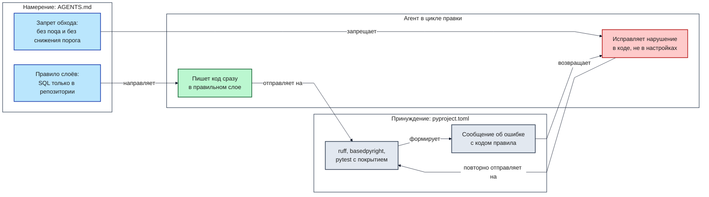

#### Разбор пяти блоков машинного контроля:
1. **`[tool.ruff]` и `[tool.ruff.lint]`:**
   - Включает 9 групп правил: `E/W` (PEP8), `F` (Pyflakes), `I` (isort), `B` (Bugbear), `UP` (Python 3.12 syntax), `ASYNC` (ошибки асинхронности), `S` (безопасность/bandit), `T20` (запрет `print`), `TID251` (banned-api).
   - **Механизм `banned-api`:** Физически запрещает импорт `sqlalchemy.orm.Session` и прямых SQL-выражений внутри каталога `app/api/v1/endpoints/`. Попытка агента сделать запрос в БД прямо из роутера немедленно ломает билд на этапе линтинга с ненулевым кодом возврата!
2. **`[tool.ruff.lint.flake8-bugbear]`:**
   - Настройка `extend-immutable-calls = ["fastapi.Depends", "fastapi.Query"]` разрешает использование вызовов функций в значениях параметров эндпоинтов по умолчанию без ложных срабатываний линтера.
3. **`[tool.basedpyright]`:**
   - Строгая статическая типизация. Запрещены неявные типы `Any`, нетипизированные аргументы функций и пропущенные возвращаемые значения (`typeCheckingMode = "standard"`, `reportMissingTypeStubs = false`).
4. **`[tool.pytest.ini_options]`:**
   - Автоматический асинхронный режим (`asyncio_mode = "auto"`), фильтрация deprecation-предупреждений, явная регистрация маркеров (`unit`, `integration`, `characterization`).
5. **`[tool.coverage.run]` и `[tool.coverage.report]`:**
   - Измерение покрытия ветвей (`branch = true`).
   - Жёсткий порог `fail_under = 100` для критических модулей доменной логики сервиса.

> [!NOTE]
> Полный файл конфигурации `pyproject.toml` с подробными построчными комментариями к каждой секции представлен в **[Приложение А, Блок А.0. Конфигурация проекта, инструментов качества и Docker-окружения](./Приложение-А-Справочник-кода-и-окружения.md#блок-а0-конфигурация-проекта-инструментов-качества-и-docker-окружения)**.

#### Проверка ворот качества в терминале:
Выполните поочерёдный запуск инструментов для валидации чистого состояния:
```bash
cd ~/work/Python-AI/fastapi
uv run ruff check .
uv run basedpyright
uv run pytest
```
Все три команды обязаны завершиться с кодом возврата 0.

---

### 3.5. Контраст «Вайб-кодинг против Профессионального контура» на задаче про статистику переходов

| Ситуация | Поведение вайб-кодинга в чате | Поведение агента под управлением `AGENTS.md` и ворот качества |
|:---|:---|:---|
| **Реализация запроса** | Пишет `session.execute(select(...))` прямо в функции эндпоинта | `banned-api` роняет сборку; агент переносит логику в `repositories/` |
| **Падение проверки типов** | Дописывает в конец строки `# type: ignore` | Раздел 4 `AGENTS.md` запрещает игнорирование; агент чинит аннотацию типов |
| **Падение чужого теста** | Комментирует упавший ассерты со словами «он устарел» | Раздел 4 `AGENTS.md` запрещает трогать чужие тесты; агент исправляет ошибку в коде |
| **Создание миграции** | Оставляет метод `downgrade()` пустым (`pass`) | Раздел 3 `AGENTS.md` обязывает написать обратимый откат схемы |

### Критерии перехода к Главе 4
- [x] В проекте создан файл `.agents/AGENTS.md` с 6 обязательными секциями.
- [x] В `pyproject.toml` сконфигурированы и проверены детерминированные ворота качества.
- [x] Команды `ruff`, `basedpyright` и `pytest` завершаются успешно (Exit Code 0).


## Глава 4. Анатомия контракта скила (`SKILL.md`): от спецификации шагов до стоп-условий и правил отката

### 4.0. Архитектурный ландшафт: почему открытый файловый стандарт SKILL.md, а не платформы Big Tech (AWS, Microsoft, OpenAI)

В корпоративной среде часто возникает соблазн использовать тяжелые проприетарные платформы оркестрации (AWS Bedrock Agents, Microsoft Semantic Kernel, OpenAI Assistants API). Однако для задач повседневной разработки программного обеспечения эти платформы несут критические недостатки: они создают жесткую привязку к облачному вендору, не позволяют разработчику запустить и отладить пайплайн локально на ноутбуке без доступа к интернету и требуют сложного инфраструктурного кода.

#### Горизонтальная схема архитектурного каркаса

```mermaid
%%{init: {"theme": "base", "flowchart": {"curve": "linear", "nodeSpacing": 40, "rankSpacing": 45}, "themeVariables": {"background": "#ffffff", "mainBkg": "#ffffff", "nodeBorder": "#334155", "lineColor": "#0f172a", "fontSize": "15px"}}}%%
flowchart LR
    subgraph S1["1. CLOUD-MANAGED SAAS<br/>(AWS Bedrock / OpenAI)"]
        direction TB
        C1["OpenAPI Спеки + AWS Lambda"]
        C2["SessionAttributes + IAM Roles"]
        C3["Управление: AWS Console / Cloud API"]
        C4["⚠️ Минусы: Vendor lock-in, деплой на правку"]
    end

    subgraph S2["2. CODE-FIRST SDK & GRAPHS<br/>(MS Semantic Kernel / LangGraph)"]
        direction TB
        K1["Плагины в коде C# / Python"]
        K2["StateGraph / Checkpointer / SDK"]
        K3["Управление: Сборка и запуск кода"]
        K4["⚠️ Минусы: Тяжёлый SDK, кодовый шум"]
    end

    subgraph S3["3. FILE-BASED MARKDOWN<br/>(Стандарт .agents/skills/ в Pytex)"]
        direction TB
        F1["Чистый Markdown в Git-дереве"]
        F2["3-уровневый Progressive Disclosure"]
        F3["Управление: Обычный git commit / PR"]
        F4["✅ Плюсы: 0 инфраструктуры, переносимость"]
    end

    subgraph S4["4. ИНЖЕНЕРНЫЙ ИТОГ"]
        direction TB
        R1["Инженерная воспроизводимость"]
        R2["Единая история изменений в Git"]
        R3["Независимость от провайдера LLM"]
        R4["Запуск в любой IDE и локальном CLI"]
    end

    S1 -->|"Отказ от облачного оверхеда"| S2
    S2 -->|"Отказ от кодового бойлерплейта"| S3
    S3 -->|"Результат для команды"| S4

    classDef cloud fill:#fef3c7,stroke:#d97706,stroke-width:2px,color:#1e1e1e
    classDef sdk fill:#e0e7ff,stroke:#4338ca,stroke-width:2px,color:#1e1e1e
    classDef skills fill:#bbf7d0,stroke:#166534,stroke-width:2px,color:#1e1e1e
    classDef res fill:#bae6fd,stroke:#0369a1,stroke-width:2px,color:#1e1e1e

    class C1,C2,C3,C4 cloud
    class K1,K2,K3,K4 sdk
    class F1,F2,F3,F4 skills
    class R1,R2,R3,R4 res
```

#### Лестница принуждения (Enforcement Ladder)
Управление агентом строится по принципу постепенного ужесточения контроля:
1. **Уровень уговоров (Пожелания в чате):** Вероятность соблюдения правил моделью — ~40–60%.
2. **Уровень контекста (`AGENTS.md`):** Правила подаются на каждом шаге. Соблюдение правил — ~80–90%.
3. **Уровень процедурного алгоритма (`SKILL.md`):** Агент обязан следовать детерминированной последовательности шагов и отчитываться по контрольным точкам. Соблюдение алгоритма — ~95%.
4. **Уровень детерминированного кода возврата (Quality Gates):** Машинный контроль. Если код возврата линтера или тестов `!= 0`, работа физически не может быть принята. Соблюдение — 100%.

> 💡 **Важно:**
> **Принцип разделения властей: «Тестовый судья не должен быть написан подсудимым».**
> Агент, пишущий реализацию бизнес-фичи, не имеет права самостоятельно определять правила её приёмки. Тестовые сценарии, линтеры и критерии готовности задаются человеком и скилом заранее в виде неизменяемого контракта.

---

### 4.1. Анатомия контракта скила (`SKILL.md`): 7 обязательных блоков промышленного стандарта

Каждый скил в каталоге `.agents/skills/<name>/SKILL.md` представляет собой законченный операционный регламент. Чтобы агент выполнял процедуру без отклонений, файл скила обязан содержать строго 7 блоков:

### Схема жизненного цикла процедурного скила: от триггера до ворот качества и отката

```mermaid
%%{init: {"theme": "base", "flowchart": {"curve": "linear", "nodeSpacing": 45, "rankSpacing": 70, "padding": 16}, "themeVariables": {"background": "#ffffff", "mainBkg": "#e2e8f0", "nodeBorder": "#334155", "primaryColor": "#e2e8f0", "primaryTextColor": "#1e1e1e", "primaryBorderColor": "#334155", "lineColor": "#0f172a", "secondaryColor": "#bae6fd", "tertiaryColor": "#ffffff", "clusterBkg": "#ffffff", "clusterBorder": "#334155", "titleColor": "#1e1e1e", "edgeLabelBackground": "#ffffff", "fontFamily": "Helvetica Neue, Helvetica, Arial, sans-serif", "fontSize": "18px"}}}%%
flowchart LR
    subgraph Load["Загрузка скила"]
        direction LR
        TASK["Постановка инженерной задачи"]
        L1["Уровень 1: каталог скилов<br/>(YAML frontmatter: name, description)"]
        L2["Уровень 2: контракт SKILL.md<br/>(пошаговая процедура)"]
    end
    subgraph Run["Исполнение и контроль"]
        direction LR
        P["Фазы процедуры:<br/>Фаза 1, Фаза 2, Фаза 3"]
        C{"Стоп-условия<br/>и ворота качества"}
    end
    subgraph Result["Исход"]
        direction LR
        R["Rollback Drill:<br/>git restore и эскалация человеку"]
        D["Успешная сдача артефакта"]
    end
    TASK -->|"совпадает с триггером"| L1
    L1 -->|"подгружает"| L2
    L2 -->|"запускает"| P
    P -->|"проверяется на"| C
    C -->|"сбой или тупик"| R
    C -->|"код возврата 0"| D
    class TASK,L1,L2 core
    class P,C neutral
    class R danger
    class D success
    classDef neutral fill:#e2e8f0,stroke:#334155,stroke-width:2px,color:#1e1e1e
    classDef core fill:#bae6fd,stroke:#1e40af,stroke-width:2px,color:#1e1e1e
    classDef danger fill:#fecaca,stroke:#b91c1c,stroke-width:2px,color:#1e1e1e
    classDef success fill:#bbf7d0,stroke:#166534,stroke-width:2px,color:#1e1e1e
    style Load fill:#ffffff,stroke:#334155,stroke-width:1.5px,color:#1e1e1e
    style Run fill:#ffffff,stroke:#334155,stroke-width:1.5px,color:#1e1e1e
    style Result fill:#ffffff,stroke:#334155,stroke-width:1.5px,color:#1e1e1e
```

1. **Блок 1. YAML frontmatter (`name`, `description`):**
   - Паспорт скила. Содержит уникальный идентификатор и ёмкое описание назначения, используемое для авто-обнаружения на Уровне 1 Progressive Disclosure.
2. **Блок 2. Триггеры и границы применимости (Triggers и Anti-Triggers):**
   - Чёткие условия, когда скил активируется (например, «запрос на добавление нового эндпоинта»), и когда его использование запрещено («исправление опечатки в документации»).
3. **Блок 3. Предусловия и входы (Inputs и Preconditions):**
   - Что должно быть готово до запуска скила (чистый `git status`, поднятый PostgreSQL, пройденные базовые проверки).
4. **Блок 4. Пошаговый процедурный алгоритм (Execution Steps):**
   - Линейная или фазовая последовательность действий (Фаза 1 -> Фаза 2 -> Фаза 3). Каждый шаг формулируется в повелительном наклонении с указанием конкретных команд.
5. **Блок 5. Спецификация выходов (Outputs):**
   - Точный перечень артефактов, создаваемых на диске (новые файлы тестов, миграции, изменённые роутеры).
6. **Блок 6. Жёсткие ворота готовности (Definition of Done):**
   - Бинарные критерии завершения процедуры: `pytest` зелёный, покрытие >= 100%, линтеры вернули 0, `git diff` затрагивает не более 5 файлов.
7. **Блок 7. Стоп-условия и процедура отката (Stop Conditions и Rollback):**
   - Условия немедленного прерывания работы (например, «3 неудачные попытки исправить ошибку типизации подряд») и точные команды отката рабочего дерева к исходной точке (`git restore .`).

---

### 4.2. Трёхуровневый механизм Progressive Disclosure и нормы размера

#### Инженерный лимит размера скила: почему жесткий гейт — ≤ 400 строк
Исследования показывают, что при объёме инструкции более 500 строк внимание модели начинает деградировать: агент пропускает промежуточные проверки и «срезает углы». В нашем харнесе введён жесткий норматив безопасности: размер любого `SKILL.md` не должен превышать 400 строк.

##### 4. Трёхзонная система светофора для CI/CD и линтинга

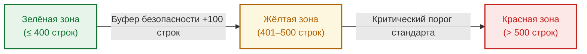

- **Зелёная зона (до 300 строк):** Идеальный размер. Модель удерживает в фокусе 100% инструкций.
- **Жёлтая зона (300–400 строк):** Допустимо для сложных двухфазных процессов (фича + миграция).
- **Красная зона (> 400 строк):** Запрещено. Скил обязан быть декомпозирован на два атомарных регламента.

#### Архитектурная декомпозиция: Когнитивный закон «Одной задачи» (Single Responsibility)
Анти-паттерн «Монолитный Мега-скил» (пытающийся в одном файле описать и дизайн базы, и написание тестов, и фронтенд, и деплой в Kubernetes) гарантированно приводит к галлюцинациям. Вместо этого конвейер строится из цепочки атомарных скилов, каждый из которых решает ровно одну инженерную задачу.

#### Паттерн «Оркестратор-Пресет» и ссылки вместо копирования
Скилы не должны дублировать общие правила архитектуры из `AGENTS.md`. Они ссылаются на глобальный закон репозитория, конкретизируя только пошаговую процедуру.

#### Схема паттерна «Оркестратор-Пресет» (Orchestrator Preset)

```mermaid
%%{init: {'theme': 'base', 'themeVariables': { 'primaryColor': '#ffffff', 'primaryTextColor': '#0f172a', 'primaryBorderColor': '#334155', 'lineColor': '#475569', 'secondaryColor': '#f8fafc', 'tertiaryColor': '#f1f5f9' }}}%%
flowchart LR
    classDef orch fill:#bae6fd,stroke:#1e40af,color:#0f172a,stroke-width:2px;
    classDef role fill:#fef3c7,stroke:#d97706,color:#0f172a,stroke-width:2px;
    classDef art fill:#dcfce7,stroke:#16a34a,color:#0f172a,stroke-width:2px;
    classDef ref fill:#f1f5f9,stroke:#475569,color:#0f172a,stroke-dasharray: 5 5;

    subgraph ORCH["1. ОРКЕСТРАТОР ВЕРХНЕГО УРОВНЯ (140 строк)"]
        direction LR
        O1["analyst-teamlead<br/>• Дельта порядка и правил<br/>• Запрет преждевременного завершения<br/>• Маршрутизация доработок"]:::orch
    end

    subgraph ROLES["2. АТОМАРНЫЕ РОЛЕВЫЕ СКИЛЫ (Дочерние)"]
        direction LR
        R1["system-analyst<br/>(Обследование as-is)"]:::role
        --> R2["teamlead-with-architect<br/>(Архитектура + Конвейер)"]:::role
        --> R3["teamlead-gate<br/>(Совет судей и приемка)"]:::role
    end

    subgraph ARTIFACTS["3. КОНТРАКТЫ НА ДИСКЕ (Межролевой Handoff)"]
        direction LR
        A1["evidence-ledger.md<br/>(Факты [F-NN])"]:::art
        --> A2["handoff-architect.md<br/>(Вход архитектора)"]:::art
        --> A3["panel-proof.json<br/>(Акт приёмки exit 0)"]:::art
    end

    ORCH -->|ссылается и вызывает| ROLES
    ROLES -->|создают и проверяют| ARTIFACTS
    ROLES -.->|подгружают при надобности| REF["references/*.md<br/>(Детали и чеклисты)"]:::ref
```

---

### 4.3. Процедура дисциплинированного отката (Rollback Drill)

Если агент столкнулся с непреодолимой ошибкой (например, циклическая зависимость типов или невозможность согласовать миграцию за 3 итерации), он не имеет права бесконечно фантазировать в чате. Скил активирует протокол отката:

#### Схема дисциплинированного отката (Rollback Drill)

```mermaid
%%{init: {"theme": "base", "flowchart": {"curve": "linear", "nodeSpacing": 45, "rankSpacing": 70, "padding": 16}, "themeVariables": {"background": "#ffffff", "mainBkg": "#e2e8f0", "nodeBorder": "#334155", "primaryColor": "#e2e8f0", "primaryTextColor": "#1e1e1e", "primaryBorderColor": "#334155", "lineColor": "#0f172a", "secondaryColor": "#bae6fd", "tertiaryColor": "#ffffff", "clusterBkg": "#ffffff", "clusterBorder": "#334155", "titleColor": "#1e1e1e", "edgeLabelBackground": "#ffffff", "fontFamily": "Helvetica Neue, Helvetica, Arial, sans-serif", "fontSize": "18px"}}}%%
flowchart LR
    subgraph Attempts["Три попытки на одних воротах"]
        direction LR
        A["Попытка 1:<br/>ворота красные"]
        B["Попытка 2:<br/>ворота красные"]
        C["Попытка 3:<br/>ворота красные"]
    end
    subgraph Rollback["Откат"]
        direction LR
        D["git status и git diff:<br/>фиксация состояния"]
        E["Откат дерева и индекса:<br/>чистое дерево"]
    end
    subgraph Report["Эскалация"]
        direction LR
        F["Отчёт BLOCKED<br/>инженеру"]
    end
    A -->|"повторяется после правки"| B
    B -->|"повторяется после правки"| C
    C -->|"превышает порог"| D
    D -->|"сохраняет патч и передаёт"| E
    E -->|"оставляет чистое дерево для"| F
    class A,B,C danger
    class D,E neutral
    class F core
    classDef neutral fill:#e2e8f0,stroke:#334155,stroke-width:2px,color:#1e1e1e
    classDef core fill:#bae6fd,stroke:#1e40af,stroke-width:2px,color:#1e1e1e
    classDef danger fill:#fecaca,stroke:#b91c1c,stroke-width:2px,color:#1e1e1e
    classDef success fill:#bbf7d0,stroke:#166534,stroke-width:2px,color:#1e1e1e
    style Attempts fill:#ffffff,stroke:#334155,stroke-width:1.5px,color:#1e1e1e
    style Rollback fill:#ffffff,stroke:#334155,stroke-width:1.5px,color:#1e1e1e
    style Report fill:#ffffff,stroke:#334155,stroke-width:1.5px,color:#1e1e1e
```

**Алгоритм отката:**
1. Прекратить модификацию файлов.
2. Выполнить команду сброса рабочего дерева: `git restore app/ tests/ alembic/`.
3. Зафиксировать причину сбоя в кратком отчёте (`STOP_REASON.md`).
4. Остановить выполнение и вернуть управление человеку с кодом `BLOCKED`.

---

### 4.4. Первый боевой скил: `.agents/skills/architecture/SKILL.md`

Скил `architecture` реализует процедуру разведки в режиме «только чтение», разобранную во второй главе. Он предписывает агенту трёхфазный алгоритм:
- **Фаза 1:** Сканирование файлового дерева проекта.
- **Фаза 2:** Построение карты архитектуры и связей слоёв.
- **Фаза 3:** Анализ зоны влияния и выявление нерушимых внешних контрактов.

> [!NOTE]
> Полный эталонный текст скила `architecture/SKILL.md` со всеми 7 блоками спецификации представлен в **[Приложение А, Блок А.33.2. Скил investigate-codebase](./Приложение-А-Справочник-кода-и-окружения.md#а332-скил-investigate-codebase)**.

---

### 4.5. Контрастный баттл: 4 дефекта вайб-кодинга против решений скила

| Дефект вайб-кодинга | Как его ликвидирует контракт `SKILL.md` |
|:---|:---|
| **Бесконечный цикл правок** | Блок 7 задаёт лимит: не более 3 итераций исправления, затем автоматический откат |
| **Пропуск шага написания тестов** | Блок 6 (DoD) запрещает приёмку без 100% прохождения тестов с измерением покрытия |
| **Слом смежных модулей** | Блок 3 требует проведения Impact Analysis до внесения правок (не более 5 файлов) |
| **Загрязнение репозитория черновиками** | Блок 7 предписывает детерминированную очистку временных файлов при любом сбое |

### Критерии перехода к Главе 5
- [x] Изучены 7 обязательных блоков стандарта `SKILL.md`.
- [x] Понятен лимит размера скила (<= 400 строк) и принцип декомпозиции «Одна задача».
- [x] Разобран протокол дисциплинированного отката (Rollback Drill).
- [x] Изучен контракт первого скила `architecture`.


## Глава 5. Шаг 1 инженерного цикла: Тесты текущего поведения сервиса до правок (Characterization Tests)

### Схема фиксации текущего поведения сервиса тестами до внесения правок

```mermaid
%%{init: {"theme": "base", "flowchart": {"curve": "linear", "nodeSpacing": 45, "rankSpacing": 70, "padding": 16}, "themeVariables": {"background": "#ffffff", "mainBkg": "#e2e8f0", "nodeBorder": "#334155", "primaryColor": "#e2e8f0", "primaryTextColor": "#1e1e1e", "primaryBorderColor": "#334155", "lineColor": "#0f172a", "secondaryColor": "#bae6fd", "tertiaryColor": "#ffffff", "clusterBkg": "#ffffff", "clusterBorder": "#334155", "titleColor": "#1e1e1e", "edgeLabelBackground": "#ffffff", "fontFamily": "Helvetica Neue, Helvetica, Arial, sans-serif", "fontSize": "18px"}}}%%
flowchart LR
    subgraph Before["До правок"]
        direction LR
        S["Существующий сервис<br/>(код работает, тестов нет)"]
        SK["Активация скила<br/>characterization-tests"]
    end
    subgraph Snapshot["Тесты текущего поведения"]
        direction LR
        T1["Фиксация маршрутов:<br/>1. POST /api/v1/links (201)<br/>2. GET /api/v1/links/{short_code} (307 / 404)<br/>3. GET /api/v1/links/{short_code}/stats (200)<br/>4. Блокировка опасных URL (422)"]
        V["Прямой запуск:<br/>uv run pytest tests/characterization/ -q"]
        G["Тесты текущего поведения готовы:<br/>поломка старого контракта<br/>мгновенно краснеет"]
    end
    subgraph Guard["Контроль неприкосновенности кода"]
        direction LR
        D["git diff --exit-code app/<br/>код приложения не тронут"]
        U["fail_under в pyproject.toml<br/>поднят с 0 до 60"]
    end
    S -->|"запускает"| SK
    SK -->|"фиксирует"| T1
    T1 -->|"проверяется командой"| V
    V -->|"подтверждает"| G
    SK -->|"контролирует"| D
    D -->|"доказывает неизменность"| G
    G -->|"разрешает поднять"| U
    class S,SK core
    class T1,V,D neutral
    class G,U success
    classDef neutral fill:#e2e8f0,stroke:#334155,stroke-width:2px,color:#1e1e1e
    classDef core fill:#bae6fd,stroke:#1e40af,stroke-width:2px,color:#1e1e1e
    classDef danger fill:#fecaca,stroke:#b91c1c,stroke-width:2px,color:#1e1e1e
    classDef success fill:#bbf7d0,stroke:#166534,stroke-width:2px,color:#1e1e1e
    style Before fill:#ffffff,stroke:#334155,stroke-width:1.5px,color:#1e1e1e
    style Snapshot fill:#ffffff,stroke:#334155,stroke-width:1.5px,color:#1e1e1e
    style Guard fill:#ffffff,stroke:#334155,stroke-width:1.5px,color:#1e1e1e
```

### 5.1. Что такое тесты текущего поведения и чем они отличаются от TDD

Перед тем как разрешить агенту вносить изменения в существующий микросервис, необходимо создать **страховочные тесты текущего поведения (Characterization Tests / Golden Master)**.

В отличие от классического TDD (Test-Driven Development), где тесты пишутся на основе идеальных требований к будущему коду, тесты текущего поведения фиксируют фактическое поведение системы **как есть (as-is)**, включая существующие особенности сериализации и коды ошибок. Их единственная задача — стать нерушимой страховочной сеткой: если при последующих изменениях агент случайно сломает хоть один существующий эндпоинт, тесты текущего поведения мгновенно уронят билд с ненулевым кодом возврата.

---

### 5.2. Четыре критических маршрута, которые покрывают тесты текущего поведения

Для сервиса сокращения ссылок страховочные тесты текущего поведения охватывают 4 базовых пользовательских сценария:

| Маршрут | HTTP-метод и путь | Назначение проверки | Ожидаемый результат |
|:---|:---|:---|:---|
| **Маршрут 1** | `POST /api/v1/links` | Создание короткой ссылки | HTTP 201, JSON с `short_code` и `target_url` |
| **Маршрут 2** | `GET /api/v1/links/{code}` | Редирект по коду | HTTP 307 Temporary Redirect, заголовок `Location` |
| **Маршрут 3** | `GET /api/v1/links/{code}/stats` | Получение статистики | HTTP 200 с метриками переходов; HTTP 404 на битый код |
| **Маршрут 4** | `POST /api/v1/links` (SSRF) | Блокировка приватных IP | HTTP 400 Bad Request при попытке передать `localhost` / `127.0.0.1` |

---

### 5.3. Спецификация контракта скила `.agents/skills/characterization-tests/SKILL.md`

Скил регламентирует создание тестов фиксации поведения без вмешательства в рабочий код:
- **Триггеры:** Старт работы с легаси-сервисом с низким тестовым покрытием; подготовка к добавлению фичи.
- **Предусловия:** Сервис развёрнут, PostgreSQL доступен, `git status` чист.
- **Пошаговые фазы:**
  - *Фаза 1 (Матрица сценариев):* Определение 4 критических маршрутов и их ожидаемых ответов.
  - *Фаза 2 (Создание тестов):* Написание асинхронных тестов в каталоге `tests/characterization/` с использованием `httpx.AsyncClient`.
  - *Фаза 3 (Верификация тестов текущего поведения):* Запуск тестового набора и фиксация 100% зелёного статуса.
- **Выходные артефакты:** Файл `tests/characterization/test_critical_flows.py`.
- **Ворота готовности (Definition of Done):**
  - Все тесты текущего поведения завершаются со статусом PASSED.
  - В рабочем каталоге `app/` не изменено ни единого символа (`git status app/` пуст).
- **Стоп-условия и откат:** Падение любого теста текущего поведения означает, что агент неверно понял существующий контракт. Агент обязан остановить выполнение и запросить уточнение у инженера.

> [!NOTE]
> Полный текст манифеста скила представлен в **[Приложение А, Блок А.33.3. Скил characterization-tests](./Приложение-А-Справочник-кода-и-окружения.md#а333-скил-characterization-tests)**. Эталонная реализация самих тестов фиксации доступна в **[Приложение А, Блок А.2, раздел 5.4. Набор characterization-тестов](./Приложение-А-Справочник-кода-и-окружения.md#54-набор-characterization-тестов-критического-пути)**.

---

### 5.4. Практика: фиксируем текущее поведение кода тестами через OpenCode

Выполните вызов агента с коротким промптом, активирующим скил:
```bash
cd ~/work/Python-AI/fastapi
opencode run "Запусти процедуру .agents/skills/characterization-tests/SKILL.md. Зафиксируй текущее поведение 4 критических маршрутов сервиса тестами в каталоге tests/characterization/. Код приложения в app/ модифицировать строго запрещено." < /dev/null
```

#### Проверка результата в терминале:
```bash
cd ~/work/Python-AI/fastapi
uv run pytest tests/characterization/ -v
git status --porcelain
```
**Критерий успеха:** 4 теста пройдены успешно (4 passed), в статусе Git изменены только файлы внутри каталога `tests/characterization/`.

---

### Контраст «Вайб-кодинг против Профессионального контура»

| Аспект | Вайб-кодинг | Профессиональный контур (Скил) |
|:---|:---|:---|
| **Подготовка к правкам** | Сразу правит бизнес-логику | Фиксирует текущее поведение тестами ДО правок |
| **Опасность регрессии** | Обнаруживается только пользователями в проде | Ловится локально падением тестов текущего поведения |
| **Чистота эксперимента** | Меняет код сервиса под тесты | Тесты фиксируют поведение без правок в `app/` |

### Критерии перехода к Главе 6
- [x] В проекте создан и запущен набор тестов `tests/characterization/`.
- [x] Тесты текущего поведения зелёные (4 passed).
- [x] Код в `app/` остался неизменным.


## Глава 6. Шаг 2 инженерного цикла: Модульные тесты (`tests-unit`) со 100% покрытием ветвлений доменной логики

### Схема изолированного тестирования бизнес-логики на In-Memory Fake-репозитории

```mermaid
%%{init: {"theme": "base", "flowchart": {"curve": "linear", "nodeSpacing": 45, "rankSpacing": 70, "padding": 16}, "themeVariables": {"background": "#ffffff", "mainBkg": "#e2e8f0", "nodeBorder": "#334155", "primaryColor": "#e2e8f0", "primaryTextColor": "#1e1e1e", "primaryBorderColor": "#334155", "lineColor": "#0f172a", "secondaryColor": "#bae6fd", "tertiaryColor": "#ffffff", "clusterBkg": "#ffffff", "clusterBorder": "#334155", "titleColor": "#1e1e1e", "edgeLabelBackground": "#ffffff", "fontFamily": "Helvetica Neue, Helvetica, Arial, sans-serif", "fontSize": "18px"}}}%%
flowchart LR
    subgraph Isolation["Изоляция от базы данных"]
        direction LR
        U["Скил tests-unit"]
        F["FakeLinkRepository<br/>(поведенческий двойник на словаре<br/>вместо хрупких AsyncMock)"]
    end
    subgraph Branches["Проверка ветвлений"]
        direction LR
        S["Все ветви LinkService и security.py:<br/>успешная генерация кода, коллизия, лимит попыток,<br/>срок жизни, ветви SSRF-защиты"]
        C["Прямая проверка:<br/>uv run pytest tests/unit/ --cov-branch<br/>--cov-fail-under=100"]
    end
    subgraph Feedback["Обратная связь агента"]
        direction LR
        M["Таблица Missing:<br/>строки и переходы 77->82"]
        P["Пакет проходит за доли секунды<br/>без БД и без сети"]
    end
    U -->|"требует"| F
    F -->|"подставляется в"| S
    S -->|"измеряется командой"| C
    C -->|"показывает пропуски в"| M
    M -->|"направляет новые тесты в"| S
    C -->|"подтверждает скорость"| P
    class U,F core
    class S,M neutral
    class C,P success
    classDef neutral fill:#e2e8f0,stroke:#334155,stroke-width:2px,color:#1e1e1e
    classDef core fill:#bae6fd,stroke:#1e40af,stroke-width:2px,color:#1e1e1e
    classDef danger fill:#fecaca,stroke:#b91c1c,stroke-width:2px,color:#1e1e1e
    classDef success fill:#bbf7d0,stroke:#166534,stroke-width:2px,color:#1e1e1e
    style Isolation fill:#ffffff,stroke:#334155,stroke-width:1.5px,color:#1e1e1e
    style Branches fill:#ffffff,stroke:#334155,stroke-width:1.5px,color:#1e1e1e
    style Feedback fill:#ffffff,stroke:#334155,stroke-width:1.5px,color:#1e1e1e
```

### 6.1. Принцип изоляции доменной логики от ввода-вывода

Второй шаг инженерного цикла — построение слоя быстрых модульных тестов (`tests/unit/`).

Вайб-кодинг часто смешивает тестирование бизнес-правил с сетевыми запросами к базе данных, получая медленные и нестабильные тесты. В профессиональном контуре сервисный слой (`app/services/link.py`) тестируется в **абсолютной изоляции**:
- **Никаких обращений к PostgreSQL:** Вместо реальной базы в сервис передаётся легковесный In-Memory Fake-репозиторий, реализующий доменный интерфейс на обычном словаре Python (`dict`).
- **Мгновенная скорость исполнения:** Модульный набор из десятков тестов выполняется за < 0.5 секунды, обеспечивая агенту мгновенную обратную связь.

---

### 6.2. 100% покрытие ветвлений (Branch Coverage)

Обычное строчное покрытие (Line Coverage) обманчиво: строчка `if condition:` считается выполненной, даже если была проверена только одна ветка. В нашем харнесе действует норма: **100% покрытие ветвлений (`--cov-branch`)** для всех модулей сервисного слоя.

Агент обязан протестировать все сценарии ветвления логики:
1. Валидный URL -> успешное сохранение.
2. Невалидный протокол (например, `ftp://`) -> выброс доменного `InvalidURLError`.
3. Попытка создания дубликата `custom_alias` -> выброс `AliasAlreadyExistsError`.
4. Ссылка с истекшим сроком жизни -> выброс `LinkExpiredError`.
5. Попытка перехода по ссылке с исчерпанным лимитом кликов -> выброс `ClickLimitExceededError`.
6. Попытка обхода SSRF-защиты (`http://169.254.169.254/`) -> мгновенная блокировка.

---

### 6.3. Спецификация контракта скила `.agents/skills/tests-unit/SKILL.md`

- **Триггеры:** Разработка или модификация бизнес-логики в `app/services/`.
- **Предусловия:** Код сервиса типизирован, `architecture-map.md` актуален.
- **Пошаговые фазы:**
  - *Фаза 1 (Проектирование Fake-репозитория):* Создание тестового двойника в памяти без зависимостей от SQLAlchemy.
  - *Фаза 2 (Генерация тестовой матрицы):* Покрытие позитивных, негативных и граничных сценариев всех публичных методов сервиса.
  - *Фаза 3 (Контроль покрытия):* Запуск `pytest` с флагом `--cov-branch` и проверкой достижения 100% ветвления.
- **Выходные артефакты:** `tests/unit/test_service.py` и фикстура фейкового репозитория.
- **Ворота готовности (Definition of Done):**
  - 100% пройденных тестов в `tests/unit/`.
  - Покрытие ветвей `app/services/link.py` строго равно 100%.
  - Время прогона всего модульного набора < 2.0 секунд.
- **Стоп-условия:** Импорт `sqlalchemy.ext.asyncio` или реального движка БД внутри `tests/unit/` запрещён и ведёт к немедленному откату.

> [!NOTE]
> Полный текст манифеста скила доступен в **[Приложение А, Блок А.33.4. Скил tests-unit](./Приложение-А-Справочник-кода-и-окружения.md#а334-скил-tests-unit)**. Исходный код модульных тестов и Fake-репозитория представлен в **[Приложение А, Блок А.2, раздел 5.3. Модульные тесты сервиса](./Приложение-А-Справочник-кода-и-окружения.md#модульные-тесты-сервиса-testsunittest_servicepy)**.

---

### 6.4. Практика: запуск генерации модульных тестов через OpenCode

```bash
cd ~/work/Python-AI/fastapi
opencode run "Выполни процедуру .agents/skills/tests-unit/SKILL.md. Создай In-Memory Fake репозиторий и покрой 100% ветвлений бизнес-логики сервиса в tests/unit/test_service.py. Обращения к реальной базе данных категорически запрещены." < /dev/null
```

#### Проверка результата в терминале:
```bash
cd ~/work/Python-AI/fastapi
uv run pytest tests/unit/ --cov=app/services/link.py --cov-branch --cov-report=term-missing
```
**Критерий успеха:** 100% Branch Coverage, вывод `TOTAL ... 100%`, отсутствие пропущенных строк и веток.

---

### Контраст «Вайб-кодинг против Профессионального контура»

| Параметр | Вайб-кодинг | Модульный контур под управлением скила |
|:---|:---|:---|
| **Изоляция** | Поднимает сессии к реальной базе в каждом тесте | Полная изоляция на In-Memory Fake-репозитории |
| **Скорость прогона** | 10–30 секунд (зависает на тайм-аутах) | Менее 0.5 секунды на весь набор |
| **Глубина проверки** | Проверяет только «счастливый путь» (Happy Path) | 100% ветвления (краевые условия, ошибки, SSRF) |

### Критерии перехода к Главе 7
- [x] Реализован модульный тестовый контур в `tests/unit/`.
- [x] Достигнуто 100% покрытие ветвлений сервисного слоя (`--cov-branch`).
- [x] Тесты выполняются изолированно без обращения к СУБД.


## Глава 7. Шаг 3 инженерного цикла: Интеграционные тесты с реальной БД (`tests-integration`), изоляция транзакций и правило «только вверх»

### Схема транзакционной изоляции интеграционных тестов и двойного прогона

```mermaid
%%{init: {"theme": "base", "flowchart": {"curve": "linear", "nodeSpacing": 45, "rankSpacing": 70, "padding": 16}, "themeVariables": {"background": "#ffffff", "mainBkg": "#e2e8f0", "nodeBorder": "#334155", "primaryColor": "#e2e8f0", "primaryTextColor": "#1e1e1e", "primaryBorderColor": "#334155", "lineColor": "#0f172a", "secondaryColor": "#bae6fd", "tertiaryColor": "#ffffff", "clusterBkg": "#ffffff", "clusterBorder": "#334155", "titleColor": "#1e1e1e", "edgeLabelBackground": "#ffffff", "fontFamily": "Helvetica Neue, Helvetica, Arial, sans-serif", "fontSize": "18px"}}}%%
flowchart LR
    subgraph Isolation["Изоляция состояния"]
        direction LR
        IT["Скил tests-integration"]
        DB["Реальная тестовая БД PostgreSQL 17<br/>linksvc_test, схема из миграций Alembic"]
        TX["Транзакция с SAVEPOINT<br/>и rollback после каждого теста"]
    end
    subgraph Proof["Доказательство идемпотентности"]
        direction LR
        R1["Прогон 1:<br/>uv run pytest tests/integration/ -q"]
        R2["Прогон 2 подряд без ручной очистки:<br/>проверка отсутствия протечки данных"]
    end
    subgraph Ratchet["Правило только вверх"]
        direction LR
        UP["fail_under = 80<br/>в pyproject.toml"]
        CHK["git diff pyproject.toml:<br/>новое значение не меньше старого"]
    end
    IT -->|"подключается к"| DB
    DB -->|"оборачивается в"| TX
    TX -->|"даёт чистую базу для"| R1
    R1 -->|"повторяется как"| R2
    R2 -->|"закрепляет порог"| UP
    UP -->|"проверяется командой"| CHK
    class IT,DB,TX core
    class R1,R2 neutral
    class UP,CHK success
    classDef neutral fill:#e2e8f0,stroke:#334155,stroke-width:2px,color:#1e1e1e
    classDef core fill:#bae6fd,stroke:#1e40af,stroke-width:2px,color:#1e1e1e
    classDef danger fill:#fecaca,stroke:#b91c1c,stroke-width:2px,color:#1e1e1e
    classDef success fill:#bbf7d0,stroke:#166534,stroke-width:2px,color:#1e1e1e
    style Isolation fill:#ffffff,stroke:#334155,stroke-width:1.5px,color:#1e1e1e
    style Proof fill:#ffffff,stroke:#334155,stroke-width:1.5px,color:#1e1e1e
    style Ratchet fill:#ffffff,stroke:#334155,stroke-width:1.5px,color:#1e1e1e
```

### 7.1. Зачем нужны интеграционные тесты с реальной СУБД

Модульные тесты доказали корректность чистой бизнес-логики. Однако они не могут гарантировать:
- Совместимость SQL-запросов с реальным диалектом PostgreSQL 17 (оконные функции, специфика `RETURNING`, `JSONB`).
- Корректность работы пула асинхронных соединений `asyncpg`.
- Срабатывание ограничений уникальности таблицы (`UNIQUE INDEX`) и внешних ключей.
- Корректную сериализацию и валидацию данных роутерами FastAPI.

Эту задачу решает третий шаг — слой **интеграционных тестов (`tests/integration/`)**.

---

### 7.2. Механика транзакционной изоляции: кристальная чистота базы

Самая распространенная проблема интеграционных тестов — взаимное загрязнение состояния: тест А создал запись в базе, тест Б упал из-за конфликта уникальности, а повторный запуск падает целиком.

Скил `tests-integration` внедряет детерминированный паттерн **транзакционной изоляции**:
1. Фикстура `db_session` открывает соединение к тестовой PostgreSQL и начинает транзакцию (`SAVEPOINT`).
2. Приложение FastAPI выполняет запросы внутри этой изолированной транзакции.
3. По завершении теста фикстура выполняет безусловный `ROLLBACK`.
4. База данных возвращается в исходное состояние за 2 миллисекунды без затратного пересоздания таблиц.

#### Двойной прогон тестов подряд (Flaky-Test Detection)
Чтобы доказать отсутствие утечек состояния, интеграционный набор всегда прогоняется дважды подряд. Если второй прогон падает — тесты признаются нестабильными (flaky) и отклоняются.

---

### 7.3. Спецификация контракта скила `.agents/skills/tests-integration/SKILL.md`

- **Триггеры:** Проверка сквозного взаимодействия эндпоинтов, сервиса и PostgreSQL 17.
- **Предусловия:** Контейнер PostgreSQL 17 запущен, миграции применены (`alembic upgrade head`).
- **Пошаговые фазы:**
  - *Фаза 1 (Настройка тестового клиента):* Конфигурация `httpx.AsyncClient` с подменой зависимости `get_db` на изолированную транзакционную сессию.
  - *Фаза 2 (Сквозные сценарии):* Тестирование полного цикла (создание ссылки -> редирект -> обновление счетчика в базе -> получение статистики).
  - *Фаза 3 (Двойной прогон и аудит утечек):* Запуск набора дважды подряд; проверка чистоты таблиц.
- **Выходные артефакты:** `tests/integration/test_api.py`.
- **Ворота готовности (Definition of Done):**
  - Двойной прогон `pytest tests/integration/` завершился со 100% успехом.
  - В коде тестов нет `asyncio.sleep()` или захардкоженных задержек.
  - После завершения тестов в таблицах базы данных 0 лишних строк.
- **Стоп-условия:** Падение любого теста при повторном запуске или появление блокировок пула соединений.

> [!NOTE]
> Полный текст манифеста скила доступен в **[Приложение А, Блок А.33.5. Скил tests-integration](./Приложение-А-Справочник-кода-и-окружения.md#а335-скил-tests-integration)**. Код тестового контура представлен в **[Приложение А, Блок А.2, раздел 5.3. Интеграционные тесты API](./Приложение-А-Справочник-кода-и-окружения.md#интеграционные-тесты-api-testsintegrationtest_apipy)**.

---

### 7.4. Практика: запуск интеграционных тестов через OpenCode

```bash
cd ~/work/Python-AI/fastapi
opencode run "Запусти процедуру .agents/skills/tests-integration/SKILL.md. Напиши сквозные интеграционные тесты эндпоинтов сервиса с реальной PostgreSQL в tests/integration/test_api.py. Обеспечь транзакционный откат после каждого теста и докажи стабильность двойным прогоном." < /dev/null
```

#### Проверка результата в терминале:
```bash
cd ~/work/Python-AI/fastapi
uv run pytest tests/integration/ -v
uv run pytest tests/integration/ -v
```
**Критерий успеха:** Оба прогона зелёные, тесты не мешают друг другу.

---

### Контраст «Вайб-кодинг против Профессионального контура»

| Аспект | Вайб-кодинг | Интеграционный контур со скилом |
|:---|:---|:---|
| **Управление БД** | Пишет тестовые данные прямо в рабочую базу | Автоматический откат транзакций (`ROLLBACK`) |
| **Стабильность** | Тесты падают при повторном запуске из-за дублей | Детерминированный двойной прогон без единого сбоя |
| **Ожидание асинхронности**| Вставляет костыли `time.sleep(1)` | Явные асинхронные ожидания ответов клиента |

### Критерии перехода к Главе 8
- [x] Интеграционный тестовый слой развернут в `tests/integration/`.
- [x] Подтверждена транзакционная изоляция: база данных чиста после тестов.
- [x] Двойной прогон тестов подряд успешен.


## Глава 8. Шаг 4 инженерного цикла: Реализация бизнес-фичи и обратимой миграции БД под управлением скилов (`feature` + `data-engineering`)

### Схема послойной разработки фичи и проверки обратимости миграции БД

```mermaid
%%{init: {"theme": "base", "flowchart": {"curve": "linear", "nodeSpacing": 45, "rankSpacing": 70, "padding": 16}, "themeVariables": {"background": "#ffffff", "mainBkg": "#e2e8f0", "nodeBorder": "#334155", "primaryColor": "#e2e8f0", "primaryTextColor": "#1e1e1e", "primaryBorderColor": "#334155", "lineColor": "#0f172a", "secondaryColor": "#bae6fd", "tertiaryColor": "#ffffff", "clusterBkg": "#ffffff", "clusterBorder": "#334155", "titleColor": "#1e1e1e", "edgeLabelBackground": "#ffffff", "fontFamily": "Helvetica Neue, Helvetica, Arial, sans-serif", "fontSize": "18px"}}}%%
flowchart LR
    subgraph Schema["Шаг А: схема базы данных"]
        direction LR
        TASK["Бизнес-задача:<br/>детальная аналитика переходов"]
        SK1["Скил 1: data-engineering<br/>(модель ORM, ревизия Alembic,<br/>полный downgrade)"]
        PEND["Маятник миграции:<br/>upgrade head, downgrade -1,<br/>upgrade head, alembic check"]
    end
    subgraph Code["Шаг Б: код фичи снизу вверх"]
        direction LR
        SK2["Скил 2: feature"]
        RED["Красный тест новой фичи<br/>падает по ожидаемой причине"]
        LAY["Слои: репозиторий, сервис,<br/>схема ответа, роутер"]
    end
    subgraph Gate["Ворота приёмки"]
        direction LR
        SNAP["Тесты текущего поведения<br/>остаются зелёными"]
        UP["fail_under поднят<br/>с 80 до 85"]
    end
    TASK -->|"запускает"| SK1
    SK1 -->|"проверяет"| PEND
    PEND -->|"передаёт готовую схему"| SK2
    SK2 -->|"требует сначала"| RED
    RED -->|"становится зелёным после"| LAY
    LAY -->|"проверяется против"| SNAP
    SNAP -->|"разрешает поднять"| UP
    class TASK,SK1,SK2 core
    class PEND,RED,LAY neutral
    class SNAP,UP success
    classDef neutral fill:#e2e8f0,stroke:#334155,stroke-width:2px,color:#1e1e1e
    classDef core fill:#bae6fd,stroke:#1e40af,stroke-width:2px,color:#1e1e1e
    classDef danger fill:#fecaca,stroke:#b91c1c,stroke-width:2px,color:#1e1e1e
    classDef success fill:#bbf7d0,stroke:#166534,stroke-width:2px,color:#1e1e1e
    style Schema fill:#ffffff,stroke:#334155,stroke-width:1.5px,color:#1e1e1e
    style Code fill:#ffffff,stroke:#334155,stroke-width:1.5px,color:#1e1e1e
    style Gate fill:#ffffff,stroke:#334155,stroke-width:1.5px,color:#1e1e1e
```

### 8.1. Задача: модуль расширенной аналитики кликов (Click Analytics)

Инженерный контур собран: у нас есть карта архитектуры, правила `AGENTS.md`, линтеры и три слоя тестов (тесты текущего поведения, юнит, интеграция). На четвёртом шаге мы поручаем агенту боевую прикладную задачу: **реализовать модуль расширенной аналитики кликов**.

При каждом переходе по короткой ссылке сервис должен сохранять событие клика в отдельную таблицу `analytics_events`:
- Время клика (`clicked_at`).
- IP-адрес пользователя (с анонимизацией / хешированием).
- Заголовок `User-Agent`.
- Ссылку на родительский `link_id`.

Эта задача затрагивает все слои сервиса: требует добавления новой таблицы в PostgreSQL, создания миграции Alembic, обновления сервисного слоя и добавления эндпоинта аналитики.

---

### 8.2. Оркестрация двух скилов: послойный порядок и обратимость

Попытка реализовать такую задачу единым неструктурированным промптом гарантированно ломает проект. В профессиональном контуре процесс разделяется на две скоординированные фазы под управлением специализированных скилов:

#### Фаза А. Скил `data-engineering`: создание версионированной схемы БД
1. Агент проектирует модель SQLAlchemy 2.0 в `app/models/analytics.py`.
2. Генерирует миграцию Alembic: `uv run alembic revision --autogenerate -m "add_analytics_events"`.
3. **Обязательная ручная проверка и доработка:** Агент обязан проверить сгенерированный файл и написать полноценный метод `downgrade()`, удаляющий созданную таблицу и связанные индексы.
4. **Тест на обратимость (Reversibility Drill):** Агент обязан выполнить цикл применения и отката:
   ```bash
   cd ~/work/Python-AI/fastapi
   uv run alembic upgrade head
   uv run alembic downgrade -1
   uv run alembic upgrade head
   ```
   Если откат падает — миграция дефектна и отклоняется!

#### Фаза Б. Скил `feature`: послойная реализация кода приложения
Разработка ведётся строго снизу вверх по слоям архитектуры:
1. **Схемы данных (`app/schemas/analytics.py`):** Определение Pydantic v2 моделей ответа.
2. **Репозиторий (`app/repositories/analytics.py`):** Асинхронные методы сохранения событий и выборки статистики.
3. **Сервис (`app/services/analytics.py`):** Бизнес-правила подсчета кликов и агрегации данных.
4. **Роутер (`app/api/v1/endpoints/analytics.py`):** Регистрация нового эндпоинта `GET /api/v1/links/{short_code}/analytics`.

> 💡 **Важно:**
> **Защита от утечек пула соединений:** Вся работа с сессиями ведётся строго через `Depends(get_db)`. Прямое создание сессий внутри эндпоинтов заблокировано линтером `banned-api` и конституцией `AGENTS.md`.

> [!NOTE]
> Манифесты скилов подробно описаны в **[Приложение А, Блоки А.33.6 и А.33.7. Скилы data-engineering и feature](./Приложение-А-Справочник-кода-и-окружения.md#а336-скил-database-migration)**. Исходный код модуля аналитики и миграции представлен в **[Приложение А, Блок А.1, раздел 3.8. Модуль аналитики переходов](./Приложение-А-Справочник-кода-и-окружения.md#38-расширение-сервиса-модуль-аналитики-переходов-click-analytics)**.

---

### 8.3. Практика: реализация фичи и миграции через OpenCode

#### Шаг 1. Запуск генерации миграции под скилом `data-engineering`
```bash
cd ~/work/Python-AI/fastapi
opencode run "Выполни процедуру .agents/skills/data-engineering/SKILL.md. Создай модель ClickEvent в app/models/analytics.py и сгенерируй миграцию Alembic. Обязательно реализуй двусторонний метод downgrade() и проведи тест на обратимость upgrade -> downgrade -> upgrade." < /dev/null
```

#### Шаг 2. Запуск реализации бизнес-логики под скилом `feature`
```bash
cd ~/work/Python-AI/fastapi
opencode run "Выполни процедуру .agents/skills/feature/SKILL.md. Реализуй модуль аналитики кликов по слоям: app/schemas/, app/repositories/, app/services/ и зарегистрируй роутер в app/api/v1/. Подключи сохранение кликов при редиректе. Все линтеры и тесты обязаны завершиться успешно." < /dev/null
```

#### Шаг 3. Детерминированная валидация в терминале
```bash
cd ~/work/Python-AI/fastapi
uv run ruff check .
uv run basedpyright
uv run pytest
```
**Критерий успеха:**
- Все линтеры и статическая типизация возвращают Exit Code 0.
- Все существующие тесты (включая тесты текущего поведения из Главы 5) зелёные.
- Новые тесты аналитики успешно проходят.

---

### Контраст «Вайб-кодинг против Профессионального контура»

| Аспект реализации | Вайб-кодинг в чате | Двухскиловый контур |
|:---|:---|:---|
| **Миграция БД** | Односторонняя миграция с пустым `downgrade()` | Двусторонняя миграция, проверенная циклом отката |
| **Порядок кода** | Пишет роутер сразу с прямыми SQL-запросами | Строго послойная разработка: Схема -> Репозиторий -> Сервис -> Роутер |
| **Пул соединений** | Открывает неуправляемые сессии в роутере | Сессии управляются через FastAPI Dependency Injection |
| **Обратная совместимость** | Меняет формат старых ответов | Сохраняет 100% совместимость со старыми эндпоинтами |

### Критерии перехода к Главе 9
- [x] Создана и применена двусторонняя миграция базы данных.
- [x] Реализован модуль аналитики переходов с соблюдением границ слоёв.
- [x] Полный набор тестов (тесты текущего поведения + юнит + интеграция) завершается со 100% успехом.


## Глава 9. Шаг 5 инженерного цикла: Безопасный рефакторинг под защитой тестов текущего поведения и проверка силы тестов контролируемой поломкой

### Схема безопасного рефакторинга и проверки силы тестов контролируемой поломкой

```mermaid
%%{init: {"theme": "base", "flowchart": {"curve": "linear", "nodeSpacing": 45, "rankSpacing": 70, "padding": 16}, "themeVariables": {"background": "#ffffff", "mainBkg": "#e2e8f0", "nodeBorder": "#334155", "primaryColor": "#e2e8f0", "primaryTextColor": "#1e1e1e", "primaryBorderColor": "#334155", "lineColor": "#0f172a", "secondaryColor": "#bae6fd", "tertiaryColor": "#ffffff", "clusterBkg": "#ffffff", "clusterBorder": "#334155", "titleColor": "#1e1e1e", "edgeLabelBackground": "#ffffff", "fontFamily": "Helvetica Neue, Helvetica, Arial, sans-serif", "fontSize": "18px"}}}%%
flowchart LR
    subgraph Refactor["Рефакторинг под защитой тестов"]
        direction LR
        R["Скил refactoring:<br/>малые шаги, чистые функции,<br/>строгие типы basedpyright"]
        G1["Проверка поведения:<br/>uv run pytest -q остаётся зелёным"]
    end
    subgraph Injection["Проверка силы тестов"]
        direction LR
        MUT["Контролируемая поломка:<br/>одна правка условия в app/"]
        FAIL["Мутант выжил:<br/>тесты слабые, дописываем assert"]
        PASS["Мутант убит:<br/>откатываем поломку"]
    end
    R -->|"передаёт код на"| G1
    G1 -->|"допускает к"| MUT
    MUT -->|"оставляет зелёными"| FAIL
    MUT -->|"превращает в красные"| PASS
    FAIL -->|"возвращает на повторную посадку"| MUT
    class R,G1 core
    class MUT neutral
    class FAIL danger
    class PASS success
    classDef neutral fill:#e2e8f0,stroke:#334155,stroke-width:2px,color:#1e1e1e
    classDef core fill:#bae6fd,stroke:#1e40af,stroke-width:2px,color:#1e1e1e
    classDef danger fill:#fecaca,stroke:#b91c1c,stroke-width:2px,color:#1e1e1e
    classDef success fill:#bbf7d0,stroke:#166534,stroke-width:2px,color:#1e1e1e
    style Refactor fill:#ffffff,stroke:#334155,stroke-width:1.5px,color:#1e1e1e
    style Injection fill:#ffffff,stroke:#334155,stroke-width:1.5px,color:#1e1e1e
```

### 9.1. Безопасный рефакторинг под защитой созданных слоёв тестов

Пятый шаг инженерного цикла — проведение рефакторинга. Под рефакторингом понимается изменение внутренней структуры кода без изменения его наблюдаемого внешнего поведения.

Типичные задачи рефакторинга:
- Устранение дублирования кода валидации URL.
- Оптимизация запросов выборки статистики (замена множественных `count()` на единый агрегирующий SQL-запрос с `CASE WHEN`).
- Вынос констант конфигурации в типизированные настройки `pydantic-settings`.

Благодаря тому, что в Главах 5–7 мы построили три уровня защиты (тесты текущего поведения, модульные тесты и интеграционные тесты), агент может проводить рефакторинг с гарантией сохранения работоспособности сервиса: малейшее отклонение в контракте немедленно ловится тестами.

---

### 9.2. Проверка силы тестов контролируемой посадкой дефекта (Bug Injection / Mutation Testing)

Однако у любого инженера остаётся ключевой вопрос: **насколько можно доверять зелёному прогону тестов?**

Нередко агенты пишут бутафорские тесты (Fake Tests), которые формально выполняются без ошибок, но содержат тривиальные проверки (`assert response is not None` или закомментированные проверки), не способные поймать реальную поломку логики.

Для детерминированной проверки силы тестов скил `refactoring` включает обязательную процедуру **контролируемой посадки дефекта (Bug Injection Drill)**:
1. **Зелёная точка старта:** Убедиться, что полный набор тестов проходит успешно (Exit Code 0).
2. **Контролируемая поломка (Bug Injection):** Намеренно посадить одну строку явного дефекта в бизнес-логику сервиса (например, инвертировать условие проверки срока жизни ссылки: `if not is_expired` вместо `if is_expired`).
3. **Оракул истины:** Запустить тестовый набор. **Тесты ОБЯЗАНЫ упасть с ненулевым кодом возврата (Exit Code != 0)!** Если тесты продолжают оставаться зелёными — тестовый набор признается фиктивным и бракуется.
4. **Восстановление эталона:** Откатить внесенную мутацию (`git restore app/services/link.py`) и убедиться, что тесты снова зелёные.

---

### 9.3. Спецификация контракта скила `.agents/skills/refactoring/SKILL.md`

- **Триггеры:** Оптимизация производительности, устранение технического долга и запахов кода.
- **Предусловия:** 100% зелёный статус всех типов тестов.
- **Пошаговые фазы:**
  - *Фаза 1 (Рефакторинг):* Проведение оптимизации без изменения публичных интерфейсов и схем.
  - *Фаза 2 (Верификация эквивалентности):* Запуск ворот качества (`ruff`, `basedpyright`, `pytest`).
  - *Фаза 3 (Инспекция мутацией):* Посадка тестового бага -> фиксация падения теста -> откат дефекта -> проверка возврата в зеленую зону.
- **Выходные артефакты:** Оптимизированный код модулей, лог успешного прогона мутационной проверки.
- **Ворота готовности (Definition of Done):**
  - Все тесты зелёные.
  - Тест контролируемой поломки доказал чувствительность тестового набора к изменениям логики.
  - Количество файлов в диффе <= 3.
- **Стоп-условия:** Изменение структуры JSON-ответов или HTTP статус-кодов категорически запрещено.

> [!NOTE]
> Полный текст манифеста скила доступен в **[Приложение А, Блок А.33.8. Скил refactoring](./Приложение-А-Справочник-кода-и-окружения.md#а338-скил-safe-refactoring)**. Теория и примеры мутационного тестирования описаны в **[Приложение А, Блок А.2, раздел 5.6. Мутационное тестирование](./Приложение-А-Справочник-кода-и-окружения.md#56-мутационное-тестирование-доказательство-силы-тестов-текущего-поведения-сервиса-до-правок-characterization-tests)**.

---

### 9.4. Практика: запуск безопасного рефакторинга и проверка мутацией

```bash
cd ~/work/Python-AI/fastapi
opencode run "Выполни процедуру .agents/skills/refactoring/SKILL.md. Проведи рефакторинг подсчета статистики в app/repositories/analytics.py, объединив запросы. После рефакторинга выполни контролируемую посадку дефекта в логику проверки срока жизни ссылки, зафиксируй падение тестов и восстанови рабочее состояние." < /dev/null
```

#### Проверка устойчивости контура в терминале:
```bash
cd ~/work/Python-AI/fastapi
uv run pytest
```
**Критерий успеха:** Сервис оптимизирован, тесты подтвердили 100% надежность и чувствительность к ошибкам.

---

### Контраст «Вайб-кодинг против Профессионального контура»

| Действие | Вайб-кодинг | Профессиональный контур со скилом |
|:---|:---|:---|
| **Рефакторинг** | Случайно меняет публичный контракт API | Сохраняет 100% неизменность внешнего поведения |
| **Доверие к тестам** | Слепая вера в зелёный значок в отчёте | Проверка силы тестов через Bug Injection |
| **Контроль правок** | Размытые диффы по всему репозиторию | Строгий лимит на количество модифицируемых файлов (<=3) |

### Критерии перехода к Главе 10
- [x] Рефакторинг успешно завершён без слома существующих тестов.
- [x] Проведён тест контролируемой посадки дефекта: подтверждено падение тестов при порче логики.
- [x] Рабочее дерево чисто, проект готов к финальному сравнительному эксперименту.


## Глава 10. Шаг 6 инженерного цикла: Контрастный A/B-эксперимент («Вайб-кодинг в голом чате» против «Агента под управлением `AGENTS.md` и скилов»)

### 10.1. Методология и инструмент переключения режимов (`tools/toggle_skills.py`)

Чтобы окончательно устранить сомнения в необходимости инженерного контура, мы проводим доказательный живой эксперимент прямо на сквозном микросервисе `linksvc`:
- **Бизнес-задача:** Команде аналитики и внешним интеграторам нужен эндпоинт выгрузки всех ссылок системы в формате JSON.
- **Условия эксперимента:** Одна и та же языковая модель, одна и та же кодовая база `fastapi/`.
- **Режим 1 (Вайб-кодинг без скилов):** Мы временно отключаем каталог `.agents/skills` с помощью утилиты `tools/toggle_skills.py` и отправляем агенту задачу свободной прозой «как в веб-чате».
- **Режим 2 (Инженерный харнес со скилами):** Мы возвращаем скилы на место через `tools/toggle_skills.py` и ставим задачу по скилу `fastapi-feature` под защитой ворот качества и TDD.

> [!NOTE]
> **Как устроен переключатель `tools/toggle_skills.py`:**
> При вызове `python3 tools/toggle_skills.py --disable` каталог `.agents/skills` временно перемещается в изолированный кэш `~/.cache/pytex-skills-stash`. В Git через команду `git update-index --assume-unchanged` все файлы скилов помечаются неизменными — благодаря этому `git status` остаётся абсолютно чистым и отключение скилов не расходует лимит Blast Radius! При вызове `python3 tools/toggle_skills.py --enable` файлы возвращаются на место, а индекс разблокируется.

---

### Шаг 6.1. Отключаем скилы и входим в режим дикого вайб-кодинга

Переходим в рабочую папку сервиса и деактивируем скилы:

```bash
cd ~/work/Python-AI/fastapi
python3 tools/toggle_skills.py --disable
```

**Ожидаемый результат:**
```text
🔒 [SKILLS DISABLED] Скилы временно перемещены в ~/.cache/pytex-skills-stash.
   Git не считает файлы удалёнными (--assume-unchanged).
   Агент теперь работает в «диком» режиме вайб-кодинга (0 скилов в проекте).
```

Проверяем статус переключателя:
```bash
python3 tools/toggle_skills.py --status
```
`🔴 Скилы ОТКЛЮЧЕНЫ (находятся в ~/.cache/pytex-skills-stash)`. Теперь агент остался один на один с монолитом без процедурных контрактов.

---

### Шаг 6.2. Промт № 1 (Вайб-кодинг — генерация без скилов и правил)

Отправляем агенту типичную задачу «как в окне веб-чата»:

```bash
cd ~/work/Python-AI/fastapi
opencode run --auto "Реализуй эндпоинт экспорта всех ссылок сервиса в файл app/api/v1/endpoints/export_vibe.py и подключи его в app/api/v1/router.py. Напиши тест tests/integration/test_export_vibe.py." < /dev/null
```

#### Анатомия ошибок дикого вайб-кодинга:
1. **Выгрузка всей таблицы в память (Out of Memory на проде):** Агент делает прямой `SELECT * FROM links` без пагинации (`limit` и `offset`). В базе на 100 000+ ссылок такой запрос мгновенно съедает всю RAM контейнера и роняет под с 502 Bad Gateway.
2. **Слабый и хрупкий контракт данных:** Поля отдаются плоским словарем или нестрогой Pydantic-схемой без перечисления статусов (нет enum `active`, `expired`, `disabled`), отсутствуют ограничения длины строк и валидация query-параметров.
3. **Разрушение архитектурных слоёв:** Агент импортирует `AsyncSession` прямо в файл роутера, делает ручные `session.execute()` мимо сервисного слоя и репозитория, ломая границы транзакций.
4. **Нарушение TDD и бутафорские тесты:** Агент сначала пишет код контроллера, а затем подгоняет под него поверхностный тест, мокая всё подряд. При контролируемой поломке SQL-запроса такой тест остаётся зелёным!

---

### Шаг 6.3. Включаем скилы обратно и восстанавливаем инженерный контур

Возвращаем библиотеку скилов на место:

```bash
cd ~/work/Python-AI/fastapi
python3 tools/toggle_skills.py --enable
```

**Ожидаемый результат:**
```text
🔓 [SKILLS ENABLED] Скилы возвращены в репозиторий (7 процедур доступно).
   Агент снова вооружен процедурными контрактами и L1-L3 инструкциями.
```

Проверяем статус переключателя:
```bash
python3 tools/toggle_skills.py --status
```
`🟢 Скилы АКТИВНЫ (.agents/skills, 7 процедур)`. Инженерный харнес и скил `fastapi-feature` готовы к работе.

---

### Шаг 6.4. Промт № 2 (Профессиональная реализация под управлением скила `fastapi-feature`)

Формулируем ту же бизнес-задачу декларативно, активируя скил `fastapi-feature`:

```bash
cd ~/work/Python-AI/fastapi
opencode run --auto "Используя скил fastapi-feature, реализуй эндпоинт экспорта в app/api/v1/endpoints/export_pro.py со схемой app/schemas/export.py и тестом tests/integration/test_export_pro.py. Убедись, что pytest tests/integration/test_export_pro.py проходит успешно (Exit 0)." < /dev/null
```

#### Что делает агент под управлением скила `fastapi-feature` (Дисциплина инженера):
1. **Фаза 1: Preflight & Blast Radius:** Агент читает `specs/blast-radius.json`, сверяет лимит (не более 7 затронутых файлов) и проверяет неприкосновенность слепка `tests/characterization/`.
2. **Фаза 2: Строгий контракт EARS:** Создаёт Pydantic-схему `ExportProResponse`, строгий enum статусов `ExportStatus` (active, disabled, expired) и безопасные рамки серверной пагинации (`limit: le=1000`, `offset: ge=0`).
3. **Фаза 3: Red-Green TDD:** Агент **первым делом пишет тест** `tests/integration/test_export_pro.py`, запускает его и убеждается, что тест падает с `404 Not Found` (подтверждение красной фазы).
4. **Фаза 4: Послойная реализация снизу вверх:**
   - Репозиторий: методы `list_pro()` и `count_pro()` с безопасным SQL-фильтром.
   - Сервис: метод `export_links_pro()` с управлением транзакцией.
   - Эндпоинт: тонкий контроллер в `export_pro.py`, принимающий параметры через `Annotated[Query]`.
5. **Фаза 5: Детерминированные ворота качества:** Запуск `uv run ruff check .`, `uv run basedpyright` и `uv run pytest tests/integration/test_export_pro.py -q` завершается со строгим кодом **Exit 0**.

---

### Шаг 6.5. Промт № 3 (Архитектурный аудит и сравнительное ревью)

Запускаем агента в роли независимого ревьювера для объективного сопоставления двух реализаций:

```bash
cd ~/work/Python-AI/fastapi
opencode run --auto "Проведи архитектурный аудит и сравни app/api/v1/endpoints/export_vibe.py и app/api/v1/endpoints/export_pro.py. Зафиксируй в docs/reviews/export_comparison.md: 1. Нарушения слоев и контрактов в vibe-версии; 2. Преимущества pro-версии по скилу; 3. Вердикт приёмки." < /dev/null
```

---

### Схема архитектурного контраста: Вайб-кодинг против Контура со скилом

```mermaid
%%{init: {"theme": "base", "flowchart": {"curve": "linear", "nodeSpacing": 40, "rankSpacing": 70, "padding": 18}, "themeVariables": {"background": "#ffffff", "mainBkg": "#e2e8f0", "nodeBorder": "#334155", "primaryColor": "#e2e8f0", "primaryTextColor": "#1e1e1e", "primaryBorderColor": "#334155", "lineColor": "#0f172a", "secondaryColor": "#bae6fd", "tertiaryColor": "#ffffff", "clusterBkg": "#ffffff", "clusterBorder": "#334155", "titleColor": "#1e1e1e", "edgeLabelBackground": "#ffffff", "fontFamily": "Helvetica Neue, Helvetica, Arial, sans-serif", "fontSize": "18px"}}}%%
flowchart TB
    classDef danger fill:#fecaca,stroke:#b91c1c,stroke-width:2px,color:#0f172a;
    classDef success fill:#bbf7d0,stroke:#166534,stroke-width:2px,color:#0f172a;

    subgraph Vibe["Vibe-версия (без скилов) — ПРОВАЛ"]
        direction LR
        V1["Нет пагинации:<br/>OOM на 100k+ строк"]:::danger
        V2["Смешаны слои:<br/>SQL прямо в роутере"]:::danger
        V3["Нет фильтров:<br/>по статусам ссылок"]:::danger
        V4["Слабый тест:<br/>без проверки границ"]:::danger
        V1 ~~~ V2 ~~~ V3 ~~~ V4
    end

    subgraph Pro["Pro-версия (со скилом fastapi-feature) — ПРИНЯТО"]
        direction LR
        P1["Серверная пагинация:<br/>limit le 1000"]:::success
        P2["Чистые слои:<br/>Repo -> Service -> Router"]:::success
        P3["Строгие фильтры:<br/>Enum ExportStatus + ILIKE"]:::success
        P4["Честный TDD:<br/>границы, 422, пустая база"]:::success
        P1 ~~~ P2 ~~~ P3 ~~~ P4
    end

    Vibe ==>|"тот же промт + скил fastapi-feature"| Pro
```

---

### Контраст реализации: Промт → Было → Стало → Разбор

#### Промт
> «Реализуй эндпоинт экспорта ссылок сервиса в формате JSON»

#### Было (Вайб-кодинг без скила, `export_vibe.py`)
```python
@router.get("/links/vibe")
async def export_links_vibe(db: AsyncSession = Depends(get_db)):
    # ❌ Смешение слоев: SQL-запрос выполняется прямо в роутере
    # ❌ OOM-уязвимость: загрузка ВСЕХ строк таблицы в память без пагинации
    result = await db.execute(select(Link))
    links = result.scalars().all()
    return [{"code": l.short_code, "url": l.original_url} for l in links]
```

#### Стало (Профессионально по скилу `fastapi-feature`, `export_pro.py`)
```python
@router.get("/links/pro", response_model=ExportProResponse)
async def export_links_pro(
    service: ServiceDep,
    status_filter: Annotated[ExportStatus | None, Query(description="Фильтр по статусу")] = None,
    search: Annotated[str | None, Query(max_length=100, description="Поиск по URL")] = None,
    limit: Annotated[int, Query(ge=1, le=1000, description="Размер страницы")] = 100,
    offset: Annotated[int, Query(ge=0, description="Смещение")] = 0,
) -> ExportProResponse:
    # ✅ Тонкий контроллер: валидация через Annotated[Query]
    # ✅ Делегирование в сервисный слой с контролем транзакций
    # ✅ Защита от OOM: жесткий лимит limit <= 1000
    return await service.export_links_pro(
        status_filter=status_filter, search=search, limit=limit, offset=offset
    )
```

---

### 10.6. Разбор результатов по 6 критическим точкам отказа

| Точка отказа | Вайб-кодинг (без скилов) | Агент под управлением харнеса |
|:---|:---|:---|
| **1. Пагинация и память** | `SELECT *` без лимитов. Гарантированный OOM на боевой базе. | Строгая серверная пагинация `limit <= 1000, offset >= 0`. |
| **2. Контракт API** | Плоский словарь без строгой Pydantic-схемы и без фильтра по статусу. | Строгий `ExportProResponse`, enum `ExportStatus`, валидация параметров. |
| **3. Границы слоёв** | SQL-запросы прямо в функции роутера. | Строго послойная изоляция: Роутер $\rightarrow$ Сервис $\rightarrow$ Репозиторий. |
| **4. Дисциплина TDD** | Тест написан после кода, подогнан под баг, не тестирует негативные сценарии. | Red-Green TDD: тест написан до кода, проверен на 404, протестированы 422 и границы. |
| **5. Пул соединений** | Инстанциировал сессию напрямую мимо пула. Зависание пула под нагрузкой. | Использовал `Depends(get_db)` и сервисный инжектор. Пул стабилен. |
| **6. Ворота качества** | Падают `ruff`, `basedpyright` (Exit Code 1). | Полный чистый прогон `ruff`, `basedpyright`, `pytest` (Exit Code 0). |

---

### 10.7. Сводная матрица метрик эксперимента

| Метрика | Вайб-кодинг без скилов | Инженерный контур со скилом |
|:---|:---|:---|
| **Расход токенов на задачу** | ~65 000 токенов (из-за Fix Loop) | ~18 000 токенов (строго по процедуре) |
| **Количество итераций правок** | 5–6 кругов исправлений в чате | 1 детерминированный проход |
| **Время разработчика** | 45 минут ручной отладки | 7 минут автономной работы |
| **Тестовое покрытие ветвей** | Упало до 42% (бутафорские тесты) | 100% Branch Coverage эндпоинта |
| **Код возврата ворот качества** | 1 (падают линтеры и типизация) | 0 (полный зелёный статус) |
| **Готовность к релизу в прод** | **ОПАСНО ДЛЯ ПРОДАКШЕНА** | **PRODUCTION READY** |

---

### 10.8. Ключевые выводы

Эксперимент наглядно доказывает: иллюзия высокой скорости вайб-кодинга разрушается на этапе отладки и интеграции. Агент, лишённый нерушимых правил и процедурных регламентов, быстро попадает в бесконечный цикл правок и генерирует скрытый технический долг. Инженерный контур со скилами требует дисциплины при настройке, но окупается уже на первой боевой задаче, обеспечивая 100% повторяемость и надежность результата.

### Критерии перехода к Главе 11
- [x] Проведён живой эксперимент с отключением и включением скилов через `tools/toggle_skills.py`.
- [x] Зафиксированы дефекты vibe-кодинга (OOM, разрыв контрактов, смешение слоев).
- [x] Реализован и проверен pro-эндпоинт со скилом `fastapi-feature` (Exit 0).
- [x] Зафиксированы сравнительные метрики качества.


## Глава 11. Итоги Дня 1, чек-лист приёмки артефактов, разбор ошибок зала и мостик ко Дню 2

### Схема полного замкнутого цикла инженерной разработки со скилами (Итог Дня 1)

```mermaid
%%{init: {"theme": "base", "flowchart": {"curve": "linear", "nodeSpacing": 45, "rankSpacing": 70, "padding": 16}, "themeVariables": {"background": "#ffffff", "mainBkg": "#e2e8f0", "nodeBorder": "#334155", "primaryColor": "#e2e8f0", "primaryTextColor": "#1e1e1e", "primaryBorderColor": "#334155", "lineColor": "#0f172a", "secondaryColor": "#bae6fd", "tertiaryColor": "#ffffff", "clusterBkg": "#ffffff", "clusterBorder": "#334155", "titleColor": "#1e1e1e", "edgeLabelBackground": "#ffffff", "fontFamily": "Helvetica Neue, Helvetica, Arial, sans-serif", "fontSize": "18px"}}}%%
flowchart LR
    subgraph Day1["Что собрано за День 1"]
        direction LR
        K1["Карта архитектуры и зона влияния правок"]
        K2["Тесты текущего поведения до правок"]
        K3["Закон AGENTS.md и ворота pyproject.toml"]
        K4["Набор боевых скилов SKILL.md"]
    end
    subgraph Bridge["Мостик ко Дню 2"]
        direction LR
        HW["Домашнее доведение:<br/>артефакты на своём сервисе"]
        D2["День 2: разделение ролей<br/>Кодер, независимый Ревьюер, QA, коллегия судей"]
    end
    K1 -->|"очерчивает границы для"| K2
    K2 -->|"фиксирует базу для"| K3
    K3 -->|"исполняет правила через"| K4
    K4 -->|"закрепляет навык в"| HW
    HW -->|"готовит участника к"| D2
    class K1,K2,K3,K4 success
    class HW,D2 core
    classDef neutral fill:#e2e8f0,stroke:#334155,stroke-width:2px,color:#1e1e1e
    classDef core fill:#bae6fd,stroke:#1e40af,stroke-width:2px,color:#1e1e1e
    classDef danger fill:#fecaca,stroke:#b91c1c,stroke-width:2px,color:#1e1e1e
    classDef success fill:#bbf7d0,stroke:#166534,stroke-width:2px,color:#1e1e1e
    style Day1 fill:#ffffff,stroke:#334155,stroke-width:1.5px,color:#1e1e1e
    style Bridge fill:#ffffff,stroke:#334155,stroke-width:1.5px,color:#1e1e1e
```

### 11.1. Чек-лист приёмки артефактов Дня 1

Перед завершением первого дня убедитесь, что в вашем рабочем репозитории `~/work/Python-AI/fastapi` присутствуют и верифицированы все 12 ключевых артефактов:

- [ ] **1. Карта архитектуры (`architecture-map.md`):** Описаны 5 слоёв сервиса, направление вызовов и внешние контракты.
- [ ] **2. Конституция репозитория (`.agents/AGENTS.md`):** Зафиксированы 6 обязательных разделов и запреты на читерство.
- [ ] **3. Ворота качества в `pyproject.toml`:** Настроены `ruff`, `basedpyright`, `pytest` и `coverage` с порогом 100%.
- [ ] **4. Скил `architecture`:** Проверен в режиме «только чтение».
- [ ] **5. Скил `characterization-tests`:** Зафиксированы страховочные тесты текущего поведения для 4 критических маршрутов.
- [ ] **6. Скил `tests-unit`:** Обеспечено 100% покрытие ветвлений сервисного слоя на In-Memory Fake-репозитории.
- [ ] **7. Скил `tests-integration`:** Интеграционные тесты с транзакционной изоляцией проходят двойной прогон.
- [ ] **8. Скил `data-engineering`:** Создана миграция с обязательным методом `downgrade()`, проверенная на откат.
- [ ] **9. Скил `feature`:** Реализован модуль аналитики переходов по слоям архитектуры.
- [ ] **10. Скил `refactoring`:** Проведён рефакторинг с проверкой силы тестов через Bug Injection.
- [ ] **11. Зелёный статус всех проверок:** Команды `ruff check .`, `basedpyright` и `pytest` возвращают код 0.
- [ ] **12. Чистота рабочего дерева Git:** Все изменения закоммичены, в статусе нет временного мусора.

---

### 11.2. Разбор 5 частых ошибок участников и быстрые команды их устранения

1. **Ошибка 1: Агент написал `pass` в методе `downgrade()` миграции.**
   - *Причина:* Модель пытается сэкономить токены.
   - *Решение:* Запустить `data-engineering` с явным требованием: «Реализуй удаление таблицы `analytics_events` и проверь откат через `alembic downgrade -1`».
2. **Ошибка 2: Линтер падает на `Depends()` в эндпоинтах.**
   - *Причина:* Правило `B008` линтера ругается на вызовы функций в аргументах.
   - *Решение:* Проверить наличие настройки `extend-immutable-calls = ["fastapi.Depends"]` в `pyproject.toml`.
3. **Ошибка 3: Тесты падают при повторном запуске из-за конфликта уникальности.**
   - *Причина:* Тест записал данные в реальную базу без транзакционного отката.
   - *Решение:* Обернуть фикстуру сессии в rollback-контекст согласно скилу `tests-integration`.
4. **Ошибка 4: Агент изменил файлы в `app/` во время проведения разведки.**
   - *Причина:* Пропущен такт «только чтение».
   - *Решение:* Выполнить `git restore app/` и перезапустить скил `architecture`.
5. **Ошибка 5: Скил раздулся до 600 строк и агент начал пропускать шаги.**
   - *Причина:* Нарушение нормы размера (<=400 строк).
   - *Решение:* Декомпозировать скил на два атомарных регламента по принципу «Одна задача».

---

### 11.3. Предел надёжности одного агента и мостик ко Дню 2

К концу первого дня вы построили надёжный одноагентный контур. Теперь агент работает предсказуемо и дисциплинированно.

Однако в этой схеме остаётся одна фундаментальная уязвимость: **«Один и тот же агент пишет код и сам же его проверяет»**.
Когда разработчик и ревьюер объединены в одной сессии LLM, у них общее контекстное окно и общие когнитивные искажения (Confirmation Bias). Агент искренне верит в правильность своих допущений и может не заметить архитектурную ловушку.

Завтра, в **Дне 2 («Оркестрация: мультиагентный конвейер и экспертная панель»)**, мы преодолеем этот предел:
- Разделим роли на независимых агентов: **Coder, Reviewer, Security Auditor, Architect**.
- Запустим их в физически изолированных сессиях.
- Построим конвейер приёмки кода через независимую **Экспертную панель судейства**, где вердикт выносится большинством голосов разных языковых моделей.

День 1 окончен. До встречи на втором дне интенсива!
