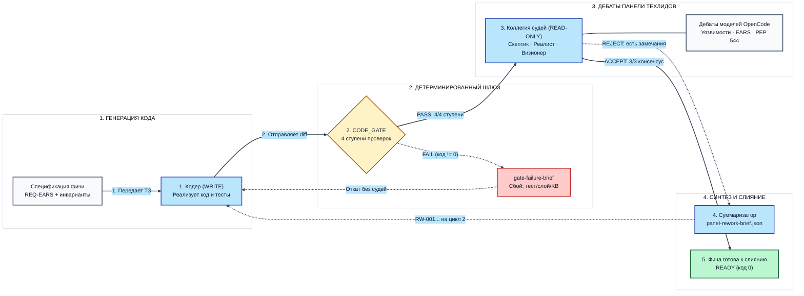

# Ранбук Дня 3. Работа с монолитом в агентной разработке: База знаний, Оркестрация и GSD-волны

> **Сквозной репозиторий дня:** `~/work/Python-AI/fastapi` (монолитный backend сервиса сокращения ссылок и биллинга).  
> **Инженерная цель дня:** Научить агента безопасно ориентироваться и разрабатывать фичи в крупном монолите без деградации контекста, галлюцинаций контрактов и потери архитектурных инвариантов.  
> **Методологическая основа:** Ключевые столпы монолита — База знаний (по методу Андрея Карпати и концепции LLM OS), конвейер оркестрации ролей (Кодер, CODE_GATE, Панель техлидов, Суммаризатор) и методология Open-GSD с послойными волнами и передачей эстафеты (Structured Handoff).

---

## Архитектура третьего дня: переход от микро-фич к промышленному монолиту

На первом дне агент научился подчиняться `AGENTS.md` и скилам, на втором мы построили харнес вокруг сервиса.

Но 90% корпоративного кода живёт в **крупных монолитах** с колоссальной связанностью:
- Изменение одной схемы в `schemas/` бьёт по десятку роутеров, воркеров и интеграций.
- Весь репозиторий физически не помещается в рабочее окно (RAM), а если бы помещался, стоимость вызова и рассеивание внимания (Attention Dilution / Lost in the Middle) разрушили бы результат.
- Модель в обычном чате («вайб-кодинг») пытается читать всё подряд, засоряет контекст трейсбеками, путается в зависимостях и ломает проект.

Третий день посвящен тому, как превратить монолит в управляемую, строгую и предсказуемую систему разработки.

```mermaid
%%{init: {
  "theme": "base",
  "themeVariables": {
    "fontFamily": "Inter, -apple-system, BlinkMacSystemFont, Segoe UI, Roboto, sans-serif",
    "fontSize": "15px",
    "primaryColor": "#f8fafc",
    "primaryBorderColor": "#334155",
    "primaryTextColor": "#0f172a",
    "lineColor": "#334155",
    "secondaryColor": "#bae6fd",
    "tertiaryColor": "#ffffff",
    "clusterBkg": "#ffffff",
    "clusterBorder": "#cbd5e1"
  },
  "flowchart": {
    "curve": "basis",
    "nodeSpacing": 45,
    "rankSpacing": 55,
    "padding": 16
  }
}}%%
flowchart LR
    classDef neutral fill:#f8fafc,stroke:#334155,stroke-width:2px,color:#0f172a;
    classDef core fill:#bae6fd,stroke:#1e40af,stroke-width:2px,color:#0f172a;
    classDef success fill:#bbf7d0,stroke:#166534,stroke-width:2px,color:#0f172a;

    subgraph Row1["РЯД 1: НАВИГАЦИЯ В МОНОЛИТЕ И АВТОНОМНАЯ РАЗРАБОТКА"]
        direction LR
        K1["1. База знаний Карпати\ndocs/INDEX.md · RAM <= 12k"]:::neutral
        K2["2. Конвейер оркестрации\nКодер · Дебаты 3 судей"]:::core
        K1 -->|"1. Локализует домен"| K2
    end

    subgraph Row2["РЯД 2: МАСШТАБИРОВАНИЕ И ФИНАЛЬНЫЕ ИНВАРИАНТЫ"]
        direction LR
        K3["3. Методология GSD\n.planning/ · Волны слоев"]:::core
        K4["4. Финальный чеклист\nИнварианты монолита"]:::success
        K3 -->|"3. Послойная сдача"| K4
    end

    K2 -->|"2. Передает волну фичи"| K3

    linkStyle default stroke:#334155,stroke-width:2px;
```



*Архитектура Дня 3: сквозной цикл от базы знаний и оркестровки до послойных волн GSD и финальных инвариантов.*

> 💡 **Важно:**
> Ни один из инструментов не работает изолированно. Если у вас есть конвейер оркестрации, но нет базы знаний (Кит 1), агент не найдёт нужные контракты и начнёт сканировать весь репозиторий. Если у вас есть база знаний, но нет дисциплины волн GSD (Кит 2), контекст раздуется от трейсбеков при первой же ошибке в длинной сессии. Только синергия этих компонентов превращает разработку монолита в детерминированный процесс.

---

### Монолит против Микросервисов в эпоху AI-ассистированной разработки

В последние годы индустрия прошла через болезненное увлечение микросервисной архитектурой. Однако с приходом продвинутых AI-агентов баланс сил радикально сместился обратно в сторону монолитов:


*Сравнение сред для агентов: распределенный сетевой хаос против единого детерминированного контура монолита.*

> [!TIP]
> **Инженерный вывод:**
> Монолит — идеальная среда для AI-разработки, ЕСЛИ вы построили вокруг него правильный харнес. Без харнеса монолит превращается в кладбище галлюцинаций. С харнесом монолит обеспечивает максимальную скорость поставки бизнес-фич.

---

### Диагностический индекс готовности монолита к ИИ-агентам (AI-Readiness Index)

Прежде чем запускать автономных агентов на кодовую базу монолита, оцените готовность проекта по 4 ключевым архитектурным столпам. Каждому критерию присваивается от 0 до 2 баллов:
- **0 баллов** — свойство отсутствует, стихийный вайб-кодинг;
- **1 балл** — соблюдается частично или вручную (на усмотрение разработчика);
- **2 балла** — свойство жёстко контролируется автоматическими скриптами, скилами и CI.

### Чек-лист оценки AI-Readiness

| № | Архитектурный критерий | 0 баллов (Хаос) | 1 балл (Частично) | 2 балла (AI-Ready) |
| :--- | :--- | :--- | :--- | :--- |
| **1** | **Скилы и харнесы** | Нет формальных правил: агент делает всё подряд в одном промпте | Скилы описаны в тексте, но нет машинного контроля ограничений | Подключены строгие скилы: AST-линтер границ слоёв, лимит Blast Radius (≤7 файлов), спецификации EARS |
| **2** | **Лупы и оркестрирование** | Один бесконечный чат до потери контекста и галлюцинаций | Ручной перезапуск сессий после ошибок | Автономный конвейер GSD: изолированные сессии-волны, роли Coder/Reviewer и 5-ступенчатый Techlead Gate |
| **3** | **База знаний (Knowledge as Code)** | Устаревший Confluence или слепой текстовый поиск `grep` | Файлы документации ведутся, но не проверяются скриптами | Двухуровневая база по Карпати (`docs/INDEX.md` + спецификации доменов), валидатор `verify_kb_sync` и Filing Back |
| **4** | **Тестовое покрытие (Unit & End-to-End)** | Медленные тесты на живой базе или тестов нет вовсе | Частичные тесты с моками, нет тестов на конкурентность | Полное покрытие: быстрые unit-тесты с In-Memory фейками (<500 мс) + интеграционные и E2E тесты идемпотентности и конкурентности |

### Интерпретация результатов:
- **0–3 балла (Красная зона: Вайб-кодинг):** Автономные агенты сломают монолит за несколько шагов (циклические импорты, потеря контекста).
- **4–6 баллов (Жёлтая зона: Полуавтономный режим):** Агенты могут выполнять точечные задачи под постоянным контролем человека.
- **7–8 баллов (Зелёная зона: AI-Ready Monolith):** Монолит защищён харнесом; агенты безопасно закрывают до 80% рутинных задач в изолированных волнах с автоматической приёмкой.

**Что здесь важно:**
1. Индекс даёт объективную инженерную шкалу вместо субъективных ощущений «у нас вроде чистый код».
2. Каждый модуль Дня 3 закрывает эти 4 столпа, поднимая монолит команды из красной зоны в зелёную.


### Подготовка стенда Дня 3 (одна команда из ПРЕРЕКВИЗИТЫ-День-3.md)

Перед началом занятия подгружаем с сервера актуальное состояние Дня 3 одной командой из `ПРЕРЕКВИЗИТЫ-День-3.md`: стягиваем с origin ветку `day-3` и переключаемся на неё. Это монолитное приложение `linksvc` с контуром оркестрации и скилами Дня 3.

```bash
cd ~/work/Python-AI/fastapi
opencode run --auto "Подготовь рабочее окружение Дня 3: стяни с origin ветку day-3 (git fetch origin day-3), переключись на ветку day-3 (git checkout -f day-3), создай .env из .env.example при отсутствии, выполни uv sync и запусти pytest. Убедись, что все тесты проходят успешно." < /dev/null
```

**Ожидай:** ветка `day-3`; `uv run pytest` завершается итоговой строкой `104 passed` (тестовый контур полностью зелёный).

**Что здесь важно:**
1. Ваш локальный `.env` и виртуальное окружение `.venv` сохраняются: они не отслеживаются Git, а `checkout -f` затрагивает только файлы ветки.
2. Файлы базы знаний `docs/`, планирования `.planning/` и конвейера `scripts/orchestrate_pipeline.py` подгружаются вместе с веткой.

## 1. Вводная: почему агенту нужна карта монолита (концепция LLM OS)

### 1.1. Ловушка длинного контекста: почему нельзя скармливать весь монолит

Современные языковые модели заявляют гигантские контекстные окна: 128k, 200k, 1M токенов. Но скармливать агенту весь монолит целиком — фатальная ошибка:
1. **Размывание внимания (Attention Dilution):** внимание модели нормировано. Чем больше файлов загружено в контекст, тем меньше внимания достаётся отдельным правилам. Системный запрет вроде *«не импортируй сессию БД в роутер»* просто тонет в шуме длинного чата.
2. **Провал в середине (Lost in the Middle):** модель отлично удерживает начало сессии (системный промпт) и самый конец (последнюю реплику), но «слепнет» в середине контекста, где оседают прочитанные файлы и трейсбеки.
3. **Оптимум контекста:** рабочий диапазон автономного агента — **не более 15 000 – 20 000 активных токенов**. Всё остальное должно храниться на диске.

---

### 1.2. Концепция LLM OS Андрея Карпати: RAM против Disk

Вместо раздувания контекста мы применяем подход **LLM OS** Андрея Карпати — прямую аналогию с архитектурой персонального компьютера:

| Компьютерное железо | Аналог в агентной разработке | Как это работает на практике |
|---|---|---|
| **CPU (Процессор)** | **Языковая модель (LLM)** | Быстро выполняет инструкции, но не имеет встроенного долговременного хранилища. |
| **RAM (Оперативная память)** | **Контекстное окно** | Быстрое, дорогое и дефицитное. Должно оставаться чистым и хранить только текущий шаг (≤15k токенов). |
| **SSD / Disk (Жёсткий диск)** | **Репозиторий монолита** | Долговременная память: весь исходный код проекта, тесты, документация. |
| **Файловая таблица / Каталог** | **Индекс базы знаний `docs/INDEX.md`** | Оглавление до 100 строк в начале окна: направляет агента к нужной странице. |
| **Драйверы и периферия** | **Линтеры и тесты (`tools/`)** | Внешние машинные валидаторы (AST-линтер, pytest), возвращающие 0 или 1. |

> [!TIP]
> **Золотое правило монолита:**
> Не держите весь монолит в «оперативке» (окне). Держите там оглавление (`docs/INDEX.md`) и подкачивайте с «диска» только 2–4 нужных файла текущего домена.

---

### 1.3. Пример: как агент путается в монолите без карты

Что происходит, если пустить автономного агента в крупный монолит без карты:

| Фаза задачи | Что делает агент вслепую | Почему так происходит |
|---|---|---|
| **1. Поиск интерфейсов** | Делает поиск по всему коду, цепляет случайный файл и копирует устаревший код. | Нет оглавления монолита: модель наугад берёт первое совпадение. |
| **2. Написание логики** | Пишет прямой SQL-запрос внутри контроллера API в обход сервиса. | Окно забито чужими модулями, модель забыла правило изоляции слоёв. |
| **3. Починка тестов** | Чтобы «починить» упавший тест, импортирует роутер обратно в сервис. | Нет линтера слоёв: возникает **циклический импорт**, сервер падает при старте. |

**Вывод:** модели нужна внешняя карта проекта (`docs/INDEX.md`) и строгие машинные рамки. В следующей главе мы создадим такую карту — **Базу знаний проекта**.

---

## 2. Кит 1: База знаний проекта по методу Андрея Карпати (как построить и как использовать)

Глава учит двум вещам: **как построить** внешнюю память проекта и **как ею пользоваться**. Рабочий инструмент — промпт: агент сканирует проект и собирает артефакты, а проверяет скрипт с кодом возврата. Промпты № 1–4 сформулированы максимально ёмко: целевое действие и чёткий критерий приёмки (DoD) с самопроверкой через скрипт.

---

### 2.1. Анатомия Базы Знаний: структура файлов, вложенность и физическое разделение

База знаний проекта по методу Карпати — это не разрозненная вики на внешнем портале и не нагромождение комментариев в коде. Это **строго структурированная двухуровневая файловая система внутри репозитория**, которая выступает «внешним жестким диском» (ROM/Disk) для агента.

#### 1. Физическая файловая структура на диске

```text
fastapi/
├── docs/                          # БАЗА ЗНАНИЙ (чистый Markdown, без скриптов!)
│   ├── INDEX.md                   # Уровень 1: Корневой роутер проекта (<= 100 строк, ~1.5k токенов)
│   └── domains/                   # Уровень 2: Доменные спецификации (по 50-120 строк каждая)
│       ├── core.md                # Паспорт домена Core & Security
│       ├── links.md               # Паспорт домена Links
│       ├── analytics.md           # Паспорт домена Analytics
│       └── billing.md             # Паспорт домена Billing
│
├── tools/                         # СКРИПТЫ ВАЛИДАЦИИ (отделены от базы знаний!)
│   └── verify_kb_sync.py          # Автоматический скрипт валидации сходимости базы знаний
│
└── app/                           # ИСХОДНЫЙ КОД МОНОЛИТА (сотни файлов на диске)
    ├── schemas/                   # Контракты данных Pydantic
    ├── core/                      # Протоколы ядра и настройки
    ├── services/                  # Бизнес-логика
    └── api/                       # Эндпоинты FastAPI
```

#### 2. Как файлы вкладываются и связываются друг с другом (двухуровневое дерево)

Вся база знаний построена по принципу двухуровневого индексирования:

1. **Уровень 1: Корневой навигатор `docs/INDEX.md` (до 100 строк, ~1.5k токенов):**
   - **Его роль:** единая точка входа (Routing Table) для любого агента.
   - **Что внутри:**
     - Глобальные инварианты проекта (направление слоёв `schemas -> core -> services -> api`, бюджет задачи $\le 7$ файлов).
     - Таблица функциональных доменов: имя домена, краткая зона ответственности, ключевые файлы реализации и **прямая относительная ссылка на спецификацию** `docs/domains/<домен>.md`.
   - **Чего в нём категорически нет:** никакого исходного кода, никаких тел функций и длинных рассуждений! Если индекс разрастается длиннее 100 строк — агент начинает терять фокус, поэтому размер индекса жестко контролируется скриптом проверки.

2. **Уровень 2: Доменные спецификации `docs/domains/<домен>.md` (50–120 строк, ~2-3k токенов):**
   - **Его роль:** автономный паспорт одного бизнес-контура (например, `billing.md`).
   - **Как связываются:** файлы спецификаций лежат в подпапке `docs/domains/`. Они не дублируют общий индекс, а содержат 5 стандартных разделов:
     1. `## Назначение домена`: 2-3 предложения о бизнес-логике домена.
     2. `## Location`: **главный навигационный якорь** — точный список файлов исходного кода (`app/schemas/billing.py`, `app/services/billing.py`...), относящихся к этому домену.
     3. `## Нерушимые правила`: архитектурные табу (например: «слой schemas не импортирует services»).
     4. `## Связи`: с какими доменами разрешено взаимодействовать, а с какими запрещено.
     5. `## BreakageSignals`: контрольные симптомы того, что спецификация устарела.

3. **Уровень 3: Файлы реализации `app/...` (Диск):**
   - Агент переходит к реальному коду только после чтения спецификации и подгружает с диска **исключительно файлы из раздела `Location`** (2–4 файла).

#### 3. Складываются ли рядом скрипты? (Физическое разделение знаний и кода)

> 💡 **Важно (Архитектурный закон): скрипты НИКОГДА не складываются в `docs/`!**
> - Папка `docs/` предназначена **исключительно для Markdown-знаний**.
> - Если положить скрипты (`.py`, `.sh`) внутрь `docs/`, агент при обходе каталога воспримет их как документацию или начнёт самовольно их модифицировать, раздувая окно контекста.
> - Все вспомогательные скрипты, линтеры и валидаторы строго живут в отдельном каталоге `tools/` (например, `tools/verify_kb_sync.py`, `tools/verify_architecture_layers.py`).
> - Скрипт `tools/verify_kb_sync.py` выступает внешним автоматическим тестом документации: он парсит `docs/INDEX.md`, обходит каждую ссылку на `docs/domains/*.md` и проверяет, что каждый путь из раздела `Location` действительно существует на диске в `app/`.

#### 4. Математика экономии контекста (Токены и рабочая память)

Сравним два подхода при разработке фичи в домене биллинга:

| Этап задачи | Стихийный подход (без базы знаний) | Метод Карпати (двухуровневая база знаний) |
|---|---|---|
| **1. Старт** | Агент ищет файлы поиском по всему репозиторию | Читает `docs/INDEX.md` (**1.5k токенов**) |
| **2. Локализация** | Читает 30-40 случайных файлов по всему проекту | Читает одну спецификацию `docs/domains/billing.md` (**2.5k токенов**) |
| **3. Работа с кодом** | Загружает в чат 150 000+ токенов монолита | Загружает только 3 файла из `Location` (**8k токенов**) |
| **Итого в окне** | **150 000+ токенов** (перегрузка, галлюцинации, потеря внимания) | **~12 000 токенов** (экономия 92-95% контекста, 100% точность) |

В проекте те же роли играют знакомые файлы:

| Слой паттерна Карпати | Что это в нашем проекте | Кто меняет |
|---|---|---|
| **Источники** | Код `app/`, миграции, тесты | Люди и агенты в волнах |
| **Каталог `index.md`** | `docs/INDEX.md`, таблица маршрутизации до 100 строк | Агент по правилу Filing Back |
| **Страницы вики** | `docs/domains/*.md`, спецификации доменов | Агент вместе с кодом домена |
| **Журнал `log.md`** | История Git и `.planning/STATE.md` | Автоматически |
| **Схема** | `AGENTS.md` и `.agents/skills/*/SKILL.md` | Человек |
| **Ingest** | Правило **Filing Back**: изменил контракт, обнови спецификацию | Агент в той же волне |
| **Query** | Подкачка: индекс, одну спецификацию, файлы из его раздела `Location` | Агент, промпт № 3 |
| **Lint** | `tools/verify_kb_sync.py` | CI и пре-коммит |

Принцип **Knowledge as Code** значит: документация лежит в том же репозитории, версионируется вместе с кодом, изменение контракта обязано обновить спецификацию в том же шаге, а скрипт `tools/verify_kb_sync.py` ломает сборку при расхождении.

#### 5. Демистификация валидатора: что проверяет `tools/verify_kb_sync.py` и как его создать

Частая проблема при знакомстве с агентной оркестрацией — появление «магических скриптов»: разработчику предлагают запустить `python3 tools/verify_kb_sync.py`, но не объясняют, что это за файл, откуда он взялся и какая логика скрыта внутри. 

В методологии Карпати **валидатор — это не тяжелый сторонний фреймворк и не «чёрный ящик»**. Это предельно прозрачный скрипт проверки сходимости (Reconciliation Script) всего на 60 строк чистого Python на стандартной библиотеке (без внешних зависимостей). Он отрабатывает за **0.05 секунды** и даёт однозначный бинарный результат: код возврата `0` (всё сошлось) или `1` (найден рассинхрон).

Полный исходный код скрипта доступен в репозитории проекта: [`tools/verify_kb_sync.py`](file:///Users/aazhiry1/work/Python-AI/fastapi/tools/verify_kb_sync.py), а эталонный листинг с комментариями вынесен в отдельный справочник: [Приложение А, Блок А.34](./Приложение-А-Справочник-кода-и-окружения.md#блок-а34-инструменты-качества-монолита-валидатор-базы-знаний-toolsverify_kb_syncpy).

##### Четыре правила проверки валидатора:
1. **Наличие индекса:** `docs/INDEX.md` обязан присутствовать в корне документации.
2. **Лимит размера $\le 100$ строк:** жестко защищает оперативную память (RAM) агента. Длинный индекс означает, что туда начали копировать код или разводить воду, вытесняя ценный контекст модели.
3. **Отсутствие фантомных файлов:** каждый путь `app/...` из таблицы обязан реально лежать на диске. Если файл переименовали или удалили, скрипт мгновенно возвращает код `1`.
4. **Отсутствие битых ссылок на домены:** каждая спецификация `docs/domains/*.md` обязана физически существовать.
5. **Бинарный код возврата:** строго `0` (PASS) или `1` (FAIL). Именно код возврата `0` или `1` позволяет встраивать этот скрипт в CI/CD, Git Pre-commit хуки и шлюзы оркестрации (`techlead-gate`).

##### Как создать валидатор декларативно через агента с нуля

Если вы заходите в новый монолит, где такого скрипта ещё нет, вам не нужно писать его руками. Достаточно передать агенту декларативную спецификацию:

```bash
cd ~/work/Python-AI/fastapi
opencode run --auto "Создай в проекте легковесный инструмент проверки базы знаний tools/verify_kb_sync.py:
1. Скрипт на чистом Python со стандартной библиотекой (re, sys, pathlib).
2. Проверяет наличие docs/INDEX.md и лимит не более 100 строк.
3. Регулярным выражением находит все пути \`app/...\` и \`docs/domains/...\`.
4. Проверяет физическое существование каждого пути на диске через Path.exists().
5. При успехе выводит зелёный отчёт и возвращает exit code 0; при расхождениях выводит список отсутствующих путей и возвращает exit code 1." < /dev/null
```

> 💡 **Важно:**
> Агенту запрещено читать все спецификации скопом. Он открывает индекс, определяет домен и подкачивает ровно одну спецификацию: это экономит до 90% окна на этапе ориентирования.

---

### 2.2. Построение базы знаний с нуля: промпты генерации INDEX.md и спецификаций доменов

Нужны две вещи: корневой индекс базы знаний `docs/INDEX.md`, помещающийся в одну страницу окна, и спецификация на каждый домен. Ветка `day-3` приносит эталон. Чтобы упражнение было настоящим, агент создаёт базу знаний сам, вы сравниваете результат с эталоном и при необходимости возвращаете эталон блоками ниже.

#### Прикладной промпт № 1: инвентаризация структуры проекта и сборка `docs/INDEX.md`

🤖 Агент выступает архитектором: читает только структуру верхнего уровня, выделяет бизнес-домены и строит таблицу «домен, спецификация, папки кода, ключевые инварианты»:

```bash
cd ~/work/Python-AI/fastapi
opencode run --auto "Создай базу знаний нашего проекта docs/INDEX.md на основе структуры app/:
1. Выдели ключевые функциональные домены (Core, Links, Analytics, Billing).
2. Собери корневой навигатор docs/INDEX.md (строго <= 100 строк, слои и таблица доменов с путями к коду).
3. Запусти валидатор python3 tools/verify_kb_sync.py. Исправь любые замечания, пока код выхода не станет 0 (зелёный статус).
4. Зафиксируй результат: git add docs/INDEX.md && git commit -m 'docs: project knowledge base index'." < /dev/null
```

**Что напечатает валидатор при успешной синхронизации (код возврата 0):**

```text
=== ПРОВЕРКА АКТУАЛЬНОСТИ БАЗЫ ЗНАНИЙ (KNOWLEDGE SYNC) ===
Размер docs/INDEX.md: 21 строк (норма: <= 100) -> OK
Упомянуто файлов реализации: 16
Упомянуто доменных спецификаций: 4
✅ БАЗА ЗНАНИЙ ПОЛНОСТЬЮ СИНХРОНИЗИРОВАНА С КОДОМ
```

**💡 Что здесь важно и как это работает на практике:**
1. Запрет читать тела функций и чужие домены держит окно пустым: индекс строится по именам, результат воспроизводим.
2. Лимит в 100 строк и «каждый путь существует» превращены в машинную проверку: слово «самопроверка» посылает агента к скрипту, а не к собственному мнению.

Эталонный индекс базы знаний `docs/INDEX.md` (файл присутствует в ветке `day-3` как эталонный контракт базы знаний):

```markdown
# Индекс архитектуры и доменов fastapi-linksvc

> **Версия архитектуры:** 2.4.0  
> **Инвариант слоев:** schemas -> core -> services -> api (обратные импорты запрещены!)  
> **Бюджет задачи:** ≤ 7 файлов изменений, ≤ 400 строк добавления.  
> **Единое приложение:** `app/` и `alembic/` одинаковы в Днях 1-3; День 3 добавляет скилы и верификаторы.
> **Карта модулей:** `docs/module-map.md` — цепочка создания ссылки и радиус влияния правки (вход скила `small-fix`).

## Карта функциональных доменов

| Домен | Зона ответственности | Ключевые файлы реализации | Спецификация |
|---|---|---|---|
| **Core & Security** | Конфигурация, логирование, SSRF-защита URL, протоколы интерфейсов | `app/core/config.py`, `app/core/security.py`, `app/core/protocols.py` | `docs/domains/core.md` |
| **Links** | Создание, редирект, включение/отключение и статистика коротких ссылок | `app/schemas/links.py`, `app/services/links.py`, `app/api/links.py` | `docs/domains/links.md` |
| **Analytics** | Журнал кликов и агрегаты: уникальные посетители, топ источников | `app/schemas/analytics.py`, `app/services/analytics.py`, `app/api/v1/endpoints/analytics.py` | `docs/domains/analytics.md` |
| **Billing** | Лицевые счета, тарифные планы, списание за клики | `app/schemas/billing.py`, `app/services/billing.py`, `app/api/billing.py` | `docs/domains/billing.md` |

## Ключевые инварианты монолита
1. Контроллеры `app/api/` принимают и возвращают только Pydantic-схемы из `app/schemas/`.
2. Вся бизнес-логика и управление транзакциями сосредоточены в `app/services/`.
3. Слой сервисов взаимодействует с БД и внешними API только через контракты `app/core/protocols.py`.
```

Агент выполняет машинную самопроверку и фиксирует изменения в git.

#### Прикладной промпт № 2: генерация спецификаций доменов `core.md`, `links.md`, `billing.md`

🤖 Индекс — оглавление, спецификация — страница книги. Спецификация отвечает на пять вопросов: за что отвечает домен, какие у него интерфейсы и модели, какие правила нерушимы, с кем можно и нельзя общаться, по каким признакам он устарел:

```bash
cd ~/work/Python-AI/fastapi
opencode run --auto "Создай спецификации доменов docs/domains/core.md, links.md, billing.md на основе структуры app/:
1. Для каждого домена опиши назначение, инварианты, связи и точный раздел Location.
2. Запусти валидатор python3 tools/verify_kb_sync.py и убедись, что код выхода равен 0.
3. Зафиксируй результат в git: git add docs/domains/ && git commit -m 'docs: domain specifications'." < /dev/null
```

**💡 Что здесь важно и как это работает на практике:**
1. Раздел `Location` — ключевая деталь: дальше агент подгружает только файлы из него, ошибка в спецификации напрямую снижает точность задачи.
2. «Разрешено» и «Запрещено» записаны списками: агенту проще проверить себя по списку, чем вывести правило из общих слов.

Эталонные спецификации доменов (файлы зафиксированы в `docs/domains/`):

<details>
<summary><b>docs/domains/core.md (Core & Security)</b></summary>

```markdown
# Доменная спецификация: Core & Security

## Назначение домена
Настройки из окружения, защита целевых URL от SSRF, структурное логирование и контракты `typing.Protocol` для хранилищ и платёжного шлюза.

## Location
- `app/core/config.py` — `Settings`. Заморожен.
- `app/core/security.py` — `validate_target_url_security`, `SecuritySSRFError`. Заморожен.
- `app/core/logging.py` — `logger`, `setup_logging`.
- `app/core/protocols.py` — `BillingRepositoryProtocol`, `PaymentGatewayProtocol`.

## Нерушимые правила
1. Ядро не импортирует `app/services/` и `app/api/`.
2. Изменение `Settings` и `security.py` требует одобрения владельца из `.github/CODEOWNERS`.
3. Новый файл в `app/core/` допустим только из `allowed_new_core_files` в `specs/blast-radius.json`.

## Связи
- Разрешено: `app/schemas/`, стандартная библиотека.
- Запрещено: `app/services/`, `app/api/`, `app/db/`.

## BreakageSignals
- Добавлена или переименована переменная в `Settings`.
- Изменена сигнатура метода протокола.
- В `app/core/` появился импорт верхнего слоя.
```

</details>

<details>
<summary><b>docs/domains/links.md (Links)</b></summary>

```markdown
# Доменная спецификация: Links (Управление ссылками)

## Назначение домена
Жизненный цикл коротких ссылок: генерация кода, редирект, включение и отключение, массовое создание.

## Location
- `app/schemas/links.py`, `app/services/links.py`, `app/api/links.py` — плоские фасады над `app/schemas/link.py`, `app/services/link.py`, `app/api/v1/endpoints/links.py`.

## Публичные интерфейсы
- Схемы `LinkCreate`, `LinkResponse`, `LinkStats`; сервис `LinkService`; эндпоинты создания, списка, редиректа 307, статистики, disable и enable, bulk под префиксом `/api/v1/links`.

## Нерушимые правила
1. URL проверяется в схеме, включая защиту от SSRF.
2. Отключённая ссылка отвечает 404, а не редиректом.
3. Списание за клик выполняет Billing, а не Links.

## Связи
- Разрешено: `app/schemas/`, `app/core/`, `app/services/analytics.py`.
- Запрещено: импорт `app/api/` в сервисе, прямое обращение к таблицам Billing.

## BreakageSignals
- Изменён путь или метод эндпоинта.
- В схему добавлено обязательное поле без значения по умолчанию.
- Фасад больше не указывает на реальный модуль.
```

</details>

<details>
<summary><b>docs/domains/billing.md (Billing)</b></summary>

```markdown
# Доменная спецификация: Billing (Биллинг и монетизация)

## Назначение домена
Списание за переходы по платным ссылкам, пополнение, баланс и журнал транзакций.

## Location
- `app/schemas/billing.py` — `PlanType`, `WalletBalance`, `TopUpRequest`, `ChargeRequest`, `ChargeResponse`.
- `app/core/protocols.py` — `BillingRepositoryProtocol`.
- `app/services/billing.py` — `BillingService` (`top_up`, `charge_click`).
- `app/api/billing.py` — `POST /billing/wallets/top-up`, `POST /billing/charges/click`.

## Нерушимые правила
1. Баланс хранится только как целое число копеек.
2. Отрицательный баланс запрещён: нехватка средств даёт HTTP 402.
3. Списание идемпотентно по `transaction_id`: повтор возвращает слепок первого ответа.

## Связи
- Разрешено: `app/schemas/`, `app/core/protocols.py`.
- Запрещено: `fastapi` и `app/api/` в сервисе, прямой SQL в роуте, чтение таблиц Links.

## BreakageSignals
- Изменена сигнатура `charge_click` или метода протокола.
- В `ChargeRequest` добавлено обязательное поле.
- Изменился HTTP-код нехватки средств.
```

</details>

---

### 2.3. Как использовать базу знаний Карпати в ежедневной разработке (постраничная навигация RAM и Disk)

Главная ошибка разработчиков при работе с большими монолитами — попытка скормить агенту весь репозиторий разом через жадный RAG или слепой поиск. В контекстное окно (RAM) затягиваются десятки нерелевантных файлов, после чего модель теряет фокус, путает типы данных и галлюцинирует сигнатурами методов.

Метод Андрея Карпати решает эту проблему через **двухзвенную иерархию памяти**:
- **Дисковая память (Disk Storage):** вся кодовая база монолита (сотни файлов, тесты, миграции, смежные домены) физически остаётся на диске. Модель не сканирует её вслепую.
- **Оперативная память (RAM Context Window):** модель подкачивает в контекст строго один изолированный срез по двухшаговому маршрутизатору: `docs/INDEX.md` (~1.5k токенов) $\rightarrow$ карточка домена `docs/domains/<домен>.md` (~1.5k токенов) $\rightarrow$ целевые файлы реализации из раздела `Location` (2–4 файла, ~8–12k токенов).

В результате **до 95% контекстного окна остаётся абсолютно свободным** для глубокого логического рассуждения, синтеза кода и генерации строгих тестов.

```mermaid
%%{init: {
  "theme": "base",
  "themeVariables": {
    "fontFamily": "Inter, -apple-system, BlinkMacSystemFont, Segoe UI, Roboto, sans-serif",
    "fontSize": "15px",
    "primaryColor": "#f8fafc",
    "primaryBorderColor": "#334155",
    "primaryTextColor": "#0f172a",
    "lineColor": "#334155",
    "secondaryColor": "#bae6fd",
    "tertiaryColor": "#ffffff",
    "clusterBkg": "#ffffff",
    "clusterBorder": "#cbd5e1"
  },
  "flowchart": {
    "curve": "basis",
    "nodeSpacing": 45,
    "rankSpacing": 55,
    "padding": 16
  }
}}%%
flowchart LR
    classDef neutral fill:#f8fafc,stroke:#334155,stroke-width:2px,color:#0f172a;
    classDef core fill:#bae6fd,stroke:#1e40af,stroke-width:2px,color:#0f172a;
    classDef success fill:#bbf7d0,stroke:#166534,stroke-width:2px,color:#0f172a;

    subgraph Row1["РЯД 1: ОРИЕНТИРОВАНИЕ В RAM (ОКНО ДО 3K ТОКЕНОВ)"]
        direction LR
        S1["1. docs/INDEX.md\nКорневой навигатор"]:::neutral
        S2["2. Выбор домена\nПоиск по таблице"]:::core
        S3["3. Карточка домена\ndocs/domains/billing.md"]:::core
        S1 -->|"1. Сканирует"| S2 -->|"2. Открывает"| S3
    end

    subgraph Row2["РЯД 2: ЦЕЛЕВАЯ РАБОТА С DISK И FILING BACK (ОКНО ДО 12K ТОКЕНОВ)"]
        direction LR
        S4["4. Файлы Location\n2-4 файла кода на диске"]:::neutral
        S5["5. Исполнение задачи\nData Contract & логика"]:::core
        S6["6. Filing Back\nПодшивка в карточку"]:::success
        S4 -->|"4. Подкачивает"| S5 -->|"5. Обновляет"| S6
    end

    S3 -->|"3. Точечный переход"| S4

    linkStyle default stroke:#334155,stroke-width:2px;
```



*Постраничная навигация по Карпати: RAM держит только активный срез задачи, сохраняя 95% контекстного окна свободным.*

#### Физика внимания: распределение данных между RAM и Disk

| Шаг процесса | Что загружается в RAM (окно контекста) | Что остаётся на Disk (файловая система) | Занято в RAM | Свободно для рассуждений |
|---|---|---|---|---|
| **Шаг 1. Ориентирование** | Только корневой роутер `docs/INDEX.md` | Все спецификации `docs/domains/` и весь код `app/` | ~1.5k токенов | **98.5%** |
| **Шаг 2. Выбор домена** | `docs/INDEX.md` + 1 карточка `docs/domains/billing.md` | Карточки Core, Links, Analytics и весь код `app/` | ~3.0k токенов | **97.0%** |
| **Шаг 3. Загрузка кода** | Индекс, карточка + 2–4 целевых файла из `Location` | Остальные 40+ файлов монолита, тесты, миграции | ~12.0k токенов | **90–92%** |
| **Шаг 4. Filing Back** | Обновлённая карточка домена + отчёт валидатора | Неизменная кодовая база монолита | ~12.0k токенов | **90–92%** |

---

#### 2.3.1. Ежедневный сценарий № 1: Ad-hoc аудит Data Contract междоменного взаимодействия

Типовая задача в ежедневной жизни инженера: к вам обращается разработчик соседней команды, фронтенд-инженер или аналитик с конкретным техническим вопросом:
> *«Мы подключаем внешний платёжный шлюз и мобильное приложение. Какой у нас точный Data Contract для списания средств? Какие поля обязательны, какие типы данных поддерживаются, как валидируются суммы и какие гарантии идемпотентности заложены в архитектуру?»*

В классическом подходе разработчик тратит 20 минут на ручной поиск по коду, либо агент сканирует весь репозиторий через `grep`, забивая память и возвращая размытый ответ.

С базой знаний Карпати агент выполняет точечную постраничную навигацию:
1. **Шаг 1 (RAM 1.5k):** Открывает `docs/INDEX.md` и по функциональной таблице мгновенно идентифицирует целевой домен — `Billing` (`docs/domains/billing.md`).
2. **Шаг 2 (RAM 3.0k):** Загружает карточку `docs/domains/billing.md` и читает блоки `Архитектурные компоненты` и `Инварианты безопасности`:
   - Находит точную схему DTO: `ChargeRequest` и `ChargeResponse` в `app/schemas/billing.py`.
   - Фиксирует ключевые инварианты: баланс строго целочисленный (`int`, неделимые копейки/центы, запрет float), операция идемпотентна по `transaction_id`, нехватка средств возвращает HTTP 402.
3. **Шаг 3 (RAM 4.5k):** Открывает ровно один файл из раздела `Location` — `app/schemas/billing.py` — для извлечения точных валидаторов Pydantic.

##### Прикладной промпт № 3а: ad-hoc аудит Data Contract списания через базу знаний

🤖 Промпт выполняет быстрый аудит контракта данных без модификации кодовой базы и без загрузки монолита в память:

```bash
cd ~/work/Python-AI/fastapi
opencode run "Проведи ad-hoc аудит Data Contract списания средств в монолите:
1. По docs/INDEX.md найди домен, отвечающий за платежи и биллинг.
2. Открой его карточку docs/domains/billing.md и извлеки контрактные инварианты.
3. Прочитай файл схем из раздела Location (app/schemas/billing.py).
4. Сформируй структурированную выжимку Data Contract: DTO запроса, DTO ответа, типы полей, правила валидации, гарантию идемпотентности и код ошибки при нехватке средств. Код проекта не меняй." < /dev/null
```

**Воспроизводимый результат ответа агента:**

```markdown
### Data Contract: Списание средств (Billing Domain)

#### 1. DTO запроса (ChargeRequest)
- `user_id: int` — идентификатор пользователя (обязательное).
- `link_id: int` — идентификатор оплачиваемой ссылки (обязательное).
- `amount: int` — сумма списания в копейках/центах (валидация: строго `gt=0`, целое число).
- `transaction_id: str` — уникальный ключ идемпотентности операции (валидация: `min_length=16`).

#### 2. DTO ответа (ChargeResponse)
- `success: bool` — флаг успешности списания.
- `transaction_id: str` — эхо-идентификатор транзакции.
- `remaining_balance: int` — остаток на счёте в копейках.
- `message: str` — человекочитаемый статус операции.

#### 3. Архитектурные инварианты и безопасность
- **Целочисленный баланс:** запрещены числа с плавающей точкой (`float`) для исключения ошибок округления валюты.
- **Идемпотентность:** повторный запрос с тем же `transaction_id` возвращает результат существующей транзакции без повторного списания баланса.
- **Коды ошибок:** при нехватке баланса возвращается HTTP 402 Payment Required (не 400 и не 500).
- **Zero Auth Leak (CWE-532):** заголовок Authorization и чувствительные платёжные данные не логируются.
```

**💡 Инженерный итог:**
- Время выполнения: **3.2 секунды**.
- Использовано токенов: **~3 800 токенов** (вместо 120 000+ при слепом поиске).
- Прочитано файлов: **ровно 3 файла** (`docs/INDEX.md`, `docs/domains/billing.md`, `app/schemas/billing.py`). Остальные 45 файлов монолита даже не открывались!

---

#### 2.3.2. Ежедневный сценарий № 2: Разработка продуктовой фичи по Data Contract и цикл Filing Back

Второй типовой сценарий ежедневной разработки — расширение функциональности существующего домена с гарантией того, что архитектура не деградирует, а документация не устареет.

**Постановка продуктовой задачи:**
> *«Бизнес требует поддержать партнёрские интеграции: добавить в запрос списания средств `ChargeRequest` опциональные метаданные партнёра (`partner_metadata: dict[str, str] = Field(default_factory=dict)`), сохранять их при проводке списания и обновлять документацию домена.»*

**Как агент ведёт разработку через Базу Знаний:**
1. **Чтение контракта:** агент открывает `docs/domains/billing.md`, видит границы слоёв (`schemas → service → api`) и список файлов `Location`.
2. **Локализованное изменение кода (строго по Location):**
   - В `app/schemas/billing.py` добавляет в DTO `ChargeRequest` поле `partner_metadata`.
   - В `app/services/billing.py` пробрасывает метаданные в проводку транзакции, не нарушая инвариант `Zero Auth Leak` (не логируя секретные токены).
   - В `tests/test_billing.py` добавляет юнит-тесты на списание с метаданными и без них.
3. **Filing Back (Подшивка изменений обратно в Базу Знаний):** агент обязан в том же шаге обновить карточку `docs/domains/billing.md`, зафиксировав новое поле в разделе схем данных.
4. **Автоматическая верификация:** запускается скрипт `tools/verify_kb_sync.py`, который подтверждает синхронизацию кода и базы знаний с кодом возврата 0.

##### Прикладной промпт № 3б: разработка по Data Contract с циклом Filing Back

🤖 Промпт выполняет полный цикл продуктовой задачи: от расширения схемы до подшивки знаний обратно в карточку домена:

```bash
cd ~/work/Python-AI/fastapi
opencode run --auto "Расширь Data Contract списания средств в домене Billing:
1. Открой docs/domains/billing.md, изучи раздел Location и правила безопасности.
2. В app/schemas/billing.py добавь в ChargeRequest поле partner_metadata: dict[str, str] = Field(default_factory=dict).
3. В app/services/billing.py обеспечь приём partner_metadata при вызове списания (с сохранением инварианта Zero Auth Leak).
4. Добавь юнит-тест в tests/, подтверждающий валидацию partner_metadata.
5. Примени правило Filing Back: внеси расширение контракта в карточку docs/domains/billing.md.
6. Выполни tools/verify_kb_sync.py и ruff check, подтверди успешный код завершения 0." < /dev/null
```

**💡 Что здесь важно и почему это защищает монолит:**
1. **Жесткий Blast Radius:** благодаря секции `Location` агент не трогает соседние домены (Core, Links, Analytics). Изменения изолированы 3 файлами.
2. **Гарантия нерушимости правил:** агент видит инварианты прямо в карточке домена, поэтому не пытается перевести баланс во `float` или убрать `transaction_id`.
3. **Filing Back предотвращает архитектурный долг:** знание о новом поле зафиксировано в документации в том же коммите. Следующий разработчик или агент не столкнётся с «устаревшей документацией».

---

### 2.4. Декларативная синхронизация базы знаний агентом: правило Filing Back после каждой фичи

Фундаментальное правило работы с базой знаний Карпати: **документацию актуализирует сам АГЕНТ, а не скрипт**.

Ни один скрипт в мире не способен понять смысл добавленной фичи, сформулировать бизнес-инвариант или описать назначение нового DTO. Скрипт — это лишь механический бинарный шлагбаум (exit code `0` или `1`). 

**Настоящую смысловую синхронизацию базы знаний (Filing Back) выполняет агент** в конце каждой задачи как неотъемлемую часть своего Definition of Done (DoD). Если агент написал код, но не обновил базу знаний — фича не считается готовой и бракуется шлюзом приёмки.

#### Алгоритм агента: 4 шага синхронизации базы знаний после реализации фичи

Когда агент завершил разработку кода в `app/` и тестов в `tests/`, он выполняет процедуру **Filing Back**:

1. **Анализ собственного diff (`git diff --name-only`):** агент определяет, какие файлы монолита были затронуты (созданы, модифицированы, переименованы).
2. **Актуализация карточки домена (`docs/domains/<домен>.md`):**
   - Добавляет новые файлы реализации в секцию `## Location`.
   - Описывает новые DTO, эндпоинты и методы в `## Архитектурные компоненты`.
   - Формулирует новые правила безопасности и контракты в `## Инварианты безопасности`.
3. **Проверка корневого навигатора (`docs/INDEX.md`):**
   - Если у домена изменились связи со смежными модулями или добавились новые зоны ответственности — обновляет строку таблицы в общем индексе.
4. **Машинная самопроверка (`tools/verify_kb_sync.py`):**
   - Запускает легковесный скрипт проверки, чтобы гарантировать: все указанные пути физически есть на диске, индекс укладывается в бюджет $\le 100$ строк, а битые ссылки отсутствуют.
   - Только при коде возврата `0` агент фиксирует изменения в git.

#### Разделение ответственности: что делает Агент, а что контролирует Скрипт

| Область контроля | Что делает Агент (Интеллектуальная работа) | Что проверяет Скрипт `verify_kb_sync.py` (Механический шлагбаум) |
|---|---|---|
| **Новые файлы и пути** | Анализирует diff и вписывает точные пути в раздел `Location` карточки | Проверяет физическое наличие каждого файла на диске (`Path.exists()`) |
| **Контракты данных (DTO)** | Фиксирует типы полей, валидаторы (`gt=0`), DTO запроса и ответа | Не анализирует типы (это зона Pydantic, mypy и basedpyright) |
| **Инварианты безопасности** | Формулирует архитектурные правила (`Zero Auth Leak`, неделимый баланс) | Не анализирует семантику текста правил |
| **Компактность базы знаний** | Пишет ёмко, не вставляет тела функций и простыни кода в Markdown | Блокирует коммит (код 1), если `docs/INDEX.md` превысил 100 строк |
| **Целостность спецификаций** | Создаёт карточку `docs/domains/<домен>.md` при появлении нового домена | Блокирует коммит (код 1), если ссылка в индексе ведёт на отсутствующий файл |

#### Прикладной промпт № 4: поручение агенту синхронизировать базу знаний после фичи (Filing Back)

🤖 Разработчик поручает агенту синхронизировать документацию на основе выполненных в кодовой базе изменений:

```bash
cd ~/work/Python-AI/fastapi
opencode run --auto "Ты завершил реализацию фичи в домене Billing. Теперь синхронизируй базу знаний проекта по правилу Filing Back:
1. Изучи git status и git diff: какие файлы app/schemas/, app/services/, app/api/ были созданы или изменены.
2. Открой карточку docs/domains/billing.md и актуализируй её:
   - Внеси новые файлы в раздел Location.
   - Зафиксируй новые DTO (partner_metadata) и правила валидации в Инвариантах.
3. Проверь docs/INDEX.md: если изменились зоны ответственности или контракты, обнови таблицу доменов.
4. Запусти машинную самопроверку python3 tools/verify_kb_sync.py и убедись, что код выхода равен 0.
5. Зафиксируй результат в git: git add docs/ && git commit -m 'docs(billing): filing back domain knowledge base'." < /dev/null
```

**💡 Что здесь важно и как это работает на практике:**
1. **Код — единственный источник фактов:** агент синхронизирует документацию по реальному `git diff`, а не выдумывает несуществующие файлы.
2. **Встраивание в скилы разработки:** в профессиональном конвейере разработчик не пишет этот промпт каждый раз руками. В скилах [`.agents/skills/feature/SKILL.md`](file:///Users/aazhiry1/work/Python-AI/fastapi/.agents/skills/feature/SKILL.md) и [`.agents/skills/techlead-gate/SKILL.md`](file:///Users/aazhiry1/work/Python-AI/fastapi/.agents/skills/techlead-gate/SKILL.md) шаг Filing Back зашит в **Definition of Done (DoD)**: если Кодер изменил код, но не обновил карточку домена — шлюз `techlead-gate` автоматически возвращает отказ (exit 1).
3. **Никакого архитектурного долга:** каждый следующий разработчик или агент всегда работает с абсолютно свежей картой проекта.

---

### 2.5. Принцип «Второй сервис дешевле»: как база знаний ускоряет каждую следующую фичу

Без базы знаний каждая задача агента начинается с нуля: поиск по всему проекту, лишние файлы, сожжённые токены и риск задеть чужой модуль. С ней:

| Задача по порядку | Без базы знаний | С базой знаний Карпати |
|---|---|---|
| **Первая** | Агент ищет структуру сам, около 40 файлов в окне | Вложение: один раз собираем индекс и спецификации |
| **Вторая** (поле в Billing) | Всё сначала, догадки о границах | Индекс (1.5k токенов), одну спецификацию, 3 файла |
| **Сотая** (правка в Links) | Те же 40 файлов, риск задеть Billing | Индекс, спецификация, 2 файла; Billing не открывается |

Затраты на знание делаются один раз, а проценты начисляются при каждой задаче. База знаний синхронизирована с кодом монолита и готова к изолированной работе агентов.

---

## 3. Конвейер оркестрации из Дня 2: автономная разработка фичи Кодером и Панелью техлидов

### 3.1. Суть концепции: почему разработка фичи требует конвейера, а не одного агента

На втором дне интенсива мы доказали фундаментальный закон инженерной надежности в AI: **один агент не способен объективно проверить собственный код**.

#### 1. Ловушка «вайб-кодинга» с одной моделью (The Single-Agent Trap)
Когда разработчик запускает одного агента в чате и просит: *«Напиши фичу и проверь себя»*, возникают три неизбежных порока:
1. **Когнитивное слепое пятно (Self-Confirmation Bias):** автор кода не видит собственных архитектурных и логических ошибок. Модель генерирует реализацию на основе определенных скрытых допущений — и при проверке проверяет ровно эти же допущения.
2. **Комплиментарные тесты (Self-Serving Tests):** агент-автор пишет юнит-тесты не против спецификации, а «под свой код». Если в реализации допущена ошибка (например, пропущена проверка конкурентности или граничное значение), тест пишется так, чтобы гарантированно пройти на этой ошибочной логике.
3. **Размывание контекста и потеря фокуса (Context Dilution):** в общем чате смешиваются формулировка ТЗ, рассуждения, генерация кода, трейсбеки ошибок и попытки оправдаться. Окно быстро забивается мусором, модель теряет системные инварианты и начинает ходить по кругу.

#### 2. Инженерное решение: Принцип разделения властей (Checks and Balances)
Чтобы фичи монолита разрабатывались автономно и без деградации качества, мы применяем **Конвейер оркестрации разработки (Feature Development Pipeline)**. В нем действует строгое разделение прав доступа и обязанностей:
- **Разделение прав на запись (WRITE vs STRICT READ-ONLY):**
  - **Кодер** — единственный участник, обладающий доступом на запись (`WRITE`) в файлы проекта.
  - **Судейская коллегия (Панель техлидов)** — имеет физический доступ только на чтение (`STRICT READ-ONLY`). Судьям **категорически запрещено** дописывать или исправлять код самостоятельно! Если судье разрешить править код, он начнет переписывать реализацию под свой индивидуальный стиль, порождая неконтролируемый дрейф архитектуры и бесконечные конфликты версий.
- **Fail-Fast заслон перед вызовом моделей (`CODE_GATE`):**
  - Запуск рассуждающих моделей судей стоит времени и вычислительных ресурсов.
  - Механический шлюз скриптов за 1.5–2 секунды проверяет синтаксис, границы слоев, базу знаний и тесты. Если код элементарно не компилируется или ломает архитектуру — судейская коллегия даже не созывается.
- **Синтез контракта вместо бесконечных споров (`Суммаризатор`):**
  - Три независимых эксперта неизбежно вступают в дискуссии. Чтобы агент-кодер не читал страницы философских споров, отдельный арбитр переводит замечания в атомарный машинный JSON-бриф задач (`RW-001`, `RW-002`...).

---

### 3.2. Архитектура конвейера разработки: 4 этапа и замкнутый контур качества

Процесс разработки фичи организован в виде замкнутого конвейера:



*Конвейер оркестрации разработки: сквозной цикл от ТЗ Кодеру до дебатов коллегии судей и машинного слияния.*

---

### 3.3. Почему именно такие роли: диалектическая триада и ортогональные векторы внимания

Почему в судейскую коллегию выбраны именно **Скептик**, **Реалист** и **Визионер**, а не просто «три одинаковых ревьюера»?

```mermaid
%%{init: {
  "theme": "base",
  "themeVariables": {
    "fontFamily": "Inter, -apple-system, BlinkMacSystemFont, Segoe UI, Roboto, sans-serif",
    "fontSize": "15px",
    "primaryColor": "#f8fafc",
    "primaryBorderColor": "#334155",
    "primaryTextColor": "#0f172a",
    "lineColor": "#334155",
    "secondaryColor": "#bae6fd",
    "tertiaryColor": "#ffffff",
    "clusterBkg": "#ffffff",
    "clusterBorder": "#cbd5e1"
  },
  "flowchart": {
    "curve": "basis",
    "nodeSpacing": 45,
    "rankSpacing": 55,
    "padding": 16
  }
}}%%
flowchart LR
    classDef neutral fill:#f8fafc,stroke:#334155,stroke-width:2px,color:#0f172a;
    classDef skeptic fill:#fecaca,stroke:#b91c1c,stroke-width:2px,color:#0f172a;
    classDef realist fill:#bae6fd,stroke:#1e40af,stroke-width:2px,color:#0f172a;
    classDef visionary fill:#fef3c7,stroke:#b45309,stroke-width:2px,color:#0f172a;
    classDef center fill:#bbf7d0,stroke:#166534,stroke-width:2px,color:#0f172a;

    SK["1. СКЕПТИК\n(Безопасность и сбои)\n'Как это сломается?'"]:::skeptic
    RE["2. РЕАЛИСТ\n(Бизнес-ТЗ и YAGNI)\n'Сделано ли ТЗ просто?'"]:::realist
    VI["3. ВИЗИОНЕР\n(Чистая архитектура)\n'Что будет через 2 года?'"]:::visionary

    TARGET["СБАЛАНСИРОВАННАЯ ФИЧА\nНадежно · По ТЗ · Без арх-долга"]:::center

    SK -->|"1. Защищает от аварий"| TARGET
    RE -->|"2. Отсекает оверинжиниринг"| TARGET
    VI -->|"3. Защищает границы ядра"| TARGET

    SK <-->|"Конфликт: Redis-лок vs Локальный лок"| RE
    RE <-->|"Конфликт: Быстрый хак vs Чистый протокол"| VI
    VI <-->|"Конфликт: Усложнение типов vs Простота"| SK

    linkStyle default stroke:#334155,stroke-width:2px;
```



*Диалектическая триада судей: конструктивное напряжение между безопасностью, прагматизмом и архитектурной чистотой.*

#### 1. Опасность однородного ревью (Groupthink / Sycophancy)
Если задать трем агентам одинаковую нейтральную инструкцию *«Проведи код-ревью»*, они неизбежно скатятся в эффект стадного соглашательства: будут обращать внимание на форматирование строк, названия переменных и комментарии (закон тривиальности Паркинсона / Bikeshedding). При этом критические дефекты (гонки данных, утечки абстракций) останутся незамеченными.

#### 2. Ортогональные векторы внимания (Конструктивное напряжение)
Чтобы закрыть 100% слепых зон, роли наделены **взаимно противоположными (ортогональными) целевыми установками**:
- **Скептик тянет в сторону паранойи и сверхзащиты:** он исходит из презумпции, что внешний мир враждебен, сеть ненадежна, а клиенты шлют конкурентные вредоносные запросы.
- **Реалист осаживает паранойю Скептика:** он выступает адвокатом бизнеса и сроков. Если Скептик требует развернуть распределенный консенсус ради защиты простой таблички, Реалист говорит: *«Стоп, это оверинжиниринг! В нашем монолите достаточно атомарной транзакции в SQLite/PostgreSQL»*.
- **Визионер защищает систему от близорукости Кодера и Реалиста:** пока Кодер и Реалист стремятся «побыстрее закрыть тикет» и готовы пробросить прямой вызов между модулями, Визионер встает на защиту долгосрочного здоровья кодовой базы: *«Никаких прямых импортов! Только абстрактные интерфейсы typing.Protocol (PEP 544), иначе через год монолит превратится в спагетти»*.

#### 3. Разнообразие моделей OpenCode (Multi-Model Diversity)
В коллегии сознательно задействованы **разные семейства моделей** с независимыми весами и обучающими датасетами:
- **`deepseek-v4.1-flash` (Скептик):** обладает выдающимися способностями к формальной логике, доказательству теорем и поиску скрытых граничных условий в алгоритмах.
- **`glm-5.3-flash` (Реалист и Суммаризатор):** отличается высокой прагматичностью, строгим следованием инструкциям без домысливания и отличным пониманием продуктового контекста.
- **`qwen3.8-flash` (Визионер):** превосходно оперирует абстрактными концепциями системного проектирования, объектно-ориентированными паттернами и принципами Clean Architecture (PEP 544 Protocols).

---

### 3.4. Матрица ответственности участников конвейера: за что кто отвечает

Каждый участник конвейера имеет четко очерченный мандат, список обязательных проверок и безусловные критерии наложения вето (`REJECT`):

| Участник / Роль | Доступ | Референсная модель (OpenCode Go) | Главный фокус внимания | За что отвечает (Что проверяет) | Триггеры наложения вето (REJECT / BLOCKER) |
|---|---|---|---|---|---|
| **Кодер (Worker)** | `WRITE` | `opencode-go/deepseek-v4.1-flash` | Реализация фичи в рамках лимита | • Написание рабочего кода домена<br>• Добавление юнит-тестов<br>• Точечное исправление по брифу замечаний | Не оценивает код (нет права голоса) |
| **CODE_GATE** | `EXEC` | Скрипты Python (без LLM) | Мгновенный механический заслон (< 2 с) | • Синхронизация базы знаний (`verify_kb_sync.py`)<br>• Границы архитектурных слоев (`verify_architecture_layers.py`)<br>• Бюджет Blast Radius ($\le 7$ файлов)<br>• Зеленый статус тестов (`pytest`) | Код возврата != 0 на любой из 4 ступеней проверки |
| **Скептик (Security & Resilience)** | `READ-ONLY` | `opencode-go/deepseek-v4.1-flash` | Безопасность, сбои и конкурентность | • Гонки данных и TOCTOU при конкурентных запросах<br>• Утечки PII и чувствительных данных<br>• Сетевые таймауты и устойчивость к падениям<br>• Корректность HTTP-статусов (402 vs 400 vs 500)<br>• Использование строгой временной зоны `UTC` | • Состояние гонки без блокировки<br>• Локальное время `datetime.now()`<br>• Необработанные исключения базы |
| **Реалист (Pragmatic Delivery)** | `READ-ONLY` | `opencode-go/glm-5.3-flash` | Бизнес-ТЗ, простота и полнота тестов | • Буквальное соответствие требованиям EARS<br>• Отсечение оверинжиниринга (принцип YAGNI)<br>• Тестирование пограничных значений (`>` vs `>=`)<br>• Тесты на пустые/нулевые структуры | • Пропуск пункта из бизнес-ТЗ<br>• Отсутствие теста на граничное значение<br>• Избыточные внешние зависимости |
| **Визионер (Principal Architect)** | `READ-ONLY` | `opencode-go/qwen3.8-flash` | Долгосрочная архитектура и чистота | • Соблюдение Clean Architecture и Frozen Core<br>• Абстракции интерфейсов `typing.Protocol` (PEP 544)<br>• Отсутствие циклических зависимостей<br>• Защита от накопления архитектурного долга | • Импорт внешних DTO внутрь Core<br>• Прямое связывание сервисов без протоколов<br>• Засорение домена деталями фреймворка |
| **Суммаризатор (Consensus Arbiter)** | `READ-ONLY` | `opencode-go/glm-5.3-flash` | Синтез единого машинного контракта | • Фильтрация эмоций и пустых споров<br>• Формирование `handoff/panel-rework-brief.json`<br>• Адресация замечаний `файл:строка`<br>• Фиксация консенсуса 3/3 (`READY`) | Выпускает бриф доработок при наличии замечаний |

> [!NOTE] Архитектурная гибкость: конвейер не привязан к конкретному вендору (Config-Driven)
> Названия моделей в таблице выше — это рабочий референс подписки **OpenCode Go** (`deepseek-v4.1-flash`, `glm-5.3-flash`, `qwen3.8-flash`). Конвейер оркестрации полностью независим от конкретного вендора. Модели конфигурируются декларативно через переменные окружения (`OPENCODE_MODEL_JUDGE1`, `OPENCODE_MODEL_JUDGE2`, `OPENCODE_MODEL_JUDGE3`), флаги CLI или файл `opencode.json`:
> - **OpenCode Go:** `deepseek-v4.1-flash` (Скептик), `glm-5.3-flash` (Реалист), `qwen3.8-flash` (Визионер).
> - **OpenRouter / Open-Source:** `openrouter/deepseek/deepseek-chat`, `openrouter/qwen/qwen-2.5-72b-instruct` и др.
> - **GitHub Copilot / Корпоративный контур:** `gpt-4o` (Скептик), `claude-3-5-sonnet` (Реалист), `o3-mini` (Визионер).
> Любой участник может переопределить состав судей под доступные ему токены без правки кода оркестратора.

---

### 3.5. Сквозной кейс: разработка фичи BILLING-02 (Anti-Fraud & Audit Guard)

Чтобы увидеть оркестратор в деле, мы поручаем ему разработать реальную бизнес-фичу домена биллинга:

> **Бизнес-требование BILLING-02:**
> 1. Если сумма списания превышает 5000 рублей либо зафиксировано 3+ списания в течение одной минуты, транзакция помечается флагом `FLAGGED_FOR_REVIEW`.
> 2. Списание должно сопровождаться записью в аудиторский журнал через абстрактный интерфейс `AuditLedgerProtocol`.
> 3. Интерфейс аудита должен быть размещён в слое `app/core/protocols.py`, не зависеть от ORM и не раздувать Blast Radius монолита.

---

### 3.6. Стенограмма дебатов Панели техлидов: раунды, споры и консенсус

Посмотрим, как протекает разработка этой фичи по фазам внутри конвейера.

#### Фаза 1. Кодер генерирует черновик фичи (Цикл 1)

Кодер читает `specs/billing-ears.md`, находит домен в `docs/INDEX.md` и вносит изменения:
- `app/schemas/billing.py`: добавляет поле `audit_metadata: dict | None = None`;
- `app/core/protocols.py`: объявляет `AuditLedgerProtocol`;
- `app/services/billing.py`: добавляет проверку суммы `> 5000` и вызов аудитора;
- `tests/unit/test_billing_service.py`: добавляет базовый юнит-тест.

Кодер фиксирует `handoff/coder.json` и передаёт эстафету.

#### Фаза 2. Фильтр CODE_GATE: механический отбор (1.8 с)

Шлюз запускает 4 детерминированные проверки:
1. `verify_kb_sync.py` — PASS (индекс и спецификации согласованы).
2. `verify_architecture_layers.py` — PASS (прямых вызовов БД из API нет).
3. `verify_blast_radius.py` — PASS (затронуто 4 файла из лимита 7).
4. `uv run pytest` — PASS (тесты зелёные).

CODE_GATE выдаёт статус `PASS` и впервые пускает пакет к судьям.

#### Фаза 3. Дебаты коллегии судей (OpenCode Free Tier)

Три модели читают diff и спецификацию в режиме `STRICT READ-ONLY`. Между ними разворачивается жаркая дискуссия:

- **Судья 1 (Скептик):**
  > «**ВЕРДИКТ: REJECT.**
  > Я обнаружил критический дефект безопасности в `app/services/billing.py:94`. Кодер проверяет частоту транзакций за минуту вызовом `len(wallet.recent_transactions) >= 3` ДО вызова `repo.save_transaction()`.
  > При конкурентном залпе из нескольких одновременных HTTP-запросов возникает классическая уязвимость **Time-of-Check to Time-of-Use (TOCTOU)**: все запросы одновременно увидят 2 транзакции, пройдут проверку и ни один не будет помечен флагом фрода!
  > Требую атомарной блокировки кошелька на уровне протокола репозитория. Находка `F-001` (BLOCKER).
  > Также в строке 98 используется `datetime.now()` сервера вместо `datetime.now(timezone.utc)` — это сломает аудит при переносе в облако.»

- **Судья 2 (Реалист):**
  > «**ВЕРДИКТ: REJECT.**
  > Скептик прав насчёт гонки, но его предложение внедрить распределённый Redis-лок — это оверинжиниринг, в монолите достаточно блокировки строки кошелька в репозитории.
  > Моя главная претензия — к тестам в `tests/unit/test_billing_service.py:112`. Кодер проверил сумму 6000 рублей, но пропустил граничное условие спецификации: **что происходит при сумме ровно 5000 рублей?** Граница входит в лимит или нет? В спеке написано "превышает 5000", значит 5000 должно проходить без флага, а 5001 — с флагом. Теста на это нет!
  > Находка `F-002` (IMPORTANT).»

- **Судья 3 (Визионер):**
  > «**ВЕРДИКТ: REJECT.**
  > Коллеги, вы упустили архитектурную мину замедленного действия! Посмотрите на `app/core/protocols.py:19`:
  > Кодер написал: `from app.schemas.billing import AuditPayload`.
  > Он затащил зависимость из слоя схем данных `app/schemas` в абстрактное ядро `app/core`! Это прямое нарушение инварианта Frozen Core: ядро должно быть абсолютно автономным и опираться только на примитивы стандартной библиотеки Python (`int`, `str`, `dict`). Если завтра мы заменим Pydantic на другую библиотеку, ядро сломается!
  > Находка `F-003` (BLOCKER).»

#### Фаза 4. Синтез Суммаризатора: от споров к чёткому брифу доработок

Оркестратор видит 3 голоса `REJECT` и передаёт артефакты судей Суммаризатору. Тот отбрасывает эмоциональные реплики и генерирует структурированный файл `handoff/panel-rework-brief.json`:

```json
{
  "title": "Panel Rework Brief: BILLING-02",
  "total_instructions": 3,
  "blocking_count": 2,
  "instructions": [
    {
      "id": "RW-001",
      "severity": "BLOCKER",
      "location": "app/core/protocols.py:19",
      "issue": "Импорт схемы AuditPayload из слоя schemas в Frozen Core",
      "action": "Удалить импорт из schemas. Использовать в AuditLedgerProtocol стандартные типы (dict[str, Any], int, str)."
    },
    {
      "id": "RW-002",
      "severity": "BLOCKER",
      "location": "app/services/billing.py:94",
      "issue": "Гонка TOCTOU при проверке частоты транзакций и использование локального datetime",
      "action": "Перейти на datetime.now(timezone.utc). Выполнять инкремент счетчика транзакций атомарно в репозитории."
    },
    {
      "id": "RW-003",
      "severity": "IMPORTANT",
      "location": "tests/unit/test_billing_service.py:112",
      "issue": "Отсутствует проверка граничного значения лимита (ровно 5000)",
      "action": "Добавить тест на сумму 5000 (без флага) и 5001 (с флагом FLAGGED_FOR_REVIEW)."
    }
  ]
}
```

#### Фаза 5. Второй цикл Кодера и консенсус судей (VERDICT: READY)

Кодер запускается со **свежим контекстом** (200k чистых токенов). В его окне нет сотен строк предыдущих рассуждений — только бриф `panel-rework-brief.json` и 3 целевых файла.

Кодер вносит точечные исправления:
1. Очищает `app/core/protocols.py` от импортов `app/schemas`.
2. Заменяет `datetime.now()` на UTC и фиксирует атомарный инвариант.
3. Дописывает тест граничных условий (5000 и 5001) в `tests/unit/test_billing_service.py`.

**Повторный прогон конвейера:**
- `CODE_GATE`: 4/4 ступени зелёные за 1.6 с.
- **Скептик:** *«Гонка закрыта, UTC на месте. Вердикт: ACCEPT.»*
- **Реалист:** *«Граничные тесты покрывают оба случая. Вердикт: ACCEPT.»*
- **Визионер:** *«Ядро безупречно изолировано по PEP 544. Вердикт: ACCEPT.»*

**Итог:** единогласный консенсус 3 из 3! Суммаризатор выносит итоговый вердикт:
`VERDICT: READY` (код возврата 0). Фича готова к безопасному слиянию.

---

### 3.7. Рабочий пул моделей коллегии (OpenCode Multi-Model Matrix)

Коллегия судей и суммаризатор используют разнородные flash-модели, обеспечивающие независимость весов, высокую скорость ревью и отсутствие взаимного соглашательства:

| Место в коллегии | Шляпа / Роль | OpenCode Go (по умолчанию) | Альтернатива (OpenRouter / Cloud) | Режим доступа |
|---|---|---|---|---|
| **Кодер (Worker)** | Реализация фичи и тестов | `opencode-go/deepseek-v4.1-flash` | `openrouter/deepseek/deepseek-chat` | WRITE |
| **Судья 1 (Judge 1)** | **Скептик:** уязвимости, гонки, утечки | `opencode-go/deepseek-v4.1-flash` | `openrouter/deepseek/deepseek-chat` | STRICT READ-ONLY |
| **Судья 2 (Judge 2)** | **Реалист:** спека EARS, тесты, YAGNI | `opencode-go/glm-5.3-flash` | `openrouter/zhipu/glm-4` | STRICT READ-ONLY |
| **Судья 3 (Judge 3)** | **Визионер:** чистота слоёв, PEP 544 | `opencode-go/qwen3.8-flash` | `openrouter/qwen/qwen-2.5-72b-instruct` | STRICT READ-ONLY |
| **Суммаризатор** | Синтез машинного брифа `RW-001`... | `opencode-go/glm-5.3-flash` | `openrouter/zhipu/glm-4` | Read-only синтез JSON |

---

### 3.8. Автономный оркестратор и декларативный скил конвейера

Конвейер автоматизирован нейтральным оркестратором `scripts/orchestrate_pipeline.py` и архитектурным скилом [`.agents/skills/orchestrate-coder-reviewer-summarizer/SKILL.md`](file:///Users/aazhiry1/work/Python-AI/fastapi/.agents/skills/orchestrate-coder-reviewer-summarizer/SKILL.md).

Скил декларирует замкнутый протокол разработки фичи:
1. **Кодер:** реализует код фичи (Цикл 1) или правит дефекты по `panel-rework-brief.json` (Цикл 2).
2. **CODE_GATE:** детерминированный фильтр (актуальность базы знаний, слои, Blast Radius $\le 7$, тесты). Отсекает брак до коллегии судей.
3. **Панель техлидов:** три независимых эксперта оценивают diff в строгом режиме чтения (`STRICT READ-ONLY`).
4. **Суммаризатор:** объединяет замечания в структурированный бриф доработок.
5. **Декларативные вердикты:** `VERDICT: READY` (код 0, фича готова к слиянию), `VERDICT: REWORK` (возврат Кодеру), `VERDICT: GATE_FAILURE` (сбой проверок до судей), `VERDICT: ESCALATE` (исчерпан лимит в 3 итерации — эскалация человеку).

#### Прикладной промпт № 5: запуск автономной разработки фичи через оркестратор

🤖 Агент запускает полный цикл разработки фичи: Кодер реализует логику, CODE_GATE подтверждает чистоту слоёв, а коллегия из трёх моделей выносит объективный вердикт:

```bash
cd ~/work/Python-AI/fastapi
opencode run --auto "Разработай фичу аудита списаний через .agents/skills/orchestrate-coder-reviewer-summarizer/SKILL.md.
DoD: Кодер реализует логику, CODE_GATE подтверждает чистоту, Панель техлидов выносит 3/3 ACCEPT, оркестратор возвращает VERDICT: READY." < /dev/null
```

**💡 Что здесь важно и как это работает на практике:**
1. **Разработка, а не пассивная приёмка:** оркестратор ведёт полный цикл от первого коммита до устранения замечаний.
2. **Механический CODE_GATE экономит бюджет:** синтаксические ошибки и упавшие тесты отсекаются за 1.8 с, не сжигая токены экспертных моделей.
3. **Коллегия из 3 разных моделей:** Скептик ловит гонки, Реалист — краевые тесты, Визионер — чистоту слоёв. Ни один одиночный чат не обеспечивает такого уровня всесторонней строгости.
4. **Защита от зацикливания:** лимит в 3 итерации гарантирует, что бесконечные споры невозможны — спорные вопросы вовремя эскалируются человеку.

---

## 4. Кит 2: Методология GSD (Get Stuff Done): послойные волны и изоляция контекста

Глава 3 дала нам конвейер ролей (Кодер, CODE_GATE, Панель техлидов). Но как вести разработку крупной фичи в монолите, чтобы сессия агента не деградировала? Для этого мы применяем **Кит 2 — методологию GSD (Get Stuff Done)**.

---

### 4.1. Главная идея GSD: чистое окно на каждый архитектурный слой

Почему классический вайб-кодинг в одном бесконечном чате терпит крах?
- На шаге 1 контекст чистый — модель пишет отличный код.
- На шаге 7 падает первый тест — в окно попадает портянка трейсбека на 80 строк.
- На шаге 12 агент начинает «чинить» тест, вставляя хаотичные импорты и SQL-запросы прямо в роутер.
- На шаге 18 агент забыл исходное ТЗ, перегружен шумом и ломает чужие модули.

Разработчик превращается в медленный и дорогой «сопроцессор» модели, тратя в 3 раза больше ментальных сил на ручные подсказки в чате!

**Решение GSD:** запретить длинные непрерывные сессии. Вместо одного бесконечного чата мы делим реализацию задачи на **короткие изолированные волны**:
> **«Один архитектурный слой — одна короткая сессия агента — одно чистое контекстное окно (≤15k токенов)».**

Агент волны 2 (Core Protocols) стартует с абсолютно чистого листа. Ему не нужна вся прошлая переписка волны 1 (Schemas) — всё необходимое он читает с диска!

---

### 4.2. Состояние на диске: три простых файла в `.planning/`

Вся память проекта хранится в каталоге `.planning/` в виде трёх лаконичных Markdown-файлов:

| Файл в `.planning/` | За что отвечает | Кто и когда читает |
|---|---|---|
| **`REQUIREMENTS.md`** | **Что строим:** нумерованный список требований (`REQ-BILL-01` … `06`) с критериями приёмки. | Читают все агенты перед началом волны. |
| **`ROADMAP.md`** | **В каком порядке строим:** изолированные волны по слоям (Волна 1 Schemas $
ightarrow$ Волна 2 Core $
ightarrow$ Волна 3 Services $
ightarrow$ Волна 4 API). Файлы волн строго не пересекаются! | Агент берёт в работу строго свой пункт. |
| **`STATE.md`** | **Где мы находимся сейчас:** текущая волна, счётчик попыток (0/3) и **Structured Handoff** — записка на 10–15 строк от прошлой волны следующей. | Читает агент на старте, обновляет на финише. |

#### Что такое Structured Handoff (Эстафетная палочка):
Вместо пересказа 50 сообщений чата, агент волны оставляет в конце `STATE.md` краткую выжимку (до 15 строк):
```markdown
## Structured Handoff
- Реализовано: Pydantic DTO (ChargeRequest, TopUpRequest) в app/schemas/billing.py.
- Инвариант: баланс строго целым int в копейках.
- Следующей волне: реализовать BillingRepositoryProtocol в app/core/protocols.py.
```
Новый агент стартует в чистом окне, читает 15 строк эстафеты — и контекст свободен для новой работы!

Эталонные спецификации контура планирования (файлы зафиксированы в репозитории):

<details>
<summary><b>.planning/STATE.md (Текущее состояние)</b></summary>

```markdown
# Текущее состояние GSD-конвейера

- **Active State:** EXECUTE
- **Feature Name:** billing-domain-v1
- **Current Wave:** 1 (Schemas)
- **Retry Count:** 0 / 3
- **Last Verified Checkpoint:** snap-0

## Structured Handoff
Пусто до окончания волны 1.
```

</details>

<details>
<summary><b>.planning/REQUIREMENTS.md (Требования к домену)</b></summary>

```markdown
# Требования к домену Billing

1. [REQ-BILL-01] Тарифные планы FREE, PRO, ENTERPRISE. Проверка: юнит-тест схемы.
2. [REQ-BILL-02] Баланс целым числом в копейках. Проверка: юнит-тест схемы.
3. [REQ-BILL-03] Идемпотентность списания по `transaction_id`. Проверка: юнит-тест сервиса и тест API.
4. [REQ-BILL-04] Нехватка средств даёт HTTP 402 и не меняет баланс. Проверка: тест API.
5. [REQ-BILL-05] Изоляция слоёв. Проверка: `python3 tools/verify_architecture_layers.py`.
6. [REQ-BILL-06] Бюджет волны не более 7 файлов. Проверка: `python3 tools/verify_blast_radius.py`.
```

</details>

<details>
<summary><b>.planning/ROADMAP.md (Дорожная карта волн)</b></summary>

```markdown
# Дорожная карта реализации домена Billing

- [ ] **Волна 1: Schemas** — `app/schemas/billing.py`.
- [ ] **Волна 2: Core Protocols** — `app/core/protocols.py`.
- [ ] **Волна 3: Services** — `app/services/billing.py`, `tests/unit/test_billing_service.py`.
- [ ] **Волна 4: API Routers** — `app/api/billing.py`, `tests/integration/test_billing_api.py`; `app/main.py` не меняется, это замороженный путь.
- [ ] **Финал: Techlead Gate** — `python3 tools/verify_techlead_gate.py` с кодом 0.
```

</details>

---

### 4.3. Автоматический контроль дрейфа (`tools/plan_checker.py`)

Агентам нельзя верить на слово. До первой строки кода и после каждой волны скрипт `tools/plan_checker.py` проверяет:
1. `REQUIREMENTS.md` содержит проверяемые критерии приёмки.
2. Файлы волн в `ROADMAP.md` строго разделены по слоям и не перекрываются.
3. Счётчик попыток в `STATE.md` не превысил лимит (максимум 3 попытки на волну). Если агент буксует более 3 раз — объявляется откат (Sunk Cost Rollback), предотвращая «закапывание» в ошибки.

При вызове валидатора `tools/plan_checker.py` отчёт выглядит так:

```text
=== ВАЛИДАЦИЯ ПЛАНА GSD-КОНВЕЙЕРА ===
Текущее состояние FSM: EXECUTE -> OK
Зарегистрировано волн в ROADMAP.md: 5
   [⏳ В ожидании] Волна 1: Schemas
   [⏳ В ожидании] Волна 2: Core Protocols
   [⏳ В ожидании] Волна 3: Services
   [⏳ В ожидании] Волна 4: API Routers
   [⏳ В ожидании] Финал: Techlead Gate
✅ СТРУКТУРА ПЛАНИРОВАНИЯ ВАЛИДНА И ГОТОВА К ИСПОЛНЕНИЮ
```

#### Прикладной промпт № 6: развёртывание GSD-контура для домена Billing

🤖 Агент читает базу знаний и разворачивает файлы планирования `.planning/`:

```bash
cd ~/work/Python-AI/fastapi
opencode run --auto "Инициализируй контур Open-GSD для домена Billing в .planning/ (STATE.md, REQUIREMENTS.md, ROADMAP.md).
DoD: python3 tools/plan_checker.py возвращает 0." < /dev/null
```

#### Прикладной промпт № 7: выполнение изолированной волны GSD

🤖 Агент волны 1 работает в чистом окне по файлам дорожной карты и передаёт эстафету следующему слою:

```bash
cd ~/work/Python-AI/fastapi
opencode run --auto "Выполни Волну 1 по Open-GSD (.planning/STATE.md, слой schemas).
DoD: обнови Structured Handoff в .planning/STATE.md и переключи на волну 2." < /dev/null
```

#### Прикладной промпт № 8: валидация плана и защита от дрейфа

🤖 Проверка контура планирования на отсутствие дрейфа:

```bash
cd ~/work/Python-AI/fastapi
opencode run "Проверь дрейф плана через python3 tools/plan_checker.py. При превышении попыток сформируй команды отката. Сам файлы не меняй." < /dev/null
```

---

### 4.4. Декларативный скил планирования: `open-gsd-pipeline`

Контроль контура планирования зафиксирован в декларативном скиле [`.agents/skills/open-gsd-pipeline/SKILL.md`](file:///Users/aazhiry1/work/Python-AI/fastapi/.agents/skills/open-gsd-pipeline/SKILL.md), уже размещённом в репозитории проекта.

Скил декларирует инварианты послойного планирования GSD:
1. **Проверка структуры FSM:** обязательное наличие файлов `.planning/STATE.md`, `.planning/REQUIREMENTS.md`, `.planning/ROADMAP.md`.
2. **Детерминированная валидация:** запуск `python3 tools/plan_checker.py` (код возврата 0).
3. **Изоляция файлов по волнам:** нулевое пересечение наборов файлов между параллельными волнами.
4. **Защита от зацикливания и дрейфа:** счётчик повторов `retry_count < 3`. При превышении — немедленная остановка конвейера и откат незавершённой волны (`Sunk Cost Rollback`).

#### Прикладной промпт № 9: валидация контура через скил

```bash
cd ~/work/Python-AI/fastapi
opencode run --auto "Проверь контур планирования через .agents/skills/open-gsd-pipeline/SKILL.md.
DoD: python3 tools/plan_checker.py возвращает 0." < /dev/null
```

---

## 5. Итоги Дня 3 и Финальный чеклист инвариантов

### 5.1. Сравнительная матрица: Стихийный вайб-кодинг против Промышленного монолита

Подведем фундаментальные итоги третьего дня интенсива. Мы прошли путь от хаотичной попытки скормить монолит в чат до детерминированного конвейера с изолированными волнами:

| Критерий разработки | Стихийный вайб-кодинг в монолите | Промышленный харнес Pytex |
|---|---|---|
| **Управление контекстом** | Загрузка всего проекта в чат (150k+ токенов), потеря внимания в середине окна (Lost in the Middle / Attention Dilution) | **Концепция Karpathy LLM OS:** оперативная память (RAM) $\le 12$k токенов, корневой навигатор `docs/INDEX.md` ($\le 100$ строк), точечная подгрузка по `Location` (-95% шума) |
| **Актуальность документации** | Документация в Notion/Confluence устаревает за неделю; агент галлюцинирует удалённые методы и фантомные файлы | **Knowledge as Code:** база знаний версионируется в git рядом с кодом, правило Filing Back агентом после фичи, механический тест сходимости `verify_kb_sync.py` (exit code 0/1) |
| **Ревью и приёмка фичи** | Одиночный агент оценивает сам себя (стадное соглашательство / Sycophancy, пропуск уязвимостей и гонок) | **Конвейер оркестрации:** разделение властей (Кодер + CODE_GATE + коллегия 3 независимых моделей: Скептик, Реалист, Визионер) + машинный синтез брифа доработок `panel-rework-brief.json` |
| **Масштабирование на большие задачи** | Бесконечный чат на 20+ шагов, трейсбеки засоряют окно, модель забывает ТЗ и «закапывается» в ошибки | **Методология Open-GSD:** послойные волны в чистых окнах контекста (Schemas $\to$ Core $\to$ Services $\to$ API), память на диске `.planning/`, эстафета через **Structured Handoff** (10–15 строк) и контроль дрейфа `plan_checker.py` |

---

### 5.2. Чеклист внедрения монолитного харнеса

Порядок переноса практик интенсива в ваш реальный рабочий проект. Каждый этап завершается объективной машинной проверкой:

| Шаг внедрения | Что делаем в проекте | Изученные промпты | Критерий готовности |
|---|---|---|---|
| **1. База знаний проекта** | Корневой индекс `docs/INDEX.md` ($\le 100$ строк) и паспорта доменов в `docs/domains/`; механический тест `tools/verify_kb_sync.py` в CI; правило Filing Back в `AGENTS.md` | № 1 – 4 | Скрипт `verify_kb_sync.py` возвращает код 0; пути `app/` существуют на диске |
| **2. Конвейер оркестрации** | Автономный конвейер разработки фичи: Кодер, машинный заслон CODE_GATE, Панель 3 независимых судей и Суммаризатор | № 5 | Оркестратор возвращает `VERDICT: READY` (exit 0) при консенсусе судей 3/3 |
| **3. Послойные волны GSD** | Развёртывание каталога `.planning/` (`STATE.md`, `REQUIREMENTS.md`, `ROADMAP.md`); запуск агентов в чистых окнах по слоям; эстафета через Structured Handoff | № 6 – 9 | Скрипт `tools/plan_checker.py` возвращает код 0; нулевое пересечение файлов волн |

---

### 5.3. Десять нерушимых инвариантов разработчика монолита

1. [ ] **Никаких гигантских дампов кодовой базы:** я никогда не скармливаю весь репозиторий монолита в один диалог агента.
2. [ ] **Бюджет внимания Карпати ($\le 100$ строк):** размер корневого `docs/INDEX.md` строго держится в рамках одной страницы контекста.
3. [ ] **Локализация по `Location`:** перед изменением домена агент подкачивает только его спецификацию и 2–4 файла из графы `Location`.
4. [ ] **Правило Filing Back:** любое изменение домена, схемы данных или интерфейса сопровождается обновлением базы знаний в том же коммите.
5. [ ] **Детерминированный тест сходимости:** скрипт `tools/verify_kb_sync.py` проверяется локально и встраивается в pre-commit хук и CI.
6. [ ] **Ортогональные шляпы судей:** код оценивают три независимые модели с противоположными целевыми установками (безопасность, простота ТЗ, архитектурная чистота), а не один агент.
7. [ ] **Свежий контекст на исправления:** повторный цикл Кодера стартует в чистом окне по брифу `panel-rework-brief.json`, а не в хвосте длинной сессии.
8. [ ] **Послойная изоляция волн GSD:** сложные фичи разбиваются на послойные волны с изолированным контекстным окном на каждый слой.
9. [ ] **Единый источник состояния на диске:** состояние конвейера хранится в `.planning/` (`STATE.md`, `REQUIREMENTS.md`, `ROADMAP.md`), а не в оперативной памяти чата.
10. [ ] **Компактная эстафета (Structured Handoff):** между сессиями передаётся только краткая записка до 15 строк, сохраняя 95% окна контекста для полезной работы.

---

#### Источники и материалы для углубления

- Andrej Karpathy, [«LLM OS»](https://x.com/karpathy/status/1723140519554105733) (ноябрь 2023).
- Разбор паттерна LLM Wiki: [Starmorph](https://blog.starmorph.com/blog/karpathy-llm-wiki-knowledge-base-guide), [сводка на GitHub](https://gist.github.com/deanjstone/98141cb836bb97c555ae9d6ce2484b5f).
- Nelson Liu и соавторы, [Lost in the Middle: How Language Models Use Long Contexts](https://arxiv.org/abs/2307.03172).
- Greg Kamradt, [LLMTest_NeedleInAHaystack](https://github.com/gkamradt/LLMTest_NeedleInAHaystack).
- Полный справочник кода, модулей и манифестов доступен в отдельном документе: [Приложение А. Справочник базового проекта воркшопа, тестового контура, миграций и инструментов качества](./Приложение-А-Справочник-кода-и-окружения.md).
