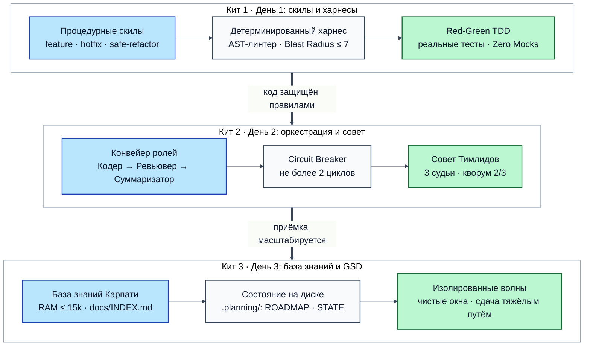
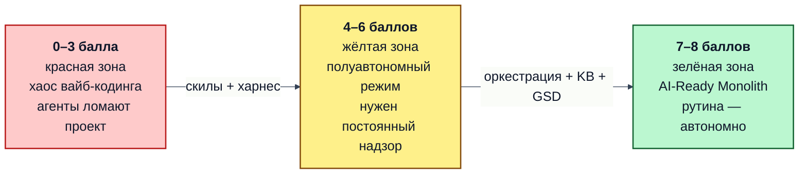
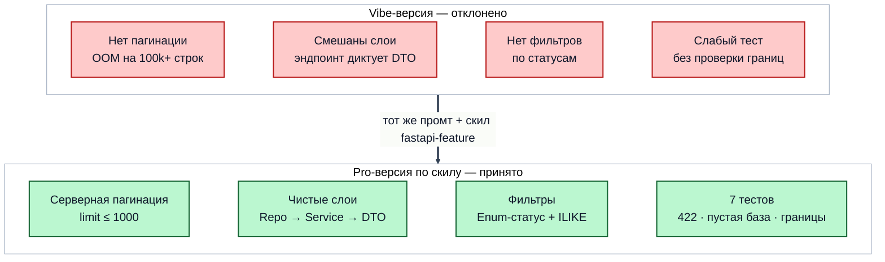
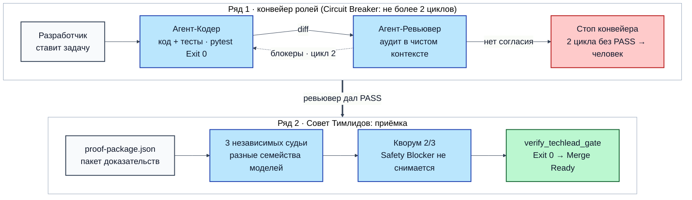
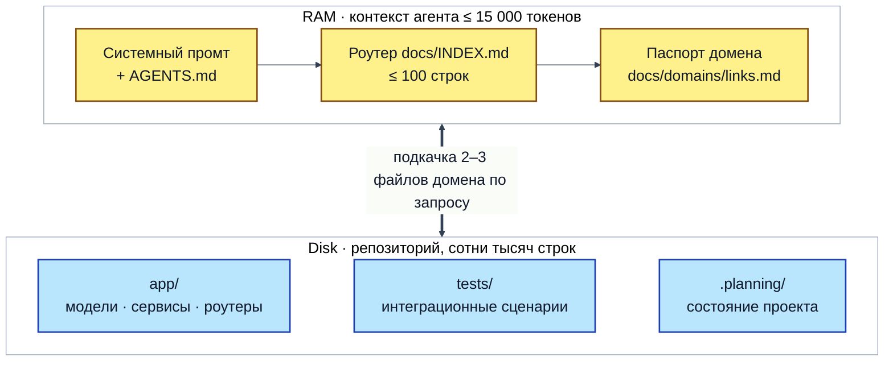
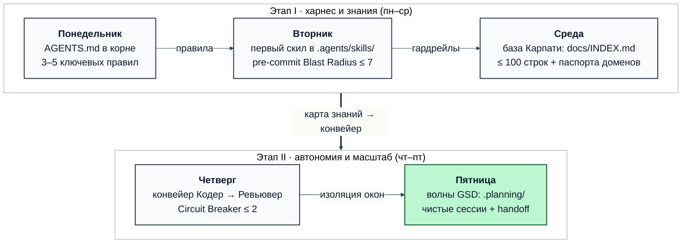

# Ранбук Итогового занятия. Синтез: От вайб-кодинга к профессиональной AI-разработке

> **Сквозной репозиторий:** `~/work/Python-AI/fastapi` (монолитный backend сервиса сокращения ссылок и биллинга).  
> **Инженерная цель занятия:** Продемонстрировать и закрепить на живом монолите полный путь трансформации от «дикого вайб-кодинга» к детерминированной промышленной AI-разработке.  
> **Методологическая основа:** Три кита агентного контура:
> 1. **Скилы, харнесы и гардрейлы** — процедурные контракты вместо пространных промтов, Red-Green TDD, бюджет Blast Radius (≤ 7 файлов) и Zero Mocks.
> 2. **Оркестрация и приёмка** — конвейер независимых ролей (Кодер → Ревьювер → Суммаризатор), предохранитель Circuit Breaker (макс. 2 цикла) и Совет Тимлидов (3 независимые модели, кворум 2/3, `verify_techlead_gate`).
> 3. **Монолит, База Знаний и GSD-волны** — концепция LLM OS Андрея Карпати (RAM ≤ 15k токенов против Disk всего репозитория, `docs/INDEX.md` + домены, валидатор `verify_kb_sync`) и послойные изолированные сессии Open-GSD (`.planning/`, передача эстафеты в чистых контекстах).

---

## Архитектура полного цикла: Три кита перехода от хаоса к системе

Вайб-кодинг («поболтать с LLM в чате и скопировать код») работает только на toy-проектах до 500 строк кода. Как только проект вырастает в реальный корпоративный монолит, вайб-кодинг приводит к катастрофе:
- Модель «слепнет» от раздутого контекста (**Attention Dilution** и **Lost in the Middle**).
- Агент ломает архитектурные границы слоев (пишет SQL в контроллерах или создает циклические импорты).
- Галлюцинирует контракты зависимостей и бесконечно «чинит» один тест, ломая три соседних.
- Один и тот же агент хвалит собственный непроверенный код (**Confirmation Bias**), закрывая PR с критическими багами.

Профессиональная AI-разработка заменяет субъективные диалоги детерминированными машинными протоколами:



*Схема 1. Сквозная архитектура промышленного AI-контура: три горизонтальных яруса от процедурного скила до масштабирования в монолите.*

---

### Таблица контрастов: Вайб-кодинг против Промышленной AI-разработки

| Характеристика | Дикий Вайб-кодинг | Промышленная AI-разработка (Pytex) |
|---|---|---|
| **Управление агентом** | Длинные поэмы-промты в диалоговом окне | Короткие декларативные команды + процедурные скилы на диске |
| **Гарантии качества** | «Вроде работает, код выглядит красиво» | Машинный Exit 0: линтеры, типизация `basedpyright`, pytest |
| **Радиус изменений** | Агент случайно переписывает 20 файлов проекта | Жёсткий лимит Blast Radius (≤ 7 файлов) с защитой ядра |
| **Контроль архитектуры** | Модель напрямую лезет в чужие слои и базы данных | AST-линтер границ слоев (Repository → Service → Endpoint) |
| **Ревью и приёмка** | Сам агент подтверждает свой код (Confirmation Bias) | Разделение ролей + независимый Совет Тимлидов (кворум 2/3) |
| **Работа с монолитом** | В контекст пихают весь репозиторий → потеря фокуса | Двухуровневая База Знаний (RAM ≤ 15k токенов) + Filing Back |
| **Длинные задачи** | Бесконечный раздувающийся чат с трейсбеками | Изолированные сессии-волны (Open-GSD) с эстафетой через `STATE.md` |

---

### Индекс готовности проекта к автономным AI-агентам (AI-Readiness Index)

Перед запуском агентов в промышленный репозиторий измерьте его индекс зрелости по 4 шкалам (максимум 8 баллов):



*Схема 2. Индекс готовности монолита к AI-агентам: три уровня зрелости от хаоса к автономной разработке.*

1. **Скилы и харнесы (0–2 балла):** есть ли в `.agents/skills/` пошаговые протоколы, EARS-критерии и скрипты Blast Radius.
2. **Оркестрация и приёмка (0–2 балла):** отделены ли Coder и Reviewer, настроен ли Совет Тимлидов (`verify_techlead_gate.py`).
3. **База знаний по Карпати (0–2 балла):** компактный роутер `docs/INDEX.md` (≤ 100 строк) + доменные спецификации + `verify_kb_sync.py`.
4. **Тестовый контур (0–2 балла):** быстрые тесты без медленных внешних моков, characterization tests, запуск за ≤ 3 секунды.

---

## 0. Подготовка окружения и Preflight (проверка за 10 секунд)

Переходим в корень сквозного репозитория монолита `fastapi` и проверяем готовность базового контура:

```bash
cd ~/work/Python-AI/fastapi
git fetch origin day-3
git checkout -f day-3
uv sync
uv run pytest -q
```

**Ожидаемый результат:** `104 passed` (или больше), 0 ошибок. Тестовый стенд полностью готов к работе.

### Инструмент мгновенного переключения скилов (`tools/toggle_skills.py`)

Чтобы наглядно увидеть разницу между вайб-кодингом и профессиональной разработкой, в репозитории подготовлена специальная утилита:

```bash
cd ~/work/Python-AI/fastapi
# Проверить текущий статус
python3 tools/toggle_skills.py --status

# Временно отключить все скилы (агент оказывается «голым», как в обычном чате)
python3 tools/toggle_skills.py --disable

# Вернуть скилы обратно в репозиторий
python3 tools/toggle_skills.py --enable
```

> [!NOTE]
> **Как устроен переключатель:**
> При отключении скилы перемещаются в изолированный каталог `~/.cache/pytex-skills-stash`, а в Git через команду `git update-index --assume-unchanged` помечаются неизменными. Благодаря этому `git status` остаётся абсолютно чистым, и отключение скилов не расходует лимит Blast Radius! При повторном включении файлы возвращаются на место и индекс Git разблокируется.

---

## БЛОК 1 (День 1): Скилы, Харнесы и Гардрейлы

### Эксперимент: «Дикий вайб-кодинг» против «Профессиональной разработки со скилами»

Бизнес-задача: команде аналитики нужен эндпоинт выгрузки всех ссылок системы в формате JSON для построения отчетов.

---

### Шаг 1.1. Отключаем скилы и входим в режим вайб-кодинга

```bash
cd ~/work/Python-AI/fastapi
python3 tools/toggle_skills.py --disable
```

**Ожидаемый результат:** `🔒 [SKILLS DISABLED] Скилы временно перемещены в ~/.cache/pytex-skills-stash`. Агент остался один на один с монолитом без процедурных инструкций.

---

### Шаг 1.2. Промт № 1 (Вайб-кодинг — генерация без скилов)

Отправляем агенту типичную задачу «как в чате»:

```bash
cd ~/work/Python-AI/fastapi
opencode run --auto "Реализуй эндпоинт экспорта всех ссылок сервиса в файл app/api/v1/endpoints/export_vibe.py и подключи его в app/api/v1/router.py. Напиши тест tests/integration/test_export_vibe.py." < /dev/null
```

#### Что делает агент без скилов (Анатомия ошибок вайб-кодинга):
1. **Выгрузка всей базы в память (OOM на проде):** агент делает `SELECT * FROM links` без пагинации (`limit`/`offset`). На базе в 1 000 000 записей такой эндпоинт мгновенно убивает сервер.
2. **Слабый контракт данных:** поля отдаются плоским списком, нет фильтрации по статусу ссылки (`active`, `expired`, `disabled`), нет валидации query-параметров.
3. **Нарушение TDD:** агент сначала пишет эндпоинт как придется, а потом подгоняет под него поверхностный тест.

---

### Шаг 1.3. Включаем скилы обратно

```bash
cd ~/work/Python-AI/fastapi
python3 tools/toggle_skills.py --enable
```

**Ожидаемый результат:** `🔓 [SKILLS ENABLED] Скилы возвращены в репозиторий (29 процедур доступно)`. Активирован скил `fastapi-feature` и машинные проверки.

---

### Шаг 1.4. Промт № 2 (Профессиональная реализация по скилу)

Формулируем ту же бизнес-задачу декларативно с указанием скила:

```bash
cd ~/work/Python-AI/fastapi
opencode run --auto "Используя скил fastapi-feature, реализуй эндпоинт экспорта в app/api/v1/endpoints/export_pro.py со схемой app/schemas/export.py и тестом tests/integration/test_export_pro.py. Убедись, что pytest tests/integration/test_export_pro.py проходит успешно (Exit 0)." < /dev/null
```

#### Что делает агент по скилу `fastapi-feature` (Дисциплина инженера):
1. **Фаза 1: Preflight & Blast Radius:** агент читает `specs/blast-radius.json`, проверяет лимит (не более 7 файлов) и сохранность защитного слепка `tests/characterization/`.
2. **Фаза 2: Строгий контракт EARS:** создаются Pydantic-схемы `ExportProResponse`, строгий enum `ExportStatus` (active, disabled, expired) и безопасные границы пагинации (`limit: le=1000`, `offset: ge=0`).
3. **Фаза 3: Red-Green TDD:** агент **первым делом пишет тест** `tests/integration/test_export_pro.py`, запускает его и убеждается, что тест падает с `404 Not Found` (подтверждение красной фазы).
4. **Фаза 4: Послойная реализация снизу вверх:**
   - Репозиторий: методы `list_pro()` и `count_pro()` с безопасным SQL-фильтром.
   - Сервис: метод `export_links_pro()` с управлением транзакцией.
   - Эндпоинт: тонкий контроллер в `export_pro.py`, принимающий параметры через `Annotated[Query]`.
5. **Фаза 5: Проверка типизации и линтинга:** автоматический запуск `basedpyright` (0 ошибок) и `pytest` (все 7 тестов зеленые, 100% Exit 0).

---

### Шаг 1.5. Промт № 3 (Архитектурный аудит и сравнительное ревью)

Запускаем агента в роли независимого ревьювера для объективного сравнения двух реализаций:

```bash
cd ~/work/Python-AI/fastapi
opencode run --auto "Проведи архитектурный аудит и сравни app/api/v1/endpoints/export_vibe.py и app/api/v1/endpoints/export_pro.py. Зафиксируй в docs/reviews/export_comparison.md: 1. Нарушения слоев и контрактов в vibe-версии; 2. Преимущества pro-версии по скилу; 3. Вердикт приёмки." < /dev/null
```

Смотрим итоговый отчет ревьювера:

```bash
cd ~/work/Python-AI/fastapi
cat docs/reviews/export_comparison.md
```

#### Ключевые выводы отчета ревьювера:



*Схема 3. Архитектурный контраст: дикий вайб-кодинг против профессионального контура со скилом.*

---

### Контраст реализации: Промт → Было → Стало → Разбор

#### Промт
> «Реализуй эндпоинт экспорта ссылок сервиса в формате JSON»

#### Было (Вайб-кодинг без скила, `export_vibe.py`)
```python
@router.get("/links", response_model=LinkExportResponse)
async def export_links(service: ServiceDep) -> LinkExportResponse:
    # Загрузка ВСЕЙ таблицы в память одним куском!
    return await service.export_all_links()
```

#### Стало (Профессионально по скилу `fastapi-feature`, `export_pro.py`)
```python
@router.get("/links/pro", response_model=ExportProResponse)
async def export_links_pro(
    service: ServiceDep,
    status_filter: Annotated[ExportStatus | None, Query()] = None,
    search: Annotated[str | None, Query(max_length=100)] = None,
    limit: Annotated[int, Query(ge=1, le=1000)] = 100,
    offset: Annotated[int, Query(ge=0)] = 0,
) -> ExportProResponse:
    return await service.export_links_pro(
        status_filter=status_filter, search=search, limit=limit, offset=offset
    )
```

#### Разбор архитектурного контраста
```diff
- 1. Без пагинации: SELECT * загружает миллионы строк в RAM (OOM-падение на проде).
+ 1. Серверная пагинация: строгие границы limit <= 1000 и offset >= 0 с валидацией 422.
- 2. Нет фильтров: невозможно запросить только активные или просроченные ссылки.
+ 2. Строгий Enum ExportStatus (active/disabled/expired) + безопасный поиск по подстроке.
- 3. Тест написан поверхностно постфактум: слабая проверка count >= 0.
+ 3. Red-Green TDD: 7 тестов (границы, пустая база, невалидные параметры, авторизация).
```

---

### Шаг 1.6. Специализированные скилы первого дня: Срочный Hotfix и Безопасный Refactoring

В промышленной разработке задачи не ограничиваются созданием новых фич (`fastapi-feature`). В реальной эксплуатации критически важны два других типовых сценария:
1. **Срочный прод-инцидент (`hotfix`)** — когда система сбоит, и неподготовленный агент в панике переписывает полпроекта, ломая соседние модули. Скил `hotfix` надевает на модель жесткие наручники:
   - Лимит объема правок: строго ≤ 20 строк.
   - Запрет на любые попутные улучшения («заодно»).
   - Обязательный регрессионный тест в том же коммите.
2. **Безопасный рефакторинг (`safe-refactoring`)** — когда нужно убрать дублирование или навести порядок в коде без риска регрессии. Главный нерушимый инвариант скила — **заморозка существующих тестов** (`git diff --exit-code tests/ == 0`): модель лишена возможности «подогнать» тесты под измененное поведение.

---

#### Промт № 4 (Срочный фикс инцидента по скилу `hotfix`)

Передаем агенту задачу устранения прод-инцидента с жестким ограничением scope:

```bash
cd ~/work/Python-AI/fastapi
opencode run --auto "Используя скил hotfix, устрани прод-инцидент: при обращении к эндпоинту экспорта с пустыми параметрами сервис должен отдавать 200 OK и пустой список без сбоев. Соблюдай правила скила: минимальный scope (≤ 20 строк), регрессионный тест в tests/integration/test_hotfix_export.py, запрещено трогать другие модули 'заодно'. Убедись, что pytest проходит успешно." < /dev/null
```

**Что здесь важно:**
1. **Защита от Scope Creep:** агент локализует фикс ровно в месте ошибки, не переписывая соседние файлы конфигурации или схемы.
2. **Регрессионный щит:** фикс сопровождается новым тестом, гарантирующим неповторение инцидента.

---

#### Промт № 5 (Безопасный рефакторинг по скилу `safe-refactoring`)

Передаем задачу на оптимизацию кода с гарантией сохранности существующих контрактов:

```bash
cd ~/work/Python-AI/fastapi
opencode run --auto "Используя скил safe-refactoring, оптимизируй повторяющиеся SQL-условия фильтрации в app/repositories/link.py. Инвариант скила: файлы в tests/ неприкосновенны (git diff tests/ обязан быть чистым), все существующие тесты обязаны проходить (Exit 0)." < /dev/null
```

**Что здесь важно:**
1. **Запрет читерства тестов:** если агент при рефакторинге сломает поведение, он не сможет переписать тест — скил заставляет модель исправлять исключительно код в `app/`.
2. **Атомарные шаги:** проверка `basedpyright` и `pytest` после каждого структурного изменения.

---

### Шаг 1.7. Проверка детерминированных гардрейлов монолита

Запускаем автоматические валидаторы Дня 1:

```bash
cd ~/work/Python-AI/fastapi
# 1. Проверка лимита затронутых файлов (не более 7)
python3 tools/verify_blast_radius.py

# 2. Проверка изоляции слоев (AST-анализ архитектурных импортов)
python3 tools/verify_layer_lint.py
```

**Ожидаемый результат:** оба скрипта завершаются с **Exit 0**. Защитные границы монолита не нарушены.

---

## БЛОК 2 (День 2): Оркестрация, Конвейер ролей и Совет Тимлидов

Написать хороший код — лишь треть дела. В промышленной разработке критически важно, **кто и как принимает изменения**.

### Почему один агент не может проверять сам себя
Если попросить ту же модель в том же чате проверить написанный ей код, сработает **Confirmation Bias (предвзятость подтверждения)**:
- Модель искренне «верит», что написала идеальный код.
- При повторном запросе она сгенерирует вежливый комплимент: «Код выглядит отлично, замечаний нет».
- Скрытые баги утекают в продакшен.

Решение: **разделение ролей** на уровне независимых изолированных процессов и консилиум внешних судей.



*Схема 4. Конвейер оркестрации и Совет Тимлидов: два горизонтальных ряда от изолированного цикла Coder-Reviewer до консилиума 3 судей.*

---

### Шаг 2.1. Промт № 6 (Оркестрация конвейера ролей со скилом)

Запускаем автономный конвейер разработки фичи:

```bash
cd ~/work/Python-AI/fastapi
opencode run --auto "Используя скил оркестрации orchestrate-coder-reviewer-summarizer, реализуй фичу фильтрации ссылок по тегам." < /dev/null
```

#### Что здесь важно:
1. **Чистая декларативность:** мы не вызываем вспомогательные скрипты и не диктуем шаги конвейера вручную. Достаточно лаконичной декларации: `Используя скил оркестрации orchestrate-coder-reviewer-summarizer, реализуй фичу фильтрации ссылок по тегам.` Вся логика ролей, конечного автомата FSM, фаз и проверок упакована внутри скила.
2. **Изоляция ролей:** Ревьювер запускается в **новом контекстном окне**, получает только `git diff` и правила проекта. Он не знает рассуждений Кодера и оценивает код беспристрастно.
3. **Circuit Breaker (Предохранитель):** если Ревьювер находит блокеры, Кодер получает шанс исправить их (Цикл 2). Если после двух циклов согласие не достигнуто, конвейер аварийно останавливается и зовёт человека. Это защищает команду от бесконечного сжигания бюджета токенов.

---

### Шаг 2.2. Промт № 7 (Совет Тимлидов: дебаты 3 судей и кворум 2/3)

```bash
cd ~/work/Python-AI/fastapi
opencode run --auto "Используя скил teamlead-panel, проведи независимую приёмку фичи Советом Тимлидов." < /dev/null
```

Проверяем машинную валидацию пакета доказательств:

```bash
cd ~/work/Python-AI/fastapi
python3 tools/verify_techlead_gate.py
```

**Ожидаемый результат:**
```text
=== TECHLEAD GATE VERIFICATION ===
[OK] Schema validation: proof-package.json matches schema
[OK] Independent judges quorum: 3 models evaluated (Quorum >= 2/3)
[OK] Zero safety blockers detected
[OK] All unit and integration tests passed (Exit 0)
TECHLEAD GATE: ACCEPTED (Ready to Merge)
```

> [!IMPORTANT]
> **Правило Блокера Безопасности (Safety Blocker):**
> Даже если два судьи проголосовали ЗА, но третий судья обнаружил утечку секретов, SQL-инъекцию или падение тестов, вердикт автоматически переходит в статус **REJECTED**. Блокер безопасности нельзя снять простым большинством голосов — требуется явное исправление кода или письменное подтверждение владельца репозитория.

---

## БЛОК 3 (День 3): Монолит, База Знаний Карпати и GSD-волны

В крупных монолитах (сотни тысяч строк) ключевая проблема — ориентация агента без раздувания контекста.

### Концепция LLM OS Андрея Карпати: RAM против Disk



*Схема 5. Концепция LLM OS: разделение быстрой оперативной памяти (RAM) и долговременного хранилища кода (Disk).*

---

### Шаг 3.1. Промт № 8 (База знаний Карпати и процедура Filing Back)

Когда агент завершает реализацию фичи в монолите, он обязан **обновить Базу Знаний (Filing Back)**, чтобы следующие агенты знали о новом API:

```bash
cd ~/work/Python-AI/fastapi
opencode run --auto "Используя скил monolith-knowledge-graph, локализуй домен links и выполни процедуру Filing Back: зарегистрируй эндпоинт экспорта в docs/domains/links.md и подтверди сходимость базы знаний." < /dev/null
```

Проверяем сходимость базы знаний автоматическим скриптом:

```bash
cd ~/work/Python-AI/fastapi
python3 tools/verify_kb_sync.py
```

**Ожидаемый результат:** `УСПЕХ: База знаний синхронизирована с кодом на диске (Exit 0)`. Никаких расхождений между спецификацией и реальными сигнатурами методов!

---

### Шаг 3.2. Промт № 9 (Инициализация Open-GSD: граф волн и FSM на диске)

Для сложных фич на несколько слоев (миграция базы → репозиторий → сервис → API → фронтенд) запускается методология **Open-GSD (Get Shit Done)**:
- Всё состояние хранится на диске в каталоге `.planning/` (`ROADMAP.md`, `STATE.md`, `REQUIREMENTS.md`).
- Задача делится на изолированные послойные **волны (Waves)**.

```bash
cd ~/work/Python-AI/fastapi
opencode run --auto "Используя скил open-gsd-pipeline, сформируй граф волн для реализации монолитного модуля аудита ссылок в .planning/." < /dev/null
```

Проверяем валидность плана:

```bash
cd ~/work/Python-AI/fastapi
python3 tools/plan_checker.py
```

**Ожидаемый результат:** `PLAN OK: Все зависимости волн ацикличны, критерии EARS определены (Exit 0)`.

---

### Шаг 3.3. Промт № 10 (Выполнение Волны в чистом окне со Structured Handoff)

Главное правило борьбы с деградацией внимания: **каждая волна выполняется в новой, свежей сессии агента**!
Агент берёт контекст из `STATE.md`, выполняет свою волну и записывает результат для следующего шага:

```bash
cd ~/work/Python-AI/fastapi
opencode run --auto "Используя скил open-gsd-pipeline, выполни Волну 1 плана в чистом контексте и зафиксируй передачу эстафеты в .planning/STATE.md." < /dev/null
```

Смотрим файл передачи эстафеты:

```bash
cd ~/work/Python-AI/fastapi
cat .planning/STATE.md
```

**Что здесь важно:**
В `STATE.md` зафиксированы точные сигнатуры созданных классов, статус тестов и контрольные точки. Следующий агент прочитает 30 строк `STATE.md` вместо 10 000 строк истории чужого диалога!

---

### Шаг 3.4. Итоговый машинный регрессионный контроль всего монолита

Перед завершением рабочего дня запускаем единый квалификационный запуск всех инвариантов:

```bash
cd ~/work/Python-AI/fastapi

# 1. Запуск полного набора тестов монолита
uv run pytest -q

# 2. Проверка сходимости Базы Знаний
python3 tools/verify_kb_sync.py

# 3. Контроль Blast Radius
python3 tools/verify_blast_radius.py

# 4. Проверка критериев планирования
python3 tools/plan_checker.py

# 5. Итоговый гейт техлида
python3 tools/verify_techlead_gate.py
```

Все 5 проверок обязаны вернуть код завершения **0**. Монолит готов к продакшену.

---

## БЛОК 4: Сводная матрица и Памятка внедрения в понедельник

### Сводная матрица перехода: от вайб-кодинга к промышленному AI-контуру

| Архитектурный столп | 0 баллов: Хаос (Вайб-кодинг) | 1 балл: Частичный контроль | 2 балла: AI-Ready Monolith |
|---|---|---|---|
| **1. Скилы и харнес (День 1)** | Длинные промты в чате, ручной копипаст, тесты пишутся после кода (или отсутствуют) | Правила описаны в тексте, но нет машинной валидации границ | Процедурные скилы в `.agents/skills/`, Red-Green TDD (Zero Mocks), лимит Blast Radius (≤ 7 файлов) |
| **2. Конвейер и приёмка (День 2)** | Один агент проверяет сам себя (Confirmation Bias), бесконечные циклы правок | Ручное ревью человеком каждого коммита агента | Конвейер Coder → Reviewer, Circuit Breaker (макс. 2 цикла), Совет Тимлидов (3 модели, кворум 2/3) |
| **3. Монолит и База Знаний (День 3)** | Весь монолит скармливается в контекст (Attention Dilution, Lost in the Middle) | Разрозненная документация в Confluence или слепой поиск `grep` | Двухуровневая База Карпати (RAM ≤ 15k токенов), Filing Back (`verify_kb_sync`), волны GSD в чистых окнах |

---

### Горизонтальная дорожная карта внедрения на рабочей неделе (Памятка инженера)



*Схема 6. Дорожная карта внедрения на рабочей неделе: пошаговый переход от правил и гардрейлов к автономии и GSD.*

### Финальный чеклист инженера

- [ ] **Никаких многословных промтов в чате:** все правила оформлены как исполняемые скилы в кодовой базе.
- [ ] **Только Red-Green TDD:** агент сначала обязан подтвердить падение теста на живом коде (Zero Mocks).
- [ ] **Строгий бюджет изменений:** Blast Radius ≤ 7 файлов защищает проект от разрастания правок.
- [ ] **Независимый аудит:** код проверяет не та же сессия, а отдельная роль Ревьювера и Совет Тимлидов.
- [ ] **Контекстное окно бережется как RAM:** оглавление `docs/INDEX.md` ведет к нужным файлам, не забивая контекст.
- [ ] **Крупные задачи — только через FSM на диске:** чистое окно для каждой волны и фиксация в `STATE.md`.
