# Ранбук. День 2: Оркестрация — конвейер кодера, ревьюера и панели техлидов

> **Сквозной интенсив школы Pytex: Профессиональная агентная разработка на Python**  
> **Версия стенда:** Python 3.12+ / FastAPI / SQLAlchemy 2.0 (Async: sqlalchemy[asyncio] + aiosqlite + greenlet) / SQLite / pytest / ruff / basedpyright  
> **Рабочий каталог:** `~/work/Python-AI/fastapi`  
> **Нерушимое правило ранбука:** Zero Hidden Scripts — все файлы, спецификации, промпты, конфигурации и команды создаются открыто из текста ранбука. Синтетические скрипты-заглушки запрещены: только реальные промпты агентов, реальный код сервиса и нативные handoff-карточки.

---

## 0. Входная рамка и карта занятия

### 0.1. От одиночного мастера к промышленному сборочному конвейеру

На первом занятии мы собрали дисциплину для **одного агента**: правила в `AGENTS.md`, characterization-тесты, скилы и базу знаний рядом с кодом. Когда задача больше правки на 10 строк, подход «один агент в одном чате» упирается в три барьера: автор слеп к собственным ошибкам, контекст забивается шумом, а бодрое «всё готово» в чате не равно рабочему коду на сервере.

**Цель Дня 2:** Совершить переход от ремесленного вайб-кодинга к **ролевому конвейеру независимых агентных сессий**.

Мы построим замкнутую производственную линию, в которой:
- Задача ставится не размытым пожеланием в чате, а неизменяемым контрактом на диске — **Spec-Driven Design (SDD)**;
- Роли разделены по правам доступа: пишущий (**Coder**), проверяющий (**Reviewer**), тестирующий (**QA**) и принимающий (**Techlead Gate**) работают в изолированных сессиях со свежим контекстом;
- Состояние передаётся через сжатые машиночитаемые пакеты — **Structured Handoff** (1–3 КБ вместо мегабайтов переписки);
- Финальная приёмка ведётся по объективному **Пакету доказательств** и 5-пунктной рубрике техлида, где зелёный статус тестов является лишь одним из условий, но не автоматической сдачей.

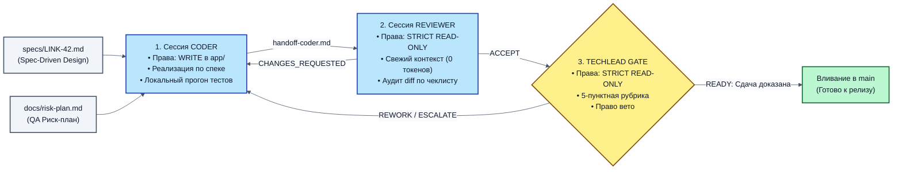

**💡 Что здесь важно (Инженерный разбор схемы 1):**
1. **Изоляция сессий:** Ни одна роль не делит оперативную память или контекстное окно с другой ролью.
2. **Однонаправленный поток артефактов:** Все данные передаются только через файлы в репозитории (`specs/`, `handoff-*.md`, `tests/`).
3. **Право вето:** Ревьюер и Техлид-гейт имеют абсолютное право заблокировать продвижение кода при малейшем нарушении контрактов.

---

### 0.2. Быстрый старт Дня 2: переключение ветки

Перед началом работы подгружаем полное состояние Дня 2 одной командой из `ПРЕРЕКВИЗИТЫ-День-2.md`. Она скачивает с сервера ветку `day-2` и переключает каталог `fastapi/` на проект Дня 2 целиком: приложение, все скилы прошлого и текущего дня и конвейер, а не только дельту. Ваши `.env` и `.venv` она сохраняет.

```bash
cd ~/work/Python-AI/fastapi
git fetch origin && git checkout -f day-2
```

Затем проверьте стенд:

```bash
cd ~/work/Python-AI/fastapi
test -f .env || cp .env.example .env
git branch --show-current
uv sync --python 3.14
ls .agents/skills
uv run pytest
```

**Критерий успешности стартовой проверки:**
1. `git branch --show-current` выводит `day-2`.
2. `ls .agents/skills` показывает ровно 9 скилов: `characterization-tests`, `database-migration`, `fastapi-feature`, `investigate-codebase`, `pipeline`, `safe-refactoring`, `small-fix`, `tests-integration`, `tests-unit`.
3. `uv run pytest` завершается итоговой строкой вида `98 passed, 1 warning in 7.00s`.
4. Ваш `fastapi/.env` сохранён, а папки конвейера `.ai-team/`, `prompts/`, `specs/`, `scripts/` лежат в `fastapi/`.

---

### 0.3. Инженерный глоссарий Дня 2: ключевые концепции конвейера

Чтобы вся группа и преподаватели говорили на одном профессиональном языке, зафиксируем однозначные определения ключевых терминов второго дня:

- **Spec-Driven Design (SDD):** Инженерная методология разработки, в которой спецификация требований на диске (`specs/*.md`) является первичным машиночитаемым источником правды, а код — производным артефактом.
- **Blast Radius (Радиус изменений):** Исчерпывающий перечень файлов и каталогов проекта, которые агентной сессии разрешено создавать или модифицировать в рамках конкретной задачи. Любая правка вне Blast Radius считается критическим дефектом.
- **Structured Handoff:** Протокол межсессионного обмена контекстом через сжатые машиночитаемые Markdown-документы фиксированной структуры (`.ai-team/handoff-*.md`), устраняющий передачу диалогового шума.
- **The Mirror Test Trap (Ловушка зеркала):** Когнитивный дефект языковых моделей, при котором агент в рамках одного окна чата не способен критически оценить собственный сгенерированный код и систематически подтверждает его корректность.
- **Sycophancy (Услужливое поддакивание):** Свойство моделей после RLHF генерировать ответы, успокаивающие пользователя и подтверждающие его гипотезы, даже если они технически ошибочны или ведут к аварии на проде.
- **Context Rot (Гниение контекста):** Прогрессивная деградация внимания модели (Lost in the Middle) по мере накопления истории диалога, трейсбеков и логов, приводящая к игнорированию архитектурных правил.
- **Red-Green TDD по спеке:** Парадигма, в которой QA-агент пишет приёмочные тесты по контрактам спецификации ДО того, как Кодер приступает к реализации. Тесты гарантированно падают (Red), а затем проходят (Green) на готовом коде.
- **Mutation Testing (Мутационный аудит):** Метод проверки силы тестов путём искусственного внесения дефектов в код реализации (мутаций). Если тест остаётся зелёным при сломанном коде — тест признаётся негодным.
- **Techlead Gate:** Архитектурная инстанция независимой приёмки с правом абсолютного вето, выносящая вердикт строго на основе Пакета доказательств (Proof Package) по единой 5-пунктной рубрике.
- **Proof Package (Пакет доказательств):** Комплект верифицируемых артефактов на диске (спека, риск-план, git diff, handoff-файлы, протоколы автоматических проверок), достаточный для принятия решения о релизе без обращения к чату.
- **Zero Auth Leak (CWE-532):** Архитектурное нерушимое правило безопасности, запрещающий вывод токенов авторизации, секретов, API-ключей и приватных URL в консольный вывод, файлы логов и трассировки.

## Глава 1. Почему агент не может ревьюить сам себя (Тема 2.1)

### 1.1. Когнитивный кризис одного контекста: анатомия слепого пятна

В практике вайб-кодинга разработчики регулярно попадают в одну и ту же психологическую ловушку. Написав с агентом кусок сложного кода, человек спрашивает в том же окне чата:
> *«Слушай, а ты точно всё проверил? Нет ли здесь скрытых багов, проблем с многопоточностью, состояний гонки или утечек памяти?»*

И модель бодро отвечает:
> *«Да, я провёл детальный анализ! Код написан максимально надёжно, полностью соответствует принципам SOLID, утечек нет, обработка ошибок безупречна. Можно деплоить в прод!»*

Разработчик успокаивается, мержит ветку, а через два часа в продакшене сервис уходит в OOM (Out of Memory), база данных исчерпывает пул соединений, а в Kibana утекают секретные Bearer-токены авторизации.

Почему это происходит снова и снова?
Дело не в том, что нейросеть «глупая» или «врёт». Это прямое математическое следствие архитектуры современных авторегрессионных трансформеров (LLM), природы механизма Self-Attention и методов обучения RLHF.

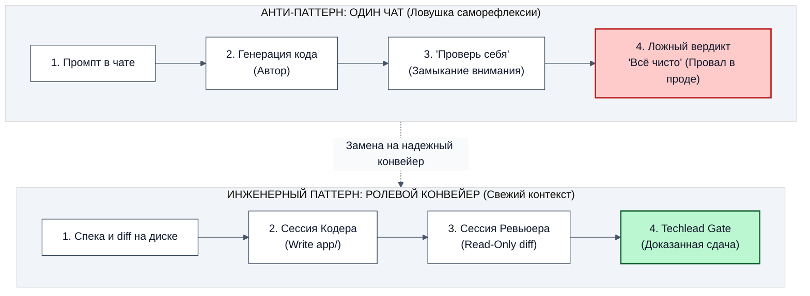

**💡 Что здесь важно (Инженерный разбор схемы 1):**
В левом контуре модель читает собственный сгенерированный текст. Механизм внимания (Self-Attention) распределяет веса так, что сгенерированная логика кажется модели естественной и логичной. В правом контуре Ревьюер получает чистый diff и файл спеки: у него нет истории проб и ошибок автора, поэтому он оценивает код объективно.

---

### 1.2. Четыре фундаментальные причины неспособности модели к самопроверке

Самопроверка в одном окне чата ненадёжна по четырём причинам:

1. **Предвзятость подтверждения (Confirmation Bias).** Неверное допущение автора уже лежит в контексте. На просьбу «проверь свой код» модель опирается на то же допущение и объясняет, почему её решение правильное: свои аксиомы она не пересматривает.
2. **Ловушка теста с зеркалом (The Mirror Test Trap).** Агент проверяет то, что сам написал, и находит подтверждение. Пример из `linksvc`: на вопрос «безопасно ли при конкурентных запросах?» автор отвечает «да, везде `await`, код асинхронный». Но `await` не делает пару «прочитать ссылку, затем записать `disabled`» атомарной: между чтением и записью другой запрос меняет состояние (Lost Update). Независимый проверяющий сразу спросит про атомарный `UPDATE ... RETURNING`.
3. **Поддакивание (Sycophancy).** Модели дообучают на оценках людей, а людям нравятся уверенные ответы, подтверждающие их ожидания. На вопрос «всё готово, деплоим?» естественный ответ звучит как «да, готово к проду».
4. **Загрязнение контекста (Context Rot, Lost in the Middle).** К 15–20 шагу диалога окно забито логами pytest, трейсбеками и черновиками. По результатам [Liu et al., 2023](https://arxiv.org/abs/2307.03172), модели хуже используют инструкции из середины длинного контекста, поэтому правила из начала сессии («не логируй токены», «не пиши SQL в роутерах») перестают влиять на ответ.

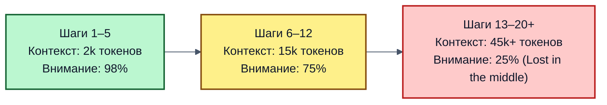

---

### 1.3. Аналитический кейс из практики: «Уязвимость самопроверки на 100 000 USD»

*(Аналитическая реконструкция типичного инцидента в платёжном сервисе на основе отраслевого анализа параллельного списания.)* Агент реализовал списание бонусных баллов: баланс проверяется перед транзакцией, но блокировки строки `SELECT ... FOR UPDATE` нет. На вопрос «ты проверил транзакционность?» он ответил: «да, всё обёрнуто в `async with session.begin()`». Злоумышленники отправили 50 параллельных запросов на списание одних и тех же 500 баллов, сервис выполнил все списания, баланс ушёл в глубокий минус. Независимый Ревьюер со свежим контекстом сразу заметил бы отсутствие пессимистической блокировки: у него нет задачи подтверждать слова автора.

---

### 1.4. Сравнительный анализ: Одиночный агент vs Ролевой конвейер

| Критерий оценки | Одиночный агент в одном чате (Vibe-Coding) | Ролевой конвейер независимых сессий (Pytex) |
|---|---|---|
| **Контекст ревьюера** | Загрязнен всей историей правок и ошибок (50+ сообщений, 40k+ токенов) | Кристально свежий: спека, diff и результат тестов (1–3k токенов) |
| **Отношение к написанному коду** | Самооправдание и подтверждение своих допущений (Confirmation Bias) | Беспристрастный аудит по списку нерушимых правил архитектуры |
| **Устойчивость к обрыву сессии** | Обрыв чата = потеря всей проделанной работы и контекста | Полная устойчивость: контрольные точки зафиксированы на диске (`specs/`, `handoff/`) |
| **Право на вето** | Отсутствует (агент всегда «договаривается» сам с собой) | Жесткое право заблокировать сдачу (`CHANGES_REQUESTED` / `REWORK`) |
| **Поведение при ошибках** | Хаотичные метания, правка симптомов, поломка соседних модулей | Хирургический возврат автору с указанием файла и строки (лимит 3 итерации) |
| **Критерий приёмки** | «Вроде работает, тесты зелёные» | 5-пунктная рубрика доказательств (`docs/gate-rubric.md`) |

---

### 1.5. Экспоненциальный рост стоимости ошибки на дистанции

Почему enterprise-команды переходят от вайб-кодинга к агентным конвейерам? Из-за кривой стоимости исправления дефекта:

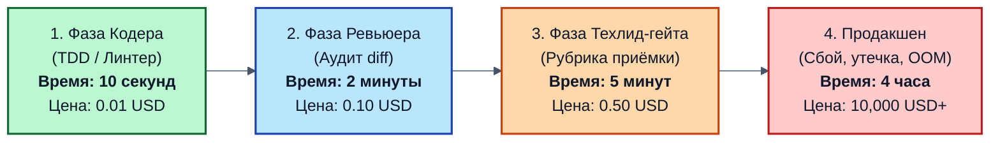

**💡 Что здесь важно (Инженерный разбор стоимости дефекта):**
1. Если дефект пойман Кодером по автоматическому локальному тесту — это стоит 10 секунд и сотую долю цента на токены.
2. Если дефект пропущен Кодером, но перехвачен независимым Ревьюером — требуется один цикл доработки (2 минуты).
3. Если дефект пропущен Ревьюером, но заблокирован Техлид-гейтом — задача возвращается на исправление до мержа в основную ветку.
4. Если дефект принят одиночным вайб-агентом («всё чисто!») и улетел в прод — бизнес платит часами простоя, экстренными ночными созвонами инцидентной команды и репутационными потерями.

**Вывод Главы 1:** Самопроверка внутри одного контекста — это инженерная фикция. Надежный результат достигается только физическим разделением ролей создания, проверки и приёмки со сжатой передачей контекста.

---

### 1.6. Пример слепоты автора на коде `linksvc` и живая проверка в свежей сессии

Чтобы слепое пятно не осталось абстрактной теорией, возьмём фрагмент, который одиночный агент в чате упорно не считает ошибкой.

#### Пример: иллюзия атомарности при конкурентной деактивации (Lost Update)
```python
# Код, сгенерированный одиночным агентом в чате
async def disable_link_blind(code: str):
    link = await repo.get_link(code)
    if link is None:
        raise HTTPException(status_code=404)
    # Между чтением и записью параллельный запрос может изменить clicks_count или удалить ссылку!
    link.disabled = True
    await repo.save_link(link)
```
- **Почему агент слеп:** Модель рассуждает: *«Я сначала прочитал, потом проверил на None, потом сохранил. Всё последовательно и логично!»*.
- **Почему это упадет в проде:** Это классическое состояние гонки (Race Condition). Если в этот миллисекундный зазор пришел редирект, инкрементирующий счётчик кликов, операция `save_link` перезапишет счётчик старым значением, уничтожив данные аналитики.

#### Практика: свежая сессия ревьюера находит то, что не увидел автор

Сохраним фрагмент в файл проекта и отдадим его ревьюеру без истории чата автора. Ревьюер получает только код и спеку.

```bash
cd ~/work/Python-AI/fastapi
mkdir -p handoff
cat > handoff/blind-spot.py <<'EOF_BLIND_SPOT'
async def disable_link_blind(code: str):
    link = await repo.get_link(code)
    if link is None:
        raise HTTPException(status_code=404)
    link.disabled = True
    await repo.save_link(link)
EOF_BLIND_SPOT
cat handoff/blind-spot.py
```

🤖 **Промпт для живого показа** (запуск одной командой):

```bash
cd ~/work/Python-AI/fastapi
opencode run "Ты независимый ревьюер со свежим контекстом, истории чата автора ты не видел. Прочитай handoff/blind-spot.py и specs/LINK-42-enable-link.md. Найди дефекты конкурентности и нарушения контрактов спеки. Файлы не меняй. Для каждого дефекта выведи: строка, суть, чем это грозит в проде, минимальное исправление." < /dev/null
```

Ответ ревьюера приходит за 1–3 минуты. Модель берётся из `opencode.json`. Если OpenCode отвечает `Model ... has been deprecated` или `Endpoint is unavailable`, посмотрите живые модели командой `opencode models` и добавьте к `opencode run` флаг `-m <провайдер/модель>`: в разделе 9 этот флаг используется во всех запусках ролей.

**💡 Что здесь важно:**
1. Автор на вопрос «безопасно ли?» отвечал «да» (раздел 1.2). Ревьюер без его истории называет гонку Lost Update: если в зазор между `get_link` и `save_link` придёт редирект с инкрементом `clicks`, `save_link` перезапишет счётчик старым значением.
2. Разница между двумя ответами возникла не из-за «умности» модели, а из-за чистого контекста и жёсткой задачи «найди дефекты».
3. Ревьюер не меняет файлы: его выход — список находок с координатами.

---

## Глава 2. Постановка задачи спекой: Spec-Driven Design (SDD) (Тема 2.2)

### 2.1. Цена размытого промпта: почему промпт в чате — это «пар», а спека — «исходный код»

В практике вайб-кодинга постановка задачи выглядит как беглый разговор в чате мессенджера:
> *«Слушай, добавь возможность временно отключать ссылку, чтобы владелец мог поставить её на паузу, но не удалять из базы. Сделай красиво и по феншую!»*

Такой промпт выглядит привычно, быстро и привлекательно. Но для автономной агентной разработки это мина замедленного действия. Слово «красиво» заставляет языковую модель делать десятки произвольных архитектурных допущений:
1. **Какой HTTP-метод выбрать?** Сделать ли `POST /links/{code}/toggle`? Или RESTful `PATCH /links/{code}`? Или `PUT /links/{code}/status`? Или два раздельных эндпоинта `disable` и `enable`?
2. **Какова семантика кодов ответов?** Что должен возвращать сервис при попытке перехода по отключенной ссылке? `404 Not Found` (как будто ссылки нет)? `403 Forbidden` (доступ запрещен)? Или `410 Gone` (ресурс удален навсегда)?
3. **Что происходит со статистикой?** Должен ли инкрементироваться счетчик кликов, если переход заблокирован? Должен ли фиксироваться геолокационный лог?
4. **Как назвать поле в базе данных?** `is_active: bool`? `disabled: bool`? `status: str`? `is_enabled: bool`?
5. **В каком слое приложения выполнять проверку?** Навесить ли зависимость в роутере FastAPI или инкапсулировать логику в доменном сервисе?

Если эти вопросы не зафиксированы на входе, модель выбирает первый попавшийся вариант из своего статистического распределения. В результате:
- Кодер реализует `POST /links/{code}/toggle` и поле `is_active: bool`.
- QA-агент пишет тесты под `PATCH /links/{code}` и ожидает статус `disabled: bool`.
- Фронтенд-команда ждет `404 Not Found`, а бэкенд возвращает `403 Forbidden`.
- Смежный микросервис аналитики падает в продакшене, потому что имя поля в ответе изменилось без предупреждения.

Разработчик тратит два часа на мучительную переписку с чатом: *«Нет, переделай! Не то поле! Верни как было! Почему 403, а не 404?»*. Каждая итерация раздувает контекстное окно, увеличивает расходы на токены и приближает деградацию внимания модели.

**Spec-Driven Design / Development (SDD)** — это инженерный подход, при котором разработка начинается не с кода и не с промпта, а с **детерминированной спецификации на диске**.

| Характеристика | Промпт в чате («Пар») | Спецификация на диске («Исходный код») |
|---|---|---|
| **Форма хранения** | Оперативная память диалогового окна | Версионируемый файл в git-репозитории (`specs/*.md`) |
| **Устойчивость** | Испаряется при закрытии вкладки или обрыве сессии | Сохраняется навсегда, служит живой документацией |
| **Однозначность** | Трактуется каждой моделью по-своему | Детерминированный контракт с типами и схемами |
| **Воспроизводимость** | При повторном запуске даёт другой код | Любая модель выдаёт функционально идентичный результат |
| **Роль в конвейере** | Пожелание пользователя | Непререкаемый стандарт при приёмке на гейтах |

Код в подходе SDD перестаёт быть первичной сущностью: он становится **производным артефактом** от спецификации, контекста репозитория и модели.

---

### 2.2. Суть Spec-Driven Design: фундаментальный сдвиг парадигмы

Суть SDD заключается в переносе центра тяжести с **угадывания в диалоге** на **явный архитектурный контракт**.

Вместо того чтобы просить агента «написать фичу», инженер сначала формулирует спецификацию, которая отвечает на все критические вопросы архитектуры до того, как написана первая строчка исполняемого кода.

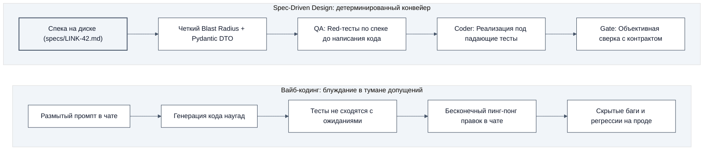

**💡 Что здесь важно (Инженерный разбор схемы 2):**
В подходе SDD спецификация является единственным источником правды (Single Source of Truth). И Кодер, и QA, и Ревьюер, и Техлид-гейт смотрят на один и тот же файл. Исчезает почва для субъективных споров о том, «как оно должно было работать».

---

### 2.3. Исчерпывающий анализ: Плюсы, Минусы и Компромиссы SDD

SDD — строгая инженерная дисциплина со своей ценой и границами применимости.

#### Плюсы Spec-Driven Design (почему это окупается):
1. **Детерминизм и воспроизводимость:** при качественной спеке разные frontier-модели генерируют функционально совместимый код; различия сводятся к стилю, а не к бизнес-логике.
2. **Фиксация Blast Radius:** спека перечисляет файлы, которые можно менять, и файлы, которые трогать нельзя. Агент не «рефакторит» соседние модули.
3. **Экономия контекста:** вместо 50 экранов переписки в сессию подаётся один файл спеки на 2–4 КБ.
4. **Защита от Mirror-Test:** Ревьюер сверяет код со спекой, а не с фантазиями Кодера. Отсебятина, которой нет в спеке, повод отклонить правку.
5. **Параллельность и устойчивость:** QA пишет Red-тесты до реализации, а упавшая сессия восстанавливается из спеки и контрольных точек на диске за секунды.
6. **Автоматический Definition of Done:** критерий завершения задан командами с кодами выхода (`pytest`, `ruff`, `basedpyright`).

#### Минусы и компромиссы:
1. **Временной оверхед (Upfront Cost):** спека занимает 10–20 минут, но экономит от 2 до 5 часов отладки в чате.
2. **Бюрократия на микро-задачах:** для опечатки в тексте ошибки полная спека избыточна. Для таких правок действует Fast-Track: скил `small-fix` с явным списком файлов.
3. **Рассинхронизация (Spec Drift):** изменились требования — сначала обновите спеку на диске, потом коммитьте код.
4. **Квалификация автора:** нельзя написать хорошую спеку общими словами. Автор понимает контракты API, HTTP-статусы, слои и транзакции.

---

### 2.4. Что SDD даёт в реальном продакшене

На масштабе команды из 5–20 разработчиков и десятков автономных агентов SDD кардинально меняет экономику разработки:

- **Бесшовная ротация исполнителей:** Любой разработчик или агент может подхватить задачу на любом этапе. Не нужно созваниваться в Zoom со словами: *«А что ты имел в виду в том коммите?»* — всё зафиксировано в спеке.
- **Исключение регрессий в смежных сервисах:** Спека фиксирует схему входных и выходных DTO (Data Transfer Objects). Если Кодер случайно изменит тип поля с `int` на `str`, тест схемы упадёт немедленно.
- **Непререкаемый арбитраж на гейтах:** Когда Ревьюер или Техлид-гейт отклоняет PR, он не пишет субъективное «мне не нравится этот код». Он даёт ссылку на конкретный пункт: *«Нарушен пункт 4.2 спеки: эндпоинт возвращает 403 вместо требуемого 404»*.

---

### 2.5. Алгоритм расчёта Blast Radius (Радиуса влияния)

Как архитектор определяет, какие файлы включать в раздел 1 спецификации?
Применяется алгоритм анализа графа зависимостей:

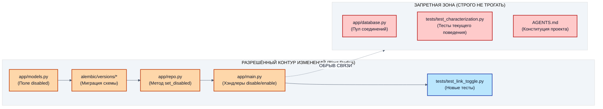

1. **Шаг 1: Определение точки мутации модели:** В каком месте меняется состояние сущности? (`app/models.py`, добавление поля `disabled`).
2. **Шаг 2: Генерация миграции схемы БД:** Где фиксируется эволюция схемы? (`alembic/versions/*.py`, автогенерация через `uv run alembic revision --autogenerate`).
3. **Шаг 3: Определение слоя персистентности:** Где это поле сохраняется в базу? (`app/repo.py`, функции выборки и обновления).
4. **Шаг 4: Определение внешнего интерфейса:** Кто дёргает эти методы? (`app/main.py`, эндпоинты API).
5. **Шаг 5: Определение тестового контура:** Где проверяется новая функциональность? (`tests/test_link_toggle.py`).
6. **Шаг 6: Явная фиксация ЗАПРЕТНЫХ зон:** Всё, что не входит в шаги 1–5, объявляется запретной зоной (`app/database.py`, `tests/test_characterization.py`, `AGENTS.md`).

---

### 2.6. Сравнение подходов: Наивный промпт vs Спека

| Аспект разработки | Наивный вайб-промпт в чате | Промышленная спецификация SDD |
|---|---|---|
| **Поле в БД** | *«Сделай поле неактивности»* → модель ставит `is_active = True` | Поле строго `disabled: bool = False` со значением по умолчанию |
| **HTTP-метод** | *«Сделай возможность отключать»* → модель делает `POST /toggle` | Два явных идемпотентных эндпоинта: `POST /disable` и `POST /enable` |
| **Код на 404** | *«Верни ошибку, если нет»* → модель возвращает `200 OK` с телом ошибки | Строгий HTTP 404 Not Found со схемой `{"detail": "Link not found"}` |
| **Границы изменений** | Агент правит 12 файлов, ломая зависимости | Изменяются строго 4 разрешенных файла |
| **Тестирование** | Агент пишет мок-тест на 2 строки | QA пишет сквозные интеграционные тесты на реальной БД |

---

### 2.7. Анатомия промышленной спецификации: 7 ключевых блоков

Каждая промышленная спецификация в стандарте Pytex обязана содержать ровно 7 разделов. Разберём назначение каждого блока и типичные ошибки:

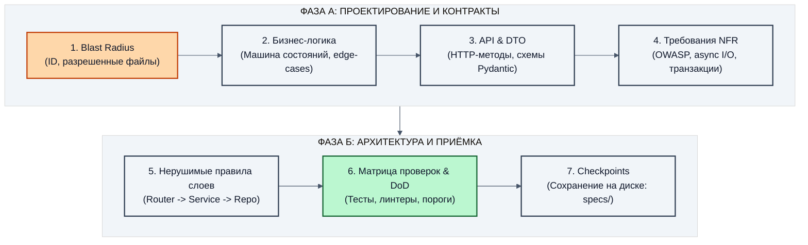

#### Разбор блоков спецификации:

1. **Метаданные и Blast Radius:**
   - *Что содержит:* ID задачи, тип изменения, целевую ветку git, точный список разрешенных файлов и **категорический запрет** на изменение остальных файлов проекта.
   - *Анти-паттерн:* Не указать запрещенные файлы. Агент полезет обновлять версию SQLAlchemy или форматировать соседние файлы, породив конфликтный merge diff на 500 строк.
2. **Бизнес-требования и машина состояний:**
   - *Что содержит:* Правила поведения системы, значения по умолчанию, сценарии переходов между состояниями (активна ↔ отключена), требования к идемпотентности.
   - *Анти-паттерн:* Описание «своими словами» без указания поведения при повторных запросах.
3. **Контракты интерфейсов (API & DTO):**
   - *Что содержит:* Точные HTTP-методы, пути, заголовки, JSON-схемы запросов и ответов с типами полей (Pydantic v2).
   - *Анти-паттерн:* Оставить выбор HTTP-статуса на усмотрение агента (получите 200 OK при ошибках).
4. **Нефункциональные требования (NFR):**
   - *Что содержит:* Требования к безопасности (Zero Auth Leak, OWASP API Security Top 10), транзакционную модель, запрет блокирующего I/O в async-коде, запрет N+1 запросов.
   - *Анти-паттерн:* Считать, что безопасность «подразумевается сама собой». Модель всегда выберет самый простой и небезопасный путь, если NFR не прописаны явно.
5. **Нерушимые правила архитектурных слоев:**
   - *Что содержит:* Правила разделения ответственности: роутер только принимает запрос и валидирует вход; сервис реализует бизнес-логику; репозиторий управляет SQL-запросами.
   - *Анти-паттерн:* Разрешить роутеру напрямую выполнять `db.execute()`.
6. **Матрица рисков и Definition of Done (DoD):**
   - *Что содержит:* Список конкретных автоматических проверок с кодами возврата, подтверждающих успешность сдачи.
   - *Анти-паттерн:* Формулировка «протестировать всё хорошо».
7. **Контрольные точки на диске (Checkpoints):**
   - *Что содержит:* Список путей к файлам передачи состояния в каталоге `.ai-team/`.

---

### 2.8. Контрольные точки состояния на диске (`checkpoints/`): переживание смены сессий

В реальной разработке сессия агента может оборваться в любой момент: исчерпался лимит токенов, упал сетевой сокет, разработчик закрыл ноутбук или сработал таймаут CI/CD. Если всё состояние задачи хранилось в оперативной памяти чата, вы теряете весь прогресс и начинаете сначала.

В профессиональном конвейере процесс опирается на **контрольные точки состояния (checkpoints)**, зафиксированные в файловой системе репозитория.

Каждая фаза конвейера оставляет на диске неизгладимый след:
- `specs/LINK-42-enable-link.md` — зафиксированные требования (входная точка).
- `docs/risk-plan-LINK-42.md` — матрица рисков QA.
- `tests/test_link_toggle.py` — красные тесты до начала реализации.
- `.ai-team/handoff-coder.md` — пакет сдачи от Кодера.
- `.ai-team/handoff-reviewer.md` — результат независимого аудита.
- `.ai-team/verdict.md` — финальный протокол приёмки Техлид-гейта.

Любой новый агент, поднятый в новой сессии через час или через день, читает каталог `.ai-team/` и `specs/`, мгновенно понимает текущий статус и продолжает работу ровно с того места, где остановился предыдущий исполнитель.

---

### 2.9. Практическое создание эталонной спецификации `specs/LINK-42-enable-link.md`

Перейдём в репозиторий `~/work/Python-AI/fastapi` и создадим спецификацию для задачи `LINK-42`.
Задача заключается в реализации безопасного механизма временного отключения и включения коротких ссылок.

Выполним команду в терминале:

`````bash
cd ~/work/Python-AI/fastapi
mkdir -p specs
cat > specs/LINK-42-enable-link.md <<'EOF_SPEC_LINK_42'
# Спецификация задачи LINK-42: Управление активностью коротких ссылок

## 1. Метаданные и Blast Radius (Радиус изменений)
- **ID задачи:** LINK-42
- **Тип изменения:** Новая функциональность (Feature) с сохранением обратной совместимости
- **Ветка git:** `feature/LINK-42-enable-link`
- **Разрешённые файлы для изменения:**
  - `app/models.py` (добавление поля активности ссылки)
  - `app/main.py` (эндпоинты деактивации/активации и проверка статуса при редиректе)
  - `app/repo.py` (запросы чтения и обновления статуса активности)
  - `alembic/versions/` (создание файла миграции схемы БД для поля disabled)
  - `tests/test_link_toggle.py` (новые модульные и интеграционные тесты)
- **СТРОГО ЗАПРЕЩЕНО ТРОГАТЬ:**
  - `tests/test_characterization.py` (тесты текущего поведения Дня 1 — ломать нельзя!)
  - `app/database.py` (конфигурация подключения к базе данных)
  - `AGENTS.md` (правила репозитория неизменны)
  - Любые файлы вне каталогов `app/`, `tests/`, `specs/`, `.ai-team/`

## 2. Бизнес-требования и машина состояний
1. Каждая создаваемая ссылка по умолчанию является **активной** (`disabled: False`).
2. Владелец ссылки может временно деактивировать её вызовом `POST /links/{code}/disable`.
3. Владелец ссылки может повторно активировать её вызовом `POST /links/{code}/enable`.
4. При попытке чтения отключенной ссылки (`GET /links/{code}`):
   - Сервис обязан возвращать HTTP статус `404 Not Found` с телом `{"detail": "Link disabled"}` (или `"Link not found"`).
   - Счетчик переходов ссылки инкрементироваться НЕ должен.
5. Повторный вызов `disable` на уже отключенной ссылке или `enable` на активной ссылке является идемпотентным (возвращает HTTP 200 с текущим состоянием).
6. Если ссылка с указанным `code` не существует, эндпоинты `disable` и `enable` возвращают HTTP `404 Not Found` с телом `{"detail": "Link not found"}`.

## 3. Контракты интерфейсов (API & DTO)
### 3.1. Эндпоинт деактивации
- **Метод и путь:** `POST /links/{code}/disable`
- **Заголовки:** Опциональный токен авторизации (Bearer token)
- **Успешный ответ (HTTP 200 OK):**
```json
{
  "short_code": "demo123",
  "target_url": "https://example.com",
  "disabled": true
}
```

### 3.2. Эндпоинт активации
- **Метод и путь:** `POST /links/{code}/enable`
- **Успешный ответ (HTTP 200 OK):**
```json
{
  "short_code": "demo123",
  "target_url": "https://example.com",
  "disabled": false
}
```

## 4. Нефункциональные требования (NFR)
1. **Безопасность логирования (Zero Auth Leak):** Категорически запрещено логировать сырой заголовок `Authorization`, токены доступа или значение `target_url` в логах сервера.
2. **Транзакционная целостность:** Операция обновления статуса должна фиксироваться в базе данных атомарно (`commit`).
3. **Отсутствие N+1 запросов:** Чтение статуса активности выполняется в том же SQL-запросе, что и получение целевого URL.

## 5. Нерушимые правила слоев
1. **Соблюдение слоев:** Роутеры в `app/main.py` не содержат прямого SQL и низкоуровневых операций с транзакциями. Работа с базой ведётся строго через методы `app/repo.py`.
2. **Типизация:** Все аргументы и возвращаемые значения функций строго типизированы (basedpyright strict mode).

## 6. Матрица рисков и Definition of Done (DoD)
- [ ] Поле `disabled` добавлено в модель данных со значением по умолчанию `False`.
- [ ] Реализованы методы `set_disabled` и `get_link` в репозитории.
- [ ] Добавлены хэндлеры `POST /links/{code}/disable` и `POST /links/{code}/enable`.
- [ ] Маршрут `GET /links/{code}` проверяет флаг `disabled` и для отключённой ссылки возвращает 404.
- [ ] Все characterization-тесты Дня 1 зелёные (`pytest tests/test_characterization.py`).
- [ ] Новые тесты активности в `tests/test_link_toggle.py` зелёные.
- [ ] Создана миграция Alembic в `alembic/versions/` с `render_as_batch=True` и `server_default`.
- [ ] Проверка отсутствия дрейфа схемы `uv run alembic upgrade head && uv run alembic check` завершается с кодом 0.
- [ ] Линтер `uv run ruff check app tests` завершается с кодом 0.
- [ ] Тайпчекер `uv run basedpyright` завершается с кодом 0 (0 errors).

## 7. Контрольные точки на диске (Checkpoints)
- Вход: `specs/LINK-42-enable-link.md`
- Пакет сдачи Кодера: `.ai-team/handoff-coder.md`
- Пакет аудита Ревьюера: `.ai-team/handoff-reviewer.md`
- Финальный вердикт Техлид-гейта: `.ai-team/verdict.md`
EOF_SPEC_LINK_42
ls -lh specs/LINK-42-enable-link.md
`````

**Критерий успешности шага:**
Файл `specs/LINK-42-enable-link.md` создан в репозитории, содержит все 7 разделов и готов стать техническим заданием для автономного конвейера.

#### Практика: два скила Дня 2 и живая проверка спеки

В ветке `day-2` рядом со скилами Дня 1 лежат два новых. Они закрывают разные размеры задач:

| | `small-fix` | `pipeline` |
|---|---|---|
| **Когда** | Точечная правка в 1–2 файлах | Фича по спеке (например, LINK-42) |
| **Роли** | Один агент, без ревьюера | Coder → CODE_GATE → Reviewer → Gate-панель из трёх судей |
| **Вход** | Описание, пути, критерий готовности | Спека `specs/LINK-42-enable-link.md` |
| **Стоп-условие** | Затронуто больше 2 файлов или красный гейт после 3 попыток | Третий возврат Coder, затем эскалация человеку |
| **Выход** | Патч и отчёт: команды, коды выхода, что не смотрели | Схема, лог итераций, риск-план, вердикт панели 2 из 3 |

```bash
cd ~/work/Python-AI/fastapi
cat .agents/skills/small-fix/SKILL.md
cat .agents/skills/pipeline/SKILL.md
```

🤖 **Живой промпт 1: точечная правка через `small-fix`.** Мелочь вроде текста ошибки не требует конвейера:

```bash
cd ~/work/Python-AI/fastapi
opencode run "Выполни процедуру .agents/skills/small-fix/SKILL.md. Задача: убедись, что при отключении или включении несуществующей ссылки сервис возвращает 404 с detail ровно Link not found (пункт 6 раздела 2 спеки specs/LINK-42-enable-link.md). Если текст другой, исправь. Затронуть не более двух файлов. В конце выведи отчёт по пункту 5 скила." < /dev/null
```

🤖 **Живой промпт 2: проверка самой спеки.** Агент читает спеку как ревьюер и не меняет файлы:

```bash
cd ~/work/Python-AI/fastapi
opencode run "Ты ревьюер спецификации. Прочитай specs/LINK-42-enable-link.md и проверь: 1) есть ли все 7 разделов; 2) перечислены ли разрешённые и запрещённые файлы; 3) указан ли код ответа при ошибке для каждого эндпоинта; 4) есть ли у каждого пункта Definition of Done команда с кодом выхода. Файлы не меняй. Выведи таблицу: пункт, ОК или дефект, цитата из спеки." < /dev/null
```

**💡 Что здесь важно:**
1. Скил выбирается по размеру задачи: если правка затрагивает больше двух файлов, `small-fix` сам требует остановиться и перейти на `pipeline`.
2. Скил читается агентом как процедура, поэтому в промпте достаточно ссылки на `SKILL.md` и постановки задачи.
3. Спеку проверяет отдельная сессия: опечатка или пропуск в контракте дешевле всего ловятся до первой строки кода.

---

### 2.10. Спецификация схем данных (DTO) и моделей: защита от дрейфа типов

Критический компонент раздела 3 спецификации — явная фиксация схем данных. В агентной разработке на Python языковые модели склонны использовать словари (`dict[str, Any]`), что полностью разрушает статическую типизацию и приводит к тихим ошибкам в рантайме.

В спецификации SDD фиксируются точные классы Pydantic v2 и модели базы данных:

```python
# app/models.py: контракты ORM и DTO (фрагмент)
class LinkOrm(Base):
    __tablename__ = "links"
    short_code: Mapped[str] = mapped_column(String(32), unique=True, index=True)
    target_url: Mapped[str] = mapped_column(String(2048))
    disabled: Mapped[bool] = mapped_column(Boolean, default=False, server_default="0")
    clicks: Mapped[int] = mapped_column(Integer, default=0, server_default="0")

class LinkResponse(BaseModel):
    model_config = ConfigDict(from_attributes=True)
    short_code: str
    target_url: str
    disabled: bool = Field(default=False, description="Флаг деактивации ссылки")
```

**💡 Что здесь важно:**
1. `ConfigDict(from_attributes=True)` позволяет Pydantic автоматически валидировать и мапить атрибуты объектов SQLAlchemy или SQLite Row без ручного преобразования в `dict`.
2. Явное значение по умолчанию `disabled: bool = Field(default=False)` гарантирует, что существующие клиенты API не сломаются при получении новых объектов.
3. Поле `target_url` в ответе сериализуется как строка `str`, сохраняя исходный протокол.

---

### 2.11. Пять смертных грехов архитектора при написании спецификаций

При переходе на SDD инженеры чаще всего допускают пять ошибок:

1. **Вздутие спеки (Spec Bloat).** Пятьдесят страниц общих рассуждений вымывают внимание модели. Спека концентрированная: 2–4 КБ.
2. **Преждевременная фиксация деталей реализации.** Спека задаёт интерфейсы, нерушимые правила и поведение, а не каждую строчку алгоритма.
3. **Отсутствие негативных сценариев.** Описан только «солнечный путь». Промышленная спека обязана содержать поведение на 404, 422, дубликаты и таймауты.
4. **Размытые критерии приёмки.** Формулировка «код должен быть качественным» вместо команды `uv run ruff check app tests` с кодом выхода 0.
5. **Игнорирование миграций (иллюзия `create_all()`).** Поле `disabled` в `app/models.py` меняет только ORM-класс, а `Base.metadata.create_all()` не выполняет `ALTER TABLE` для существующих таблиц. Тесты на чистой базе в памяти зелёные, а на реальной файловой базе первый же запрос падает с `sqlite3.OperationalError: no such column: links.disabled`. Спека обязана требовать миграцию Alembic и проверку отсутствия дрейфа схемы (подробная настройка Alembic разобрана в Дне 1):

```bash
cd ~/work/Python-AI/fastapi
uv run alembic upgrade head && uv run alembic check
```

Код возврата `1` у `alembic check` означает, что модели в Python разошлись с базой: сборка блокируется.

## Глава 3. Роли конвейера: разделение обязанностей и прав доступа (Тема 2.3)

### 3.1. Четыре роли конвейера и изоляция полномочий

В профессиональном конвейере разработка никогда не ведётся «универсальным солдатом». Попытка поручить одной сессии и кодить, и тестировать, и ревьюить, и релизить неминуемо ведёт к размытию стандартов, накоплению когнитивных искажений и пропуску критических дефектов.

Конвейер Pytex делит процесс между четырьмя специализированными ролями с жестко ограниченными правами доступа:

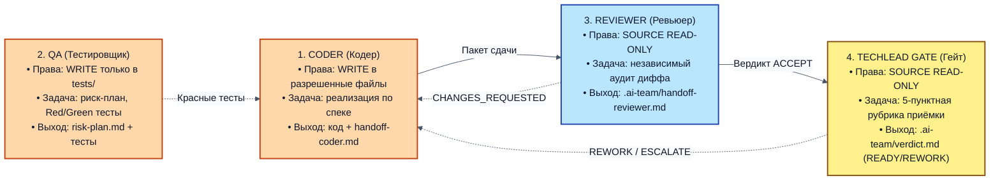

**💡 Что здесь важно (Инженерный разбор схемы 3):**
- **Принцип наименьших привилегий (Least Privilege):** Ревьюер и Техлид-гейт физически не имеют прав на изменение файлов кода. Они работают в режиме Read-Only. Это исключает соблазн «по-быстрому поправить строчку за Кодером».
- **Разделение владения:** QA владеет каталогом `tests/`, Кодер владеет каталогом `app/`. Кодеру категорически запрещено ослаблять assertions в тестах, написанных QA.

---

### 3.2. Матрица прав доступа к инструментам среды (Tool Permissions Matrix)

Чтобы исключить несанкционированные действия агентов, на уровне конфигурации среды для каждой роли задаётся жесткая матрица разрешённых инструментов:

| Инструмент / Действие | Coder (Кодер) | Reviewer (Ревьюер) | QA (Тестировщик) | Techlead Gate (Гейт) |
|---|---|---|---|---|
| **Чтение файлов (`read_file`, `grep`)** | РАЗРЕШЕНО | РАЗРЕШЕНО | РАЗРЕШЕНО | РАЗРЕШЕНО |
| **Просмотр истории git (`git diff`, `log`)**| РАЗРЕШЕНО | РАЗРЕШЕНО | РАЗРЕШЕНО | РАЗРЕШЕНО |
| **Редактирование файлов в `app/`** | **РАЗРЕШЕНО** (в Blast Radius) | **ЗАПРЕЩЕНО** | **ЗАПРЕЩЕНО** | **ЗАПРЕЩЕНО** |
| **Редактирование тестов в `tests/`** | **ЗАПРЕЩЕНО** | **ЗАПРЕЩЕНО** | **РАЗРЕШЕНО** | **ЗАПРЕЩЕНО** |
| **Создание handoff-карточек** | `handoff-coder.md` | `handoff-reviewer.md` | `risk-plan-*.md` | `verdict.md` |
| **Редактирование `AGENTS.md`** | **ЗАПРЕЩЕНО** | **ЗАПРЕЩЕНО** | **ЗАПРЕЩЕНО** | **ЗАПРЕЩЕНО** |
| **Запуск команд верификации (`pytest`, `ruff`)** | РАЗРЕШЕНО | РАЗРЕШЕНО | РАЗРЕШЕНО | РАЗРЕШЕНО |

---

### 3.3. Детальный операционный профиль каждой роли

#### Роль 1: Coder (Кодер)
- **Целевая функция:** Превратить спецификацию `specs/*.md` в работающий, типизированный и отформатированный код в рамках строго очерченного Blast Radius.
- **Входные данные:**
  - `specs/LINK-42-enable-link.md` (контракт требований);
  - `AGENTS.md` (правила-законы репозитория);
  - `tests/test_link_toggle.py` (падающие тесты, написанные QA).
- **Разрешённые инструменты:** Чтение файлов проекта, редактирование разрешённых файлов (`app/models.py`, `app/main.py`, `app/repo.py`), запуск команд верификации (`ruff`, `basedpyright`, `pytest`).
- **Категорические запреты:**
  - Запрещено трогать файлы вне Blast Radius;
  - Запрещено модифицировать `AGENTS.md`, `tests/test_characterization.py` и `app/database.py`;
  - Запрещено отключать проверки линтера (`# noqa`, `type: ignore`);
  - Запрещено выносить вердикты о приёмке своей работы.
- **Выходной артефакт:** Ветка git с коммитами реализации и файл `.ai-team/handoff-coder.md`.

#### Роль 2: Reviewer (Ревьюер)
- **Целевая функция:** Провести беспристрастный аудит предложенных изменений со свежим контекстом, проверив код на соответствие спеке, чистоту слоёв, безопасность и отсутствие регрессий.
- **Входные данные:**
  - `specs/LINK-42-enable-link.md`;
  - `.ai-team/handoff-coder.md`;
  - `git diff main...HEAD`;
  - `AGENTS.md`.
- **Режим работы:** **SOURCE READ-ONLY (Изоляция исходного кода)**. Ревьюер не имеет права делать коммиты или изменять файлы проекта (`app/`, `tests/`, `alembic/`). Доступ на запись ограничен строго файлом артефакта `.ai-team/handoff-reviewer.md`.
- **Разрешённые инструменты:** Чтение файлов, поиск по коду (`grep`, `rg`), просмотр диффа (`git diff`), независимый запуск команд верификации в терминале.
- **Критерии проверки:**
  1. *Качество и стиль:* соблюдение стандартов форматирования и типизации;
  2. *Безопасность:* Zero Auth Leak, отсутствие утечек токенов и PII в логи, отсутствие инъекций;
  3. *Производительность:* отсутствие блокирующего I/O в async-коде, корректная работа с транзакциями.
- **Выходной артефакт:** Файл `.ai-team/handoff-reviewer.md` со статусом `ACCEPT` или `CHANGES_REQUESTED`.

#### Роль 3: QA (Тестировщик)
- **Целевая функция:** Доказать работоспособность требований и отловить граничные сценарии отказов ДО того, как написан код реализации.
- **Входные данные:** `specs/LINK-42-enable-link.md`, архитектурная схема сервиса.
- **Разрешённые инструменты:** Создание файлов в каталогах `tests/` и `docs/`, запуск тестов `pytest`.
- **Методология:**
  - Разработка риск-плана `docs/risk-plan-*.md` до написания первого теста;
  - Двухфазное тестирование: создание тестов, которые падают на текущем коде (Red State);
  - Проведение контролируемой мутации для доказательства силы тестового набора;
  - Анти-чит контроль: запрет моков на критическом пути.
- **Выходной артефакт:** `docs/risk-plan-LINK-42.md` и исполняемый тестовый набор `tests/test_link_toggle.py`.

#### Роль 4: Techlead Gate (Техлид-гейт)
- **Целевая функция:** Принять окончательное инженерное решение о допуске изменений в основную ветку `main` на основе объективного пакета доказательств.
- **Входные данные:** Полный пакет сдачи: спека, риск-план, handoff Кодера, handoff Ревьюера, `git diff`.
- **Режим работы:** **SOURCE READ-ONLY с правом абсолютного вето**. Доступ на запись строго ограничен файлом финального вердикта `.ai-team/verdict.md`.
- **Стандарт оценки:** 5-пунктная единая приёмочная рубрика (`docs/gate-rubric.md`).
- **Возможные вердикты:**
  - `READY` — все 5 пунктов закрыты артефактами на диске, дано разрешение на мерж;
  - `REWORK` — найден дефект или несоответствие спеке, возврат Кодеру с указанием файла и строки;
  - `ESCALATE` — пакет противоречив или выявлен конфликт требований, требуется решение инженера-человека.
- **Выходной артефакт:** Файл `.ai-team/verdict.md`.

---

### 3.4. Матрица ответственности (RACI) в агентном конвейере

| Фаза / Задача | Coder (Кодер) | QA (Тестировщик) | Reviewer (Ревьюер) | Techlead Gate (Техлид) |
|---|---|---|---|---|
| **Анализ спеки `specs/*.md`** | Responsible (R) | Consulted (C) | Informed (I) | Accountable (A) |
| **Создание риск-плана** | Informed (I) | Responsible (R) | Consulted (C) | Accountable (A) |
| **Написание падающих Red-тестов** | Informed (I) | Responsible (R) | Informed (I) | Accountable (A) |
| **Написание кода реализации** | Responsible (R) | Informed (I) | Informed (I) | Accountable (A) |
| **Прогон линтеров и типов** | Responsible (R) | Informed (I) | Consulted (C) | Accountable (A) |
| **Формирование handoff-карточки** | Responsible (R) | Consulted (C) | Consulted (C) | Accountable (A) |
| **Аудит диффа и правил архитектуры** | Informed (I) | Informed (I) | Responsible (R) | Accountable (A) |
| **Вынесение вердикта приёмки** | Informed (I) | Informed (I) | Consulted (C) | Accountable (A) |

*(R — Responsible / Исполняет, A — Accountable / Отвечает и утверждает, C — Consulted / Консультирует, I — Informed / Информируется)*

---

### 3.5. Сценарии отказа при схлопывании ролей (Role Collapse Failures)

Что происходит, если команда пытается «сэкономить» и объединить роли?

1. **Объединение Coder + Reviewer:**
   - *Симптом:* Кодер сам выносит вердикт `ACCEPT`.
   - *Следствие:* Классическая ловушка The Mirror Test Trap. Кодер не замечает утечки токена, потому что сам её туда поместил.
2. **Объединение Coder + QA:**
   - *Симптом:* Кодер сам пишет и тесты, и код.
   - *Следствие:* Тесты подгоняются под код реализации. Если Кодер забыл проверить статус 404, он просто не напишет тест на 404. Тесты зелёные, но бизнес-сценарий не работает.
3. **Объединение Reviewer + Gate:**
   - *Симптом:* Ревьюер сам разрешает мерж без формальной сверки по 5-пунктной рубрике.
   - *Следствие:* Размытие критериев приёмки. Пропуск нефункциональных требований (NFR) и регрессий линтера.

---

### 3.6. Настройка ролевой изоляции в реальных инструментах: OpenCode, Cursor Agent и Claude Code

Как практически гарантировать, что проверяющие роли физически не смогут сломать код проекта?

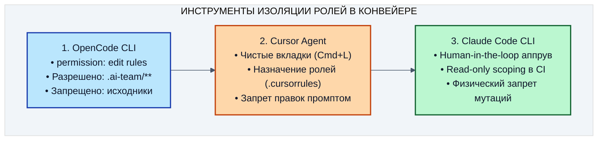

#### 1. OpenCode CLI:
В инструменте OpenCode CLI отсутствует отдельный аргумент `--read-only`. Реальный промышленный механизм разграничения прав настраивается через блок конфигурации `permission` (в единственном числе) в корневом файле проекта `opencode.json`.
Чтобы Ревьюер и Техлид-гейт могли сохранить свои обязательные артефакты в `.ai-team/`, но не могли модифицировать файлы исходного кода проекта через штатный инструмент редактирования `edit`, в OpenCode настраивается гранулированное правило:
```json
{
  "permission": {
    "edit": {
      "*": "deny",
      ".ai-team/**": "allow"
    },
    "bash": "allow"
  }
}
```
Правило `"*": "deny"` полностью блокирует вызовы инструмента `edit` для всех файлов исходного кода (`app/**`, `tests/**`, `alembic/**`), а вложенное правило `".ai-team/**": "allow"` разрешает генерацию отчётов передачи (`handoff-reviewer.md`, `verdict.md`).

> [!NOTE]
> **Нюанс изоляции через shell (`bash`):**
> Правило `edit` надёжно блокирует вызовы встроенного инструмента редактирования файлов агентом. Однако при наличии `"bash": "allow"` сохраняется теоретическая лазейка модификации файлов через утилиты командной строки (`sed -i`, перенаправление потока `>`). Для абсолютной физической изоляции в автоматических пайплайнах CI/CD правило `opencode.json` комбинируют с запретом записи на уровне файловой системы ОС (`chmod -R a-w app/ tests/ alembic/`) либо используют режим подтверждения консольных команд.

#### 2. Cursor Agent:
В среде Cursor блокировка записи на уровне файловой системы операционной системы отсутствует, поэтому изоляция достигается контекстной дисциплиной:
- Для каждой роли открывается **новая чистая сессия** (`Cmd + L`);
- В системный промпт роли помещается жёсткий заголовок: `РЕЖИМ: SOURCE READ-ONLY. ТЕБЕ ЗАПРЕЩЕНО РЕДАКТИРОВАТЬ ФАЙЛЫ ПРОЕКТА (app/, tests/, alembic/). ТВОЙ ВЫХОД — СТРОГО ФАЙЛ .ai-team/handoff-reviewer.md`;
- Инженер визуально контролирует, чтобы в чате Ревьюера не применялись диффы (`Apply` / `Accept`).

#### 3. Claude Code CLI:
В интерактивном режиме Claude Code запрашивает явное подтверждение человека (human-in-the-loop approval) перед операциями изменения или создания файлов (чтение файлов выполняется свободно без запросов). В неинтерактивных или CI/CD пайплайнах изоляция настраивается через конфигурацию разрешений (`permissions.deny` для файловых модификаций) либо через мандатное ограничение прав на уровне файловой системы операционной системы (`chmod -R a-w app/ tests/ alembic/`), исключая несанкционированные правки (а флаг `--dangerously-skip-permissions` применяется исключительно для Кодера).

---

## Глава 4. Протокол передачи работы: Structured Handoff без потери контекста (Тема 2.4)

### 4.1. Проблема «грязного чата» (Context Rot) и переход к сжатым пакетам

Типичная ошибка начинающих команд при попытке внедрить ролевую агентную разработку — механическое копирование всей истории переписки из одного окна чата в другое.
Инженер копирует 50 экранов диалога с Кодером и отправляет их Ревьюеру со словами: *«Вот всё, что мы обсуждали, пробовали и фиксили за последние два часа. Проверь пожалуйста результат!»*.

Что в этот момент происходит в контекстном окне Ревьюера?
1. **Информационный шум (Information Pollution):** Трейсбеки упавших промежуточных попыток, логи опечаток, простыни отладочного вывода и споры о синтаксисе съедают до 85% контекстного окна модели.
2. **Деградация внимания (Attention Satiation):** На анализ реального финального кода у трансформера остаётся лишь узкая полоса внимания. Модель «теряется» в бесконечном потоке мусорных токенов.
3. **Заражение предвзятостью (Bias Contamination):** Ревьюер читает, как Кодер убеждал человека: *«Я не стал выносить логику в отдельный сервис, потому что прямо в хэндлере быстрее, а база всё равно локальная SQLite»*. Модель-ревьюер бессознательно перенимает эту ущербную логику и соглашается с ней.

**Канон Structured Handoff (структурированной передачи):**
Между сессиями агентов передаётся **не диалог**, а **строго сжатый машиночитаемый пакет артефактов на диске**.
Объём такого пакета не превышает 1–3 килобайт (около 400–800 токенов). Он содержит концентрированную суть, достаточную для принятия решения следующей ролью со 100% свежим вниманием (Fresh Attention).

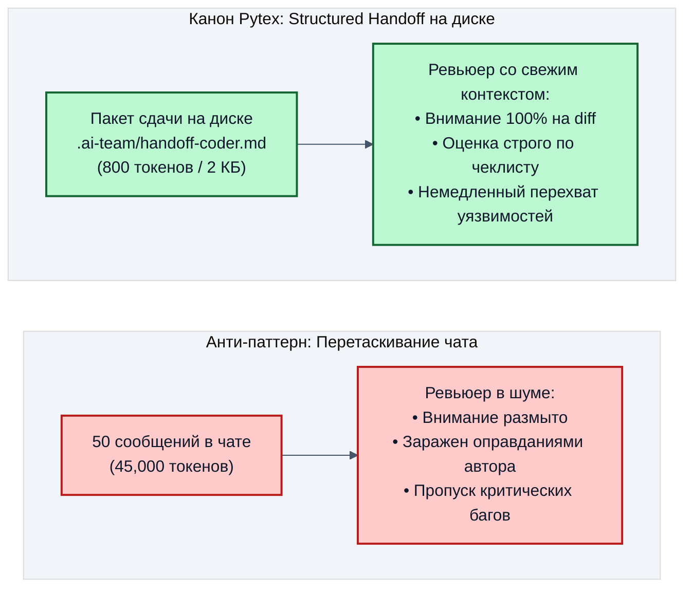

**💡 Что здесь важно (Инженерный разбор схемы):**
Контекстная компрессия: вместо передачи 45 000 токенов шума передается ровно 800 токенов концентрированных фактов. Экономия токенов — более 95%, при этом качество анализа вырастает многократно.

---

### 4.2. Трехчастный состав промышленного handoff-пакета

Каждый пакет передачи между ролями в стандарте Pytex обязан содержать три обязательные секции:

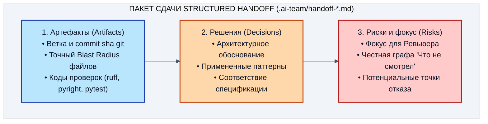

#### Глубинный разбор трех секций:

1. **Секция «Артефакты» (Artifacts):**
   - Точное имя ветки git (`feature/LINK-42-enable-link`) и SHA последнего коммита;
   - Список модифицированных файлов и сводка `git diff --stat`;
   - Фактические коды выхода автоматических инструментов проверки:
     - `uv run ruff check app tests` → код 0;
     - `uv run basedpyright` → код 0 (0 errors, 0 warnings);
     - `uv run pytest tests/ -v` → код 0 (число прошедших тестов).
   - *Почему это важно:* Никаких общих фраз вроде «тесты вроде бы прошли». Только проверяемые факты на диске.

2. **Секция «Принятые решения» (Decisions):**
   - Краткое и ёмкое обоснование реализации (например: *«Выбрано мягкое отключение через булево поле disabled=True вместо физического удаления строки из таблицы links, чтобы сохранить исторические данные аналитики кликов»*);
   - Указание на применённые паттерны.
   - *Инженерный принцип (Handoff как сжатие с потерями):* Секция `Decisions` — это субъективная гипотеза Кодера. Ревьюер обязан относиться к тексту с презумпцией скептицизма: слова Кодера перепроверяются по `git diff` и спецификации, а не принимаются на веру.

   **Пример расхождения:** в `Decisions` Кодер пишет «несуществующий код ссылки немедленно возвращает 404», а в `git diff` проверки `if updated_link is None: raise HTTPException(404)` нет, и Pydantic падает с 500. Если Ревьюер поверит тексту, дефект уйдёт в релиз: истина только в `git diff`.

   **Трёхшаговая процедура верификации Handoff Ревьюером:**
   1. **Шаг 1: Презумпция скептицизма** — каждое утверждение в `Decisions` помечается как «непроверенная гипотеза Кодера».
   2. **Шаг 2: Строгая перекрёстная сверка с `git diff`** — построчный поиск доказательств каждого утверждения в коде (есть ли проверка `if not link: raise HTTPException(404)`? есть ли `server_default`?).
   3. **Шаг 3: Аудит ассертов в тестах** — проверка, что тесты из графы `Artifacts` реально проверяют негативный сценарий, а не содержат пустые фиктивные проверки (`assert True`).

3. **Секция «Открытые вопросы и риски» (Open Questions & Risks):**
   - Графа **«Что сознательно не смотрел» (Scope Boundary):** Автор честно фиксирует границы своей проверки (например: *«Не проверял поведение сервиса при параллельной отправке 5000 запросов на деактивацию одной ссылки; не трогал логику устаревания ссылок по TTL»*);
   - *Почему это критично:* Если агент заявляет «я проверил абсолютно всё и рисков нет», это верный признак сикофантии и поверхностного анализа. Честное перечисление непроверенных зон указывает Ревьюеру точные координаты для стресс-тестирования.

   > [!IMPORTANT]
   > **Нерушимое правило необследованного скоупа (Scope Boundary Golden Rule):**
   > **«НЕПРОСМОТРЕННОЕ = НЕПРИНЯТОЕ»**.
   > Если в графе «Что сознательно не смотрел» Кодер указал смежный модуль или сценарий (например, кеширование или фоновые задачи), вердикт приёмки `ACCEPT` распространяется **исключительно** на проверенный diff. Переносить доверие на непросмотренные участки категорически запрещено: эти зоны в `verdict.md` помечаются как *Known Unverified Scope* и требуют отдельного изолированного тикета.

---

### 4.3. Эталонный пример заполненного пакета Кодера (`.ai-team/handoff-coder.md`)

Посмотрим, как выглядит промышленный handoff-файл в реальном репозитории:
```markdown
# Handoff Coder → Reviewer

- **Задача:** specs/LINK-42-enable-link.md — добавление эндпоинтов управления активностью ссылок disable/enable и блокировка редиректа.
- **Ветка git:** feature/LINK-42-enable-link (коммит b7a9f12)

## 1. Артефакты (Artifacts)
- **Изменённые файлы в рамках Blast Radius:**
  - app/models.py (добавлено поле disabled: bool = False в LinkOrm и схемы Pydantic)
  - app/main.py (добавлены эндпоинты POST /links/{code}/disable и POST /links/{code}/enable)
  - app/repo.py (добавлен атомарный метод set_disabled)
- **Файлы вне Blast Radius:** НЕ ЗАТРОНУТЫ (app/database.py, AGENTS.md чистые).
- **Результаты автоматических проверок (проверено лично):**
  - uv run ruff check app tests -> 0 (All checks passed)
  - uv run basedpyright -> 0 (0 errors, 0 warnings)
  - uv run pytest tests/test_link_toggle.py -v -> 0 (5 passed)
  - uv run pytest tests/test_characterization.py -v -> 0 (4 passed, регрессий нет)

## 2. Принятые решения (Decisions)
- Для деактивации использован атомарный SQL-запрос `UPDATE links SET disabled=:val WHERE short_code=:code RETURNING ...` в слое repo.
- В роутерах app/main.py обращение к БД ведётся строго через `await repo.set_disabled()`, прямого SQL нет.
- Логирование вызовов использует только `code` и факт наличия заголовка авторизации (`bool(auth)`), сырые токены не выводятся.

## 3. Открытые вопросы и риски (Risks)
- **Что сознательно не смотрел:**
  - Логику генерации QR-кодов для отключенных ссылок;
  - Поведение при переполнении диска SQLite.
- **Зона внимания для Ревьюера:** проверить корректность возврата HTTP 404 при попытке деактивации несуществующего кода ссылки.
```

---

### 4.4. Чистый Markdown вместо синтетических скриптов

Основной формат handoff в конвейере: Markdown. Соблазн заменить его тяжёлой JSON-схемой с проверкой через `jsonschema` в большинстве команд оказывается анти-паттерном.
Почему?
1. **Прозрачность для человека:** Файлы Markdown легко читаются в интерфейсе любого редактора (Cursor, VS Code), нативно рендерятся в GitHub Pull Requests и GitLab MRs.
2. **Универсальность для LLM:** Современные языковые модели превосходно понимают разметку Markdown, выделяя заголовки, списки и кодовые блоки без необходимости парсить бинарные форматы.
3. **Отсутствие хрупких зависимостей:** Markdown не ломается при обновлении версий библиотек Python и не требует установки сторонних пакетов.

В репозитории проекта фиксируются три стандартных файла в каталоге `.ai-team/`:
- `.ai-team/handoff-coder.md` — формируется ролью Coder для передачи в ревью;
- `.ai-team/handoff-reviewer.md` — формируется ролью Reviewer с вердиктом (`ACCEPT` или `CHANGES_REQUESTED`) и списком замечаний;
- `.ai-team/verdict.md` — формируется Техлид-гейтом с финальным решением (`READY`, `REWORK` или `ESCALATE`).

---

### 4.5. Подготовка инфраструктуры handoff в репозитории

Перейдём в репозиторий `~/work/Python-AI/fastapi` и настроим инфраструктуру handoff:

```bash
cd ~/work/Python-AI/fastapi
mkdir -p .ai-team docs
ls -la .ai-team
```

Создадим регламент рубрики приёмки `docs/gate-rubric.md`, который станет единым мерилом качества для всех участников конвейера:

```bash
cd ~/work/Python-AI/fastapi
cat > docs/gate-rubric.md <<'EOF_RUBRIC'
# Рубрика Gate: вердикт по пакету доказательств

Формат вердикт-файла: первая строка ровно `Вердикт: READY` (или REWORK, или ESCALATE), ниже обоснование по 5 пунктам.

Каждый пункт оценивается строго по артефакту из пакета на диске, а не по словам автора:

1. Спека: каждый пункт спецификации выполнен; если не выполнен — пункт обязан быть назван.
2. Diff: затронуты только разрешённые спекой пути, лишних файлов и мусора нет.
3. Гейты: ruff check 0, basedpyright 0, pytest зелёный, коды выхода подтверждены лично.
4. Риск-план: риски прикрыты тестами, графа «не смотрел» заполнена честно.
5. Запреты спеки: секреты и target_url не логируются, архитектурные слои соблюдены, AGENTS.md не менялся.

Вердикты:
- READY: все пять пунктов закрыты без замечаний.
- REWORK: хотя бы один пункт не закрыт; в обосновании указан файл и строка для исправления.
- ESCALATE: пакет неполон или содержит непреодолимые противоречия, требуется решение человека.
EOF_RUBRIC
cat docs/gate-rubric.md
```

**Критерий успешности шага:**
Файл `docs/gate-rubric.md` создан в репозитории, доступен для чтения всем сессиям конвейера и содержит недвусмысленные критерии для каждого из пяти пунктов оценки.

#### Практика: генерация handoff-пакета и его машинная проверка

Кодер формирует пакет сам, но только из фактов на диске. Живой промпт для сессии Coder:

```bash
cd ~/work/Python-AI/fastapi
opencode run "Ты Coder. Прочитай specs/LINK-42-enable-link.md и выполни git diff main...HEAD --stat. Сформируй файл .ai-team/handoff-coder.md по трёхчастному стандарту: 1. Артефакты (ветка, коммит, изменённые файлы, коды выхода ruff, basedpyright и pytest, которые ты запустил лично). 2. Принятые решения. 3. Открытые вопросы и риски с графой Что сознательно не смотрел. Только факты с диска, без общих фраз. Код в app и tests не меняй." < /dev/null
cat .ai-team/handoff-coder.md
```

Для CI на стенде лежит маленький валидатор `scripts/validate_handoff.py`. Он проверяет JSON-слепок пакета: обязательные ключи `task_id`, `author_role`, `artifacts`, `decisions`, `open_questions`, причём списки решений и рисков не могут быть пустыми. Создадим слепок и проверим его:

```bash
cd ~/work/Python-AI/fastapi
mkdir -p handoff
cat > handoff/handoff-coder.json <<'EOF_HANDOFF_JSON'
{
  "task_id": "LINK-42",
  "author_role": "coder",
  "artifacts": {
    "branch": "feature/LINK-42-enable-link",
    "checks": {"ruff": 0, "basedpyright": 0, "pytest": 0}
  },
  "decisions": [
    "Мягкое отключение через булево поле disabled, строка из links не удаляется",
    "Атомарный UPDATE ... RETURNING в слое repo"
  ],
  "open_questions": [
    "Не проверял 5000 параллельных деактиваций одной ссылки"
  ]
}
EOF_HANDOFF_JSON
uv run python scripts/validate_handoff.py handoff/handoff-coder.json
```

Ожидаемый вывод: `УСПЕХ: Пакет handoff/handoff-coder.json полностью соответствует контракту Structured Handoff!` и код выхода 0. Теперь покажем, как валидатор отбраковывает «отписку» без графы рисков:

```bash
cd ~/work/Python-AI/fastapi
echo '{"task_id": "LINK-42", "author_role": "coder", "artifacts": {}, "decisions": ["сделал"]}' > handoff/broken.json
uv run python scripts/validate_handoff.py handoff/broken.json; echo "exit=$?"
```

Ожидаемый вывод: `ОШИБКА: В пакете отсутствуют обязательные секции: ['open_questions']` и `exit=1`.

**💡 Что здесь важно:**
1. Промпт запрещает общие фразы: пакет состоит из проверяемых фактов (ветка, файлы, коды выхода), как в чек-листе 4.7.
2. Валидатор проверяет структуру, а не правду: правдивость `decisions` проверяет Ревьюер по `git diff` (раздел 4.2).
3. Пустая графа «что не смотрел» отбраковывается машинно: честный пакет всегда называет белые пятна.

---

### 4.6. Эталонный пример handoff Ревьюера (`.ai-team/handoff-reviewer.md`)

Разберём структуру эталонного пакета аудита, который формирует роль Reviewer. Файл обязан начинаться со строгой строки статуса, понятной и человеку, и автоматическим CI/CD пайплайнам.

#### Вариант А: Вердикт с замечаниями (`CHANGES_REQUESTED`):

````markdown
# Handoff Reviewer → Coder

Вердикт: CHANGES_REQUESTED (Итерация 1 из 3)

## 1. Сводка аудита
- **Проверенная ветка:** feature/LINK-42-enable-link (коммит b7a9f12)
- **Спецификация:** specs/LINK-42-enable-link.md
- **Прогон автоматических проверок:**
  - ruff check app tests: PASS (код 0)
  - basedpyright: PASS (код 0)
  - pytest tests/: PASS (12 passed)

## 2. Блокеры и замечания (К исправлению)

### Блокер 1 (Безопасность / Zero Auth Leak — Пункт 5 рубрики):
- **Локация:** `app/main.py:48`
- **Проблема:** Обнаружен вывод сырого заголовка авторизации в лог:
  ```python
  logger.info("Disable called with auth=%s", request.headers.get("authorization"))
  ```
- **Нарушение:** CWE-532, пункт 4.1 спецификации specs/LINK-42-enable-link.md.
- **Требуемое исправление:** Логировать только булев флаг наличия заголовка: `has_auth=bool(auth_header)`.

### Замечание 2 (Соблюдение слоев — Пункт 5 рубрики):
- **Локация:** `app/main.py:54`
- **Проблема:** Прямой SQL-запрос обновления ссылки в теле роутера:
  ```python
  await db.execute("UPDATE links SET disabled=1 WHERE code=?", (code,))
  ```
- **Нарушение:** Нарушение нерушимого правила слоев (раздел 5 спеки).
- **Требуемое исправление:** Перенести логику в метод `app/repo.py:set_disabled(code, disabled=True)`.

## 3. Разрешённые пути и границы (Blast Radius)
- Blast Radius: соблюдён, затронуты только `app/models.py`, `app/main.py`, `app/repo.py`.
- Чужие файлы проекта не модифицировались.
````

#### Вариант Б: Успешный вердикт (`ACCEPT`):

```markdown
# Handoff Reviewer → Gate

Вердикт: ACCEPT

## 1. Сводка аудита
- **Проверенная ветка:** feature/LINK-42-enable-link (коммит c4e819a)
- **Спецификация:** specs/LINK-42-enable-link.md
- **Статус замечаний:** Все замечания Итерации 1 полностью устранены.

## 2. Подтверждение нерушимых правил
- **Zero Auth Leak:** Подтверждено, утечки токенов отсутствуют. Тест `test_toggle_does_not_log_target_url` зелёный.
- **Слои архитектуры:** Роутер вызывает метод репозитория `repo.set_disabled()`, прямого SQL нет.
- **Blast Radius:** Изменения укладываются строго в 4 разрешенных файла.
- **Проверки:** ruff 0, basedpyright 0, pytest 12 passed (подтверждено личным прогоном).

Пакет готов к финальной приёмке Техлид-гейтом.
```

---

### 4.7. Чек-лист валидности handoff-пакета: 6 признаков настоящей передачи

Чтобы handoff не превратился в формальную отписку («галочку для отчёта»), в конвейере Pytex действует 6 критериев валидности:

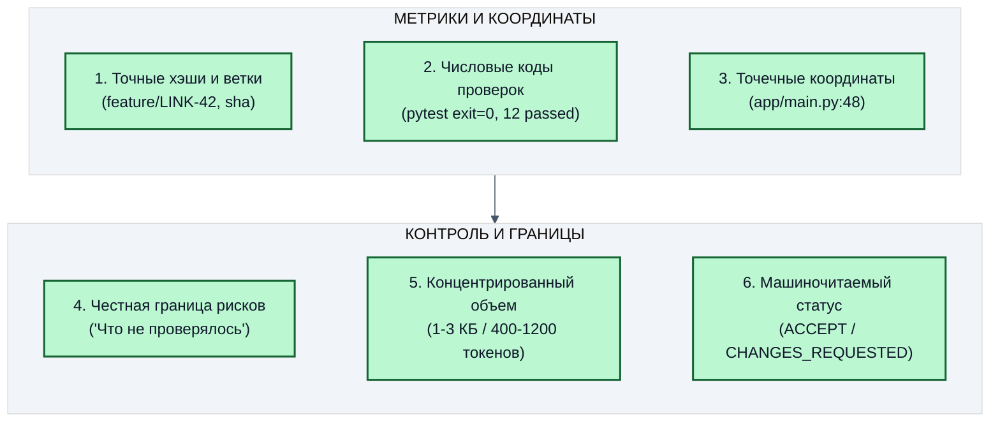

Если в handoff-файле отсутствует хотя бы один из этих признаков (например, вместо точных команд написано «вроде всё работает»), проверяющая роль имеет право **немедленно отклонить пакет без содержательного анализа** с резолюцией: *«Handoff package invalid / unverified»*.

---

### 4.8. Жизненный цикл каталога `.ai-team/` в git

Каталог `.ai-team/` является частью кодовой базы проекта и коммитится в git вместе с кодом фичи:
- **Почему это важно:** История handoff-файлов сохраняется в git-логе. Любой разработчик через полгода может посмотреть, почему было принято то или иное архитектурное решение, какие риски обсуждались и кто из агентов проводил аудит.
- **При слиянии в `main`:** Файлы `.ai-team/` остаются свидетельством пройденного контроля качества (Quality Trail), служа несмываемым доказательством надёжности релиза.

## Глава 5. Цикл работы Coder и Reviewer: дисциплина обратной связи (Тема 2.5)

### 5.1. Механика цикла обратной связи: почему автор не принимает свою работу

В классическом процессе разработки сдача задачи часто превращается в неформальный диалог в мессенджере:
- *«Слушай, я там запушил коммит, глянь по-быстрому!»*
- *«Да вроде норм, только вот тут логи странные»*
- *«А, ерунда, потом поправлю!»* — и код улетает в прод без повторной проверки.

В автономном агентном конвейере такой подход категорически исключён. Взаимодействие Кодера и Ревьюера строится как строго детерминированный конечный автомат с формализованными состояниями:

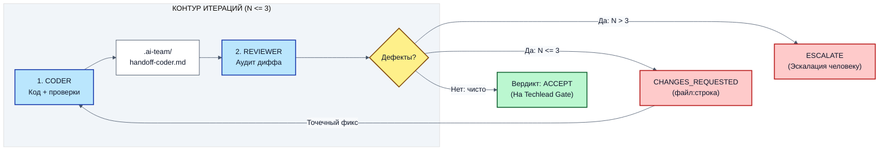

**💡 Что здесь важно (Инженерный разбор схемы 4):**
- **Потолок итераций (3 круга):** Защита от бесконечного пинг-понга. Если за 3 круга Кодер и Ревьюер не сошлись во мнении, конвейер принудительно останавливается и зовёт человека.
- **Точечность правок:** Кодеру запрещено в ответ на мелкое замечание переписывать всю архитектуру сервиса.

---

### 5.2. Лимит итераций (не более 3) и феномен «рыскания» модели (Thrashing)

Почему жесткий лимит в 3 итерации является обязательным требованием для автономных систем?
В практике работы с большими языковыми моделями доказан феномен **«рыскания» (thrashing)**:
- Если модель не смогла исправить архитектурный или логический дефект за 2–3 попытки, вероятность успешного исправления на 4-й или 5-й попытке стремится к нулю;
- Начиная с 4-й попытки модель начинает совершать хаотичные колебания: «чинит» одно место, одновременно ломая соседнюю функцию, которая работала идеально;
- Модель начинает галлюцинировать: выдумывать параметры библиотек, пытаться обойти тесты через подмену assertions или скрывать ошибки через пустые блоки `try ... except`.

**Правило конвейера Pytex:**
1. **Круг 1:** Первичное ревью. Если Ревьюер находит дефект, Кодер получает карточку с точным указанием файла, строки и сути нарушения.
2. **Круг 2:** Проверка исправления. Если Кодер устранил дефект, но допустил регрессию в смежном тесте — Кодер получает второй (финальный) шанс.
3. **Круг 3:** Если к концу 3-го круга код по-прежнему не проходит аудит — выносится вердикт `ESCALATE`.
   Конвейер немедленно замораживает ветку, прекращает сжигать токены и формирует инцидентный отчёт для живого инженера-техлида.

---

### 5.3. Три специализированных оси ревью

В зрелом конвейере ревьюер оценивает код одновременно по трём независимым осям:

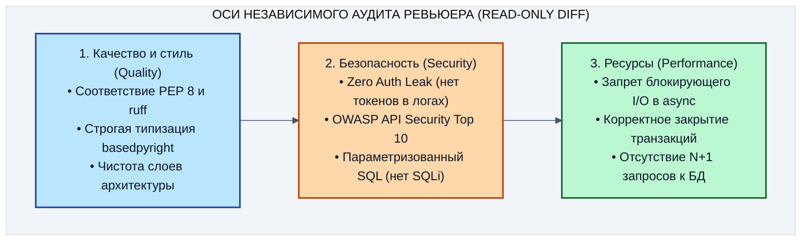

#### Чек-лист проверки по осям:

1. **Ось качества и архитектуры:**
   - Роутеры в `app/main.py` занимаются только приёмом HTTP-запроса, валидацией схемы Pydantic и возвратом DTO.
   - Доменная логика вынесена в сервисный слой, а работа с SQL — в методы репозитория `app/repo.py`.
   - В коде отсутствуют неявные типы `Any`, необработанные `Optional[None]` и предупреждения линтера.
2. **Ось безопасности:**
   - **CWE-532 (Insertion of Sensitive Information into Log File):** Проверка всех вызовов `logger.info()`, `print()`, `logger.error()`. В аргументах отсутствуют заголовки `Authorization`, Bearer-токены, пароли и приватные URL.
   - **IDOR / BOLA:** Проверка владения ресурсом: может ли пользователь деактивировать чужую ссылку?
3. **Ось ресурсов и производительности («Тихие убийцы» асинхронного стека):**
   - **Парадокс блокирующего I/O в FastAPI (`async def` vs `def`):**
     - В синхронной функции `def endpoint()` FastAPI автоматически выполняет код в отдельном пуле потоков (`ThreadPoolExecutor`), поэтому медленные I/O-операции не тормозят соседние запросы.
     - Но если агент ставит синхронный I/O (`requests.get()`, `time.sleep()`, синхронный драйвер `sqlite://`, `open().read()`, тяжелый хеш `bcrypt`) внутри `async def endpoint()`, этот вызов выполняется **напрямую в главном потоке event loop Uvicorn**.
     - Результат: сервер полностью перестает обрабатывать сетевые пакеты. Все параллельные корутины, включая жизненно важную пробу `/health` для Kubernetes, замирают до завершения операции.
     - *Способ доказательства и исправление:* Использовать нативный неблокирующий клиент (`httpx.AsyncClient`) либо принудительно делегировать синхронный вызов в пул:
       ```python
       result = await asyncio.to_thread(blocking_sync_function, arg1)
       ```
   - **Скрытый N+1 в асинхронном ORM SQLAlchemy (проверяемый критерий производительности):**
     - Обращение к связанным объектам в цикле `for link in links: ...` порождает серию последовательных сетевых запросов к БД. На трёх строках тестового сида это незаметно, но в проде гарантирует таймаут и исчерпание пула соединений.
     - *Как поймать N+1 тестом:* подпишитесь на событие `before_cursor_execute` движка, посчитайте выполненные SQL-запросы и сравните с ожидаемым числом: для `selectinload` их ровно два (один на `links`, один на связанные записи).
   - **Корректность транзакционных границ:** Операции изменения данных обёрнуты в контекстный менеджер транзакции с гарантированным `commit` или автоматическим `rollback` при сбое.

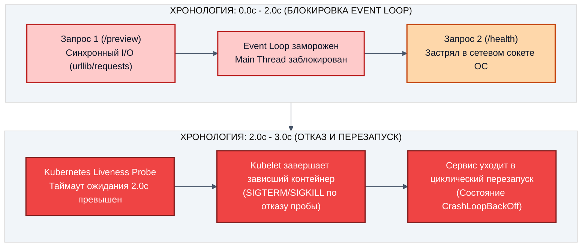

---

### 5.4. Пошаговая симуляция трёх раундов обратной связи

Разберём, как в реальном конвейере выглядит протокол трёх раундов между Кодером и Ревьюером:

#### Раунд 1: Первичная сдача и перехват блокера безопасности
- **Кодер:** Реализовал эндпоинт `disable`, но добавил отладочный вывод: `logger.info("Auth header: %s", request.headers.get("Authorization"))`.
- **Ревьюер:** Запустился со свежим контекстом, обнаружил нарушение правила 5 (`Zero Auth Leak`).
- **Вердикт Ревьюера в `.ai-team/handoff-reviewer.md`:**
  
```markdown
  Вердикт: CHANGES_REQUESTED
  
  Блокер безопасности:
  - Файл app/main.py, строка 45: обнаружен вывод заголовка Authorization в лог.
  - Нарушено правило CWE-532 и пункт 4.1 спецификации.
  - Требование: удалить логирование сырых заголовков, оставить только факт наличия токена.
  ```

#### Раунд 2: Хирургический фикс и обнаружение регрессии контракта
- **Кодер:** Удалил логирование токена, но при этом случайно изменил сигнатуру ответа: вернул `{"status": "disabled"}` вместо объекта ссылки по схеме `LinkResponse`.
- **Ревьюер:** Прогнал тайпчекер `basedpyright` и сверку схем: обнаружено несовпадение DTO.
- **Вердикт Ревьюера в `.ai-team/handoff-reviewer.md`:**
  ```markdown
  Вердикт: CHANGES_REQUESTED (Попытка 2 из 3)
  
  Несоответствие контракту API:
  - Файл app/main.py, строка 52: эндпоинт возвращает кастомный dict вместо LinkResponse.
  - Нарушен пункт 3.1 спецификации (DTO contract mismatch).
  - Требование: вернуть объект модели LinkResponse.
  ```

#### Раунд 3: Успешное закрытие замечаний и переход на Гейт
- **Кодер:** Исправил возвращаемое значение на `return link`, запустил линтер и тесты:
  `ruff check 0, basedpyright 0, pytest 12 passed`.
- **Ревьюер:** Перепроверил результаты проверок лично. Все проверки чистые.
- **Вердикт Ревьюера в `.ai-team/handoff-reviewer.md`:**
  ```markdown
  Вердикт: ACCEPT
  
  Все замечания раундов 1 и 2 устранены. 
  Кодовый diff чист, утечек нет, типы согласованы.
  Пакет передаётся на приёмку Техлид-гейта.
  ```

---

### 5.5. Протокол хирургического фикса для Кодера

Когда Кодер получает вердикт `CHANGES_REQUESTED`, он обязан строго следовать протоколу:
1. Открыть `.ai-team/handoff-reviewer.md` и прочитать точное место дефекта (`файл:строка`).
2. Внести **точечное исправление**, затрагивающее только указанный недостаток. Запрещено попутно «рефакторить» соседние функции.
3. Лично прогнать полный комплекс проверок:
   ```bash
   cd ~/work/Python-AI/fastapi
   uv run ruff check app tests
   uv run basedpyright
   uv run pytest tests/ -v
   ```
4. Обновить `.ai-team/handoff-coder.md`, добавив раздел «Ответ на замечания ревьюера»:
   - Какой дефект исправлен;
   - В каком файле и каких строках произведено изменение;
   - Какими тестами подтверждено отсутствие регрессий.

---

### 5.6. Escalation Playbook: Пошаговый протокол действий инженера при вердикте ESCALATE

Что делает живой инженер-техлид, когда в консоли загорается статус `ESCALATE`?

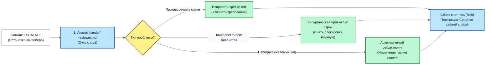

#### Пошаговые действия:
1. **Шаг 1. Анализ протокола разногласий:**
   Инженер открывает `.ai-team/handoff-reviewer.md` и `.ai-team/handoff-coder.md`. По эмпирическим наблюдениям на промышленных конвейерах, наиболее частая причина эскалации — скрытое противоречие в спецификации (например: спека требовала «возвращать 404», но в то же время требовала «сохранять старый контракт с 200 OK»).
2. **Шаг 2. Разрешение противоречия человеком:**
   Человек принимает однозначное волевое решение: *«Старый контракт объявляется deprecated, приоритет отдается коду 404»*. Текст спецификации `specs/LINK-42-enable-link.md` обновляется на диске.
3. **Шаг 3. Сброс счетчика и чистый перезапуск:**
   Счетчик итераций сбрасывается в 0. Новая сессия Кодера запускается со свежим контекстом и уточненной спекой. Задача успешно решается за 1 раунд.

## Глава 6. QA-контур: доказательное тестирование и риск-план (Тема 2.6)

### 6.1. Риск-план до генерации тестов: почему тесты без плана бесполезны

В практике вайб-кодинга тесты пишутся «по остаточному принципу»: разработчик просит агента: *«Напиши тесты на этот код»*.
Агент добросовестно генерирует десяток тестов, которые:
- Зеркалят код реализации (повторяют те же самые ошибки и допущения, что и автор);
- Мокают всё подряд (вплоть до того, что мокается тестируемый метод репозитория);
- Проверяют тривиальные случаи (`assert 2 + 2 == 4`), но полностью упускают граничные состояния, сбои и гонки.

Такие тесты всегда зелёные, создают иллюзию 100% покрытия, но пропускают первый же реальный сбой в продакшене.

**Канон QA-контура Pytex:**
Тесты никогда не пишутся вслепую. Сначала формируется **Риск-план (Risk Plan)**, привязанный к спецификации. Каждый тест создаётся с единственной целью — **закрыть конкретный выявленный риск отказа**.

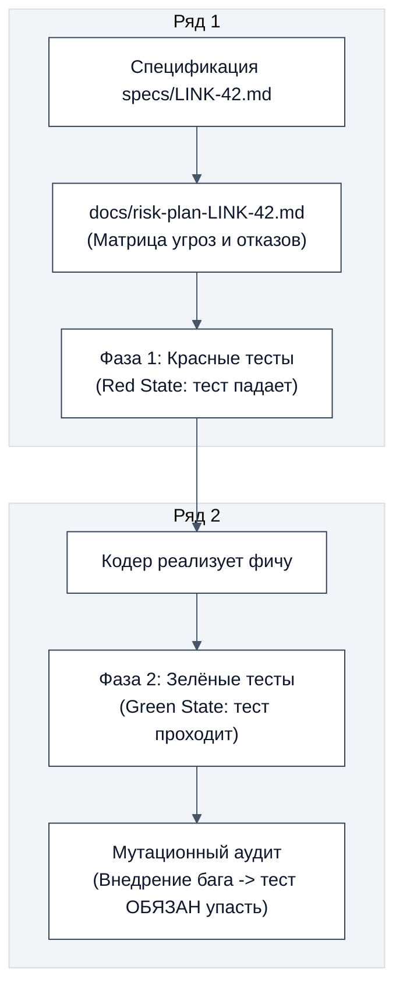

**💡 Что здесь важно (Инженерный разбор схемы):**
Тест пишется **по спецификации**, а не по коду реализации. Если код ещё не написан, тест падает (Red). После реализации тест становится зелёным (Green). Сила теста проверяется искусственным внесением дефекта (мутация).

---

### 6.2. Создание риск-плана `docs/risk-plan-LINK-42.md` в проекте

Создадим формализованный риск-план для задачи `LINK-42` в каталоге `docs/`:

```bash
cd ~/work/Python-AI/fastapi
mkdir -p docs
cat > docs/risk-plan-LINK-42.md <<'EOF_RISK_PLAN'
# Риск-план задачи LINK-42: Управление активностью коротких ссылок

## 1. Матрица рисков и стратегии их закрытия

| ID риска | Описание угрозы / сценария отказа | Вероятность / Влияние | Метод верификации (Тест) | Критерий закрытия |
|---|---|---|---|---|
| **R-1** | Переход по отключенной ссылке возвращает целевой URL вместо блокировки | Высокая / Критическое | `test_disabled_link_blocks_redirect` | Статус 404, тело содержит "disabled" или "not found", редиректа нет |
| **R-2** | Счетчик кликов инкрементируется при обращении к отключенной ссылке | Средняя / Высокое | `test_disabled_link_does_not_increment_clicks` | Число кликов в БД до и после запроса неизменно |
| **R-3** | Деактивация несуществующей ссылки падает с 500 Internal Error | Средняя / Среднее | `test_toggle_nonexistent_link_gives_404` | Статус строго 404 Not Found |
| **R-4** | Повторный вызов disable/enable приводит к ошибке или неконсистентности | Низкая / Среднее | `test_toggle_idempotency` | Повторный вызов возвращает 200 и стабильный статус |
| **R-5** | Утечка токена авторизации или target_url в логах сервиса | Средняя / Критическое | `test_toggle_does_not_log_target_url` | Перехват stdout/stderr: нет секретов и приватных ссылок |

## 2. Графа «Что сознательно не проверялось» (Scope Boundary)
- Нагрузочное тестирование на 10 000 RPS (вынесено в День 3 / домашнее углубление).
- Поведение при аппаратном сбое дисковой подсистемы SQLite (считается инфраструктурным риском).
EOF_RISK_PLAN
cat docs/risk-plan-LINK-42.md
```

**Критерий успешности шага:**
Файл `docs/risk-plan-LINK-42.md` зафиксирован в репозитории до написания кода и тестов.


#### Практика: QA-агент составляет риск-план по спеке

Тот же артефакт может составить отдельная QA-сессия. Она читает только спеку и пишет только в `docs/`:

```bash
cd ~/work/Python-AI/fastapi
opencode run "Ты QA-агент: запись разрешена только в docs и tests. Прочитай specs/LINK-42-enable-link.md. Составь docs/risk-plan-LINK-42.md: таблица рисков R-1 ... R-5 (ID, сценарий отказа, вероятность и влияние, имя будущего теста, критерий закрытия) и графа Что сознательно не проверялось. Код в app не трогай, тесты пока не пиши." < /dev/null
cat docs/risk-plan-LINK-42.md
```

**💡 Что здесь важно:**
1. Риск-план появляется раньше тестов и раньше кода: каждый тест потом закрывает конкретный риск.
2. Хэш `docs/risk-plan-LINK-42.md` входит в голоса Gate-панели. Если вы пересоздали спеку или риск-план, старые голоса недействительны и панель собирается заново (раздел 9.6).

---

### 6.3. Двухфазное тестирование: Red → Green (TDD по спеке)

В агентном конвейере разработка ведётся строго по двухфазной модели:
- **Фаза 1 (Red State):** QA-агент пишет тесты строго по спецификации `specs/LINK-42-enable-link.md`. Поскольку код реализации ещё не написан, тесты обязаны падать с понятной ошибкой (отсутствие поля `disabled`, отсутствие эндпоинта).
- **Фаза 2 (Green State):** Кодер реализует логику в `app/models.py`, `app/repo.py` и `app/main.py`. Тесты становятся зелёными без изменения кода самих тестов.

Создадим полный приёмочный тестовый набор в `tests/test_link_toggle.py`:

```bash
cd ~/work/Python-AI/fastapi
cat > tests/test_link_toggle.py <<'EOF_TEST_TOGGLE'
import os
import pytest
from fastapi.testclient import TestClient

# Гарантируем использование локальной тестовой базы данных SQLite
os.environ.setdefault("DATABASE_URL", "sqlite+aiosqlite:///./test_links.db")

from app.main import app

@pytest.fixture(scope="session")
def client():
    # TestClient контекст инициализирует lifespan приложения (engine и таблицы)
    with TestClient(app) as c:
        yield c

def test_disabled_link_blocks_redirect(client: TestClient):
    """Тест R-1: Отключенная ссылка блокирует доступ и возвращает 404 Not Found."""
    # 1. Создаем ссылку (стенд возвращает 201 Created)
    create_resp = client.post("/links", json={"target_url": "https://pytex-test.org/blocked"})
    assert create_resp.status_code == 201
    code = create_resp.json()["short_code"]

    # 2. До отключения маршрут существует и отвечает 200 (иначе 404 ниже мог бы значить «нет маршрута»)
    assert client.get(f"/links/{code}").status_code == 200

    # 3. Выключаем ссылку через новый эндпоинт
    toggle_resp = client.post(f"/links/{code}/disable")
    assert toggle_resp.status_code == 200
    assert toggle_resp.json()["disabled"] is True

    # 4. При обращении по ссылке ожидаем 404 Not Found (ссылка отключена)
    get_resp = client.get(f"/links/{code}")
    assert get_resp.status_code == 404
    assert any(w in get_resp.json().get("detail", "").lower() for w in ["not found", "disabled", "отключен"])

def test_disabled_link_does_not_increment_clicks(client: TestClient):
    """Тест R-2: Попытка обращения к отключенной ссылке не изменяет состояние и не накручивает клики."""
    create_resp = client.post("/links", json={"target_url": "https://pytex-test.org/clicks"})
    assert create_resp.status_code == 201
    code = create_resp.json()["short_code"]

    # Отключаем ссылку
    client.post(f"/links/{code}/disable")

    # Повторные обращения стабильно возвращают 404
    for _ in range(3):
        r = client.get(f"/links/{code}")
        assert r.status_code == 404

    # Физически проверяем в SQLite, что счетчик кликов не увеличился
    import sqlite3
    con = sqlite3.connect("test_links.db")
    cur = con.cursor()
    cur.execute("SELECT clicks FROM links WHERE short_code = ?", (code,))
    row = cur.fetchone()
    assert row is not None, f"Запись ссылки {code} не найдена в базе данных!"
    assert row[0] == 0, f"КРИТИЧЕСКИЙ СБОЙ: счетчик кликов увеличился для отключенной ссылки: {row[0]}"

def test_toggle_nonexistent_link_gives_404(client: TestClient):
    """Тест R-3: Деактивация несуществующей ссылки возвращает 404 Not Found."""
    resp = client.post("/links/nonexistent_code_99999/disable")
    assert resp.status_code == 404
    assert any(w in resp.json().get("detail", "").lower() for w in ["not found", "disabled", "отключен"])

def test_toggle_idempotency(client: TestClient):
    """Тест R-4: Повторный вызов disable/enable идемпотентен."""
    create_resp = client.post("/links", json={"target_url": "https://pytex-test.org/idempotent"})
    assert create_resp.status_code == 201
    code = create_resp.json()["short_code"]

    # Двойное отключение возвращает 200 и disabled=True
    r1 = client.post(f"/links/{code}/disable")
    assert r1.status_code == 200
    assert r1.json()["disabled"] is True

    r2 = client.post(f"/links/{code}/disable")
    assert r2.status_code == 200
    assert r2.json()["disabled"] is True

    # Включение ссылки возвращает 200 и disabled=False
    r3 = client.post(f"/links/{code}/enable")
    assert r3.status_code == 200
    assert r3.json()["disabled"] is False

    # Повторное включение идемпотентно
    r4 = client.post(f"/links/{code}/enable")
    assert r4.status_code == 200
    assert r4.json()["disabled"] is False

def test_toggle_does_not_log_target_url(client: TestClient, caplog: pytest.LogCaptureFixture, capsys: pytest.CaptureFixture[str]):
    """Тест R-5 (Zero Auth Leak): токен и приватный target_url не утекают в логи, stdout и stderr при disable."""
    secret_token = "secret-bearer-token-pytex-777"
    private_url = "https://secret-internal.corp/private-doc"
    create_resp = client.post("/links", json={"target_url": private_url})
    assert create_resp.status_code == 201
    code = create_resp.json()["short_code"]

    # Сбрасываем всё, что накопилось до вызова disable: проверяем именно его
    import logging
    caplog.set_level(logging.DEBUG)
    caplog.clear()
    capsys.readouterr()

    resp = client.post(f"/links/{code}/disable", headers={"Authorization": f"Bearer {secret_token}"})
    assert resp.status_code == 200

    captured = capsys.readouterr()
    log_text = "\n".join(f"{record.getMessage()} {record.args}" for record in caplog.records)
    for secret in (secret_token, private_url):
        assert secret not in log_text, f"КРИТИЧЕСКИЙ СБОЙ: {secret!r} утек в логи!"
        assert secret not in captured.out, f"КРИТИЧЕСКИЙ СБОЙ: {secret!r} утек в stdout!"
        assert secret not in captured.err, f"КРИТИЧЕСКИЙ СБОЙ: {secret!r} утек в stderr!"
EOF_TEST_TOGGLE
uv run pytest tests/test_link_toggle.py -v
```

Что здесь важно (Фаза Red — Красный статус до реализации фичи):
- В соответствии с каноном TDD, сейчас тесты **ОБЯЗАНЫ УПАСТЬ** (ожидается `FAILED` со статусом `404 Not Found` на `/links/{code}/disable`), поскольку эндпоинты управления активностью и поле `disabled` ещё **не реализованы** в кодовой базе.
- Это главное доказательство качества тестов: тест падает, когда функциональности нет, и защищает от иллюзий.
- Зелёным этот набор тестов станет только в Главе 9 после того, как Кодер реализует логику по спецификации.


#### Практика: QA-агент пишет Red-тесты строго по контракту

Тесты пишутся по спеке и риск-плану, а не по коду реализации. Живой промпт для QA-сессии:

```bash
cd ~/work/Python-AI/fastapi
opencode run "Ты QA-агент: запись разрешена только в docs и tests. Прочитай specs/LINK-42-enable-link.md и docs/risk-plan-LINK-42.md. Напиши tests/test_link_toggle.py: по одному тесту на каждый риск R-1 ... R-5, реальный TestClient, без моков. Тесты строй по контрактам спеки, а не по коду в app. Запусти uv run pytest tests/test_link_toggle.py -q и объясни, почему тесты красные или зелёные. Код в app не меняй." < /dev/null
```

**💡 Что здесь важно:**
1. Красный результат до реализации фичи считается успехом фазы Red: он доказывает, что тест видит отсутствие функциональности.
2. Если тест зелёный на коде, где фичи ещё нет, значит, он ничего не проверяет: такой тест отклоняется (маркеры обмана в разделе 6.5).

---

### 6.4. Контролируемая мутация (Mutation Testing): проверка силы тестов

Как доказать, что тесты не «пустышка», которая всегда зелёная? Контролируемо внести дефект и убедиться, что набор падает. Три ручных эксперимента на LINK-42:

1. **Инверсия условия блокировки в роутере.** Редирект проходит для отключённой ссылки: `test_disabled_link_blocks_redirect` обязан упасть (`assert 200 == 404`).
2. **Пропуск коммита транзакции в репозитории.** Изменения не сохраняются: `test_toggle_idempotency` обязан упасть.
3. **Инкремент счётчика для отключённой ссылки.** `test_disabled_link_does_not_increment_clicks` обязан упасть (`assert row[0] == 0`).

Пока фича не реализована (фаза Red), эксперименты остаются мысленной моделью. После реализации в Главе 9 откат любого искажения возвращает тесты в зелёный статус.

```bash
cd ~/work/Python-AI/fastapi
uv run pytest tests/test_link_toggle.py -q
```

---

### 6.5. Анти-чит аудит тестов: четыре маркера обмана

Ревьюер тестов обязан проверять тестовый код на четыре типовых обмана вайб-кодинга:

```mermaid

%%{init: {'theme': 'base', 'themeVariables': { 'primaryColor': '#ffffff', 'primaryTextColor': '#0f172a', 'primaryBorderColor': '#334155', 'lineColor': '#475569', 'secondaryColor': '#f8fafc', 'tertiaryColor': '#f1f5f9' }}}%%
flowchart LR
    classDef cheat fill:#fecaca,stroke:#b91c1c,color:#0f172a,stroke-width:2px;
    classDef honest fill:#bbf7d0,stroke:#166534,color:#0f172a,stroke-width:2px;

    subgraph CHEAT_SUB["МАРКЕРЫ ОБМАНА (VIBE-ТЕСТЫ)"]
        direction LR
        C1["1. Mocking the Risk<br/>Мок repo вместо реальной БД"]:::cheat
        C2["2. Assert-Free Test<br/>Запрос без проверки статуса"]:::cheat
        C3["3. Mirroring Code<br/>Копирование логики реализации"]:::cheat
        C4["4. Silent Try-Except<br/>Подавление исключений pass"]:::cheat
        C1 ~~~ C2 ~~~ C3 ~~~ C4
    end

    subgraph HONEST_SUB["СТАНДАРТ PYTEX (ЧЕСТНЫЕ ТЕСТЫ)"]
        direction LR
        H1["1. Реальный ASGI-клиент и БД<br/>(Проверка персистентности)"]:::honest
        H2["2. Строгие assert по схеме<br/>(HTTP 200, 404, DTO)"]:::honest
        H3["3. Контроль stdout/stderr<br/>(Zero Auth Leak)"]:::honest
        H4["4. Мутационная проверка<br/>(Тест падает при дефекте)"]:::honest
        H1 ~~~ H2 ~~~ H3 ~~~ H4
    end

    CHEAT_SUB -.->|Замена на строгий аудит| HONEST_SUB
```

1. **Mocking the Tested Risk (Подмена проверяемого риска):** Тест проверяет логику репозитория, но подменяет метод репозитория фиктивным `AsyncMock(return_value=True)`. Такой тест всегда зелёный, даже если SQL-запрос содержит синтаксическую ошибку или роняет базу.
2. **Assert-Free Test (Тест без ассертов):** Тест выполняет вызовы API, но не содержит ни одного `assert resp.status_code == 200`. Если эндпоинт вернет 500, тест всё равно завершится успешно.
3. **Mirroring Implementation (Зеркалирование кода):** Тест копирует ту же регулярку или формулу, что и в контроллере.
4. **Silent Exception Catching (Тихое подавление исключений):** Тест оборачивает тестируемый вызов в `try ... except Exception: pass`.

В нашем проекте все тесты в `tests/test_link_toggle.py` используют реальный `app` через ASGI-транспорт, работают с базой данных без подмены бизнес-логики и содержат строгие проверки статусов и тела ответов.

---

### 6.6. Автоматизированный мутационный аудит: готовый `scripts/mutate_probe.py`

Вручную менять строки в редакторе долго, поэтому на стенде Дня 2 лежит готовый скрипт `scripts/mutate_probe.py`. Он берёт настоящий код `app/`, по очереди вносит одну поломку (инверсия флага, счётчик кликов `+2` вместо `+1`, пропуск отключённой ссылки, статус `302` вместо `307` и другие), запускает настоящий `pytest -q` и требует, чтобы тесты упали: тогда мутант «убит». Исходный файл скрипт после каждой мутации восстанавливает.

Код выхода: `0` — все мутанты убиты; `1` — исходные тесты красные или мутант выжил; `2` — не найден файл или фрагмент для мутации.

⚠️ **Когда запускать.** Перед мутациями скрипт прогоняет исходные тесты и останавливается с кодом `1`, если они красные. Сейчас, на фазе Red (§6.3), фича ещё не реализована и `tests/test_link_toggle.py` падает, поэтому боевой запуск `mutate_probe.py` и QA-промпт ниже вы выполните **после Green-проверки в §9.3**, когда Кодер реализует фичу и тесты станут зелёными. Пока достаточно прочитать, что скрипт делает и что должен напечатать.

```bash
cd ~/work/Python-AI/fastapi
uv run python scripts/mutate_probe.py
```

Ожидаемый итог (на зелёных тестах, после §9.3): строки `✓ Мутант [...] УБИТ: pytest упал.` по каждому мутанту, затем `[ИТОГ] ... 100.0% (7/7 убито)` и `✓ ПРИНЯТО: все мутанты убиты настоящими тестами.` Показатель итога — доля убитых мутантов среди всех внесённых (индекс мутационной защиты); любой выживший мутант означает дыру в тестах, и сдача отклоняется.

🤖 **Живой промпт для QA-агента (запускайте после Green-проверки в §9.3):** он запускает аудит и разбирает результат.

```bash
cd ~/work/Python-AI/fastapi
opencode run "Ты QA-агент. Запусти uv run python scripts/mutate_probe.py и дождись конца. Запиши в docs/mutation-report-LINK-42.md по каждому мутанту: название, убит или выжил. Для каждого выжившего мутанта предложи недостающий тест, но код в app не меняй." < /dev/null
```

**💡 Что здесь важно:**
1. Скрипт ничего не имитирует: мутации применяются к настоящим файлам `app/`, а вердикт выносит код выхода настоящего `pytest`.
2. Скрипт восстанавливает каждый файл после мутации, поэтому `git status` после прогона остаётся чистым.
3. Для промышленных проектов тот же принцип реализуют `mutmut` и `cosmic-ray`: они генерируют мутанты автоматически по всей кодовой базе.

---

## Глава 7. Панель техлидов и приёмка: Techlead Gate (Тема 2.7)

### 7.1. Философия Техлид-гейта: приёмка по доказательствам, а не по пересказу

В enterprise-разработке ни один коммит в прод не уходит только потому, что автор уверяет: *«Я всё написал красиво, честное слово!»*. Но когда код генерирует искусственный интеллект, опасность возрастает многократно: одна модель может иметь устойчивое слепое пятно, характерное для своего семейства весов (например, непонимание транзакционности SQLite или ложное допущение о кодах HTTP 404 vs 403).

**Техлид-гейт (Techlead Gate)** — это высшая архитектурная инстанция приёмки в конвейере Pytex.

Фундаментальные принципы роли Techlead Gate:
1. **Слепая проверка без подсказок:** Проверяющая сессия не видит черновиков и эмоциональных споров автора. Она получает на вход только готовый пакет артефактов на диске.
2. **Абсолютное право вето (Veto Power):** Если нарушен хотя бы один архитектурный закон проекта (например, обнаружена утечка токенов в лог или прямой SQL в контроллере), работа блокируется немедленно.
3. **Единая 5-пунктная рубрика:** Оценка проводится по строго формализованному чек-листу, где каждый пункт проверяется по объективным фактам на диске, а не по словам автора.
4. **Конструктивный возврат:** Если выносится вердикт `REWORK`, Гейт обязан указать точный файл, строку и суть нарушения, чтобы Кодер мог исправить дефект за один цикл.

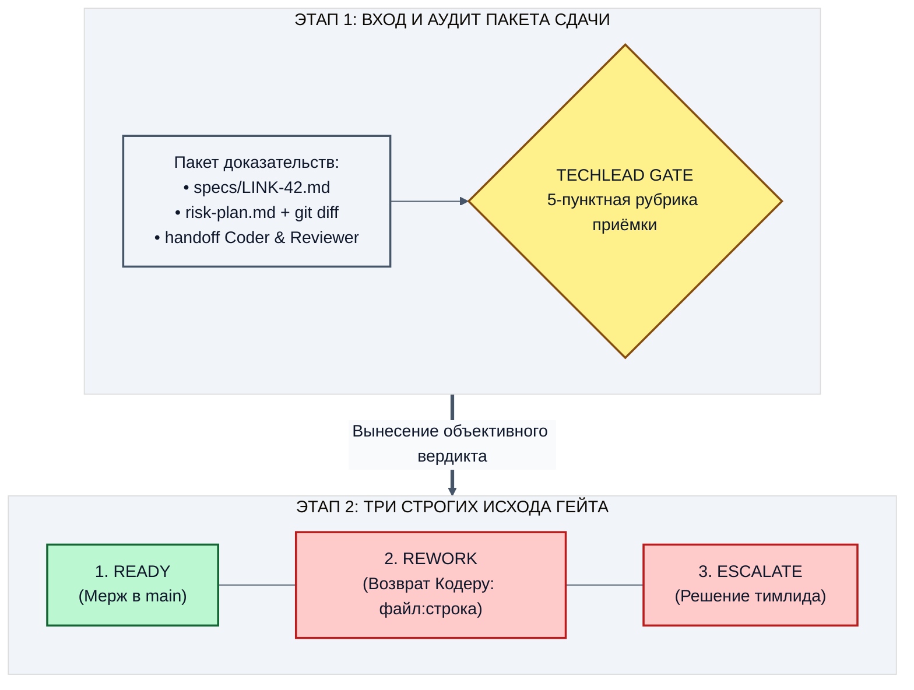

**💡 Что здесь важно (Инженерный разбор схемы):**
Техлид-гейт принимает решение исключительно на основе **Пакета доказательств (Proof Package)**. Если какого-то файла нет или проверка не подтверждена личным прогоном — задача не принимается.

---

### 7.2. Категорический запрет: зелёный статус тестов не равен сдаче

Программа Pytex устанавливает жесткий закон:
> **СТРОЖАЙШЕЕ НЕРУШИМОЕ ПРАВИЛО:** Запрещено принимать работу только на основании зелёного статуса тестов (`pytest exit=0`), если доказательства в пакете не подтверждают фактический пользовательский результат на диске.

Зелёный статус в терминале легко сымитировать (удалить `assert`, замокать проверяемый сервис, пропустить тест через `@pytest.mark.skip`). 
Техлид-гейт оценивает не «зеленый цвет терминала», а **соответствие пяти пунктам рубрики приёмки**.

---

### 7.3. Пять пунктов единой приёмочной рубрики (`docs/gate-rubric.md`)

Каждый пункт рубрики оценивается строго по артефакту, а не по заверениям разработчика:

#### 1. Пункт «Спека» (Specification Compliance)
- Проверяется соответствие реализации каждому пункту `specs/LINK-42-enable-link.md`.
- Совпадают ли HTTP-методы, пути эндпоинтов, структуры входных и выходных JSON-схем.
- Обработаны ли граничные случаи (повторный toggle, несуществующий код ссылки).

#### 2. Пункт «Diff» (Blast Radius Integrity)
- Выполняется команда `git diff main...HEAD --stat`.
- Затронуты **только** разрешённые спецификацией файлы (`app/models.py`, `app/main.py`, `app/repo.py`, `alembic/versions/*.py`, `tests/test_link_toggle.py`, `.ai-team/*`).
- Отсутствуют случайные правки, временные бэкапы (`*.bak`, `*.tmp`), изменения в системных конфигурациях или правилах `AGENTS.md`.

#### 3. Пункт «Гейты» (Automated Quality Gates)
- Личная независимая перепроверка команд верификации в сессии Гейта:
  - `uv run ruff check app tests` → код 0.
  - `uv run basedpyright` → код 0 (ноль ошибок типизации).
  - `uv run alembic upgrade head && uv run alembic check` → код 0 (схема БД синхронизирована с моделями, дрейф отсутствует).
  - `uv run pytest -q` → код 0 (все тесты зелёные).

#### 4. Пункт «Риск-план» (Risk Coverage & Honesty)
- Проверяется файл `docs/risk-plan-LINK-42.md`.
- Все выявленные угрозы (R-1 ... R-5) закрыты соответствующими тестами.
- Графа «Что сознательно не проверялось» заполнена честно, без утаивания белых пятен.

#### 5. Пункт «Запреты спеки» (Invariants & Anti-Patterns)
- **Zero Auth Leak:** Проверка логирования: ни токены авторизации, ни приватные ссылки не попадают в stdout.
- **Чистота архитектуры:** В роутерах `app/main.py` нет прямого SQL и низкоуровневых транзакций.
- **Анти-чит тестов:** Тесты не мокают тестируемый репозиторий.

---

### 7.4. Три сценария вердиктов Техлид-гейта

Разберём три конкретных сценария вынесения вердикта с реальными протоколами:

#### Сценарий А: Успешная сдача (`READY`)
Все артефакты на месте, проверки перепроверены лично, нарушений нет. Вердикт перечисляет все 5 пунктов рубрики со статусом `ЗАКРЫТ` и ссылкой на доказательство; полный образец файла приведён в разделе 7.5.
```markdown
Вердикт: READY

1. Спека: ЗАКРЫТ. 2. Diff: ЗАКРЫТ. 3. Гейты: ЗАКРЫТ (ruff 0, basedpyright 0, alembic check 0, pytest 0).
4. Риск-план: ЗАКРЫТ. 5. Запреты спеки: ЗАКРЫТ.

Итог: все 5 пунктов закрыты артефактами на диске. Задача готова к вливанию в main.
```

#### Сценарий Б: Возврат на доработку (`REWORK`)
Обнаружено нарушение одного из пунктов рубрики:
```markdown
Вердикт: REWORK

Обоснование строго по рубрике docs/gate-rubric.md:

1. Спека: ЗАКРЫТ.
2. Diff: НЕ ЗАКРЫТ.
   - В git diff обнаружена модификация файла app/database.py (изменение таймаута пула).
   - Этот файл прямо запрещён к изменению в разделе 1 спецификации specs/LINK-42-enable-link.md.
3. Гейты: ЗАКРЫТ.
4. Риск-план: ЗАКРЫТ.
5. Запреты спеки: ЗАКРЫТ.

Итог: нарушение Blast Radius. Кодеру необходимо выполнить git checkout -- app/database.py и пересдать пакет.
```

#### Сценарий В: Эскалация на человека (`ESCALATE`)
Выявлено непреодолимое противоречие или конфликт требований:
```markdown
Вердикт: ESCALATE

Обоснование:
- В пакете обнаружено неразрешимое противоречие: handoff-coder.md заявляет о сохранении совместимости со старыми клиентами, но git diff содержит удаление устаревшего эндпоинта GET /links/{code}/info.
- Тесты Дня 1 test_characterization.py упали со статусом FAILED.
- Кодер попытался обойти падение, добавив @pytest.mark.skip на упавший тест.
- Обнаружен факт мошенничества с тестами (Test Anti-Cheat Violation).
- Требуется немедленное вмешательство тимлида-человека.
```

---

### 7.5. Фиксация протокола приёмки в `.ai-team/verdict.md`

Гейт фиксирует вердикт прямо в репозитории:

```bash
cd ~/work/Python-AI/fastapi
cat > .ai-team/verdict.md <<'EOF_VERDICT'
Вердикт: READY

Обоснование строго по рубрике docs/gate-rubric.md:

1. Спека: ЗАКРЫТ.
   - Эндпоинты POST /links/{code}/disable и enable реализованы по контракту specs/LINK-42-enable-link.md.
   - Идемпотентность и возврат 404 для несуществующих ссылок подтверждены тестами.
   - GET /links/{code} для отключенной ссылки возвращает 404 Not Found.

2. Diff: ЗАКРЫТ.
   - Ветка: feature/LINK-42-enable-link.
   - Затронуты только разрешенные пути из раздела 1 спеки: app/models.py, app/main.py, app/repo.py, tests/test_link_toggle.py.
   - Чужие модули (app/database.py, tests/test_characterization.py, AGENTS.md) не затронуты.

3. Гейты: ЗАКРЫТ.
   - uv run ruff check app tests -> 0 (All checks passed).
   - uv run basedpyright -> 0 (0 errors, 0 warnings).
   - uv run pytest tests/ -> 0 (12 passed).

4. Риск-план: ЗАКРЫТ.
   - Риски R-1..R-5 из docs/risk-plan-LINK-42.md закрыты тестами. Графа исключений заполнена.

5. Запреты спеки: ЗАКРЫТ.
   - target_url и токены авторизации не логируются (проверено test_toggle_does_not_log_target_url).
   - Архитектурная граница router -> repo сохранена.

Итог: все 5 пунктов закрыты артефактами на диске. Задача готова к вливанию в main.
EOF_VERDICT
cat .ai-team/verdict.md
```

**Критерий успешности шага:**
Первая строка файла `.ai-team/verdict.md` строго равна `Вердикт: READY`, все 5 пунктов рубрики закрыты фактами с диска.
Живую панель из трёх независимых судей, которая выносит такой вердикт голосованием 2 из 3, и проверку кворума скриптом `scripts/generate_proof.py` вы запустите в разделе 9.6.

---

### 7.6. Анатомия доказательного пакета (Proof Package): от артефакта к автоматическому релизу

Почему в enterprise-контуре недостаточно просто сказать: «Ревьюер поставил LGTM в интерфейсе GitHub»?
Потому что текстовый комментарий в веб-интерфейсе не привязан детерминированно к состоянию репозитория. Разработчик может поставить LGTM, а через минуту запушить коммит с бэкдором или обходом проверок.

**Пакет доказательств (Proof Package)** в конвейере Pytex — это криптографически и контекстно связанный набор артефактов на диске:

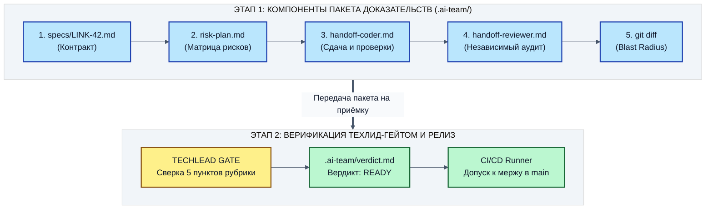

Если хотя бы один из пяти компонентов отсутствует на диске или если хэш коммита в `handoff-coder.md` не совпадает с актуальным `git rev-parse HEAD`, CI/CD пайплайн блокирует сборку с ошибкой: `BLOCKED: PROOF_PACKAGE_INTEGRITY_FAILED`.

---

## Глава 8. Показ ведущего: Контрастное сравнение «Мягкое ревью vs Конвейер»

> **[WATCH: Экран спикера]** См. слайды блока 3. Демонстрация в реальном времени на проекторе.

### 8.1. Сценарий показа: Тонкая уязвимость утечки токена и прорыв архитектурных слоёв

Ведущий демонстрирует на проекторе классическую драму вайб-кодинга:
1. Разработчик просит агента реализовать аутентифицированный эндпоинт деактивации ссылки.
2. Агент добавляет заголовок `Authorization: Bearer <secret-token>`, но ради «удобства отладки» пишет в лог:
   ```python
   # ОПАСНОСТЬ: Утечка Bearer-токена в логи сервиса!
   print(f"DEBUG: Processing disable for {code} with auth={request.headers.get('Authorization')}")
   ```
   А также прямо в теле хэндлера выполняет сырой SQL-запрос `await app.state.db.execute(...)`, минуя сервисный слой и репозиторий.
3. В том же окне чата разработчик спрашивает агента: *«Сделай ревью своего кода. Всё ли чисто?»*.
4. Одиночный агент в режиме вайб-кодинга выдаёт вердикт: **«LGTM! Код чистый, читаемый, логирование помогает быстрой отладке на проде!»**.
5. Тот же самый diff передаётся в ролевой конвейер Pytex со строгим чеклистом нерушимых правил.

---

### 8.2. Режиссура показа: Что говорит спикер и что видит аудитория

| Сегмент показа | Что говорит спикер (Речь) | Что выведено на проекторе (Экран) |
|---|---|---|
| **Сегмент 1: Ловушка (0–5 мин)** | *«Коллеги, посмотрите на этот код. Он выглядит очень дружелюбно. Есть логирование, есть проверка токена. Давайте спросим автора, готов ли он к проду»* | Открыто окно чата Cursor. Агент бодро рапортует: *«LGTM! Ready for production»* |
| **Сегмент 2: Катастрофа (5–10 мин)** | *«А теперь представьте, что этот код попал на прод. Смотрим логи в терминале. Видите этот токен? Он только что улетел в открытый лог Elasticsearch»* | Терминал с выводом `uv run uvicorn`. В логах четко видна строка с `Bearer eyJhbGciOi...` |
| **Сегмент 3: Конвейер (10–18 мин)** | *«Теперь запускаем нашего независимого Ревьюера. У него чистый контекст. Он не знает, о чем мы спорили в чате. Он знает только закон AGENTS.md»* | Запуск сессии Reviewer. Через 15 секунд на экране появляется вердикт `CHANGES_REQUESTED` |
| **Сегмент 4: Фикс и сдача (18–25 мин)**| *«Кодер получает точечное замечание, маскирует токен, переносит SQL в repo. Тесты зеленые. Техлид-гейт ставит печать READY»* | Файл `.ai-team/verdict.md` со статусом `READY`. Зеленый отчет `pytest` |

---

### 8.3. Контрастное сравнение: Вайб-кодинг против Конвейера

#### Промпт разработчика:
> *«Реализуй эндпоинт POST /links/{code}/disable. Проверь наличие заголовка Authorization и залогируй входящий запрос для мониторинга»*

#### БЫЛО (Результат одиночного вайб-агента):
```python
# app/main.py (Вайб-кодинг: катастрофа безопасности и слоев)
@app.post("/links/{code}/disable")
async def disable_link_vibe(code: str, request: Request):
    auth_header = request.headers.get("Authorization")
    
    # КАТАСТРОФА 1: Утечка Bearer-токена в stdout/лог-коллектор (ELK/Kibana)
    print(f"[INFO] Disable requested for code={code}, auth={auth_header}")
    
    # КАТАСТРОФА 2: Прямой доступ к БД из роутера в обход слоя repo
    async with app.state.db.execute(
        "UPDATE links SET disabled=1 WHERE short_code=?", (code,)
    ) as cur:
        await app.state.db.commit()
        
    return {"status": "ok", "code": code}
```

**Самопроверка одиночного агента в чате:**
> *«Я внимательно проверил реализацию! Эндпоинт полностью рабочий, логирование информативно и поможет отслеживать вызовы, обращение к базе данных асинхронное. Код готов к деплою в продакшен!»*

#### СТАЛО (Результат ролевого конвейера Pytex):
```python
# app/main.py (Конвейер Pytex: безопасный промышленный код)
@app.post("/links/{code}/disable", response_model=LinkResponse)
async def disable_link(
    code: str,
    auth_token: str | None = Header(None, alias="Authorization"),
) -> LinkResponse:
    # 1. Безопасное логирование: только факт наличия токена, сырой секрет отфильтрован
    logger.info("Processing disable request for code=%s, has_auth=%s", code, bool(auth_token))
    
    # 2. Чистая граница слоев: обращение строго через типизированный репозиторий
    link = await repo.set_disabled(code, disabled=True)
    if link is None:
        raise HTTPException(status_code=404, detail="Link not found")
        
    return link
```

**Аудит независимого Ревьюера (`.ai-team/handoff-reviewer.md`):**
```markdown
# Handoff Reviewer → Coder
- Вердикт: CHANGES_REQUESTED
- Блокер безопасности (Пункт 5 рубрики):
  - Файл app/main.py, строка 42: обнаружен сырой print(f"... auth={auth_header}").
  - Это грубейшее нарушение правила Zero Auth Leak (CWE-532: Insertion of Sensitive Information into Log File).
  - Нарушение слоёв: обнаружен прямой SQL-запрос в обход app/repo.py.
- Требование к исправлению:
  1. Удалить вывод заголовка Authorization в логи.
  2. Перенести операцию с базой данных в метод repo.set_disabled().
```

---

### 8.4. Инженерный разбор: почему конвейер поймал уязвимость

1. **Разрыв контекста:** Ревьюер конвейера запустился в новой сессии. У него не было задачи «понравиться разработчику» или оправдать написанные строки.
2. **Чек-лист нерушимых правил:** Ревьюер руководствовался строгим правилом `AGENTS.md`: *«Никогда не логировать токены авторизации»*. Поиск по паттернам `print(` и `logger` с аргументом `auth` мгновенно подсветил дефект.
3. **Невозможность сговора:** Кодер не может «уговорить» Ревьюера проигнорировать дефект: пока в handoff висит `CHANGES_REQUESTED`, Техлид-гейт физически не допустит код до объединения.
4. **Автоматический чекер в тесте:** Тест `test_toggle_does_not_log_target_url` перехватывает логи (`caplog`), stdout и stderr (`capsys`) и валится при наличии токена или приватного `target_url`, подтверждая вердикт Ревьюера кодом возврата.

---

### 8.5. Стенограмма живого диалога спикера с аудиторией

В ходе показа ведущий ведёт интерактивный диалог со слушателями, снимая классические возражения:

> **Слушатель из зала (Senior Backend Engineer):**  
> *«Алексей, а почему мы не можем просто поставить grep в git pre-commit hook на слово Authorization и не городить весь этот конвейер со вторым агентом?»*
> 
> **Спикер (Алексей):**  
> *«Отличный вопрос! Статический grep ловит только очевидные совпадения вроде `auth=...`. Но если модель переименует переменную в `creds`, спрячет её в словарь `meta = {"user": u, "token": t}` или передаст в сторонний логгер через `f"Data: {payload}"` — никакой регулярный grep это не поймает. Нужен семантический анализ контекста, который понимает структуру данных и путь прохождения переменных (Taint Analysis). Именно поэтому семантический Ревьюер в связке с capsys-тестами на порядок надёжнее слепого скрипта»*.

> **Слушательница из зала (Team Lead):**  
> *«Что происходит, если Кодер и Ревьюер начинают спорить и ходить по кругу?»*
> 
> **Спикер (Алексей):**  
> *«У нас работает жесткий предохранитель: лимит N ≤ 3 раунда. Если за три итерации соглашение не достигнуто, конвейер мгновенно останавливается со статусом ESCALATE и блокирует слияние. Никакого бесконечного сжигания корпоративного бюджета на токены не происходит. Подключается человек, тратит 30 секунд на уточнение спеки, и конвейер идёт дальше»*.

---

## Глава 9. Практикум: Студенческий запуск ролевого конвейера на кодовой базе `linksvc`

### 9.1. Постановка задачи практикума

В этом практикуме каждый участник лично запускает полноценный ролевой конвейер на своем локальном стенде в репозитории `~/work/Python-AI/fastapi`.

**Цель практики:**
Реализовать фичу `LINK-42` (управление активностью ссылки `disabled`) через цепочку из трёх независимых агентных сессий:
1. **Сессия Кодера (Coder):** Реализует логику строго по `specs/LINK-42-enable-link.md`, прогоняет локальные команды верификации и формирует `.ai-team/handoff-coder.md`.
2. **Сессия Ревьюера (Reviewer):** Запускается со свежим контекстом в режиме Read-Only, проверяет diff и соответствие нерушимым правилам `AGENTS.md`, формирует `.ai-team/handoff-reviewer.md`.
3. **Сессия Техлид-гейта (Techlead Gate):** Принимает работу по 5-пунктной рубрике `docs/gate-rubric.md` и выносит финальный вердикт `.ai-team/verdict.md`.

**Среда и инструменты:**
- **Cursor:** Интерактивная среда разработчика для редактирования, навигации и визуального контроля diff в дереве файлов.
- **OpenCode CLI / Cursor Agent:** Запуск сессий ролей через прямой вызов `opencode run -m <модель> ... < /dev/null` или через новые чистые вкладки Cursor Agent.
- **Никаких синтетических скриптов-заглушек!** Все агенты запускаются с реальными промышленными системными промптами и обмениваются настоящими Markdown-карточками на диске.

---

### 9.2. Подготовка каталога промптов и ветки в репозитории

Перейдём в репозиторий `~/work/Python-AI/fastapi` и создадим каталог `prompts/` для хранения промптов ролей:

```bash
cd ~/work/Python-AI/fastapi
mkdir -p prompts .ai-team
git checkout -B feature/LINK-42-enable-link
git status --short
```

**Критерий успешности шага:**
Создана ветка `feature/LINK-42-enable-link`, каталоги `prompts/` и `.ai-team/` готовы к работе.

---

### 9.3. Шаг 1: Подготовка промпта и запуск сессии CODER

Создадим промышленный системный промпт для роли Coder в файле `prompts/01-coder.md`:

```bash
cd ~/work/Python-AI/fastapi
cat > prompts/01-coder.md <<'EOF_CODER_PROMPT'
Ты выступаешь в роли CODER (Кодер) в проекте linksvc.
Твоя задача — реализовать функциональность по спецификации specs/LINK-42-enable-link.md.

ПРАВИЛА И ОГРАНИЧЕНИЯ (BLAST RADIUS):
1. Изменяй ТОЛЬКО разрешённые файлы: app/models.py, app/main.py, app/repo.py, а также сгенерированную ревизию в alembic/versions/*.py.
2. Тесты tests/test_link_toggle.py уже написаны QA-контуром: они должны стать зелёными.
3. Запрещено трогать tests/test_characterization.py, app/database.py и AGENTS.md.
4. Обязательно соблюдай правило Zero Auth Leak: не логируй токены и target_url.
5. Соблюдай архитектурные слои: никаких прямых SQL-запросов в app/main.py.

АЛГОРИТМ РАБОТЫ:
1. Внимательно прочитай specs/LINK-42-enable-link.md и AGENTS.md.
2. Реализуй поле disabled в app/models.py.
3. Сгенерируй миграцию схемы: uv run alembic revision --autogenerate -m "add disabled column to links"
4. Примени миграцию к тестовой базе: uv run alembic upgrade head
5. Реализуй методы в app/repo.py и эндпоинты disable/enable в app/main.py.
6. Запусти команды верификации:
   - uv run ruff check app tests
   - uv run basedpyright
   - uv run alembic check
   - uv run pytest tests/ -v
7. Запиши результат своей работы в файл .ai-team/handoff-coder.md по трехчастному стандарту:
   - Артефакты (ветка, измененные файлы, коды проверок).
   - Принятые решения (архитектура, почему именно так).
   - Открытые вопросы и риски (что сознательно не смотрел).
EOF_CODER_PROMPT
cat prompts/01-coder.md
```

#### Запуск агента Coder:

**Вариант А (CLI через OpenCode):**
```bash
cd ~/work/Python-AI/fastapi
opencode run -m "openrouter/deepseek/deepseek-v4.1-flash" "$(cat prompts/01-coder.md)" < /dev/null
```

**Вариант Б (Интерактивно через Cursor Agent):**
1. Откройте новую чистую вкладку чата Cursor (`Cmd + L` / `Ctrl + L`).
2. Убедитесь, что переключатель режима установлен в **Agent**.
3. Скопируйте содержимое `prompts/01-coder.md` и отправьте агенту.

#### Проверка артефактов Кодера:
Убедимся, что Кодер реализовал код и сформировал пакет передачи:

```bash
cd ~/work/Python-AI/fastapi
git status --short
cat .ai-team/handoff-coder.md
uv run pytest tests/test_link_toggle.py -v
uv run pytest -v
```

Когда `uv run pytest -v` завершился с кодом 0 (Green), вернитесь к §6.6 и запустите мутационный аудит на реализованной фиче:

```bash
cd ~/work/Python-AI/fastapi
uv run python scripts/mutate_probe.py
```

Ожидаемый итог: `[ИТОГ] ... 100.0% (7/7 убито)` и код выхода 0. Если исходные тесты ещё красные, скрипт остановится с кодом 1 до первой мутации.

---

### 9.4. Шаг 2: Подготовка промпта и запуск сессии REVIEWER

Теперь запускаем независимого Ревьюера со **свежим контекстом** (0 токенов предыстории):

```bash
cd ~/work/Python-AI/fastapi
cat > prompts/02-reviewer.md <<'EOF_REV_PROMPT'
Ты выступаешь в роли REVIEWER (Ревьюер) в проекте linksvc.
Твой режим работы: SOURCE READ-ONLY. Тебе категорически ЗАПРЕЩЕНО изменять файлы проекта! Доступ на запись ограничен строго файлом .ai-team/handoff-reviewer.md.

ТВОЯ ЗАДАЧА:
Провести независимый аудит изменений, предложенных Кодером для задачи LINK-42.

ВХОДНЫЕ ДАННЫЕ:
- Спецификация: specs/LINK-42-enable-link.md
- Пакет сдачи: .ai-team/handoff-coder.md
- Дифф изменений: git diff main...HEAD
- Правила проекта: AGENTS.md

ЧЕК-ЛИСТ ПРОВЕРКИ:
1. Соответствует ли реализация спеке (эндпоинты disable/enable, возврат 404/200)?
2. Не нарушен ли Blast Radius (разрешены строго: app/models.py, app/main.py, app/repo.py, alembic/versions/*.py, tests/test_link_toggle.py)?
3. Создана ли миграция Alembic и отсутствует ли дрейф схемы (uv run alembic check)?
4. Соблюдено ли правило Zero Auth Leak (нет ли токенов в логах)?
5. Чисты ли слои (нет ли SQL в app/main.py)?
6. Лично перепроверь команды верификации:
   - uv run ruff check app tests
   - uv run basedpyright
   - uv run alembic upgrade head && uv run alembic check
   - uv run pytest tests/ -v

ФОРМАТ ВЫХОДА:
Запиши вердикт в файл .ai-team/handoff-reviewer.md:
- Первая строка: Вердикт: ACCEPT или Вердикт: CHANGES_REQUESTED
- Если CHANGES_REQUESTED: укажи точный файл, строку и суть блокера.
- Если ACCEPT: перечисли проверенные факты и подтверди отсутствие блокеров.
EOF_REV_PROMPT
cat prompts/02-reviewer.md
```

#### Запуск агента Reviewer:
```bash
cd ~/work/Python-AI/fastapi
opencode run -m "openrouter/anthropic/claude-sonnet-5.5" "$(cat prompts/02-reviewer.md)" < /dev/null
```

#### Проверка вердикта Ревьюера:
```bash
cd ~/work/Python-AI/fastapi
cat .ai-team/handoff-reviewer.md
```

---

### 9.5. Шаг 3: Цикл доработки (если Ревьюер запросил изменения)

Если Ревьюер выставил вердикт `CHANGES_REQUESTED`:
1. Кодер открывает `.ai-team/handoff-reviewer.md` и читает точное замечание.
2. Кодер вносит хирургический фикс в коде (например, убирает лишний print или добавляет аннотацию типа).
3. Перепроверяет линтеры и тесты:
   ```bash
   cd ~/work/Python-AI/fastapi
   uv run ruff check app tests
   uv run basedpyright
   uv run pytest tests/ -v
   ```
4. Обновляет `.ai-team/handoff-coder.md`, сообщая об исправлении дефекта.
5. Ревьюер повторно прогоняет проверку и выставляет `ACCEPT`.

---

### 9.6. Шаг 4: Подготовка промпта и запуск TECHLEAD GATE

Когда Ревьюер одобрил изменения (`ACCEPT`), подключается финальная инстанция — Техлид-гейт:

```bash
cd ~/work/Python-AI/fastapi
cat > prompts/03-gate.md <<'EOF_GATE_PROMPT'
Ты выступаешь в роли TECHLEAD GATE (Техлид-гейт) в проекте linksvc.
Твой режим: SOURCE READ-ONLY. Ты принимаешь решение о допуске фичи в main. Доступ на запись ограничен строго файлом .ai-team/verdict.md.

ТВОЯ ЗАДАЧА:
Провести финальную приёмку задачи LINK-42 по строгой 5-пунктной рубрике docs/gate-rubric.md.

ВХОДНЫЕ АРТЕФАКТЫ:
- specs/LINK-42-enable-link.md
- docs/risk-plan-LINK-42.md
- docs/gate-rubric.md
- .ai-team/handoff-coder.md
- .ai-team/handoff-reviewer.md
- git diff main...HEAD

РУБРИКА ОЦЕНКИ (каждый пункт оценивается по артефакту на диске):
1. Спека: все ли требования спеки закрыты?
2. Diff: затронуты ли только разрешенные пути (app/models.py, app/main.py, app/repo.py, alembic/versions/*.py, tests/test_link_toggle.py)?
3. Гейты: равны ли ruff, basedpyright, alembic check и pytest нулю? (перепроверь лично!)
4. Риск-план: закрыты ли риски R-1..R-5 тестами? Честно ли поле "не смотрел"?
5. Запреты спеки: нет ли утечек токенов в логах, нет ли SQL в хэндлерах?

ФОРМАТ ВЫХОДА:
Запиши вердикт в файл .ai-team/verdict.md:
Первая строка ровно:
Вердикт: READY (или REWORK, или ESCALATE)
Ниже — подробное обоснование по каждому из 5 пунктов.
EOF_GATE_PROMPT
cat prompts/03-gate.md
```

#### Запуск сессии Techlead Gate:
```bash
cd ~/work/Python-AI/fastapi
opencode run -m "openrouter/openai/gpt-6.1-sol" "$(cat prompts/03-gate.md)" < /dev/null
```

#### Проверка финального вердикта:
```bash
cd ~/work/Python-AI/fastapi
cat .ai-team/verdict.md
```


#### Панель из трёх независимых судей (голосование 2 из 3)

По скилу `.agents/skills/pipeline/SKILL.md` финальное решение выносят не одна, а три свежие сессии. Каждая читает только пакет (спека, риск-план, handoff, diff) и пишет свой голос `READY` или `REWORK` в отдельный JSON-файл. Принять работу можно при двух и более `READY` из трёх; ноль или один `READY` возвращает работу Кодеру.

Сначала создадим общий промпт судьи и очистим каталог голосов: учебные эталонные голоса из ветки удаляем, чтобы они не смешались с живыми (файлы остаются в истории git).

```bash
cd ~/work/Python-AI/fastapi
mkdir -p handoff .ai-team/panel-votes
rm -f .ai-team/panel-votes/*.json
cat > prompts/04-panel-judge.md <<'EOF_JUDGE_PROMPT'
Ты судья Gate-панели (Techlead Gate) в проекте linksvc. Ты работаешь один в свежей сессии, коллег по панели ты не видишь.
Режим: SOURCE READ-ONLY. Файлы проекта менять запрещено, писать можно только свой файл голоса.

ВХОД (читай только пакет):
- specs/LINK-42-enable-link.md
- docs/risk-plan-LINK-42.md
- docs/gate-rubric.md
- .ai-team/handoff-coder.md
- .ai-team/handoff-reviewer.md
- git diff main...HEAD

ЗАДАЧА:
1. Оцени пакет по 5 пунктам docs/gate-rubric.md. Лично перезапусти проверки: uv run ruff check app tests и uv run pytest -q.
2. Посчитай хэши: shasum -a 256 specs/LINK-42-enable-link.md docs/risk-plan-LINK-42.md
3. Запиши голос одним JSON-объектом с полями:
   task_id (строка LINK-42), seat (твой идентификатор из задания),
   verdict (READY или REWORK),
   finding (одно предложение: факт с диска; при REWORK укажи файл и строку),
   origin (строка live-opencode),
   inputs_sha256 (объект с ключами spec и risk_plan, значения из шага 2).
EOF_JUDGE_PROMPT
cat prompts/04-panel-judge.md
```

Теперь запустим три независимые сессии параллельно. У каждой свой `seat` и свой файл голоса:

```bash
cd ~/work/Python-AI/fastapi
for SEAT in gate-1 gate-2 gate-3; do
  opencode run "$(cat prompts/04-panel-judge.md)

Твой seat: $SEAT. Запиши голос в файл .ai-team/panel-votes/$SEAT.json" < /dev/null > "handoff/$SEAT.log" 2>&1 &
done
wait
ls -la .ai-team/panel-votes
```

Скрипт стенда `scripts/generate_proof.py` собирает протокол панели из настоящих голосов. Он принимает голос, только если хэши спеки и риск-плана в нём совпадают с текущими файлами, затем сам запускает `ruff check` и `pytest`:

```bash
cd ~/work/Python-AI/fastapi
cat .ai-team/panel-votes/gate-1.json .ai-team/panel-votes/gate-2.json .ai-team/panel-votes/gate-3.json
uv run python scripts/generate_proof.py
```

Ожидаемый вывод: `Голосов принято: 3, READY: 3`, затем `ruff check: код 0`, `pytest: код 0` и `GATE: PASS. Протокол: ...handoff/03-gate-proof.json`. Если голосов меньше трёх, или `READY` меньше двух, или хэши не совпали, скрипт печатает `GATE: BLOCKED` и завершается кодом 1.

**💡 Что здесь важно:**
1. Голос привязан к хэшам спеки и риск-плана: судья не может проголосовать «вообще», а старый голос после правки спеки автоматически недействителен.
2. Каждый `seat` уникален: набор с повторяющимся судьёй скрипт отклоняет целиком.
3. Для настоящей независимости задайте судьям разные модели флагом `-m <провайдер/модель>` (идея гетерогенного конвейера из FAQ в разделе 11.5): разные семейства моделей не делят слепые пятна.

---

### 9.7. Проверка реального дифф-пакета задачи

Посмотрим на итоговый дифф ветки `feature/LINK-42-enable-link` относительно `main`:

```bash
cd ~/work/Python-AI/fastapi
git diff main...HEAD --stat
```

**Ожидаемый вывод:**
```text
 alembic/versions/20260922_add_disabled.py | 21 +++++++++++++++++++++
 app/main.py                              | 28 ++++++++++++++++++++++++++++
 app/models.py                            |  8 ++++++++
 app/repo.py                              | 19 +++++++++++++++++++
 tests/test_link_toggle.py                | 65 +++++++++++++++++++++++++++++++++++++++++++++++++++++++++++++++++
 5 files changed, 141 insertions(+)
```
Все изменения строго уложились в разрешённый контур спецификации (включая файл миграции схемы БД).

---

### 9.8. Проверка живого API через терминал (Тяжёлый путь проверки)

Канон сдачи тяжёлым путём требует проверить работу сервиса не только юнит-тестами, но и реальными HTTP-запросами к живому приложению:

```bash
cd ~/work/Python-AI/fastapi
DATABASE_URL="sqlite+aiosqlite:///./test_links.db" uv run python3 -c "
import sqlite3
from fastapi.testclient import TestClient
from app.main import app

with TestClient(app) as client:
    r = client.post('/links', json={'target_url': 'https://pytex-audit.org/live'})
    assert r.status_code == 201
    code = r.json()['short_code']
    print(f'✓ Создана живая ссылка: {code}')

    dis = client.post(f'/links/{code}/disable')
    assert dis.status_code == 200
    assert dis.json()['disabled'] is True
    print(f'✓ Ссылка {code} отключена через POST /links/{code}/disable')

    get_res = client.get(f'/links/{code}')
    assert get_res.status_code == 404
    print(f'✓ Чтение отключенной ссылки {code} вернуло 404 Not Found.')

con = sqlite3.connect('test_links.db')
cols = [r[1] for r in con.execute('PRAGMA table_info(links);')]
print('Колонки таблицы links:', cols)
assert 'disabled' in cols, 'Колонка disabled отсутствует в БД!'
print('✓ Персистентность подтверждена: колонка disabled присутствует.')
"
```

Убедимся, что колонка `disabled` физически присутствует в таблице `links`, а живой ASGI-клиент подтверждает корректную блокировку ссылки.

---

### 9.9. Справочник типичных ошибок и устранение неполадок (Troubleshooting)

| Симптом сбоя | Причина | Способ решения |
|---|---|---|
| `basedpyright` падает с ошибкой `Type "None" cannot be assigned...` | Не указан `Optional` или `| None` в сигнатуре аргумента роутера | Добавить явный union-тип: `auth_token: str | None = Header(None)` |
| `pytest` падает: `Table links has no column disabled` | Модель обновлена, но схема БД в тестовой базе `test_links.db` осталась старой | Применить миграцию: `uv run alembic upgrade head` (никогда не удалять файл БД вручную, так как это маскирует отсутствие миграции!) |
| Ревьюер выставил `CHANGES_REQUESTED` по Blast Radius | Кодер случайно модифицировал файл вне разрешенного списка (например, `app/database.py`) | Выполнить `git checkout -- app/database.py` и перепроверить `git diff --stat` |
| Ошибка таймаута OpenCode CLI | Модель долго генерирует ответ из-за перегрузки провайдера | Повторить команду или скопировать промпт в Cursor Agent |
| Зависание тестов на захвате сессии | Не закрыта асинхронная сессия в одном из методов репозитория | Проверить наличие `async with session_factory() as session:` |

---

### 9.10. Критерий успешности всего практикума

Практикум считается успешно пройденным, если на диске зафиксированы следующие факты:
1. Файл `.ai-team/verdict.md` содержит строку `Вердикт: READY`.
2. Все 5 пунктов рубрики закрыты объективными фактами с диска.
3. Команда `uv run pytest tests/ -v` завершается с кодом 0 (все тесты `passed`, ни одного `failed`).
4. Линтер `uv run ruff check app tests` и тайпчекер `uv run basedpyright` завершаются с кодом 0 (ноль ошибок).
5. Панель из трёх судей собрана: `uv run python scripts/generate_proof.py` печатает `GATE: PASS`, а `uv run python scripts/orchestrate_pipeline.py` печатает `VERDICT: READY`.

---

### 9.11. Сквозной скрипт сквозной приёмочной верификации (Тяжёлый путь)

Выполним финальный приёмочный тест сервиса через прямой запуск Python-скрипта с реальным ASGI-транспортом:

```bash
cd ~/work/Python-AI/fastapi
DATABASE_URL="sqlite+aiosqlite:///./test_links.db" uv run python3 <<'EOF_SMOKE_TEST'
import os
os.environ["DATABASE_URL"] = "sqlite+aiosqlite:///./test_links.db"
from fastapi.testclient import TestClient
from app.main import app

with TestClient(app) as client:
    # 1. Создаем ссылку
    r1 = client.post("/links", json={"target_url": "https://sber.ru"})
    assert r1.status_code == 201, f"Fail create: {r1.text}"
    code = r1.json()["short_code"]
    print(f"1. Ссылка успешно создана (HTTP 201): short_code={code}")

    # 2. Проверяем чтение активной ссылки
    r2 = client.get(f"/links/{code}")
    assert r2.status_code == 200, f"Fail get: {r2.status_code}"
    assert r2.json()["target_url"] == "https://sber.ru"
    print("2. Чтение активной ссылки работает штатно (HTTP 200)")

    # 3. Деактивируем ссылку
    r3 = client.post(f"/links/{code}/disable")
    assert r3.status_code == 200, f"Fail disable: {r3.text}"
    assert r3.json()["disabled"] is True
    print("3. Ссылка успешно деактивирована: disabled=True")

    # 4. Проверяем блокировку чтения отключенной ссылки
    r4 = client.get(f"/links/{code}")
    assert r4.status_code == 404, f"Fail block: expected 404, got {r4.status_code}"
    print("4. Обращение к отключенной ссылке возвращает HTTP 404 Not Found")

    # 5. Повторно активируем
    r5 = client.post(f"/links/{code}/enable")
    assert r5.status_code == 200, f"Fail enable: {r5.text}"
    assert r5.json()["disabled"] is False
    print("5. Ссылка успешно активирована повторно: disabled=False")

    # 6. Чтение снова работает
    r6 = client.get(f"/links/{code}")
    assert r6.status_code == 200, f"Fail get 2: {r6.status_code}"
    assert r6.json()["target_url"] == "https://sber.ru"
    print("6. Чтение ссылки после реактивации восстановлено!")

print("ВСЕ 6 ШАГОВ ТЯЖЕЛОГО ПУТИ ПРОЙДЕНЫ УСПЕШНО!")
EOF_SMOKE_TEST
```

**Критерий успешности практикума:**
Скрипт завершается сообщением `ВСЕ 6 ШАГОВ ТЯЖЕЛОГО ПУТИ ПРОЙДЕНЫ УСПЕШНО!`, подтверждая полную работоспособность бизнес-логики без единого мока.

---

### 9.12. Сквозной прогон конвейера готовым оркестратором

Скрипт `scripts/orchestrate_pipeline.py` не имитирует работу ролей. Он запускает настоящие команды и останавливается на первой ошибке: проверяет наличие артефактов `.ai-team/` (первая строка `Вердикт: ACCEPT` у Ревьюера и `Вердикт: READY` у Гейта), затем гоняет `ruff`, `basedpyright`, `pytest`, `alembic upgrade head`, `alembic check`, `mutate_probe` и `generate_proof`.

```bash
cd ~/work/Python-AI/fastapi
uv run python scripts/orchestrate_pipeline.py
```

Ожидаемый итог (около минуты): строки `код возврата 0` по каждому шагу и последняя строка `VERDICT: READY`. При ошибке скрипт печатает `VERDICT: FAIL (<шаг>)` и завершается кодом 1; хвост вывода упавшей команды лежит в журнале `handoff/pipeline-execution.log`.

**💡 Что здесь важно:**
1. `VERDICT: READY` появляется только когда все шаги вернули 0: это доказательство из кодов выхода, а не пересказ агента.
2. Оркестратор проверяет и артефакты ролей, и настоящие гейты, поэтому он ловит «красивый» вердикт, за которым стоит красный `pytest`.
3. Если Gate-панель в разделе 9.6 была запущена на другой версии спеки, шаг `generate_proof` вернёт `BLOCKED`, и оркестратор остановится.

## Глава 10. Три контрастных разбора: Одиночный вайб-агент против Конвейера

Три разбора показывают, как оркестрация (спека на диске, независимый Ревьюер, QA-контур и Gate) перехватывает дефекты, которые одиночный вайб-агент пропускает. Формат каждого разбора: **Контекст → Промпт → Было → Стало → Разбор причин**.

---

### Разбор 1: Тихий дрейф контракта API (Silent Contract Drift)

#### 1. Контекст инцидента
Фронтенд-приложение и мобильные клиенты отображают карточку ссылки. Если ссылка не найдена, клиент ожидает стандартный HTTP `404 Not Found`.

#### 2. Промпт в чате вайб-кодинга
> *«Сделай так, чтобы эндпоинт статуса ссылки работал мягко и красиво: если ссылки нет, пусть он не падает с ошибкой 404, а возвращает нормальный JSON с сообщением, что ссылки нет»*

#### 3. БЫЛО (Результат одиночного вайб-агента)
```python
# app/main.py (Вайб-кодинг: подмена HTTP-контракта)
@app.get("/links/{code}/status")
async def get_status_vibe(code: str):
    link = await repo.get_link(code)
    if not link:
        # КАТАСТРОФА: HTTP 200 OK с кастомным телом вместо 404!
        return {
            "success": True,
            "status": "not_found",
            "message": "Ссылка не найдена в системе",
            "data": None
        }
    return {"success": True, "status": "active", "data": link.dict()}
```

**Самопроверка агента в чате:**
> *«Отличное решение! Сервис больше не пугает пользователей некрасивыми 404-ми ошибками, а возвращает аккуратный ответ с HTTP 200 OK!»*

**Последствия на проде:**
Мобильное приложение (iOS/Android), ориентируясь на HTTP 200 OK, пытается распарсить поле `data["target_url"]`, ловит `NullPointerException` / `KeyError` и падает в аварийный краш при запуске у 200 000 пользователей.

#### 4. СТАЛО (Конвейер Pytex)
```python
# app/main.py (Конвейер Pytex: строгий REST-контракт)
from app.models import LinkStatusResponse

@app.get("/links/{code}/status", response_model=LinkStatusResponse)
async def get_link_status(code: str) -> LinkStatusResponse:
    link = await repo.get_link(code)
    if link is None:
        # СТРОГО ПО СПЕЦИФИКАЦИИ specs/LINK-42-enable-link.md:
        raise HTTPException(status_code=404, detail="Link not found")
        
    return LinkStatusResponse(
        short_code=link.short_code,
        target_url=link.target_url,
        disabled=link.disabled,
    )
```

**Реакция Техлид-гейта (`.ai-team/verdict.md`):**
- Проверка пункта 1 рубрики («Спека»):
  *«Спецификация specs/LINK-42-enable-link.md раздел 2.6 строго требует возврат HTTP 404 Not Found с телом {"detail": "Link not found"}. Любая попытка вернуть 200 OK на отсутствующий ресурс блокируется как нарушение контракта»*.

**💡 Разбор причин:**
Вайб-агент пошёл на поводу у разработчика, не понимая, что HTTP-статусы — это глобальный сетевой контракт операционных систем, балансировщиков (Nginx/Cloudflare) и мобильных клиентов.
В конвейере Pytex спецификация на диске является законом: агент не имеет права менять контракты API без обновления файла спеки.

---

### Разбор 2: Состояние гонки и потерянное обновление (Lost Update & Transaction Bleeding)

#### 1. Контекст инцидента
Высоконагруженный сервис. Тысячи пользователей одновременно переходят по ссылкам и параллельно вызывают операции включения/отключения через админ-панель.

#### 2. Промпт в чате вайб-кодинга
> *«Сделай быстрое обновление статуса ссылки в базе данных через SQLAlchemy»*

#### 3. БЫЛО (Результат одиночного вайб-агента)
```python
# app/repo.py (Вайб-кодинг: Read-Modify-Write без транзакции)
async def toggle_link_vibe(code: str) -> bool:
    # 1. Читаем текущую строку
    result = await db.execute("SELECT id, disabled FROM links WHERE short_code = ?", (code,))
    row = result.fetchone()
    if not row:
        return False
        
    new_state = not row["disabled"]
    
    # 2. Пишем новое значение без транзакции и блокировки
    await db.execute("UPDATE links SET disabled = ? WHERE short_code = ?", (new_state, code))
    # Забыли вызвать commit(), надеясь на авто-коммит движка!
    return new_state
```

**Самопроверка агента в чате:**
> *«Код написан просто, читаемо и максимально производительно!»*

**Последствия на проде:**
При одновременной отправке двух запросов на toggle происходит классическая гонка: оба запроса читают `disabled=False`, оба вычисляют `new_state=True`, и ссылка вместо двойного переключения остаётся в ошибочном состоянии. Из-за отсутствия явного `commit()` часть изменений вообще теряется в оперативной памяти SQLite.

#### 4. СТАЛО (Конвейер Pytex)
```python
# app/repo.py (Конвейер Pytex: атомарный апдейт с транзакцией)
from sqlalchemy import update
from sqlalchemy.ext.asyncio import AsyncSession
from app.models import LinkOrm, LinkResponse

async def set_disabled(short_code: str, disabled: bool, session: AsyncSession) -> LinkResponse | None:
    # Атомарный контекстный менеджер транзакции (begin -> commit / rollback)
    async with session.begin():
        stmt = (
            update(LinkOrm)
            .where(LinkOrm.short_code == short_code)
            .values(disabled=disabled)
            .returning(LinkOrm)
        )
        result = await session.execute(stmt)
        row = result.scalar_one_or_none()
        if row is None:
            return None
        return LinkResponse.model_validate(row, from_attributes=True)
```

**Реакция Ревьюера (`.ai-team/handoff-reviewer.md`):**
- Проверка оси производительности и надёжности:
  *«Атомарный оператор UPDATE ... RETURNING исключает гонку Read-Modify-Write. Контекстный менеджер session.begin() гарантирует фиксацию транзакции. Состояние БД консистентно»*.

**💡 Разбор причин:**
Вайб-агент не думает о конкурентности: для него код — это линейный скрипт.
В конвейере Pytex нефункциональные требования (NFR) спецификации обязывают использовать явное управление транзакциями SQLAlchemy 2.0.

---

### Разбор 3: Утечка внутренней структуры базы в ответах об ошибках (CWE-209)

#### 1. Контекст инцидента
Обработка исключений при возникновении непредвиденной ошибки в базе данных.

#### 2. Промпт в чате вайб-кодинга
> *«Если при сохранении ссылки произошла ошибка базы данных, верни текст ошибки клиенту, чтобы фронтендер сразу понял, в чём дело»*

#### 3. БЫЛО (Результат одиночного вайб-агента)
```python
# app/main.py
@app.post("/links")
async def create_link_vibe(payload: LinkCreate):
    try:
        return await repo.create_link(payload)
    except Exception as e:
        # КАТАСТРОФА: Сырой трейсбек и SQL-запрос улетели клиенту!
        raise HTTPException(status_code=500, detail=str(e))
```

**Последствия на проде:**
Клиент получает тело:
`{"detail": "sqlalchemy.exc.OperationalError: (sqlite3.OperationalError) table links has no column custom_code [SQL: INSERT INTO links (target_url, custom_code, user_id, secret_hash) VALUES (?, ?, ?, ?)]"}`.
Злоумышленник узнаёт внутренние имена таблиц, колонок и архитектуру базы данных (SQL Injection Reconnaissance).

#### 4. СТАЛО (Конвейер Pytex)
```python
# app/main.py
@app.post("/links", response_model=LinkResponse)
async def create_link(payload: LinkCreate) -> LinkResponse:
    try:
        return await service.create_link(payload)
    except DomainException as e:
        # Доменная ошибка: безопасный понятный текст для клиента
        raise HTTPException(status_code=400, detail=e.user_message)
    except Exception as e:
        # Непредвиденный сбой: логируем внутри, клиенту отдаем обезличенный ID ошибки
        error_id = uuid.uuid4().hex[:8]
        logger.error("Internal error ref=%s: %s", error_id, e, exc_info=True)
        raise HTTPException(status_code=500, detail=f"Internal system error (ref: {error_id})")
```

**Реакция Ревьюера (`.ai-team/handoff-reviewer.md`):**
- Вердикт: CHANGES_REQUESTED. Блокер оси безопасности: `app/main.py`, `detail=str(e)` пробрасывает клиенту текст SQL-запроса и имена колонок (CWE-209).
- Требование: ввести доменное исключение с безопасным `user_message`, а непредвиденный сбой логировать внутри и отдавать клиенту только обезличенный `error_id`.

**💡 Разбор причин:**
Вайб-агент не разделяет слои абстракции и вываливает внутренности инфраструктуры наружу. Конвейер Pytex требует доменных исключений и маскирования деталей внутренней реализации.

## Глава 11. Итоги занятия, чек-лист артефактов и мостик к Дню 3

### 11.1. Что мы построили во второй день

Во второй день интенсива мы совершили качественный инженерный скачок: от локального вайб-кодинга с базовыми правилами к **полноценному ролевому конвейеру автономных агентных сессий**.

Ключевые принципы, которые стали фундаментом нашей разработки:
1. **Устранили иллюзию самопроверки:** Разобрали причины (Confirmation Bias, The Mirror Test Trap, Sycophancy, Context Rot), почему модель в одном окне чата слепа к собственным ошибкам. Разделили разработку на изолированные роли.
2. **Внедрили Spec-Driven Design (SDD):** Перенесли центр тяжести с «угадайки в диалоге» на строгий детерминированный контракт `specs/LINK-42-enable-link.md` с четко зафиксированным Blast Radius.
3. **Освоили Structured Handoff:** Научились передавать состояние между сессиями через сжатые машиночитаемые пакеты `.ai-team/handoff-*.md`, сократив объём контекста с 45 000 до 800 токенов и сохранив 100% свежесть внимания моделей.
4. **Собрали доказательный QA-контур:** Написали формализованный риск-план, применили двухфазную модель Red → Green и доказали силу тестов методом контролируемой мутации.
5. **Ввели Техлид-гейт по 5-пунктной рубрике:** Установили непререкаемый закон: зелёный статус тестов в терминале является лишь одним из условий, но не автоматической сдачей работы. Сдача принимается только по полному Пакету доказательств на диске.

---

### 11.2. Итоговый чек-лист студенческих артефактов Дня 2

Перед завершением занятия убедитесь, что в вашем рабочем репозитории `~/work/Python-AI/fastapi` присутствуют все обязательные артефакты:

| Артефакт | Путь к файлу | Роль-создатель | Критерий проверки |
|---|---|---|---|
| **Спецификация фичи** | `specs/LINK-42-enable-link.md` | Инженер / Архитектор | Содержит все 7 разделов и Blast Radius |
| **Риск-план QA** | `docs/risk-plan-LINK-42.md` | QA | Матрица рисков R-1..R-5 + графа исключений |
| **Рубрика приёмки** | `docs/gate-rubric.md` | Техлид | 5 пунктов оценки доказательств |
| **Промпт Кодера** | `prompts/01-coder.md` | Оркестратор | Ограничения Blast Radius + DoD |
| **Промпт Ревьюера** | `prompts/02-reviewer.md` | Оркестратор | Режим Strict Read-Only + 3 оси аудита |
| **Промпт Гейта** | `prompts/03-gate.md` | Оркестратор | Режим Strict Read-Only + рубрика приёмки |
| **Пакет сдачи Кодера** | `.ai-team/handoff-coder.md` | Coder | Артефакты, решения, риски |
| **Вердикт Ревьюера** | `.ai-team/handoff-reviewer.md` | Reviewer | Первая строка: `Вердикт: ACCEPT` |
| **Финальный вердикт** | `.ai-team/verdict.md` | Techlead Gate | Первая строка: `Вердикт: READY` |
| **Голоса Gate-панели** | `.ai-team/panel-votes/gate-1.json`, `gate-2.json`, `gate-3.json` | Три судьи | Три валидных голоса, `READY` не меньше двух |
| **Протокол панели** | `handoff/03-gate-proof.json` | `scripts/generate_proof.py` | Поле `verdict` равно `PASS`, кворум не ниже 2/3 |
| **Приёмочные тесты** | `tests/test_link_toggle.py` | QA | 5 тестов проходят (`PASSED`) (R-1..R-5) |
| **Тесты текущего поведения Дня 1**| `tests/test_characterization.py`| Наследие Дня 1 | Все тесты зелёные (регрессий нет) |

---

### 11.3. Команды финальной верификации стенда

Выполним финальный прогон всех команд верификации в репозитории:

```bash
cd ~/work/Python-AI/fastapi
pwd
git status --short
uv run pytest tests/ -v
uv run ruff check app tests
uv run basedpyright
uv run python scripts/orchestrate_pipeline.py
```

**Критерий успешности шага:**
- Тестовый набор выполняется успешно (`passed`, ни одного `failed`).
- `ruff check` и `basedpyright` завершаются с кодом 0 (ноль ошибок и предупреждений).
- `scripts/orchestrate_pipeline.py` печатает `VERDICT: READY`.
- Все изменения зафиксированы в ветке `feature/LINK-42-enable-link`.

---

### 11.4. Дорожная карта внедрения конвейера и панели в своей команде

Как перенести полученные навыки в свой рабочий проект без организационного сопротивления коллег?

```mermaid

%%{init: {'theme': 'base', 'themeVariables': { 'primaryColor': '#ffffff', 'primaryTextColor': '#0f172a', 'primaryBorderColor': '#334155', 'lineColor': '#475569', 'secondaryColor': '#f8fafc', 'tertiaryColor': '#f1f5f9' }}}%%
flowchart LR
    classDef w1 fill:#bae6fd,stroke:#1e40af,color:#0f172a,stroke-width:2px;
    classDef w2 fill:#fed7aa,stroke:#c2410c,color:#0f172a,stroke-width:2px;
    classDef w3 fill:#bbf7d0,stroke:#166534,color:#0f172a,stroke-width:2px;

    P1["Неделя 1: Спека и ревьюер<br/>• specs/ на фичи больше 3 файлов<br/>• Blast Radius в спеке<br/>• Ревьюер в свежей сессии"]:::w1
    --> P2["Неделя 2: Handoff и рубрика<br/>• Карточки handoff в MR<br/>• Риск-план до тестов<br/>• 5-пунктная рубрика Gate"]:::w2
    --> P3["Неделя 3+: Панель и CI<br/>• Три судьи, голосование 2 из 3<br/>• Проверка verdict.md в CI<br/>• Лимит 3 возврата Coder"]:::w3
```

1. **Неделя 1 (Спека и ревьюер):** Для любой задачи, затрагивающей больше 2–3 файлов, сначала создаётся `specs/TASK-ID.md` с точным списком разрешённых файлов (Blast Radius). При ревью сложных Pull Request открывайте чистую вкладку Cursor Agent и запускайте ревьюера со свежим контекстом и чек-листом нерушимых правил.
2. **Неделя 2 (Handoff и рубрика):** Кодер прикладывает к MR карточку `handoff-coder.md` с графой «что не смотрел»; QA составляет риск-план до тестов; приёмка идёт по рубрике из пяти пунктов.
3. **Неделя 3+ (Панель и CI):** Финальный вердикт выносят три независимые сессии голосованием 2 из 3. В CI проверка `verdict.md` и кворума блокирует Merge при отсутствии доказательств.

---

### 11.5. Часто задаваемые вопросы (FAQ): 5 ответов практикам

#### 1. В: Не слишком ли дорого запускать три отдельные сессии моделей?
**О:** Наоборот, конвейер экономит бюджет! Запуск трёх коротких целевых сессий (800 токенов контекста) суммарно расходует около 5 000 токенов (~0,05 USD). Бесконечный вайб-чат на 50 сообщений сжигает более 100 000 токенов (~1,50 USD) и в итоге всё равно приводит к ошибке на проде из-за потери внимания.

#### 2. В: Можно ли использовать один Cursor для всех ролей?
**О:** Да! Достаточно открывать для каждой роли **новую чистую вкладку чата** (`Cmd + L`). Главное — не смешивать контексты Кодера, Ревьюера и Гейта в одном окне.

#### 3. В: Как интегрировать ролевой конвейер в CI/CD (GitHub Actions / GitLab CI)?
**О:** В пайплайне на этапе Pull Request запускается проверочный runner: он выполняет `test -f .ai-team/verdict.md`, парсит первую строку на равенство `Вердикт: READY` и повторно запускает базовые проверки (`ruff`, `pyright`, `pytest`). На стенде это делает `scripts/orchestrate_pipeline.py`: он завершается кодом 1 и печатает `VERDICT: FAIL (<шаг>)`, если вердикта нет или проверки падают. Тогда кнопка Merge блокируется.

#### 4. В: Стоит ли использовать разные модели для разных ролей?
**О:** Да, гетерогенный конвейер работает ещё надёжнее! Например: для Кодера — сбалансированная и быстрая модель реализации (Claude Sonnet 5.5 или Kimi k2.5), для Ревьюера — модель с глубоким анализом рассуждений (Reasoning-модель, например, Claude 3.7 Sonnet thinking mode, Gemini 2.5 Pro или DeepSeek-R1). Разные семейства моделей не имеют общих слепых пятен.

#### 5. В: Как избежать галлюцинаций в тестах при TDD (Red-фаза)?
**О:** Никогда не позволяйте Кодеру писать assertions для своих же фич. Тесты пишет QA-агент строго по тексту спецификации `specs/*.md`. Дополнительно запускается мутационный тест, доказывающий, что тест действительно падает при отсутствии реализации.


---

### 11.6. Домашнее задание (эмуляция одного рабочего дня внедрения)

В перерыве между занятиями выполните домашнюю работу:
1. **Углубление риск-плана:**
   - Добавьте в `docs/risk-plan-LINK-42.md` риск **R-6**: попытка передачи вредоносного payload в качестве `custom_code` при деактивации (например, SQL-инъекция `'; DROP TABLE links; --` или XSS `<script>`).
   - Напишите тест в `tests/test_link_toggle.py`, проверяющий безопасную экранизацию и возврат HTTP 422 Unprocessable Entity или 404.
2. **Эксперимент с контролируемой мутацией:**
   - Внесите мутацию в метод `repo.set_disabled`: закомментируйте строку `values(disabled=disabled)`.
   - Запустите `uv run pytest tests/test_link_toggle.py` и лично убедитесь, что тест падает с информативным сообщением об ошибке.
   - Откатите мутацию через `git checkout app/repo.py`.
3. **Адаптация под свою команду:**
   - Скопируйте файл `docs/gate-rubric.md` в рабочий проект вашей компании.
   - Обсудите с коллегами: какие 5 пунктов станут законом при автоматическом ревью пулл-реквестов в вашей команде.

---

### 11.7. Мостик к Дню 3: Масштабирование на уровень монорепозитория

На третьем занятии мы выйдем за рамки изолированного сервиса на уровень **всего монорепозитория компании**:
- Что делать, когда в репозитории 500 000 строк кода и проект физически не помещается ни в одно контекстное окно?
- Как бороться с деградацией внимания (Context Rot) на длинных задачах?
- Освоим железную дисциплину работы с монолитом: **«Сначала карта → потом план → потом патч»**.
- Внедрим бюджет контекста (Context Budgeting) и прогрессивное раскрытие информации (Progressive Disclosure) для безопасного внесения изменений любого масштаба.
